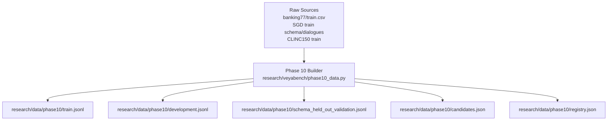
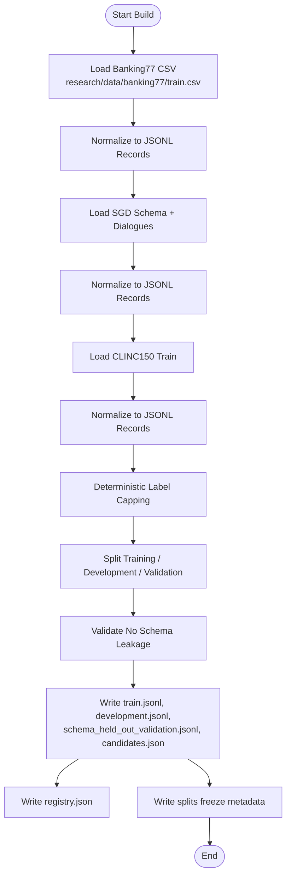
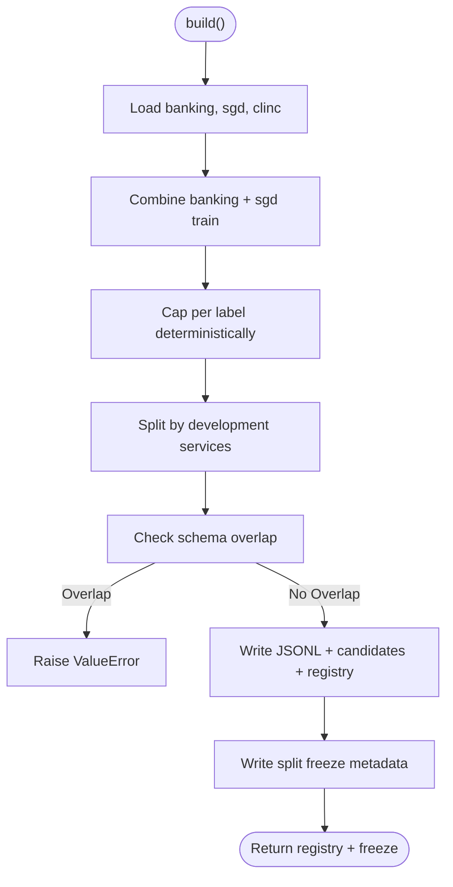
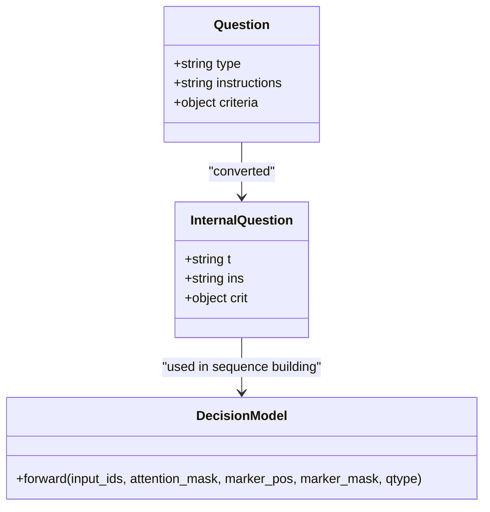
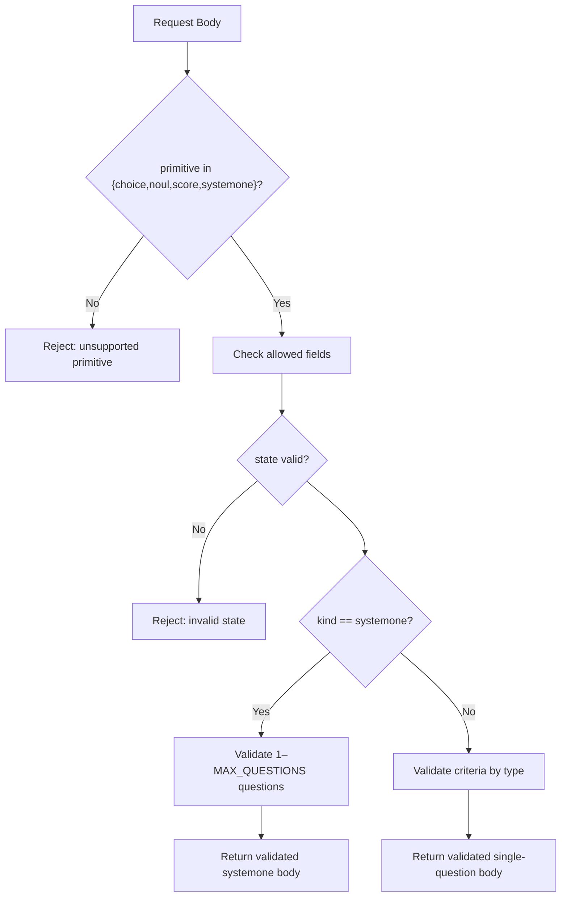
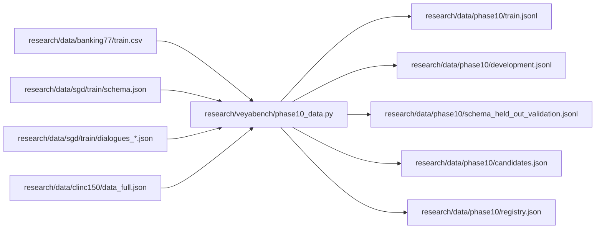

# Dataset Formats and Schemas

<cite>
**Referenced Files in This Document**   
- [phase10_data.py](file://research/veyabench/phase10_data.py)
- [train.jsonl](file://research/data/phase10/train.jsonl)
- [registry.json](file://research/data/phase10/registry.json)
- [train.csv](file://research/data/banking77/train.csv)
- [common.py](file://veya/common.py)
- [presets.py](file://veya/presets.py)
- [contracts.py](file://web/contracts.py)
- [agent.py](file://veya/agent.py)
</cite>

## Table of Contents
1. [Introduction](#introduction)
2. [Project Structure](#project-structure)
3. [Core Components](#core-components)
4. [Architecture Overview](#architecture-overview)
5. [Detailed Component Analysis](#detailed-component-analysis)
6. [Dependency Analysis](#dependency-analysis)
7. [Performance Considerations](#performance-considerations)
8. [Troubleshooting Guide](#troubleshooting-guide)
9. [Conclusion](#conclusion)

## Introduction
This document explains the dataset formats and schema definitions used by Veya, focusing on:
- JSONL files for Phase 10 datasets
- CSV format for Banking77
- Registry schemas for dataset metadata
- Decision types `choice`, `score`, and `noul`
- Field requirements, data types, validation rules, and common patterns

The goal is to help you create, validate, and consume Veya datasets consistently across training, development, and evaluation pipelines.

## Project Structure
Veya organizes dataset-related artifacts under research data directories and produces normalized JSONL outputs through a dedicated builder. The main components are:
- Raw source data (CSV, JSON, or external repositories)
- A Phase 10 builder that normalizes rows into a unified schema
- Output JSONL splits and candidate lists
- Registry metadata describing datasets, licenses, roles, and provenance

**Diagram sources**
- [phase10_data.py:72-174](file://research/veyabench/phase10_data.py#L72-L174)
- [phase10_data.py:202-215](file://research/veyabench/phase10_data.py#L202-L215)
- [phase10_data.py:217-297](file://research/veyabench/phase10_data.py#L217-L297)

**Section sources**
- [phase10_data.py:1-337](file://research/veyabench/phase10_data.py#L1-L337)

## Core Components
This section defines the core dataset record schema, decision question schema, and registry schema.

### Phase 10 JSONL Record Schema
Each line in a Phase 10 JSONL file is a single JSON object with these fields:
- `id`: Unique row identifier string
- `dataset`: Dataset name string (e.g., `banking77`, `sgd`, `clinc150`)
- `schema`: Candidate schema string (e.g., `banking77`, `sgd:<service>`, `clinc150`)
- `text`: Input text string
- `candidate_id`: Candidate label ID string (e.g., `banking77:<label>`, `sgd:<service>:<intent>`, `clinc150:<label>`)

Validation rules:
- All fields must be present
- `id`, `dataset`, `schema`, `text`, `candidate_id` must be strings
- `candidate_id` must match the expected prefix for its dataset and schema
- Rows are deterministic and sorted by `id` after processing

Example reference:
- See [train.jsonl:1-10](file://research/data/phase10/train.jsonl#L1-L10) for properly formatted records.

**Section sources**
- [phase10_data.py:72-89](file://research/veyabench/phase10_data.py#L72-L89)
- [phase10_data.py:111-153](file://research/veyabench/phase10_data.py#L111-L153)
- [phase10_data.py:156-174](file://research/veyabench/phase10_data.py#L156-L174)
- [train.jsonl:1-10](file://research/data/phase10/train.jsonl#L1-L10)

### Banking77 CSV Format
Banking77 input is a CSV with two columns:
- `text`: Customer utterance string
- `category`: Intent label string

Rules:
- Header row required
- Each row maps one `text` to one `category`
- Labels become candidates via `banking77:<category>`
- Rows are capped per label deterministically during normalization

Example reference:
- See [train.csv:1-10](file://research/data/banking77/train.csv#L1-L10) for header and sample rows.

**Section sources**
- [phase10_data.py:72-89](file://research/veyabench/phase10_data.py#L72-L89)
- [train.csv:1-10](file://research/data/banking77/train.csv#L1-L10)

### Registry Schema
The Phase 10 registry describes datasets and taint rules. Top-level fields:
- `format`: String identifying the registry version
- `seed`: Integer seed used for deterministic sampling
- `taint_rule`: String describing contamination policy
- `datasets`: Array of dataset entries

Dataset entry fields:
- `name`: Dataset name string
- `version`: Version string
- `source`: Source URL string
- `source_sha256`: SHA-256 string or object of named hashes
- `license`: License string
- `domain`: Domain description string
- `language`: Language code string
- `task_type`: Task type string
- `num_examples`: Integer or null
- `num_labels`: Integer or null
- `candidate_representation`: Description string
- `training_role`: Role string or null
- `validation_role`: Role string or null
- `blind_role`: Role string or null
- `previous_exposure`: Provenance note string

Validation rules:
- `format` must match the expected Phase 10 registry format
- `seed` must be an integer
- `taint_rule` must be non-empty
- Each dataset entry must include all listed fields; some may be null where documented

Example reference:
- See [registry.json:1-79](file://research/data/phase10/registry.json#L1-L79).

**Section sources**
- [phase10_data.py:217-297](file://research/veyabench/phase10_data.py#L217-L297)
- [registry.json:1-79](file://research/data/phase10/registry.json#L1-L79)

### Decision Question Schema
Decision questions define how models classify or score inputs. Supported types:
- `choice`: Select exactly one option from a labeled set
- `score`: Rank over ordered levels
- `noul`: Binary yes/no statement evaluation

Common fields:
- `type`: One of `choice`, `score`, `noul`
- `instructions`: Human-readable prompt describing the task
- `criteria`: Optional; structure depends on type

Type-specific rules:
- `choice`:
  - `criteria` must be a non-empty dict mapping option keys to optional descriptions
  - Keys must be unique and case-normalized
  - Values can be strings, structured objects, or null
- `score`:
  - `criteria` must be a list with at least two ordered levels
  - Levels are rendered as ordered labels
- `noul`:
  - `criteria` is optional but must be a dict if provided
  - Default options are `false` and `true`

Internal representation:
- Types are mapped to integers internally
- Questions are converted to a compact internal form before model processing

Example references:
- Preset questions demonstrate valid structures: [presets.py:5-42](file://veya/presets.py#L5-L42), [presets.py:45-79](file://veya/presets.py#L45-L79), [presets.py:82-119](file://veya/presets.py#L82-L119), [presets.py:122-151](file://veya/presets.py#L122-L151), [presets.py:154-187](file://veya/presets.py#L154-L187)
- Internal conversion and validation: [agent.py:264-289](file://veya/agent.py#L264-L289)
- Type constants and rendering: [common.py:11-12](file://veya/common.py#L11-L12), [common.py:30-61](file://veya/common.py#L30-L61)

**Section sources**
- [presets.py:5-42](file://veya/presets.py#L5-L42)
- [presets.py:45-79](file://veya/presets.py#L45-L79)
- [presets.py:82-119](file://veya/presets.py#L82-L119)
- [presets.py:122-151](file://veya/presets.py#L122-L151)
- [presets.py:154-187](file://veya/presets.py#L154-L187)
- [agent.py:264-289](file://veya/agent.py#L264-L289)
- [common.py:11-12](file://veya/common.py#L11-L12)
- [common.py:30-61](file://veya/common.py#L30-L61)

## Architecture Overview
The Phase 10 pipeline transforms heterogeneous sources into a unified dataset format and produces frozen splits plus a registry.

**Diagram sources**
- [phase10_data.py:72-174](file://research/veyabench/phase10_data.py#L72-L174)
- [phase10_data.py:177-215](file://research/veyabench/phase10_data.py#L177-L215)
- [phase10_data.py:217-331](file://research/veyabench/phase10_data.py#L217-L331)

**Section sources**
- [phase10_data.py:1-337](file://research/veyabench/phase10_data.py#L1-L337)

## Detailed Component Analysis

### Phase 10 Data Builder
Responsibilities:
- Read raw sources
- Normalize rows into a unified schema
- Cap examples per label deterministically
- Split by schema to prevent leakage
- Write JSONL splits and candidate list
- Generate registry and freeze metadata

Key behaviors:
- Banking77 uses `category` as the candidate label
- SGD uses service-scoped intents with authoritative definitions
- CLINC150 train partition is used for schema-held-out validation
- Deterministic capping uses a stable hash keyed by seed, id, and text
- Schema sets across splits must be disjoint

**Diagram sources**
- [phase10_data.py:183-215](file://research/veyabench/phase10_data.py#L183-L215)
- [phase10_data.py:217-331](file://research/veyabench/phase10_data.py#L217-L331)

**Section sources**
- [phase10_data.py:183-331](file://research/veyabench/phase10_data.py#L183-L331)

### Decision Model Integration
Decision questions are converted to an internal representation consumed by the model:
- `type` must be one of `choice`, `score`, `noul`
- `instructions` must be present and convertible to string
- `criteria` must satisfy type-specific constraints
- Internal fields: `t` (type), `ins` (instructions), `crit` (criteria)

**Diagram sources**
- [agent.py:264-289](file://veya/agent.py#L264-L289)
- [common.py:64-111](file://veya/common.py#L64-L111)
- [common.py:114-161](file://veya/common.py#L114-L161)

**Section sources**
- [agent.py:264-289](file://veya/agent.py#L264-L289)
- [common.py:64-111](file://veya/common.py#L64-L111)
- [common.py:114-161](file://veya/common.py#L114-L161)

### Web Contract Validation
The web contract layer validates request bodies for choice, noul, score, and systemone primitives:
- Allowed top-level fields depend on primitive type
- State must be a supported non-empty value
- Instructions must be a non-blank string within length limits
- Criteria must conform to type-specific rules
- SystemOne supports multiple questions with strict counts and field checks

**Diagram sources**
- [contracts.py:121-176](file://web/contracts.py#L121-L176)
- [contracts.py:179-216](file://web/contracts.py#L179-L216)

**Section sources**
- [contracts.py:121-176](file://web/contracts.py#L121-L176)
- [contracts.py:179-216](file://web/contracts.py#L179-L216)

## Dependency Analysis
The following diagram shows how dataset sources flow into normalized outputs and registries.

**Diagram sources**
- [phase10_data.py:72-174](file://research/veyabench/phase10_data.py#L72-L174)
- [phase10_data.py:202-215](file://research/veyabench/phase10_data.py#L202-L215)
- [phase10_data.py:217-297](file://research/veyabench/phase10_data.py#L217-L297)

**Section sources**
- [phase10_data.py:72-174](file://research/veyabench/phase10_data.py#L72-L174)
- [phase10_data.py:202-297](file://research/veyabench/phase10_data.py#L202-L297)

## Performance Considerations
- Deterministic capping reduces label imbalance while preserving reproducibility
- Sorting by `id` ensures stable ordering for downstream consumers
- JSON serialization uses consistent key sorting to aid diffing and verification
- Schema leakage checks prevent accidental cross-scope contamination early in the pipeline

[No sources needed since this section provides general guidance]

## Troubleshooting Guide
Common issues and resolutions:
- Schema leakage detected: Ensure development and validation schemas do not overlap with training schemas
- Unknown candidate referenced: Verify SGD rows reference only known service-intent candidates
- Invalid question definition: Confirm `type`, `instructions`, and `criteria` meet type-specific constraints
- Unexpected request fields: Remove extra fields from web requests; only allowed fields per primitive are accepted
- Probability distribution errors: Ensure probabilities sum to approximately one and use valid numeric values

Validation references:
- Schema leakage and unknown candidate checks: [phase10_data.py:194-200](file://research/veyabench/phase10_data.py#L194-L200), [phase10_data.py:124-126](file://research/veyabench/phase10_data.py#L124-L126)
- Question validation: [agent.py:264-289](file://veya/agent.py#L264-L289)
- Web contract validation: [contracts.py:121-176](file://web/contracts.py#L121-L176), [contracts.py:179-216](file://web/contracts.py#L179-L216)

**Section sources**
- [phase10_data.py:194-200](file://research/veyabench/phase10_data.py#L194-L200)
- [phase10_data.py:124-126](file://research/veyabench/phase10_data.py#L124-L126)
- [agent.py:264-289](file://veya/agent.py#L264-L289)
- [contracts.py:121-176](file://web/contracts.py#L121-L176)
- [contracts.py:179-216](file://web/contracts.py#L179-L216)

## Conclusion
Veya’s dataset formats standardize heterogeneous sources into a consistent JSONL schema, enforce strict registry metadata, and support typed decision questions (`choice`, `score`, `noul`). Following the field requirements, validation rules, and patterns described here will ensure reproducible, leak-free datasets and reliable integration with Veya’s model and web layers.

[No sources needed since this section summarizes without analyzing specific files]