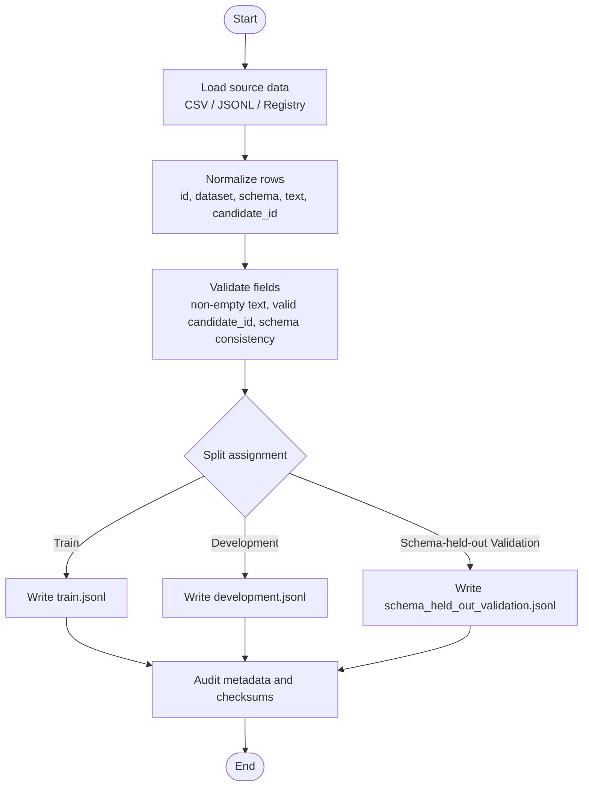
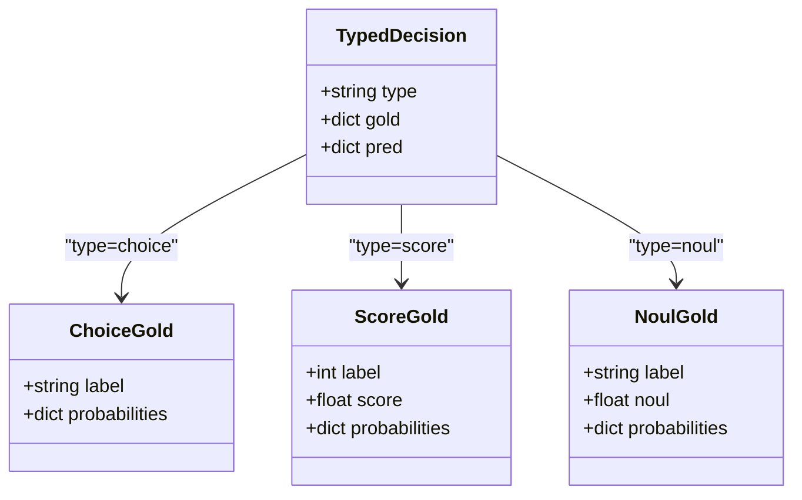
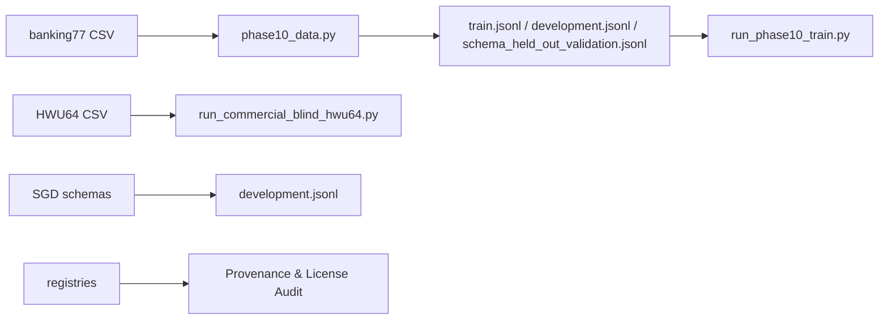

# Dataset Preparation

<cite>
**Referenced Files in This Document**
- [research/data/registry.json](file://research/data/registry.json)
- [research/data/phase10/registry.json](file://research/data/phase10/registry.json)
- [research/data/hwu64/registry.json](file://research/data/hwu64/registry.json)
- [research/data/sgd/README.md](file://research/data/sgd/README.md)
- [research/data/sgd/dev/schema.json](file://research/data/sgd/dev/schema.json)
- [research/data/sgd/train/schema.json](file://research/data/sgd/train/schema.json)
- [research/data/phase10/train.jsonl](file://research/data/phase10/train.jsonl)
- [research/data/phase10/development.jsonl](file://research/data/phase10/development.jsonl)
- [research/data/phase10/schema_held_out_validation.jsonl](file://research/data/phase10/schema_held_out_validation.jsonl)
- [research/veyabench/phase10_data.py](file://research/veyabench/phase10_data.py)
- [research/veyabench/run_phase10_train.py](file://research/veyabench/run_phase10_train.py)
- [research/veyabench/run_commercial_blind_hwu64.py](file://research/veyabench/run_commercial_blind_hwu64.py)
- [veya/agent.py](file://veya/agent.py)
- [research/scripts/bench_local.py](file://research/scripts/bench_local.py)
</cite>

## Table of Contents
1. [Introduction](#introduction)
2. [Project Structure](#project-structure)
3. [Core Components](#core-components)
4. [Architecture Overview](#architecture-overview)
5. [Detailed Component Analysis](#detailed-component-analysis)
6. [Dependency Analysis](#dependency-analysis)
7. [Performance Considerations](#performance-considerations)
8. [Troubleshooting Guide](#troubleshooting-guide)
9. [Conclusion](#conclusion)
10. [Appendices](#appendices)

## Introduction
This document explains how to prepare datasets for Veya model fine-tuning using the data available under research/data/. It covers:
- The dataset formats and schemas used by banking77, clinc150, hwu64, massive, phase10, and sgd.
- Data preprocessing steps, format requirements, and schema definitions.
- How to structure custom datasets for decision types choice, score, and noul.
- Examples of proper data formatting, validation checks, and quality assurance procedures.

The guidance is grounded in the repository’s existing dataset registries, JSONL training files, SGD schema documentation, and scripts that load, validate, and consume these datasets.

## Project Structure
The relevant data lives under research/data/:
- registry.json: top-level dataset metadata and task_type annotations.
- phase10/: canonical Phase 10 dataset registry and JSONL splits (train, development, schema_held_out_validation).
- banking77/: CSV inputs consumed by Phase 10 processing.
- hwu64/: registry describing a blind commercial evaluation dataset.
- sgd/: Schema-Guided Dialogue dataset with README and per-split schema definitions.
- clinc150/, massive/: directories present in the repository; their contents are not required for this guide but are referenced in registries.

```mermaid
graph TB
A["research/data/registry.json"] --> B["Top-level dataset metadata<br/>task_type, domain, license"]
C["research/data/phase10/registry.json"] --> D["Phase 10 dataset registry<br/>roles, versions, sources"]
E["research/data/phase10/train.jsonl"] --> F["JSONL rows with id, dataset, schema, text, candidate_id"]
G["research/data/phase10/development.jsonl"] --> F
H["research/data/phase10/schema_held_out_validation.jsonl"] --> F
I["research/data/sgd/README.md"] --> J["SGD schema definition and dialogue format"]
K["research/data/sgd/train/schema.json"] --> J
L["research/data/sgd/dev/schema.json"] --> J
M["research/data/hwu64/registry.json"] --> N["HWU64 blind evaluation metadata"]
```

**Diagram sources**
- [research/data/registry.json:1-34](file://research/data/registry.json#L1-L34)
- [research/data/phase10/registry.json:1-79](file://research/data/phase10/registry.json#L1-L79)
- [research/data/phase10/train.jsonl:1-200](file://research/data/phase10/train.jsonl#L1-L200)
- [research/data/phase10/development.jsonl:1-200](file://research/data/phase10/development.jsonl#L1-L200)
- [research/data/phase10/schema_held_out_validation.jsonl:1-200](file://research/data/phase10/schema_held_out_validation.jsonl#L1-L200)
- [research/data/sgd/README.md:72-116](file://research/data/sgd/README.md#L72-L116)
- [research/data/sgd/train/schema.json:1-120](file://research/data/sgd/train/schema.json#L1-L120)
- [research/data/sgd/dev/schema.json:1-120](file://research/data/sgd/dev/schema.json#L1-L120)
- [research/data/hwu64/registry.json:1-21](file://research/data/hwu64/registry.json#L1-L21)

**Section sources**
- [research/data/registry.json:1-34](file://research/data/registry.json#L1-L34)
- [research/data/phase10/registry.json:1-79](file://research/data/phase10/registry.json#L1-L79)
- [research/data/sgd/README.md:72-116](file://research/data/sgd/README.md#L72-L116)

## Core Components
- Dataset registries define dataset identity, source, license, domain, language, task type, and role (training/validation/blind).
- JSONL training files provide normalized examples with fields: id, dataset, schema, text, candidate_id.
- SGD schemas describe services, intents, slots, and constraints used for active-intent retrieval tasks.
- Scripts read raw CSVs or JSONL, normalize them into the canonical JSONL format, and enforce split integrity.

Key responsibilities:
- Normalize heterogeneous inputs into a unified JSONL representation.
- Maintain consistent candidate_id and schema naming across datasets.
- Enforce separation between training, development, and held-out validation sets.
- Provide metadata for licensing, provenance, and contamination risk.

**Section sources**
- [research/data/phase10/train.jsonl:1-200](file://research/data/phase10/train.jsonl#L1-L200)
- [research/data/phase10/development.jsonl:1-200](file://research/data/phase10/development.jsonl#L1-L200)
- [research/data/phase10/schema_held_out_validation.jsonl:1-200](file://research/data/phase10/schema_held_out_validation.jsonl#L1-L200)
- [research/data/sgd/README.md:72-116](file://research/data/sgd/README.md#L72-L116)

## Architecture Overview
The data preparation pipeline transforms source datasets into a unified format suitable for Veya fine-tuning and evaluation.

**Diagram sources**
- [research/veyabench/phase10_data.py:72-89](file://research/veyabench/phase10_data.py#L72-L89)
- [research/veyabench/phase10_data.py:194-215](file://research/veyabench/phase10_data.py#L194-L215)
- [research/veyabench/run_phase10_train.py:48-63](file://research/veyabench/run_phase10_train.py#L48-L63)

**Section sources**
- [research/veyabench/phase10_data.py:72-89](file://research/veyabench/phase10_data.py#L72-L89)
- [research/veyabench/phase10_data.py:194-215](file://research/veyabench/phase10_data.py#L194-L215)
- [research/veyabench/run_phase10_train.py:48-63](file://research/veyabench/run_phase10_train.py#L48-L63)

## Detailed Component Analysis

### Banking77 Dataset
- Input format: CSV with columns including category and text.
- Processing:
  - Read CSV rows and map each row to a normalized record with id, dataset, schema, text, and candidate_id.
  - Candidate IDs follow the pattern dataset:label.
  - Labels are derived from the category column and sorted deterministically.
- Output:
  - Canonical JSONL entries written to Phase 10 outputs.

Validation and quality checks:
- Ensure category maps to a known label set.
- Ensure deterministic candidate_id generation.
- Cap examples per label as implemented by the normalization function.

**Section sources**
- [research/veyabench/phase10_data.py:72-89](file://research/veyabench/phase10_data.py#L72-L89)

### Clinc150 Dataset
- Role: Used as schema-held-out validation in Phase 10.
- Format: Canonical JSONL with fields id, dataset, schema, text, candidate_id.
- Candidate IDs use the dataset prefix and intent labels.

Quality assurance:
- Verify schema names match the dataset identifier.
- Confirm no overlap with training schemas to prevent leakage.

**Section sources**
- [research/data/phase10/schema_held_out_validation.jsonl:1-200](file://research/data/phase10/schema_held_out_validation.jsonl#L1-L200)
- [research/data/phase10/registry.json:40-56](file://research/data/phase10/registry.json#L40-L56)

### HWU64 Dataset
- Metadata: Registry entry describes dataset provenance, license, prior exposure, and evaluation role.
- Input format: Semicolon-delimited CSV with required columns userid, answerid, scenario, intent, status, answer_normalised.
- Processing:
  - Reject rows with irregular status prefixes.
  - Reject rows missing essential fields.
  - Generate sampling_key and candidate_id based on normalized components.
- Output: Normalized records suitable for one-shot blind consumption.

Validation and quality checks:
- Required field presence check.
- Status filtering for irregular cases.
- Non-empty content validation for scenario, intent, and answer_normalised.

**Section sources**
- [research/data/hwu64/registry.json:1-21](file://research/data/hwu64/registry.json#L1-L21)
- [research/veyabench/run_commercial_blind_hwu64.py:63-98](file://research/veyabench/run_commercial_blind_hwu64.py#L63-L98)

### Massive Dataset
- Metadata: Referenced in Phase 10 registry as an English US voice-assistant intent dataset.
- Task type: Single-label intent classification.
- Role: Not used for training weights; potential contamination risk noted in top-level registry.

Preparation notes:
- When integrating, ensure candidate_id uses dataset:intent labeling.
- Keep separate from training sets if used for blind evaluation.

**Section sources**
- [research/data/phase10/registry.json:57-73](file://research/data/phase10/registry.json#L57-L73)
- [research/data/registry.json:1-34](file://research/data/registry.json#L1-L34)

### Phase10 Dataset
- Registries:
  - Top-level registry defines task_type and usage roles.
  - Phase 10 registry documents dataset roles, versions, sources, and taint rules.
- JSONL splits:
  - train.jsonl: Training examples with id, dataset, schema, text, candidate_id.
  - development.jsonl: Development examples, often multi-domain SGD-based.
  - schema_held_out_validation.jsonl: Held-out validation examples for schema generalization.

Processing:
- Load JSONL lines into Python dicts.
- Build candidate lists from training data.
- Write normalized outputs and candidates manifest.

Quality assurance:
- Enforce schema separation across splits to avoid leakage.
- Deterministic sorting and stable key ordering when writing JSONL.

**Section sources**
- [research/data/registry.json:1-34](file://research/data/registry.json#L1-L34)
- [research/data/phase10/registry.json:1-79](file://research/data/phase10/registry.json#L1-L79)
- [research/data/phase10/train.jsonl:1-200](file://research/data/phase10/train.jsonl#L1-L200)
- [research/data/phase10/development.jsonl:1-200](file://research/data/phase10/development.jsonl#L1-L200)
- [research/data/phase10/schema_held_out_validation.jsonl:1-200](file://research/data/phase10/schema_held_out_validation.jsonl#L1-L200)
- [research/veyabench/run_phase10_train.py:48-63](file://research/veyabench/run_phase10_train.py#L48-L63)

### SGD Dataset
- Documentation: README explains schema representation, dialogue representation, and slot/intent semantics.
- Schema files:
  - train/schema.json and dev/schema.json define services, slots, intents, required/optional slots, and result slots.
- Usage:
  - Active-intent retrieval by service schema; candidate_ids reflect service:intent pairs.

Preparation notes:
- Align candidate_id with service_name and intent name.
- Respect required_slots and optional_slots when constructing prompts or features.
- Use natural language descriptions for intents and slots to improve retriever grounding.

**Section sources**
- [research/data/sgd/README.md:72-116](file://research/data/sgd/README.md#L72-L116)
- [research/data/sgd/train/schema.json:1-120](file://research/data/sgd/train/schema.json#L1-L120)
- [research/data/sgd/dev/schema.json:1-120](file://research/data/sgd/dev/schema.json#L1-L120)
- [research/data/phase10/development.jsonl:1-200](file://research/data/phase10/development.jsonl#L1-L200)

### Decision Types: Choice, Score, Noul
Veya supports three decision types for typed decisions:
- Choice: Multi-class selection among criteria keys.
- Score: Ordinal or categorical scoring over numeric indices.
- Noul: Binary yes/no-like decision represented by true/false.

Data formatting expectations:
- For choice: gold includes label matching a criteria key and optional probabilities per key.
- For score: gold includes label index and optional probabilities per index; may include gold_score.
- For noul: gold includes label "true"/"false" and optional probability for "true".

Model output mapping:
- Agent produces answers with type-specific fields: choice/probabilities/confidence/action, score/probabilities/legend/confidence/action, or noul/confidence/action.

Evaluation mapping:
- Bench scripts convert gold labels to indices and soft probabilities aligned with question definitions.

**Diagram sources**
- [veya/agent.py:378-406](file://veya/agent.py#L378-L406)
- [research/scripts/bench_local.py:220-249](file://research/scripts/bench_local.py#L220-L249)
- [research/scripts/veya_benchmark_colab.ipynb:387-405](file://research/scripts/veya_benchmark_colab.ipynb#L387-L405)

**Section sources**
- [veya/agent.py:378-406](file://veya/agent.py#L378-L406)
- [research/scripts/bench_local.py:220-249](file://research/scripts/bench_local.py#L220-L249)
- [research/scripts/veya_benchmark_colab.ipynb:387-405](file://research/scripts/veya_benchmark_colab.ipynb#L387-L405)

## Dependency Analysis
- Phase 10 data loading depends on canonical JSONL files and a candidates manifest.
- SGD integration relies on schema definitions to construct meaningful candidate representations.
- HWU64 processing enforces strict schema validation and filters irregular rows before normalization.
- Registries provide provenance and licensing information necessary for auditability.

**Diagram sources**
- [research/veyabench/phase10_data.py:72-89](file://research/veyabench/phase10_data.py#L72-L89)
- [research/veyabench/run_phase10_train.py:48-63](file://research/veyabench/run_phase10_train.py#L48-L63)
- [research/veyabench/run_commercial_blind_hwu64.py:63-98](file://research/veyabench/run_commercial_blind_hwu64.py#L63-L98)
- [research/data/phase10/development.jsonl:1-200](file://research/data/phase10/development.jsonl#L1-L200)
- [research/data/sgd/train/schema.json:1-120](file://research/data/sgd/train/schema.json#L1-L120)

**Section sources**
- [research/veyabench/phase10_data.py:72-89](file://research/veyabench/phase10_data.py#L72-L89)
- [research/veyabench/run_phase10_train.py:48-63](file://research/veyabench/run_phase10_train.py#L48-L63)
- [research/veyabench/run_commercial_blind_hwu64.py:63-98](file://research/veyabench/run_commercial_blind_hwu64.py#L63-L98)

## Performance Considerations
- Deterministic normalization reduces variability across runs and improves reproducibility.
- Capping examples per label prevents over-representation of frequent intents.
- Keeping schemas separated across splits avoids leakage and ensures robust generalization.
- Using canonical JSONL minimizes parsing overhead and simplifies downstream consumption.

[No sources needed since this section provides general guidance]

## Troubleshooting Guide
Common issues and resolutions:
- Missing required fields in HWU64 CSV:
  - Ensure userid, answerid, scenario, intent, status, answer_normalised are present.
  - Filter out rows with irregular status prefixes and empty critical fields.
- Schema leakage between splits:
  - Validate that training, development, and validation schemas do not overlap.
- Invalid candidate_id or schema mismatch:
  - Ensure candidate_id follows dataset:intent or dataset:service:intent conventions.
  - Align schema names with dataset identifiers.
- Inconsistent decision type formatting:
  - For choice, ensure label matches a criteria key and probabilities align with keys.
  - For score, ensure label index corresponds to criteria indices and probabilities align with indices.
  - For noul, ensure label is "true"/"false" and probability for "true" is provided.

**Section sources**
- [research/veyabench/run_commercial_blind_hwu64.py:63-98](file://research/veyabench/run_commercial_blind_hwu64.py#L63-L98)
- [research/veyabench/phase10_data.py:194-215](file://research/veyabench/phase10_data.py#L194-L215)
- [veya/agent.py:378-406](file://veya/agent.py#L378-L406)
- [research/scripts/bench_local.py:220-249](file://research/scripts/bench_local.py#L220-L249)

## Conclusion
Preparing datasets for Veya fine-tuning requires:
- Normalizing heterogeneous inputs into a unified JSONL format with consistent fields.
- Maintaining clear separation between training, development, and held-out validation sets.
- Following schema definitions for SGD and adhering to registry metadata for provenance and licensing.
- Structuring decision-type data (choice, score, noul) according to the expected gold and prediction formats.
- Applying validation checks and quality assurance procedures to ensure data integrity and reproducibility.

[No sources needed since this section summarizes without analyzing specific files]

## Appendices

### Example Data Formatting Guidelines
- Canonical JSONL row fields:
  - id: unique identifier combining dataset and source index.
  - dataset: dataset name (e.g., banking77, clinc150, sgd).
  - schema: schema identifier (e.g., banking77, clinc150, sgd:Calendar_1).
  - text: user utterance string.
  - candidate_id: candidate identifier (e.g., banking77:card_delivery_estimate, sgd:Calendar_1:GetAvailableTime).

- Decision type gold formatting:
  - choice: label equals a criteria key; probabilities keyed by criteria keys.
  - score: label equals an integer index; probabilities keyed by string indices; optional gold_score.
  - noul: label equals "true"/"false"; optional probability for "true".

**Section sources**
- [research/data/phase10/train.jsonl:1-200](file://research/data/phase10/train.jsonl#L1-L200)
- [research/data/phase10/development.jsonl:1-200](file://research/data/phase10/development.jsonl#L1-L200)
- [research/scripts/bench_local.py:220-249](file://research/scripts/bench_local.py#L220-L249)