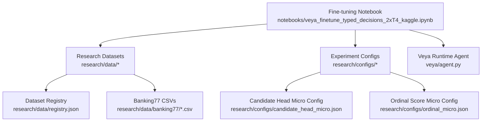
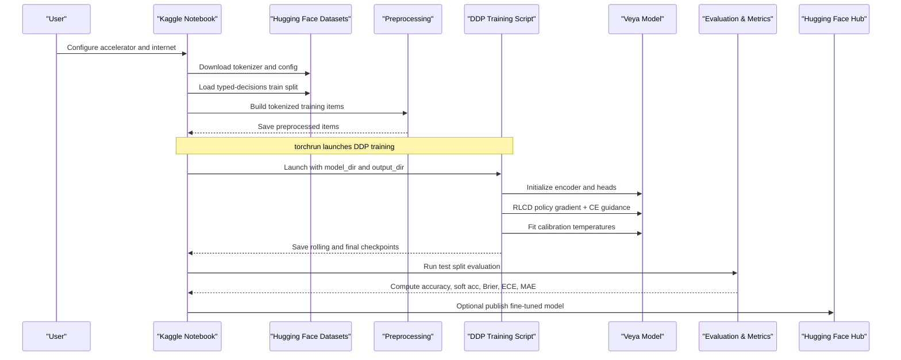
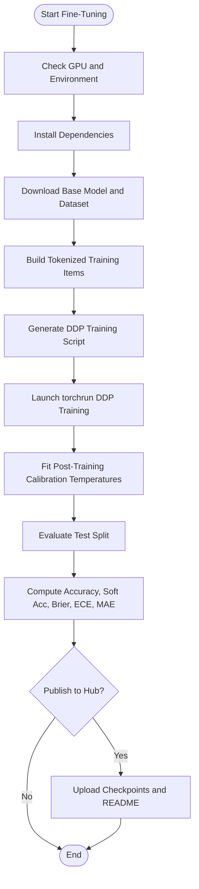
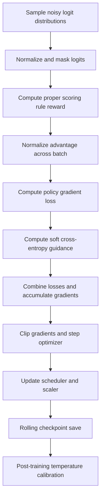
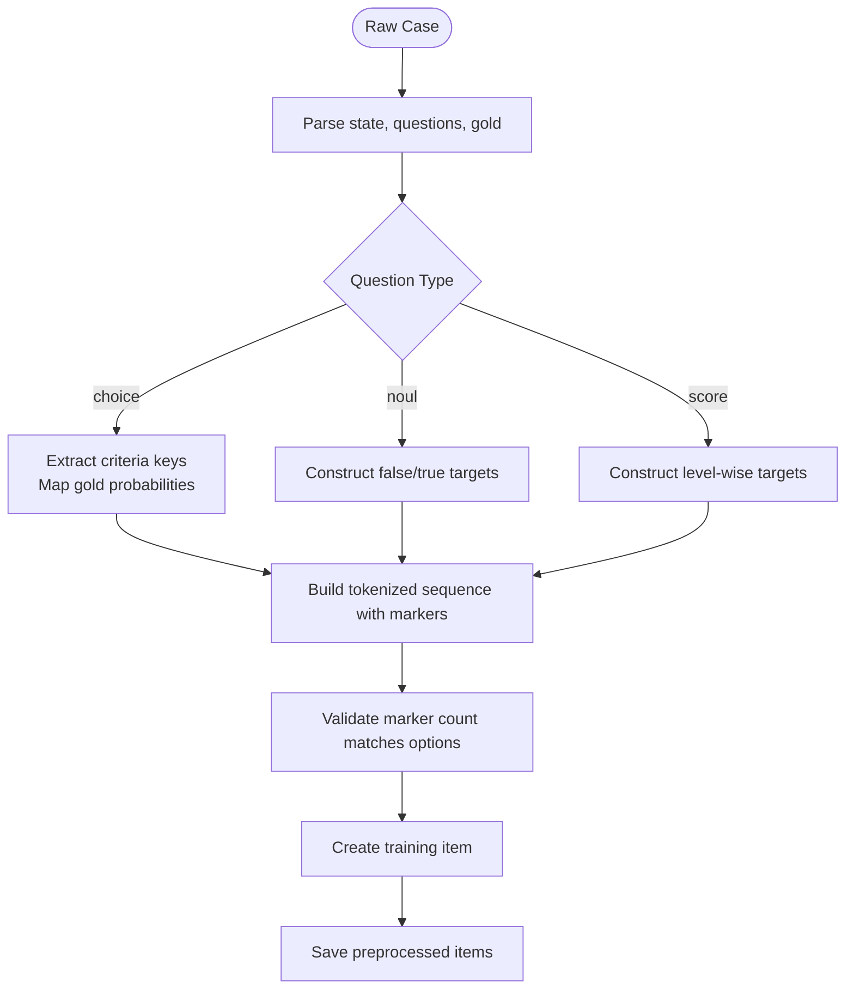
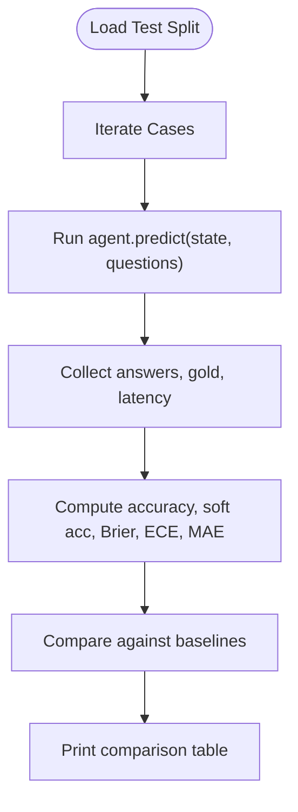
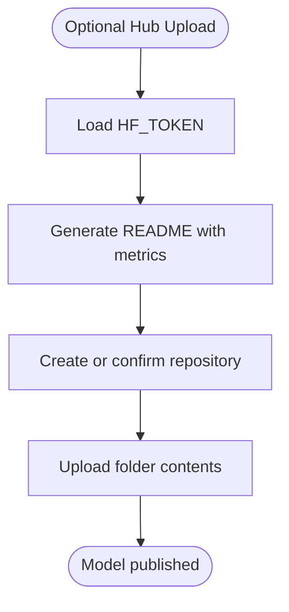
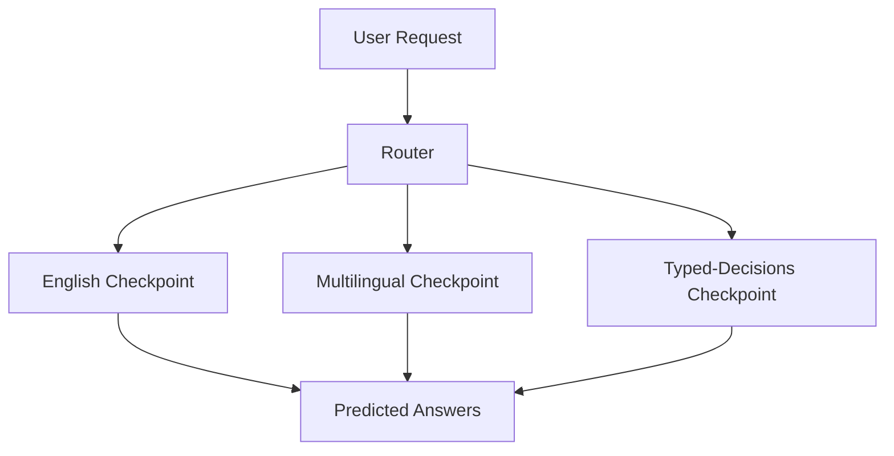
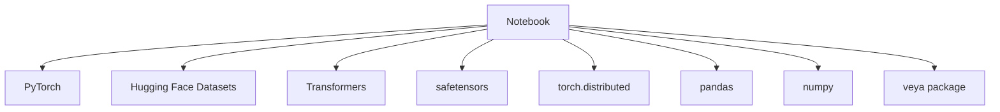

# Fine-tuning Guide

<cite>
**Referenced Files in This Document**
- [README.md](file://README.md)
- [veya_finetune_typed_decisions_2xT4_kaggle.ipynb](file://notebooks/veya_finetune_typed_decisions_2xT4_kaggle.ipynb)
- [registry.json](file://research/data/registry.json)
- [train.csv](file://research/data/banking77/train.csv)
- [test.csv](file://research/data/banking77/test.csv)
- [candidate_head_micro.json](file://research/configs/candidate_head_micro.json)
- [ordinal_micro.json](file://research/configs/ordinal_micro.json)
- [agent.py](file://veya/agent.py)
</cite>

## Table of Contents
1. [Introduction](#introduction)
2. [Project Structure](#project-structure)
3. [Core Components](#core-components)
4. [Architecture Overview](#architecture-overview)
5. [Detailed Component Analysis](#detailed-component-analysis)
6. [Dependency Analysis](#dependency-analysis)
7. [Performance Considerations](#performance-considerations)
8. [Troubleshooting Guide](#troubleshooting-guide)
9. [Conclusion](#conclusion)
10. [Appendices](#appendices)

## Introduction
This guide explains how to fine-tune Veya models for typed decisions and other model variants. It covers:
- The provided Kaggle notebook for fine-tuning the English `veyadynamics/veya` checkpoint on typed decisions.
- Dataset preparation using research datasets such as Banking77, AG News, CLINC150, MASSIVE, SGD, and Phase 10 artifacts.
- Configuration options under `research/configs/`.
- Training procedures, including RLCD-style policy gradient training with proper scoring rules, distributed data parallel execution, calibration temperature fitting, evaluation, and optional Hub publishing.
- Step-by-step guidance for adapting Veya to new domains, handling different decision types (`choice`, `score`, `noul`), and optimizing for specific use cases.
- Best practices for data preprocessing, hyperparameter tuning, and validation strategies.

The repository emphasizes that Veya is a fast base to specialize through fine-tuning rather than a zero-shot decision engine. On the typed-decisions benchmark, the base checkpoints score near chance, while the fine-tuned checkpoint reaches substantially higher accuracy.

**Section sources**
- [README.md:438-452](file://README.md#L438-L452)

## Project Structure
For fine-tuning, the most relevant areas are:
- `notebooks/`: end-to-end fine-tuning workflow.
- `research/data/`: dataset registry and domain-specific datasets.
- `research/configs/`: experiment configuration scaffolding.
- `veya/`: runtime agent and loading utilities used by the notebook.

**Diagram sources**
- [veya_finetune_typed_decisions_2xT4_kaggle.ipynb:1-15](file://notebooks/veya_finetune_typed_decisions_2xT4_kaggle.ipynb#L1-L15)
- [registry.json:1-34](file://research/data/registry.json#L1-L34)
- [candidate_head_micro.json:1-15](file://research/configs/candidate_head_micro.json#L1-L15)
- [ordinal_micro.json:1-8](file://research/configs/ordinal_micro.json#L1-L8)
- [agent.py:422-431](file://veya/agent.py#L422-L431)

**Section sources**
- [veya_finetune_typed_decisions_2xT4_kaggle.ipynb:1-15](file://notebooks/veya_finetune_typed_decisions_2xT4_kaggle.ipynb#L1-L15)
- [registry.json:1-34](file://research/data/registry.json#L1-L34)
- [candidate_head_micro.json:1-15](file://research/configs/candidate_head_micro.json#L1-L15)
- [ordinal_micro.json:1-8](file://research/configs/ordinal_micro.json#L1-L8)
- [agent.py:422-431](file://veya/agent.py#L422-L431)

## Core Components
The fine-tuning workflow centers on these components:
- **Notebook**: environment setup, dependency installation, dataset download, preprocessing into tokenized items, DDP training script generation, multi-GPU launch, evaluation, metrics computation, and optional Hub upload.
- **Training Script**: RLCD-style policy gradient loss with proper scoring rule rewards, soft cross-entropy guidance, gradient accumulation, cosine learning rate schedule, mixed precision, gradient clipping, rolling checkpointing, and post-training temperature calibration.
- **Agent Runtime**: loads checkpoints, builds sequences from state and question definitions, and evaluates typed questions in a single forward pass.

Key responsibilities:
- Data preprocessing converts raw examples into model-ready sequences with markers, target distributions, and question type identifiers.
- Training uses two optimizer groups: encoder parameters and head parameters, with separate learning rates.
- Calibration temperatures are fitted per decision primitive after training.

**Section sources**
- [veya_finetune_typed_decisions_2xT4_kaggle.ipynb:28-76](file://notebooks/veya_finetune_typed_decisions_2xT4_kaggle.ipynb#L28-L76)
- [veya_finetune_typed_decisions_2xT4_kaggle.ipynb:78-153](file://notebooks/veya_finetune_typed_decisions_2xT4_kaggle.ipynb#L78-L153)
- [veya_finetune_typed_decisions_2xT4_kaggle.ipynb:155-424](file://notebooks/veya_finetune_typed_decisions_2xT4_kaggle.ipynb#L155-L424)
- [agent.py:291-321](file://veya/agent.py#L291-L321)
- [agent.py:408-431](file://veya/agent.py#L408-L431)

## Architecture Overview
The fine-tuning architecture connects the notebook, dataset, training script, and runtime agent.

**Diagram sources**
- [veya_finetune_typed_decisions_2xT4_kaggle.ipynb:28-76](file://notebooks/veya_finetune_typed_decisions_2xT4_kaggle.ipynb#L28-L76)
- [veya_finetune_typed_decisions_2xT4_kaggle.ipynb:78-153](file://notebooks/veya_finetune_typed_decisions_2xT4_kaggle.ipynb#L78-L153)
- [veya_finetune_typed_decisions_2xT4_kaggle.ipynb:155-424](file://notebooks/veya_finetune_typed_decisions_2xT4_kaggle.ipynb#L155-L424)
- [veya_finetune_typed_decisions_2xT4_kaggle.ipynb:429-446](file://notebooks/veya_finetune_typed_decisions_2xT4_kaggle.ipynb#L429-L446)
- [veya_finetune_typed_decisions_2xT4_kaggle.ipynb:448-502](file://notebooks/veya_finetune_typed_decisions_2xT4_kaggle.ipynb#L448-L502)
- [veya_finetune_typed_decisions_2xT4_kaggle.ipynb:504-665](file://notebooks/veya_finetune_typed_decisions_2xT4_kaggle.ipynb#L504-L665)
- [veya_finetune_typed_decisions_2xT4_kaggle.ipynb:667-800](file://notebooks/veya_finetune_typed_decisions_2xT4_kaggle.ipynb#L667-L800)

## Detailed Component Analysis

### Typed Decisions Fine-Tuning Workflow
The notebook implements a complete loop:
1. Verify dual T4 GPUs and set memory allocation flags.
2. Install dependencies and import libraries.
3. Download the base model tokenizer and configuration, then load the typed-decisions dataset.
4. Preprocess each case into tokenized sequences with markers, normalized target distributions, and question type IDs.
5. Write a DDP training script implementing RLCD-style policy gradient training with proper scoring rule rewards and soft cross-entropy guidance.
6. Launch training via `torchrun` with two processes.
7. Evaluate on the test split and compute official metrics.
8. Optionally push the fine-tuned model to the Hugging Face Hub with an auto-generated model card.

**Diagram sources**
- [veya_finetune_typed_decisions_2xT4_kaggle.ipynb:28-76](file://notebooks/veya_finetune_typed_decisions_2xT4_kaggle.ipynb#L28-L76)
- [veya_finetune_typed_decisions_2xT4_kaggle.ipynb:78-153](file://notebooks/veya_finetune_typed_decisions_2xT4_kaggle.ipynb#L78-L153)
- [veya_finetune_typed_decisions_2xT4_kaggle.ipynb:155-424](file://notebooks/veya_finetune_typed_decisions_2xT4_kaggle.ipynb#L155-L424)
- [veya_finetune_typed_decisions_2xT4_kaggle.ipynb:429-446](file://notebooks/veya_finetune_typed_decisions_2xT4_kaggle.ipynb#L429-L446)
- [veya_finetune_typed_decisions_2xT4_kaggle.ipynb:448-502](file://notebooks/veya_finetune_typed_decisions_2xT4_kaggle.ipynb#L448-L502)
- [veya_finetune_typed_decisions_2xT4_kaggle.ipynb:504-665](file://notebooks/veya_finetune_typed_decisions_2xT4_kaggle.ipynb#L504-L665)
- [veya_finetune_typed_decisions_2xT4_kaggle.ipynb:667-800](file://notebooks/veya_finetune_typed_decisions_2xT4_kaggle.ipynb#L667-L800)

**Section sources**
- [veya_finetune_typed_decisions_2xT4_kaggle.ipynb:28-76](file://notebooks/veya_finetune_typed_decisions_2xT4_kaggle.ipynb#L28-L76)
- [veya_finetune_typed_decisions_2xT4_kaggle.ipynb:78-153](file://notebooks/veya_finetune_typed_decisions_2xT4_kaggle.ipynb#L78-L153)
- [veya_finetune_typed_decisions_2xT4_kaggle.ipynb:155-424](file://notebooks/veya_finetune_typed_decisions_2xT4_kaggle.ipynb#L155-L424)
- [veya_finetune_typed_decisions_2xT4_kaggle.ipynb:429-446](file://notebooks/veya_finetune_typed_decisions_2xT4_kaggle.ipynb#L429-L446)
- [veya_finetune_typed_decisions_2xT4_kaggle.ipynb:448-502](file://notebooks/veya_finetune_typed_decisions_2xT4_kaggle.ipynb#L448-L502)
- [veya_finetune_typed_decisions_2xT4_kaggle.ipynb:504-665](file://notebooks/veya_finetune_typed_decisions_2xT4_kaggle.ipynb#L504-L665)
- [veya_finetune_typed_decisions_2xT4_kaggle.ipynb:667-800](file://notebooks/veya_finetune_typed_decisions_2xT4_kaggle.ipynb#L667-L800)

### Training Algorithm and Loss Design
The training script implements:
- RLCD-style policy gradient with GRPO-style baseline sampling.
- Proper scoring rule reward (weighted spherical and RPS components).
- Full soft cross-entropy guidance against normalized gold targets.
- Gradient accumulation to simulate larger effective batch sizes.
- Cosine annealing learning rate schedule.
- Mixed precision with gradient scaling and clipping.
- Rolling checkpointing to survive session timeouts or OOM events.
- Post-training temperature calibration per decision primitive.

**Diagram sources**
- [veya_finetune_typed_decisions_2xT4_kaggle.ipynb:155-424](file://notebooks/veya_finetune_typed_decisions_2xT4_kaggle.ipynb#L155-L424)

**Section sources**
- [veya_finetune_typed_decisions_2xT4_kaggle.ipynb:155-424](file://notebooks/veya_finetune_typed_decisions_2xT4_kaggle.ipynb#L155-L424)

### Decision Types and Data Preparation
The preprocessing function handles three decision primitives:
- `choice`: maps criteria keys to probability targets derived from gold probabilities.
- `noul`: constructs binary probability targets for false and true.
- `score`: constructs level-wise probability targets based on ordinal criteria length.

Each item includes:
- Tokenized sequence.
- Marker positions indicating option boundaries.
- Question type identifier.
- Normalized target distribution.
- Argmax label.

**Diagram sources**
- [veya_finetune_typed_decisions_2xT4_kaggle.ipynb:78-153](file://notebooks/veya_finetune_typed_decisions_2xT4_kaggle.ipynb#L78-L153)

**Section sources**
- [veya_finetune_typed_decisions_2xT4_kaggle.ipynb:78-153](file://notebooks/veya_finetune_typed_decisions_2xT4_kaggle.ipynb#L78-L153)

### Evaluation and Metrics
The evaluation cell runs the fine-tuned agent over the test split and computes:
- Accuracy across all decision types.
- Soft accuracy between predicted and gold distributions.
- Brier score.
- KL divergence.
- Total variation distance.
- Expected Calibration Error (ECE).
- Mean Absolute Error for score tasks.
- Within-one-level accuracy for ordinal-like score predictions.
- Latency percentiles.

**Diagram sources**
- [veya_finetune_typed_decisions_2xT4_kaggle.ipynb:448-502](file://notebooks/veya_finetune_typed_decisions_2xT4_kaggle.ipynb#L448-L502)
- [veya_finetune_typed_decisions_2xT4_kaggle.ipynb:504-665](file://notebooks/veya_finetune_typed_decisions_2xT4_kaggle.ipynb#L504-L665)

**Section sources**
- [veya_finetune_typed_decisions_2xT4_kaggle.ipynb:448-502](file://notebooks/veya_finetune_typed_decisions_2xT4_kaggle.ipynb#L448-L502)
- [veya_finetune_typed_decisions_2xT4_kaggle.ipynb:504-665](file://notebooks/veya_finetune_typed_decisions_2xT4_kaggle.ipynb#L504-L665)

### Hub Publishing and Model Card Generation
The optional publishing step:
- Retrieves the Hugging Face token from Kaggle secrets or manual input.
- Generates a model card README with computed metrics and comparison sentences.
- Creates or updates a repository.
- Uploads weights, tokenizer, encoder config, and README.

**Diagram sources**
- [veya_finetune_typed_decisions_2xT4_kaggle.ipynb:667-800](file://notebooks/veya_finetune_typed_decisions_2xT4_kaggle.ipynb#L667-L800)

**Section sources**
- [veya_finetune_typed_decisions_2xT4_kaggle.ipynb:667-800](file://notebooks/veya_finetune_typed_decisions_2xT4_kaggle.ipynb#L667-L800)

### Conceptual Overview
Beyond the typed-decisions notebook, Veya supports multiple checkpoints and routing:
- English `veya` checkpoint.
- Multilingual `veya-multilingual` checkpoint.
- Specialized `veya-typed-decisions` checkpoint.
- Router selects the appropriate checkpoint based on language/script detection before the forward pass.

**Diagram sources**
- [README.md:48-55](file://README.md#L48-L55)
- [README.md:68-125](file://README.md#L68-L125)
- [agent.py:422-431](file://veya/agent.py#L422-L431)

[No sources needed since this section provides general conceptual context beyond the notebook]

## Dependency Analysis
The fine-tuning pipeline depends on:
- PyTorch and CUDA for GPU acceleration.
- Transformers for tokenizer and model loading.
- Hugging Face datasets for typed-decisions data access.
- safetensors for weight serialization.
- accelerate and torch.distributed for DDP.
- pandas and numpy for evaluation metrics.

**Diagram sources**
- [veya_finetune_typed_decisions_2xT4_kaggle.ipynb:61-76](file://notebooks/veya_finetune_typed_decisions_2xT4_kaggle.ipynb#L61-L76)
- [veya_finetune_typed_decisions_2xT4_kaggle.ipynb:155-424](file://notebooks/veya_finetune_typed_decisions_2xT4_kaggle.ipynb#L155-L424)
- [veya_finetune_typed_decisions_2xT4_kaggle.ipynb:448-502](file://notebooks/veya_finetune_typed_decisions_2xT4_kaggle.ipynb#L448-L502)

**Section sources**
- [veya_finetune_typed_decisions_2xT4_kaggle.ipynb:61-76](file://notebooks/veya_finetune_typed_decisions_2xT4_kaggle.ipynb#L61-L76)
- [veya_finetune_typed_decisions_2xT4_kaggle.ipynb:155-424](file://notebooks/veya_finetune_typed_decisions_2xT4_kaggle.ipynb#L155-L424)
- [veya_finetune_typed_decisions_2xT4_kaggle.ipynb:448-502](file://notebooks/veya_finetune_typed_decisions_2xT4_kaggle.ipynb#L448-L502)

## Performance Considerations
- Use dual T4 GPUs for DDP training to reduce wall-clock time.
- Enable gradient checkpointing for encoder and head to manage memory.
- Use mixed precision with gradient scaling to improve throughput.
- Tune micro-batch size and gradient accumulation to fit your hardware.
- Adjust `head_max_len` and `max_len` when evaluating high-cardinality choice questions.
- Fit calibration temperatures per decision primitive for reliable confidence scores.
- For large label sets, consider shortlisting candidates before running the decision head.

**Section sources**
- [veya_finetune_typed_decisions_2xT4_kaggle.ipynb:155-424](file://notebooks/veya_finetune_typed_decisions_2xT4_kaggle.ipynb#L155-L424)
- [README.md:388-422](file://README.md#L388-L422)

## Troubleshooting Guide
Common issues and resolutions:
- **GPU mismatch**: Ensure both T4 GPUs are allocated in Kaggle settings.
- **Tokenizer config errors**: Patch tokenizer config if the multilingual checkpoint ships incompatible special tokens.
- **OOM during training**: Reduce micro-batch size, enable gradient checkpointing, or lower sequence lengths.
- **Calibration failures**: Fall back to default temperatures if per-primitive fitting fails due to small sample size.
- **Hub upload failures**: Provide a valid HF_TOKEN and ensure repository permissions are correct.

**Section sources**
- [veya_finetune_typed_decisions_2xT4_kaggle.ipynb:28-52](file://notebooks/veya_finetune_typed_decisions_2xT4_kaggle.ipynb#L28-L52)
- [veya_finetune_typed_decisions_2xT4_kaggle.ipynb:395-415](file://notebooks/veya_finetune_typed_decisions_2xT4_kaggle.ipynb#L395-L415)
- [veya_finetune_typed_decisions_2xT4_kaggle.ipynb:667-800](file://notebooks/veya_finetune_typed_decisions_2xT4_kaggle.ipynb#L667-L800)

## Conclusion
Veya’s fine-tuning path is designed around typed decisions and calibrated outputs. The provided notebook demonstrates a reproducible, distributed training loop that transforms raw cases into tokenized sequences, trains with RLCD-style policy gradients and proper scoring rules, fits calibration temperatures, evaluates on held-out data, and optionally publishes results. For new domains, adapt the preprocessing to your dataset schema, tune hyperparameters according to hardware constraints, and validate using both accuracy and calibration metrics. The research datasets and configuration scaffolding provide additional starting points for specialized experiments such as candidate-set heads and ordinal scoring.

[No sources needed since this section summarizes without analyzing specific files]

## Appendices

### Research Datasets Overview
- **AG News**: News topic classification; used for retention measurement rather than zero-shot generalization.
- **Banking77**: High-cardinality banking intent classification; serves as a stress test for packed choice questions.
- **CLINC150, MASSIVE, SGD, Phase 10**: Additional research datasets and artifacts for retrieval, robustness, and schema-based evaluation.

**Section sources**
- [registry.json:1-34](file://research/data/registry.json#L1-L34)
- [train.csv:1-200](file://research/data/banking77/train.csv#L1-L200)
- [test.csv:1-200](file://research/data/banking77/test.csv#L1-L200)

### Configuration Options
- **Candidate Head Micro**: Scaffolds training a candidate-set head with frozen encoder; intended for recall@k reporting and not a replacement for the packed head until validated.
- **Ordinal Score Micro**: Implements cumulative thresholds for ordinal scoring; production remains categorical softmax; requires external CSV and exits with error code if missing.

**Section sources**
- [candidate_head_micro.json:1-15](file://research/configs/candidate_head_micro.json#L1-L15)
- [ordinal_micro.json:1-8](file://research/configs/ordinal_micro.json#L1-L8)

### Adapting to New Domains
Steps:
1. Prepare a dataset with state, question definitions, and gold answers.
2. Convert examples into tokenized sequences with markers and normalized targets.
3. Choose decision primitives (`choice`, `score`, `noul`) matching your task.
4. Tune learning rates, micro-batch size, gradient accumulation, and sequence lengths.
5. Fit calibration temperatures on a held-out subset.
6. Evaluate with accuracy, soft accuracy, Brier, ECE, and task-specific metrics.
7. Iterate on data quality, prompt instructions, and criterion descriptions.

**Section sources**
- [veya_finetune_typed_decisions_2xT4_kaggle.ipynb:78-153](file://notebooks/veya_finetune_typed_decisions_2xT4_kaggle.ipynb#L78-L153)
- [veya_finetune_typed_decisions_2xT4_kaggle.ipynb:155-424](file://notebooks/veya_finetune_typed_decisions_2xT4_kaggle.ipynb#L155-L424)
- [veya_finetune_typed_decisions_2xT4_kaggle.ipynb:448-502](file://notebooks/veya_finetune_typed_decisions_2xT4_kaggle.ipynb#L448-L502)