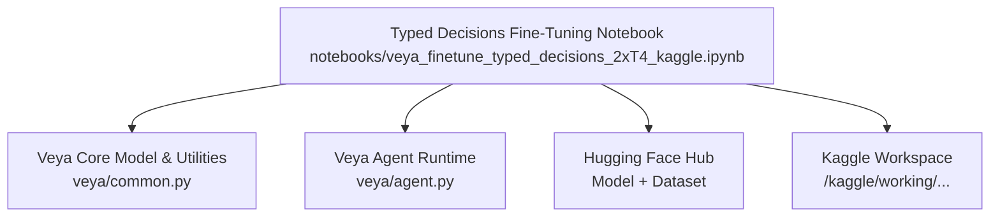
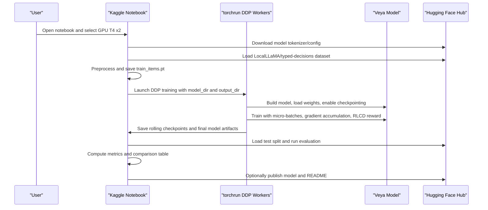
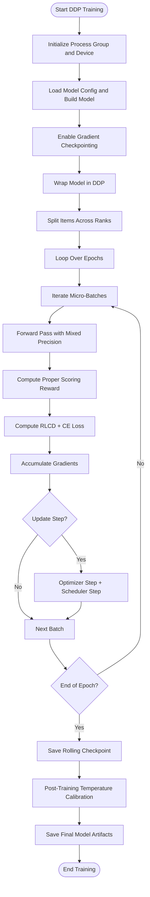
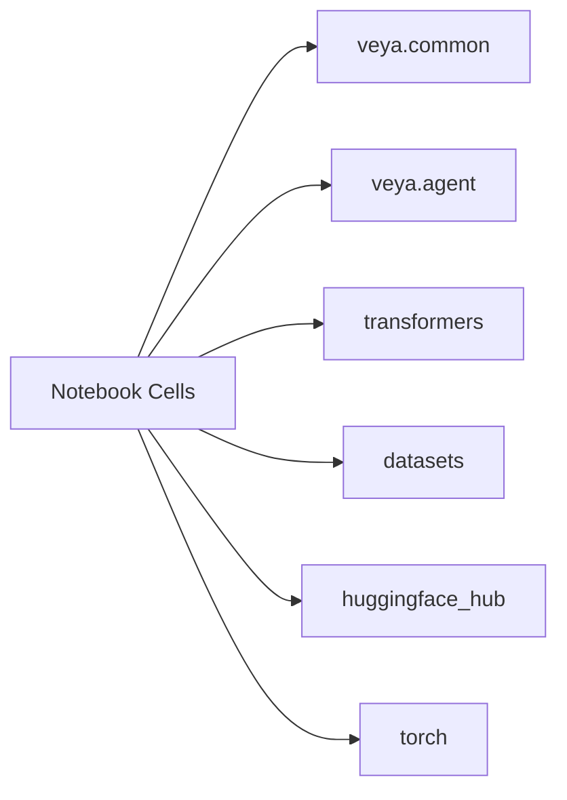

# Notebook Guides

<cite>
**Referenced Files in This Document**
- [veya_finetune_typed_decisions_2xT4_kaggle.ipynb](file://notebooks/veya_finetune_typed_decisions_2xT4_kaggle.ipynb)
- [common.py](file://veya/common.py)
- [agent.py](file://veya/agent.py)
</cite>

## Table of Contents
1. [Introduction](#introduction)
2. [Project Structure](#project-structure)
3. [Core Components](#core-components)
4. [Architecture Overview](#architecture-overview)
5. [Detailed Component Analysis](#detailed-component-analysis)
6. [Dependency Analysis](#dependency-analysis)
7. [Performance Considerations](#performance-considerations)
8. [Troubleshooting Guide](#troubleshooting-guide)
9. [Conclusion](#conclusion)

## Introduction
This document explains how to use the typed decisions fine-tuning notebook to adapt Veya models on the LocalLLaMA/typed-decisions dataset using two NVIDIA T4 GPUs through Distributed Data Parallel (DDP). It covers Kaggle environment setup, GPU requirements, step-by-step execution, parameter tuning options, expected outputs, and troubleshooting for memory constraints and dependency conflicts.

The notebook fine-tunes a 421M-parameter Veya model across three decision types:
- Choice: selecting among criteria-based options
- Noul: binary yes/no judgment
- Score: ordinal scoring over ordered levels

Training uses a policy-gradient-style objective with proper scoring rules and soft cross-entropy guidance, plus post-training temperature calibration per decision type.

## Project Structure
The relevant code is primarily in the notebook and the Veya library modules it imports during training and evaluation.

**Diagram sources**
- [veya_finetune_typed_decisions_2xT4_kaggle.ipynb:1-22](file://notebooks/veya_finetune_typed_decisions_2xT4_kaggle.ipynb#L1-L22)
- [common.py:114-172](file://veya/common.py#L114-L172)
- [agent.py:101-196](file://veya/agent.py#L101-L196)

**Section sources**
- [veya_finetune_typed_decisions_2xT4_kaggle.ipynb:1-22](file://notebooks/veya_finetune_typed_decisions_2xT4_kaggle.ipynb#L1-L22)

## Core Components
- Typed decision data pipeline: downloads the dataset, tokenizes state and question prompts, builds sequences with option markers, and prepares targets for choice/noul/score tasks.
- DDP training script: writes a multi-GPU training script that loads the Veya model, performs gradient checkpointing, micro-batching, mixed precision, RLCD-style policy gradients with proper scoring rewards, and rolling checkpoints.
- Evaluation pipeline: runs inference on the test split, computes accuracy, soft accuracy, Brier score, ECE, KL divergence, TV distance, MAE for scores, and latency percentiles.
- Optional Hugging Face publishing: generates a model card and uploads weights, tokenizer, encoder config, and README.

Key implementation references:
- Sequence construction and decision model architecture are defined in the core module.
- The agent runtime handles model loading, device selection, and compatibility checks used by evaluation.

**Section sources**
- [veya_finetune_typed_decisions_2xT4_kaggle.ipynb:81-153](file://notebooks/veya_finetune_typed_decisions_2xT4_kaggle.ipynb#L81-L153)
- [veya_finetune_typed_decisions_2xT4_kaggle.ipynb:158-424](file://notebooks/veya_finetune_typed_decisions_2xT4_kaggle.ipynb#L158-L424)
- [veya_finetune_typed_decisions_2xT4_kaggle.ipynb:451-501](file://notebooks/veya_finetune_typed_decisions_2xT4_kaggle.ipynb#L451-L501)
- [common.py:114-172](file://veya/common.py#L114-L172)
- [agent.py:101-196](file://veya/agent.py#L101-L196)

## Architecture Overview
The notebook orchestrates four major phases:
1. Environment verification and dependency installation
2. Data preprocessing and saving preprocessed items for DDP workers
3. Multi-GPU training via torchrun with DDP
4. Benchmark evaluation and optional model publishing

**Diagram sources**
- [veya_finetune_typed_decisions_2xT4_kaggle.ipynb:81-153](file://notebooks/veya_finetune_typed_decisions_2xT4_kaggle.ipynb#L81-L153)
- [veya_finetune_typed_decisions_2xT4_kaggle.ipynb:158-424](file://notebooks/veya_finetune_typed_decisions_2xT4_kaggle.ipynb#L158-L424)
- [veya_finetune_typed_decisions_2xT4_kaggle.ipynb:451-501](file://notebooks/veya_finetune_typed_decisions_2xT4_kaggle.ipynb#L451-L501)

## Detailed Component Analysis

### Kaggle Environment Setup and GPU Requirements
- Accelerator: Select GPU T4 x2 in Kaggle Notebook options.
- Internet: Enable internet access to download datasets and model files.
- Output path: Checkpoints and final model are saved under /kaggle/working/veya_finetuned_typed_decisions.
- GPU check: The notebook verifies at least two CUDA devices and sets an environment variable to improve memory allocation behavior.

Expected outputs:
- nvidia-smi output showing two T4 GPUs
- PyTorch device count and properties printed
- Confirmation that both GPUs are ready for DDP training

**Section sources**
- [veya_finetune_typed_decisions_2xT4_kaggle.ipynb:17-22](file://notebooks/veya_finetune_typed_decisions_2xT4_kaggle.ipynb#L17-L22)
- [veya_finetune_typed_decisions_2xT4_kaggle.ipynb:28-56](file://notebooks/veya_finetune_typed_decisions_2xT4_kaggle.ipynb#L28-L56)

### Dependency Installation
- Installs minimum versions for veya, transformers, datasets, safetensors, huggingface_hub, pyarrow, pandas, scipy, accelerate, tabulate.
- Prints installed versions for veya, transformers, and torch.

Expected outputs:
- Quiet pip install logs
- Version strings for veya, transformers, and torch

**Section sources**
- [veya_finetune_typed_decisions_2xT4_kaggle.ipynb:61-76](file://notebooks/veya_finetune_typed_decisions_2xT4_kaggle.ipynb#L61-L76)

### Data Preprocessing for DDP
- Downloads the base model tokenizer and configuration from Hugging Face.
- Loads the LocalLLaMA/typed-decisions dataset (train split).
- Builds training items:
  - For choice: target probabilities keyed by criteria
  - For noul: binary probabilities for false/true
  - For score: probabilities over ordered levels
- Normalizes targets and derives labels.
- Constructs tokenized sequences with option markers and saves them to disk for DDP workers.

Expected outputs:
- Number of preprocessed training sequences
- Path confirmation for saved items file

**Section sources**
- [veya_finetune_typed_decisions_2xT4_kaggle.ipynb:81-153](file://notebooks/veya_finetune_typed_decisions_2xT4_kaggle.ipynb#L81-L153)
- [common.py:42-111](file://veya/common.py#L42-L111)

### DDP Training Script
The notebook writes a multi-GPU training script that:
- Initializes NCCL process group and assigns each rank to a local GPU
- Loads model configuration and builds the Veya DecisionModel
- Enables gradient checkpointing for encoder and head
- Wraps the model in DDP
- Splits preprocessed items across ranks
- Uses micro-batching and gradient accumulation to fit effective batch sizes within T4 memory
- Applies mixed precision with GradScaler
- Computes RLCD-style policy gradient loss combined with soft cross-entropy guidance
- Uses cosine learning rate schedule and AdamW with separate encoder and head learning rates
- Saves rolling checkpoints after each epoch
- Performs post-training temperature calibration per decision type
- Saves final model artifacts including weights, encoder config, tokenizer, and updated rl_agent_config.json

Key parameters you can tune:
- EPOCHS: number of training epochs
- MICRO_BATCH: sequences per forward pass per GPU
- GRAD_ACCUM: gradient accumulation steps to achieve effective batch size
- GROUP_SIZE: number of noisy samples for policy gradient estimation
- LR_ENCODER: learning rate for encoder adaptation
- LR_HEAD: learning rate for head adaptation
- SIGMA_START/SIGMA_END: exploration noise schedule for policy gradient sampling
- max_len/head_max_len: sequence length budgets for input and decision head

Expected outputs:
- Per-step loss, reward, and learning rate logs
- Epoch completion summaries
- Rolling checkpoint directory with latest model.safetensors, encoder/, tokenizer/, and checkpoint_meta.json
- Final model artifacts in the specified output directory

**Diagram sources**
- [veya_finetune_typed_decisions_2xT4_kaggle.ipynb:158-424](file://notebooks/veya_finetune_typed_decisions_2xT4_kaggle.ipynb#L158-L424)
- [common.py:114-172](file://veya/common.py#L114-L172)

**Section sources**
- [veya_finetune_typed_decisions_2xT4_kaggle.ipynb:158-424](file://notebooks/veya_finetune_typed_decisions_2xT4_kaggle.ipynb#L158-L424)
- [common.py:114-172](file://veya/common.py#L114-L172)

### Launch Multi-GPU Fine-Tuning
- Executes torchrun with two processes (one per T4 GPU).
- Passes model directory and output directory to the training script.

Expected outputs:
- Command echo and training progress logs
- Completion message indicating successful training

**Section sources**
- [veya_finetune_typed_decisions_2xT4_kaggle.ipynb:429-446](file://notebooks/veya_finetune_typed_decisions_2xT4_kaggle.ipynb#L429-L446)

### Benchmark Evaluation on Test Split
- Loads the test split of LocalLLaMA/typed-decisions.
- Instantiates the Veya Agent with the fine-tuned model directory and runs predictions.
- Records latencies per case.

Expected outputs:
- Total evaluation time
- Predictions list containing answers, gold labels, questions, and latency

**Section sources**
- [veya_finetune_typed_decisions_2xT4_kaggle.ipynb:451-501](file://notebooks/veya_finetune_typed_decisions_2xT4_kaggle.ipynb#L451-L501)
- [agent.py:101-196](file://veya/agent.py#L101-L196)

### Metrics Computation and Comparison Table
- Computes accuracy, soft accuracy, Brier score, KL divergence, TV distance, ECE, score MAE, and within-one-level accuracy.
- Compares against TypeSafe Jev baseline, ModernBERT specialist, and teacher self-agreement ceiling.
- Prints a markdown comparison table.

Expected outputs:
- Aggregated metrics for the fine-tuned model
- Head-to-head benchmark table with latency and cost notes

**Section sources**
- [veya_finetune_typed_decisions_2xT4_kaggle.ipynb:507-665](file://notebooks/veya_finetune_typed_decisions_2xT4_kaggle.ipynb#L507-L665)

### Optional Hugging Face Publishing
- Reads HF_TOKEN from Kaggle Secrets or allows manual override.
- Generates a comprehensive README.md with metrics and usage instructions.
- Creates or updates a Hugging Face repository and uploads model artifacts.

Expected outputs:
- Generated README path
- Repository URL with published model

**Section sources**
- [veya_finetune_typed_decisions_2xT4_kaggle.ipynb:670-800](file://notebooks/veya_finetune_typed_decisions_2xT4_kaggle.ipynb#L670-L800)

## Dependency Analysis
The notebook depends on:
- Veya library for model building, sequence construction, and utilities
- Transformers for tokenizer and model loading
- Datasets for dataset access
- Hugging Face Hub for model and dataset downloads
- PyTorch for distributed training and inference

**Diagram sources**
- [veya_finetune_typed_decisions_2xT4_kaggle.ipynb:61-76](file://notebooks/veya_finetune_typed_decisions_2xT4_kaggle.ipynb#L61-L76)
- [common.py:114-172](file://veya/common.py#L114-L172)
- [agent.py:101-196](file://veya/agent.py#L101-L196)

**Section sources**
- [veya_finetune_typed_decisions_2xT4_kaggle.ipynb:61-76](file://notebooks/veya_finetune_typed_decisions_2xT4_kaggle.ipynb#L61-L76)

## Performance Considerations
- Memory optimization techniques:
  - Gradient checkpointing for encoder and head
  - Micro-batching and gradient accumulation
  - Mixed precision training with GradScaler
  - Expandable segments allocator for improved memory fragmentation handling
- Effective batch sizing:
  - MICRO_BATCH controls per-GPU forward batch size
  - GRAD_ACCUM scales effective batch size across ranks
- Exploration noise schedule:
  - SIGMA_START and SIGMA_END control policy gradient variance over epochs
- Length budgets:
  - max_len and head_max_len constrain input and decision head token limits

Recommendations:
- If OOM occurs, reduce MICRO_BATCH or increase GRAD_ACCUM conservatively.
- Reduce max_len/head_max_len if sequence lengths exceed GPU capacity.
- Lower LR_ENCODER/LR_HEAD if training becomes unstable.
- Adjust GROUP_SIZE to balance reward variance and compute cost.

[No sources needed since this section provides general guidance]

## Troubleshooting Guide

Common issues and resolutions:

- Not enough GPUs detected:
  - Symptom: Assertion fails indicating fewer than two GPUs.
  - Resolution: In Kaggle Notebook options, set Accelerator to GPU T4 x2 and ensure both GPUs are allocated.

- Dependency version conflicts:
  - Symptom: Import errors or unexpected behavior due to incompatible package versions.
  - Resolution: Reinstall dependencies with pinned minimum versions as specified in the notebook.

- Tokenizer configuration incompatibility:
  - Symptom: AutoTokenizer fails to load due to extra_special_tokens format or backend settings.
  - Resolution: The notebook applies a tokenizer config fix; ensure the fix runs before model loading.

- Out-of-memory during training:
  - Symptom: CUDA OOM errors during forward passes or gradient accumulation.
  - Resolution: Reduce MICRO_BATCH, increase GRAD_ACCUM moderately, lower max_len/head_max_len, and ensure gradient checkpointing is enabled.

- DDP initialization failures:
  - Symptom: Errors when launching torchrun or initializing NCCL.
  - Resolution: Verify two GPUs are visible and LOCAL_RANK is correctly set by torchrun.

- Hugging Face authentication errors:
  - Symptom: Failures when downloading models or uploading to the Hub.
  - Resolution: Ensure HF_TOKEN is available via Kaggle Secrets or manually set in the notebook.

- Evaluation path not found:
  - Symptom: FileNotFoundError when loading the fine-tuned model.
  - Resolution: Confirm OUTPUT_DIR contains model.safetensors, rl_agent_config.json, tokenizer/, and encoder/.

**Section sources**
- [veya_finetune_typed_decisions_2xT4_kaggle.ipynb:28-56](file://notebooks/veya_finetune_typed_decisions_2xT4_kaggle.ipynb#L28-L56)
- [veya_finetune_typed_decisions_2xT4_kaggle.ipynb:61-76](file://notebooks/veya_finetune_typed_decisions_2xT4_kaggle.ipynb#L61-L76)
- [agent.py:27-52](file://veya/agent.py#L27-L52)
- [agent.py:101-196](file://veya/agent.py#L101-L196)

## Conclusion
The typed decisions fine-tuning notebook provides a complete workflow to adapt Veya models on structured decision tasks using two T4 GPUs. It includes robust data preprocessing, efficient DDP training with memory optimizations, calibrated inference, and comprehensive evaluation. By following the setup instructions, tuning the provided parameters, and applying the troubleshooting guidance, users can reliably produce fine-tuned Veya models tailored to typed decision benchmarks.

[No sources needed since this section summarizes without analyzing specific files]