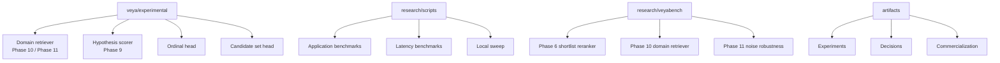
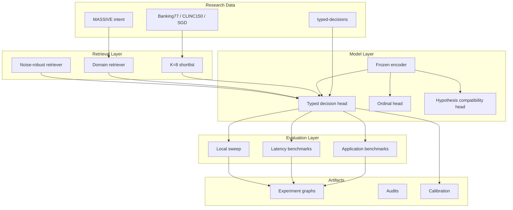
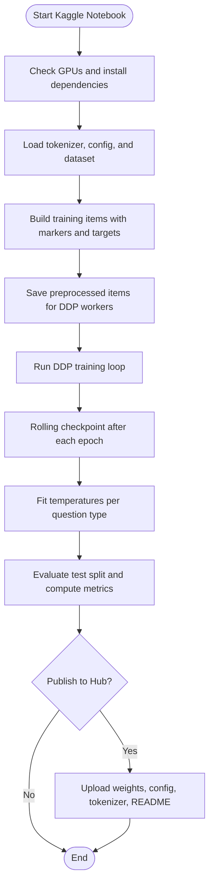
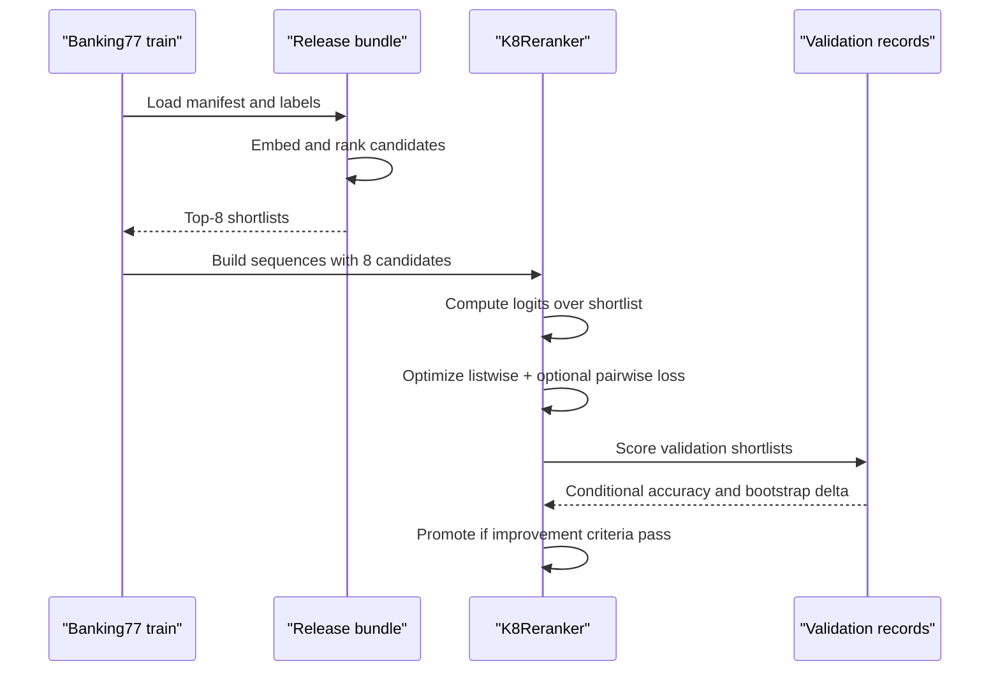
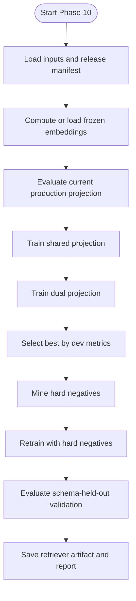
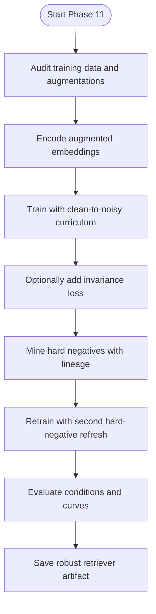
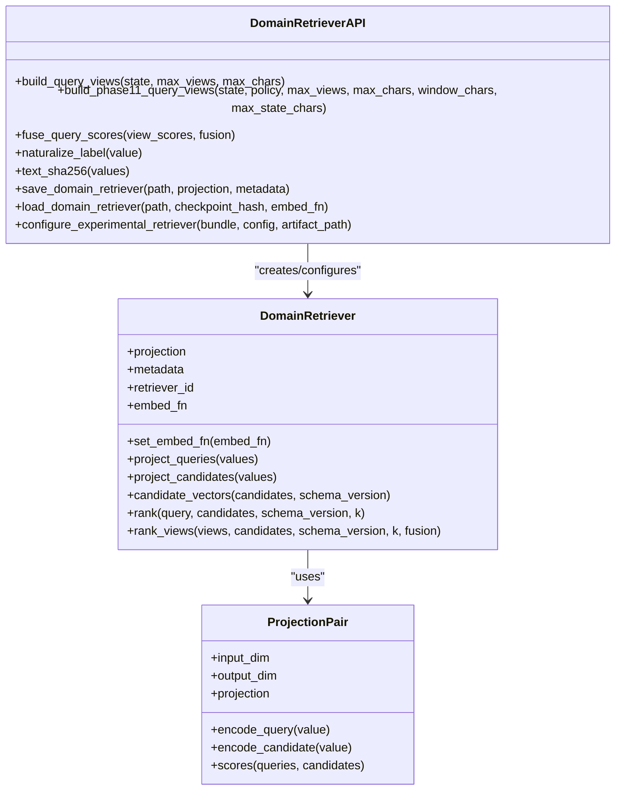
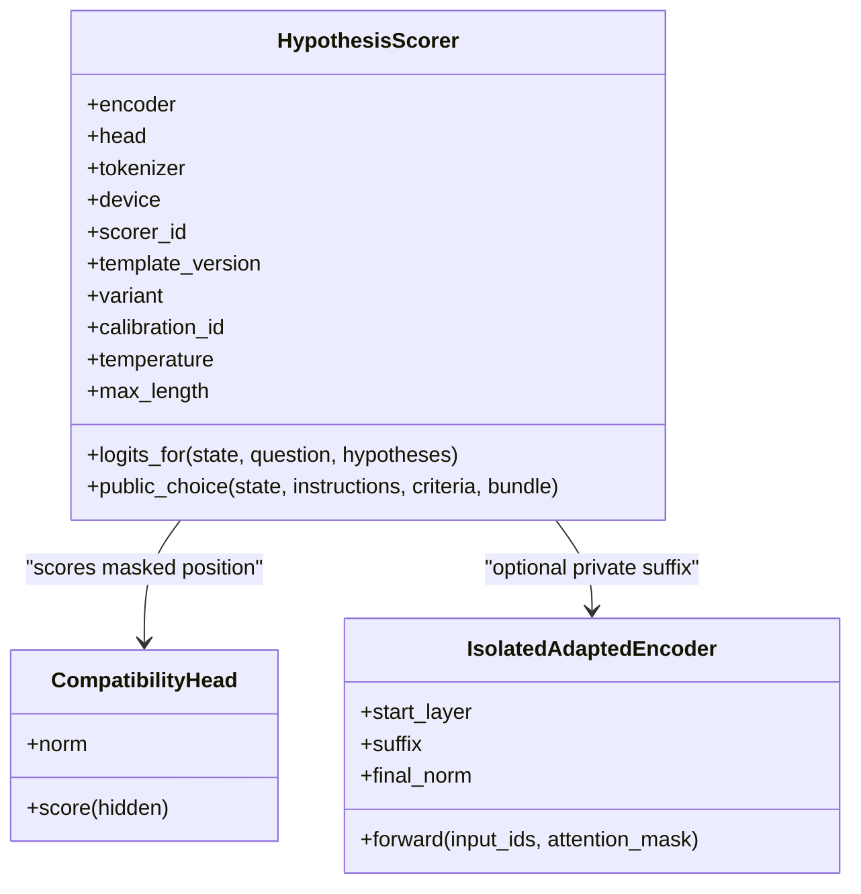
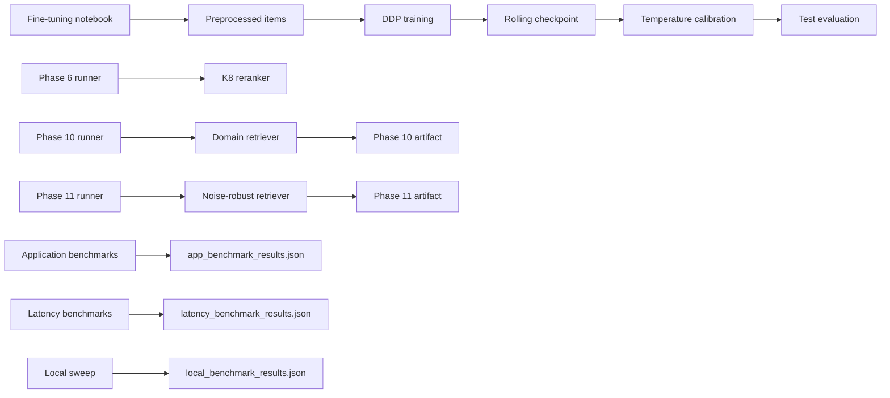

# Research & Development

<cite>
**Referenced Files in This Document**
- [README.md](file://README.md)
- [BENCHMARKS.md](file://BENCHMARKS.md)
- [research/README.md](file://research/README.md)
- [notebooks/veya_finetune_typed_decisions_2xT4_kaggle.ipynb](file://notebooks/veya_finetune_typed_decisions_2xT4_kaggle.ipynb)
- [veya/experimental/__init__.py](file://veya/experimental/__init__.py)
- [veya/experimental/candidate_set.py](file://veya/experimental/candidate_set.py)
- [veya/experimental/domain_retriever.py](file://veya/experimental/domain_retriever.py)
- [veya/experimental/hypothesis.py](file://veya/experimental/hypothesis.py)
- [veya/experimental/ordinal.py](file://veya/experimental/ordinal.py)
- [research/scripts/bench_apps.py](file://research/scripts/bench_apps.py)
- [research/scripts/bench_latency.py](file://research/scripts/bench_latency.py)
- [research/scripts/bench_local.py](file://research/scripts/bench_local.py)
- [research/veyabench/run_phase10_train.py](file://research/veyabench/run_phase10_train.py)
- [research/veyabench/run_phase11_train.py](file://research/veyabench/run_phase11_train.py)
- [research/veyabench/run_phase6_train.py](file://research/veyabench/run_phase6_train.py)
</cite>

## Table of Contents
1. [Introduction](#introduction)
2. [Project Structure](#project-structure)
3. [Core Components](#core-components)
4. [Architecture Overview](#architecture-overview)
5. [Detailed Component Analysis](#detailed-component-analysis)
6. [Dependency Analysis](#dependency-analysis)
7. [Performance Considerations](#performance-considerations)
8. [Troubleshooting Guide](#troubleshooting-guide)
9. [Conclusion](#conclusion)
10. [Appendices](#appendices)

## Introduction
This document explains Veya’s research ecosystem and development tools with a focus on experimental modules, benchmarking frameworks, evaluation methodologies, fine-tuning workflows, dataset preparation, model training procedures, extension points for new decision types and backbones, domain adaptation, and the audit trail used to ensure reproducibility.

Veya is a non-autoregressive typed-decision system that evaluates structured questions without text generation. The repository separates audited production behavior from active research: the main package provides serving primitives, while `research/` contains harnesses, scripts, raw results, and phase-based experiments. Experimental heads and retrieval strategies live under `veya/experimental/` and are explicitly not wired into the default `Agent.predict` path.

The project ships three checkpoints: an English Choice checkpoint, a multilingual checkpoint, and a benchmark-specialized typed-decisions checkpoint. The README documents routing between them, confidence gating, presets, decision primitives, benchmarks, calibration, and the fine-tuning notebook. Benchmarks are historical capability measurements and are not release certification.

**Section sources**
- [README.md:8-55](file://README.md#L8-L55)
- [README.md:255-262](file://README.md#L255-L262)
- [README.md:265-319](file://README.md#L265-L319)
- [README.md:438-453](file://README.md#L438-L453)
- [BENCHMARKS.md:1-12](file://BENCHMARKS.md#L1-L12)
- [research/README.md:1-18](file://research/README.md#L1-L18)

## Project Structure
The research-oriented parts of the repository are organized by purpose:

- `veya/experimental/`: experimental heads, retrievers, hypothesis scoring, ordinal modeling, and candidate-set scoring. These components are present and tested but are not part of the default agent prediction path.
- `research/scripts/`: benchmark generators, application workflow benchmarks, latency benchmarks, CPU sweeps, and plotting helpers.
- `research/veyabench/`: phase-based experiment runners for shortlist reranking, domain-general retrieval, noise robustness, SGD inventory, context audits, and other research phases.
- `artifacts/`: frozen decisions, commercialization artifacts, and per-phase experiment outputs such as graphs, audits, manifests, and validation reports.
- `models/production/`: production encoder and tokenizer configurations, calibration files, router configuration, and RL agent configuration.
- `notebooks/`: the Kaggle-friendly fine-tuning notebook for the typed-decisions benchmark.

**Diagram sources**
- [veya/experimental/__init__.py:1-2](file://veya/experimental/__init__.py#L1-L2)
- [veya/experimental/domain_retriever.py:1-7](file://veya/experimental/domain_retriever.py#L1-L7)
- [veya/experimental/hypothesis.py:1-6](file://veya/experimental/hypothesis.py#L1-L6)
- [veya/experimental/ordinal.py:1-5](file://veya/experimental/ordinal.py#L1-L5)
- [veya/experimental/candidate_set.py:1-6](file://veya/experimental/candidate_set.py#L1-L6)
- [research/scripts/bench_apps.py:1-16](file://research/scripts/bench_apps.py#L1-L16)
- [research/scripts/bench_latency.py:1-11](file://research/scripts/bench_latency.py#L1-L11)
- [research/scripts/bench_local.py:1-11](file://research/scripts/bench_local.py#L1-L11)
- [research/veyabench/run_phase6_train.py:1-6](file://research/veyabench/run_phase6_train.py#L1-L6)
- [research/veyabench/run_phase10_train.py:1-6](file://research/veyabench/run_phase10_train.py#L1-L6)
- [research/veyabench/run_phase11_train.py:1-6](file://research/veyabench/run_phase11_train.py#L1-L6)

**Section sources**
- [veya/experimental/__init__.py:1-2](file://veya/experimental/__init__.py#L1-L2)
- [research/README.md:1-18](file://research/README.md#L1-L18)

## Core Components
This section summarizes the key research components and their responsibilities.

### Decision Primitives
Veya evaluates typed questions without generating text:
- `choice`: top label, per-option probabilities, and confidence.
- `score`: expected level on an ordinal rubric, distribution, and confidence.
- `noul`: calibrated probability of truth.

These primitives drive both production routing and research evaluation.

**Section sources**
- [README.md:255-262](file://README.md#L255-L262)

### Experimental Heads and Retrievers
- Candidate-set head: scores each candidate independently from a state vector plus its own embedding; useful for cacheable candidate scoring.
- Domain retriever: frozen-backbone biencoder projections with exact cosine ranking, deterministic query views, fusion strategies, and versioned caching.
- Hypothesis scorer: independent state-hypothesis compatibility scoring with private encoder suffixes and temperature scaling.
- Ordinal head: cumulative-threshold softplus parameterization producing ordered class probabilities.

All experimental components are explicitly not used by `Agent.predict`.

**Section sources**
- [veya/experimental/candidate_set.py:1-26](file://veya/experimental/candidate_set.py#L1-L26)
- [veya/experimental/domain_retriever.py:1-7](file://veya/experimental/domain_retriever.py#L1-L7)
- [veya/experimental/hypothesis.py:1-6](file://veya/experimental/hypothesis.py#L1-L6)
- [veya/experimental/ordinal.py:1-5](file://veya/experimental/ordinal.py#L1-L5)
- [veya/experimental/__init__.py:1-2](file://veya/experimental/__init__.py#L1-L2)

### Benchmarking Scripts
- Application workflow benchmark: support triage, email/phishing, guardrails, RAG relevance, moderation, and model routing.
- Latency benchmark: detection overhead, raw agent latency, hot-path routing, cold-swap routing, and mixed-language throughput.
- Local sweep: MASSIVE intent across languages and typed-decisions evaluation across all three checkpoints.

**Section sources**
- [research/scripts/bench_apps.py:1-16](file://research/scripts/bench_apps.py#L1-L16)
- [research/scripts/bench_latency.py:1-11](file://research/scripts/bench_latency.py#L1-L11)
- [research/scripts/bench_local.py:1-11](file://research/scripts/bench_local.py#L1-L11)

### Phase-Based Experiment Runners
- Phase 6: route-specific K=8 reranker trained on hard shortlists with frozen encoder and base decision head.
- Phase 10: frozen-backbone domain-general retriever trained on precomputed embeddings with episodic cardinalities and hard-negative mining.
- Phase 11: dense robustness ablations over clean-to-noisy curriculum, invariance regularization, tokenization audit, and hard-negative lineage.

**Section sources**
- [research/veyabench/run_phase6_train.py:1-6](file://research/veyabench/run_phase6_train.py#L1-L6)
- [research/veyabench/run_phase10_train.py:1-6](file://research/veyabench/run_phase10_train.py#L1-L6)
- [research/veyabench/run_phase11_train.py:1-6](file://research/veyabench/run_phase11_train.py#L1-L6)

## Architecture Overview
At a high level, Veya’s research pipeline combines:

1. Frozen or partially adapted encoders.
2. Typed decision heads for choice, score, and noul.
3. Shortlist retrieval and reranking for high-cardinality choice.
4. Experimental retrievers for domain generalization and noise robustness.
5. Independent hypothesis compatibility scoring for Phase 9.
6. Calibration through temperature fitting.
7. Benchmarks and phase-based experiment runners that produce auditable artifacts.

[No sources needed since this diagram shows conceptual workflow, not actual code structure]

## Detailed Component Analysis

### Fine-Tuning Workflow for Typed Decisions
The Kaggle notebook implements a complete fine-tuning loop:

- Environment setup and dual T4 GPU verification.
- Dependency installation and model/tokenizer loading.
- Dataset preprocessing into tokenized items compatible with distributed data parallel training.
- Distributed RLCD-style policy gradient training with proper scoring rule rewards, micro-batching, gradient accumulation, cosine learning rate schedule, and gradient clipping.
- Rolling checkpoint saving to survive session timeouts.
- Post-training temperature calibration per question type.
- Evaluation on the test split and optional Hub publishing.

**Diagram sources**
- [notebooks/veya_finetune_typed_decisions_2xT4_kaggle.ipynb:28-52](file://notebooks/veya_finetune_typed_decisions_2xT4_kaggle.ipynb#L28-L52)
- [notebooks/veya_finetune_typed_decisions_2xT4_kaggle.ipynb:81-149](file://notebooks/veya_finetune_typed_decisions_2xT4_kaggle.ipynb#L81-L149)
- [notebooks/veya_finetune_typed_decisions_2xT4_kaggle.ipynb:158-420](file://notebooks/veya_finetune_typed_decisions_2xT4_kaggle.ipynb#L158-L420)
- [notebooks/veya_finetune_typed_decisions_2xT4_kaggle.ipynb:429-443](file://notebooks/veya_finetune_typed_decisions_2xT4_kaggle.ipynb#L429-L443)
- [notebooks/veya_finetune_typed_decisions_2xT4_kaggle.ipynb:451-498](file://notebooks/veya_finetune_typed_decisions_2xT4_kaggle.ipynb#L451-L498)
- [notebooks/veya_finetune_typed_decisions_2xT4_kaggle.ipynb:507-661](file://notebooks/veya_finetune_typed_decisions_2xT4_kaggle.ipynb#L507-L661)
- [notebooks/veya_finetune_typed_decisions_2xT4_kaggle.ipynb:670-800](file://notebooks/veya_finetune_typed_decisions_2xT4_kaggle.ipynb#L670-L800)

**Section sources**
- [README.md:438-453](file://README.md#L438-L453)
- [notebooks/veya_finetune_typed_decisions_2xT4_kaggle.ipynb:28-52](file://notebooks/veya_finetune_typed_decisions_2xT4_kaggle.ipynb#L28-L52)
- [notebooks/veya_finetune_typed_decisions_2xT4_kaggle.ipynb:81-149](file://notebooks/veya_finetune_typed_decisions_2xT4_kaggle.ipynb#L81-L149)
- [notebooks/veya_finetune_typed_decisions_2xT4_kaggle.ipynb:158-420](file://notebooks/veya_finetune_typed_decisions_2xT4_kaggle.ipynb#L158-L420)
- [notebooks/veya_finetune_typed_decisions_2xT4_kaggle.ipynb:451-661](file://notebooks/veya_finetune_typed_decisions_2xT4_kaggle.ipynb#L451-L661)

### Phase 6 Shortlist Reranker Training
Phase 6 trains a route-specific K=8 reranker while keeping the encoder and base decision head frozen. It selects examples where the target is already in the retrieved shortlist, constructs fixed-length sequences, and optimizes listwise loss with optional pairwise regularization. Validation uses conditional accuracy and high-confidence mistake analysis.

**Diagram sources**
- [research/veyabench/run_phase6_train.py:1-6](file://research/veyabench/run_phase6_train.py#L1-L6)
- [research/veyabench/run_phase6_train.py:32-82](file://research/veyabench/run_phase6_train.py#L32-L82)
- [research/veyabench/run_phase6_train.py:100-262](file://research/veyabench/run_phase6_train.py#L100-L262)

**Section sources**
- [research/veyabench/run_phase6_train.py:1-6](file://research/veyabench/run_phase6_train.py#L1-L6)
- [research/veyabench/run_phase6_train.py:32-82](file://research/veyabench/run_phase6_train.py#L32-L82)
- [research/veyabench/run_phase6_train.py:100-262](file://research/veyabench/run_phase6_train.py#L100-L262)

### Phase 10 Domain-General Retriever
Phase 10 trains small projection heads on frozen encoder vectors. It caches base embeddings, compares current production projections, trains shared and dual projections, mines hard negatives, and evaluates schema-held-out validation. The selected artifact is saved with full metadata.

**Diagram sources**
- [research/veyabench/run_phase10_train.py:1-6](file://research/veyabench/run_phase10_train.py#L1-L6)
- [research/veyabench/run_phase10_train.py:81-120](file://research/veyabench/run_phase10_train.py#L81-L120)
- [research/veyabench/run_phase10_train.py:180-242](file://research/veyabench/run_phase10_train.py#L180-L242)
- [research/veyabench/run_phase10_train.py:245-268](file://research/veyabench/run_phase10_train.py#L245-L268)
- [research/veyabench/run_phase10_train.py:275-532](file://research/veyabench/run_phase10_train.py#L275-L532)

**Section sources**
- [research/veyabench/run_phase10_train.py:1-6](file://research/veyabench/run_phase10_train.py#L1-L6)
- [research/veyabench/run_phase10_train.py:81-120](file://research/veyabench/run_phase10_train.py#L81-L120)
- [research/veyabench/run_phase10_train.py:180-242](file://research/veyabench/run_phase10_train.py#L180-L242)
- [research/veyabench/run_phase10_train.py:275-532](file://research/veyabench/run_phase10_train.py#L275-L532)

### Phase 11 Noise-Robust Retriever
Phase 11 builds on Phase 10 by adding deterministic noise augmentation, clean-to-noisy curriculum, invariance regularization, tokenization audit, and hard-negative lineage. It validates semantic augmentation, tracks truncation and signal retention, and produces a robust retriever artifact with selection metrics.

**Diagram sources**
- [research/veyabench/run_phase11_train.py:1-6](file://research/veyabench/run_phase11_train.py#L1-L6)
- [research/veyabench/run_phase11_train.py:92-127](file://research/veyabench/run_phase11_train.py#L92-L127)
- [research/veyabench/run_phase11_train.py:136-238](file://research/veyabench/run_phase11_train.py#L136-L238)
- [research/veyabench/run_phase11_train.py:284-352](file://research/veyabench/run_phase11_train.py#L284-L352)
- [research/veyabench/run_phase11_train.py:355-621](file://research/veyabench/run_phase11_train.py#L355-L621)

**Section sources**
- [research/veyabench/run_phase11_train.py:1-6](file://research/veyabench/run_phase11_train.py#L1-L6)
- [research/veyabench/run_phase11_train.py:136-238](file://research/veyabench/run_phase11_train.py#L136-L238)
- [research/veyabench/run_phase11_train.py:284-352](file://research/veyabench/run_phase11_train.py#L284-L352)
- [research/veyabench/run_phase11_train.py:355-621](file://research/veyabench/run_phase11_train.py#L355-L621)

### Experimental Domain Retriever API
The experimental domain retriever supports:
- Query view construction for single-line strings, structured dictionaries, and lists.
- Phase 11 adaptive view policies with bounded windows.
- Deterministic score fusion across views.
- Exact cosine ranking with process-local candidate caching.
- Versioned save/load with metadata validation.
- Integration into a release bundle via a configurable shortlist override.

**Diagram sources**
- [veya/experimental/domain_retriever.py:258-284](file://veya/experimental/domain_retriever.py#L258-L284)
- [veya/experimental/domain_retriever.py:287-402](file://veya/experimental/domain_retriever.py#L287-L402)
- [veya/experimental/domain_retriever.py:405-460](file://veya/experimental/domain_retriever.py#L405-L460)
- [veya/experimental/domain_retriever.py:463-560](file://veya/experimental/domain_retriever.py#L463-L560)

**Section sources**
- [veya/experimental/domain_retriever.py:37-97](file://veya/experimental/domain_retriever.py#L37-L97)
- [veya/experimental/domain_retriever.py:133-204](file://veya/experimental/domain_retriever.py#L133-L204)
- [veya/experimental/domain_retriever.py:207-255](file://veya/experimental/domain_retriever.py#L207-L255)
- [veya/experimental/domain_retriever.py:258-402](file://veya/experimental/domain_retriever.py#L258-L402)
- [veya/experimental/domain_retriever.py:405-560](file://veya/experimental/domain_retriever.py#L405-L560)

### Experimental Hypothesis Scorer
The hypothesis scorer treats each candidate as an independent hypothesis pair with a masked compatibility position. It supports:
- Template versions and variant construction.
- Pair encoding with premise truncation and hypothesis preservation.
- Private encoder suffix adaptation that does not mutate the shared production encoder.
- Temperature-scaled softmax over K candidates.
- Calibration record validation tied to checkpoint, shortlist, head, and encoder delta hashes.

**Diagram sources**
- [veya/experimental/hypothesis.py:111-125](file://veya/experimental/hypothesis.py#L111-L125)
- [veya/experimental/hypothesis.py:138-197](file://veya/experimental/hypothesis.py#L138-L197)
- [veya/experimental/hypothesis.py:231-279](file://veya/experimental/hypothesis.py#L231-L279)
- [veya/experimental/hypothesis.py:318-361](file://veya/experimental/hypothesis.py#L318-L361)
- [veya/experimental/hypothesis.py:378-451](file://veya/experimental/hypothesis.py#L378-L451)

**Section sources**
- [veya/experimental/hypothesis.py:22-39](file://veya/experimental/hypothesis.py#L22-L39)
- [veya/experimental/hypothesis.py:73-108](file://veya/experimental/hypothesis.py#L73-L108)
- [veya/experimental/hypothesis.py:138-229](file://veya/experimental/hypothesis.py#L138-L229)
- [veya/experimental/hypothesis.py:287-361](file://veya/experimental/hypothesis.py#L287-L361)
- [veya/experimental/hypothesis.py:378-451](file://veya/experimental/hypothesis.py#L378-L451)

### Ordinal Head
The ordinal head models cumulative thresholds using softplus gaps, ensuring ordered thresholds and valid class probabilities derived from adjacent differences. It is experimental and not the served categorical score path.

**Section sources**
- [veya/experimental/ordinal.py:1-35](file://veya/experimental/ordinal.py#L1-L35)

### Candidate Set Head
The candidate set head projects state and candidate embeddings separately, mixes them, and returns one scalar score per candidate. It is designed for state-once scoring and cacheable concatenation.

**Section sources**
- [veya/experimental/candidate_set.py:1-26](file://veya/experimental/candidate_set.py#L1-L26)

## Dependency Analysis
The research pipeline has clear layering:

- Data preparation lives in notebooks and research scripts.
- Model layers include frozen encoders, typed decision heads, and experimental heads.
- Retrieval includes shortlist reranking and experimental domain retrievers.
- Evaluation includes application benchmarks, latency benchmarks, and local sweeps.
- Artifacts capture experiment graphs, audits, calibration, and frozen decisions.

**Diagram sources**
- [notebooks/veya_finetune_typed_decisions_2xT4_kaggle.ipynb:81-420](file://notebooks/veya_finetune_typed_decisions_2xT4_kaggle.ipynb#L81-L420)
- [research/veyabench/run_phase6_train.py:100-262](file://research/veyabench/run_phase6_train.py#L100-L262)
- [research/veyabench/run_phase10_train.py:275-532](file://research/veyabench/run_phase10_train.py#L275-L532)
- [research/veyabench/run_phase11_train.py:355-621](file://research/veyabench/run_phase11_train.py#L355-L621)
- [research/scripts/bench_apps.py:267-303](file://research/scripts/bench_apps.py#L267-L303)
- [research/scripts/bench_latency.py:66-165](file://research/scripts/bench_latency.py#L66-L165)
- [research/scripts/bench_local.py:309-338](file://research/scripts/bench_local.py#L309-L338)

**Section sources**
- [research/scripts/bench_apps.py:267-303](file://research/scripts/bench_apps.py#L267-L303)
- [research/scripts/bench_latency.py:66-165](file://research/scripts/bench_latency.py#L66-L165)
- [research/scripts/bench_local.py:309-338](file://research/scripts/bench_local.py#L309-L338)

## Performance Considerations
Benchmarking focuses on two dimensions: task performance and inference speed.

- Application benchmarks measure accuracy, macro-F1, ECE, and latency across real workflows.
- Latency benchmarks measure detection overhead, raw agent latency, hot-path routing, cold-swap routing, and mixed-language throughput.
- Local sweeps evaluate MASSIVE intent across many languages and typed-decisions across all three checkpoints.
- The README documents T4 reference latency and batched throughput.

Key guidance:
- Prefer preloaded routers for production-like latency.
- Use temperature fitting for calibrated probabilities.
- Treat high-cardinality choice as retrieval-dependent.
- Keep option-token budgets sufficient for large label sets.

**Section sources**
- [research/scripts/bench_apps.py:1-16](file://research/scripts/bench_apps.py#L1-L16)
- [research/scripts/bench_latency.py:1-11](file://research/scripts/bench_latency.py#L1-L11)
- [research/scripts/bench_local.py:1-11](file://research/scripts/bench_local.py#L1-L11)
- [README.md:265-319](file://README.md#L265-L319)
- [README.md:379-427](file://README.md#L379-L427)

## Troubleshooting Guide
Common issues and their likely causes:

- Missing or mismatched retriever format: the experimental retriever enforces format, checkpoint hash, and K=8 constraints.
- Empty or invalid query views: query view builders validate bounds and require usable state content.
- Duplicate candidate labels: retriever candidate vectors require unique labels.
- Hypothesis leakage or duplicate hypothesis text: hypothesis pair builders reject leaked or identical hypothesis strings.
- Calibration record mismatch: Phase 9 calibration validation checks primitive, route, method, temperature, split, checkpoint hash, shortlist hash, head hash, encoder delta hash, template version, and start layer.
- TensorFlow import deadlock: research scripts set `USE_TF=0` to avoid abseil runtime deadlocks.
- Cold model reloads: router cold swaps can dominate latency unless models are preloaded.

Recommended actions:
- Verify artifact paths, checkpoint hashes, and metadata before loading experimental components.
- Inspect audit JSONs produced by Phase 10 and Phase 11 runners.
- Use temperature-fitted models for calibrated confidence gating.
- Increase `head_max_len` and `max_len` when evaluating very large label sets.
- Preload models or limit `max_loaded` according to workload patterns.

**Section sources**
- [veya/experimental/domain_retriever.py:405-460](file://veya/experimental/domain_retriever.py#L405-L460)
- [veya/experimental/domain_retriever.py:463-560](file://veya/experimental/domain_retriever.py#L463-L560)
- [veya/experimental/hypothesis.py:287-361](file://veya/experimental/hypothesis.py#L287-L361)
- [research/README.md:17-18](file://research/README.md#L17-L18)
- [research/scripts/bench_latency.py:104-139](file://research/scripts/bench_latency.py#L104-L139)
- [README.md:161-187](file://README.md#L161-L187)

## Conclusion
Veya’s research ecosystem separates audited production behavior from active experimentation. The core research pipeline combines frozen encoders, typed decision heads, shortlist reranking, and experimental retrievers with strong auditability. Phase 6, Phase 10, and Phase 11 runners provide reproducible training loops, artifact serialization, and validation reports. The Kaggle fine-tuning notebook demonstrates a complete loop from dataset preprocessing through distributed training, calibration, evaluation, and optional publication. Benchmarks and latency scripts make it possible to compare tasks, languages, and deployment modes consistently.

For extending Veya:
- Add new decision types by implementing compatible heads and integrating them through the experimental layer before considering production wiring.
- Replace or adapt backbones by reusing frozen encoder pipelines and training only lightweight projections or heads.
- Adapt domains by following Phase 10 and Phase 11 patterns: freeze the backbone, prepare canonical query and candidate representations, train projections with episodic cardinalities, mine hard negatives, and validate on held-out schemas.
- Track experiments by preserving artifacts, audits, calibration records, and split digests so that every result can be reproduced and verified.

[No sources needed since this section summarizes without analyzing specific files]

## Appendices

### Extending Veya for New Decision Types
Steps:
1. Define the new decision primitive and output contract.
2. Implement a compatible head under `veya/experimental/`.
3. Provide sequence building, marker handling, and qtype mapping.
4. Add evaluation logic in research scripts or notebooks.
5. Validate with synthetic and real datasets before considering integration.

Guidance:
- Follow the pattern used by choice, score, and noul.
- Keep experimental components separate from `Agent.predict`.
- Preserve calibration and audit metadata.

[No sources needed since this section provides general guidance]

### Custom Backbones
Approach:
- Load a frozen encoder from a production or custom checkpoint.
- Freeze encoder parameters during head or projection training.
- Use existing embedding functions or implement a compatible `embed_fn`.
- Validate representation quality with retrieval and classification metrics.

References:
- Phase 10 and Phase 11 runners reuse frozen encoders and train only small projections.
- The domain retriever expects consistent input/output dimensions and normalized similarity.

**Section sources**
- [research/veyabench/run_phase10_train.py:81-120](file://research/veyabench/run_phase10_train.py#L81-L120)
- [research/veyabench/run_phase11_train.py:92-127](file://research/veyabench/run_phase11_train.py#L92-L127)
- [veya/experimental/domain_retriever.py:258-284](file://veya/experimental/domain_retriever.py#L258-L284)

### Domain Adaptation Playbook
Recommended flow:
1. Prepare canonical query and candidate texts.
2. Compute frozen encoder embeddings.
3. Train projection heads with episodic cardinalities.
4. Mine hard negatives.
5. Evaluate on schema-held-out validation.
6. Serialize artifact with metadata and checksums.
7. Integrate through `configure_experimental_retriever` if replacing shortlist behavior.

**Section sources**
- [research/veyabench/run_phase10_train.py:180-242](file://research/veyabench/run_phase10_train.py#L180-L242)
- [research/veyabench/run_phase10_train.py:245-268](file://research/veyabench/run_phase10_train.py#L245-L268)
- [research/veyabench/run_phase10_train.py:275-532](file://research/veyabench/run_phase10_train.py#L275-L532)
- [veya/experimental/domain_retriever.py:463-560](file://veya/experimental/domain_retriever.py#L463-L560)

### Audit Trail and Reproducibility Practices
Reproducibility is enforced through:
- Fixed seeds and deterministic shuffling.
- Frozen embedding caches with text inventory hashes.
- File SHA-256 sidecars for artifacts.
- Calibration records tied to checkpoint, shortlist, head, and encoder delta.
- Split digests and validation split hashes.
- Audit JSONs for tokenization and augmentation.
- Git commit recording in retriever metadata.

**Section sources**
- [research/veyabench/run_phase10_train.py:448-469](file://research/veyabench/run_phase10_train.py#L448-L469)
- [research/veyabench/run_phase11_train.py:523-554](file://research/veyabench/run_phase11_train.py#L523-L554)
- [veya/experimental/hypothesis.py:287-361](file://veya/experimental/hypothesis.py#L287-L361)
- [research/veyabench/run_phase11_train.py:284-352](file://research/veyabench/run_phase11_train.py#L284-L352)