# Rival Head-to-Head Benchmark Design

<cite>
**Referenced Files in This Document**
- [2026-09-29-veya-rival-head-to-head-benchmark-design.md](file://docs/superpowers/specs/2026-09-29-veya-rival-head-to-head-benchmark-design.md)
- [README.md](file://README.md)
- [BENCHMARKS.md](file://BENCHMARKS.md)
- [bench_apps.py](file://research/scripts/bench_apps.py)
- [bench_local.py](file://research/scripts/bench_local.py)
- [bench_rival.py](file://research/scripts/bench_rival.py)
- [make_rival_plot.py](file://research/scripts/make_rival_plot.py)
- [base.py](file://research/veyabench/rivals/base.py)
- [nli.py](file://research/veyabench/rivals/nli.py)
- [st.py](file://research/veyabench/rivals/st.py)
- [jev.py](file://research/veyabench/rivals/jev.py)
- [__init__.py](file://research/veyabench/rivals/__init__.py)
- [test_rival_benchmark.py](file://tests/test_rival_benchmark.py)
</cite>

## Update Summary
**Changes Made**
- Updated all sections to reflect the completed implementation status
- Added detailed analysis of the actual implemented components
- Updated diagrams to show real file mappings and dependencies
- Enhanced troubleshooting section with actual test coverage
- Added comprehensive test suite documentation
- Updated component status from "proposed" to "implemented"

## Table of Contents
1. [Introduction](#introduction)
2. [Project Structure](#project-structure)
3. [Core Components](#core-components)
4. [Architecture Overview](#architecture-overview)
5. [Detailed Component Analysis](#detailed-component-analysis)
6. [Dependency Analysis](#dependency-analysis)
7. [Performance Considerations](#performance-considerations)
8. [Testing and Validation](#testing-and-validation)
9. [Troubleshooting Guide](#troubleshooting-guide)
10. [Conclusion](#conclusion)
11. [Appendices](#appendices)

## Introduction
The Veya Rival Head-to-Head Benchmark has been fully implemented as a research-only extension to the existing benchmarking ecosystem. The system addresses the core problem that previous comparisons with rival decision models included numbers never measured inside this repository - they were pasted constants from third-party sources. The implementation closes that gap by running Veya's three checkpoints and rival adapters over byte-identical `(state, questions)` cases using the same metrics pipeline, ensuring controlled rather than indicative comparisons.

The design is research-only, additive, and intentionally avoids changing any audited runtime files. It introduces a `Rival` adapter interface, runnable local rivals, a dormant Jev adapter, a driver script, and a dedicated plotting script. Existing scripts for application suites, local extensive benchmarks, and latency measurements remain untouched and continue to be the canonical measurement surface.

**Section sources**
- [2026-09-29-veya-rival-head-to-head-benchmark-design.md:7-30](file://docs/superpowers/specs/2026-09-29-veya-rival-head-to-head-benchmark-design.md#L7-L30)
- [README.md:265-319](file://README.md#L265-L319)
- [BENCHMARKS.md:1-12](file://BENCHMARKS.md#L1-L12)

## Project Structure
The benchmark implementation lives entirely under `research/`, preserving the boundary that nothing in `research/` is imported by the shipped `veya` package. The relevant structure is:

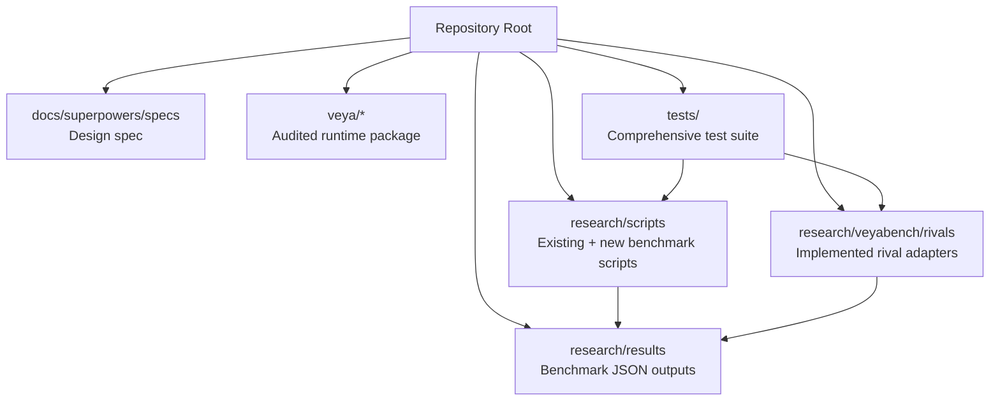

**Diagram sources**
- [2026-09-29-veya-rival-head-to-head-benchmark-design.md:32-38](file://docs/superpowers/specs/2026-09-29-veya-rival-head-to-head-benchmark-design.md#L32-L38)
- [bench_apps.py:39-41](file://research/scripts/bench_apps.py#L39-L41)
- [bench_local.py:35-39](file://research/scripts/bench_local.py#L35-L39)

Key structural constraints are maintained:
- All new code is placed under `research/`.
- No hash-pinned release file is modified.
- Existing engines (`bench_local.metrics`, `bench_apps.build`) are reused instead of forked.
- Case contracts and suite registration patterns are preserved.
- Output goes to `research/results/rival_benchmark.json`, keeping benchmark artifacts alongside existing JSON reports.

**Section sources**
- [2026-09-29-veya-rival-head-to-head-benchmark-design.md:32-57](file://docs/superpowers/specs/2026-09-29-veya-rival-head-to-head-benchmark-design.md#L32-L57)
- [bench_apps.py:39-41](file://research/scripts/bench_apps.py#L39-L41)
- [bench_local.py:35-39](file://research/scripts/bench_local.py#L35-L39)

## Core Components
The implementation centers on a complete set of components that turn any rival model into a measurable participant in the same evaluation loop used by Veya.

| Component | Purpose | Implementation Status |
|---|---|---|
| `Rival` protocol | Defines the contract every rival must implement: availability check, scoring function returning rows and timing, plus shared helpers for state rendering, option ordering, and probability normalization. | **Implemented** in `base.py` |
| NLI rival adapter | Uses Facebook's BART-MNLI zero-shot classification pipeline to map text to option probabilities aligned to the suite's option order. | **Runnable** when transformers installed |
| ST nearest-centroid rival adapter | Embeds premise and options, computes cosine similarity, applies temperature-scaled softmax, and returns a distribution over options. | **Runnable fallback** when sentence-transformers installed |
| Jev / TypeSafe rival adapter | Calls the real TypeSafe SDK when credentials and the SDK are present; otherwise remains dormant and records a skip reason. | **Dormant by design** |
| Driver script | Builds suites once, runs Veya × 3 plus all available rivals, writes JSON output, prints a combined table, and tracks skipped models explicitly. | **Implemented** entry point |
| Plot script | Reads the rival benchmark JSON and produces a grouped accuracy figure plus an ECE panel using the validated brand palette. | **Implemented** visualization tool |

The shared probability-mapping layer is what makes the comparison controlled: every rival, including Veya, is reduced to rows of `(gold_index, probability_vector)` consumed by the same `metrics()` implementation.

**Section sources**
- [2026-09-29-veya-rival-head-to-head-benchmark-design.md:75-141](file://docs/superpowers/specs/2026-09-29-veya-rival-head-to-head-benchmark-design.md#L75-L141)
- [bench_local.py:132-144](file://research/scripts/bench_local.py#L132-L144)

## Architecture Overview
At a high level, the head-to-head benchmark composes existing suite construction, a unified rival interface, and the existing metrics engine.

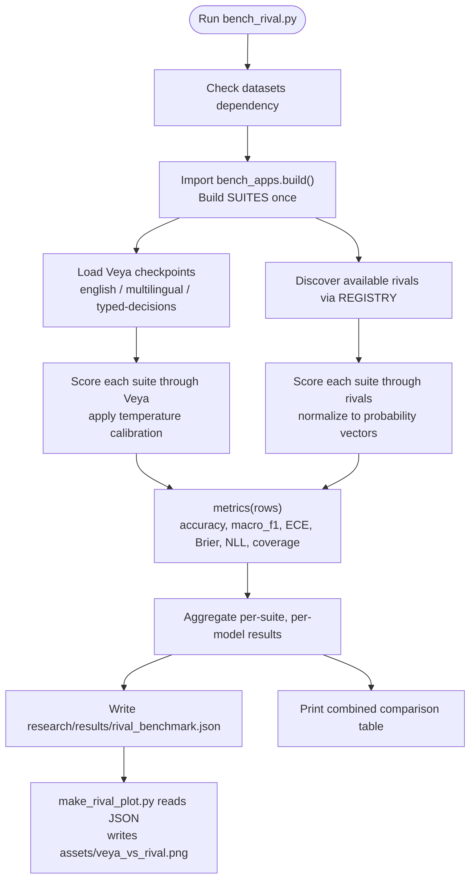

**Diagram sources**
- [2026-09-29-veya-rival-head-to-head-benchmark-design.md:143-180](file://docs/superpowers/specs/2026-09-29-veya-rival-head-to-head-benchmark-design.md#L143-L180)
- [bench_apps.py:72-264](file://research/scripts/bench_apps.py#L72-L264)
- [bench_local.py:132-144](file://research/scripts/bench_local.py#L132-L144)

The architecture deliberately reuses:
- Suite construction via `bench_apps.build()`.
- Case and gold contracts already defined by the existing scripts.
- The `metrics()` function for fairness across models.
- Environment pinning and seed conventions already established in the benchmark scripts.

**Section sources**
- [2026-09-29-veya-rival-head-to-head-benchmark-design.md:39-57](file://docs/superpowers/specs/2026-09-29-veya-rival-head-to-head-benchmark-design.md#L39-L57)
- [bench_apps.py:72-264](file://research/scripts/bench_apps.py#L72-L264)
- [bench_local.py:132-144](file://research/scripts/bench_local.py#L132-L144)

## Detailed Component Analysis

### Rival Protocol and Shared Helpers
The `Rival` protocol defines the minimal interface required for any rival to participate in the benchmark. Each rival must expose:
- A stable name.
- An availability check.
- An unavailable reason string.
- A scoring function that returns rows and elapsed time.

Shared helpers ensure consistent behavior across adapters:
- State rendering flattens structured state into readable text with a character budget.
- Option extraction preserves the exact label order expected by the suites.
- Probability normalization converts raw scores into distributions.
- Row assembly aligns gold indices with the suite's convention.

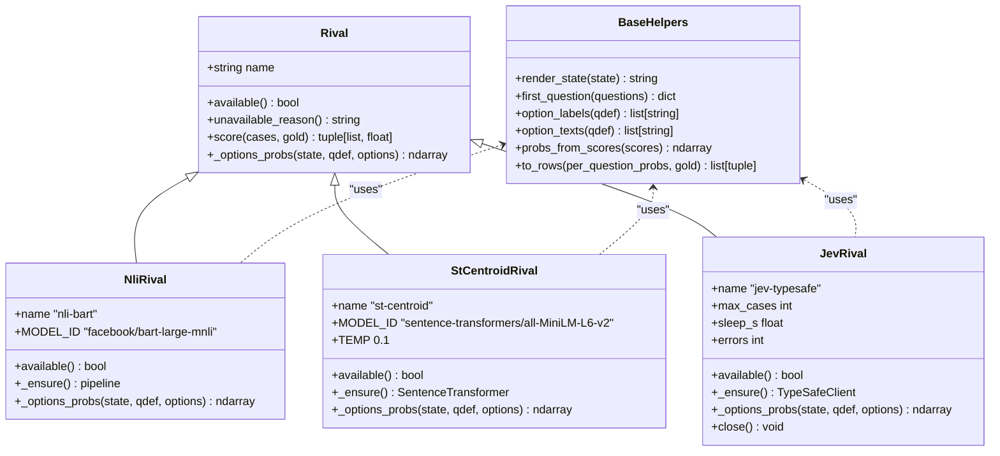

**Diagram sources**
- [base.py:87-122](file://research/veyabench/rivals/base.py#L87-L122)
- [nli.py:15-45](file://research/veyabench/rivals/nli.py#L15-L45)
- [st.py:11-39](file://research/veyabench/rivals/st.py#L11-L39)
- [jev.py:32-102](file://research/veyabench/rivals/jev.py#L32-L102)

**Section sources**
- [base.py:1-122](file://research/veyabench/rivals/base.py#L1-L122)

### NLI Rival Adapter
The NLI rival uses Facebook's BART-MNLI zero-shot classification pipeline. For each question, it constructs a premise from the rendered state and instructions, builds candidate labels from the option texts, and normalizes pipeline scores into a distribution aligned to the option order.

A critical correctness detail is label re-indexing: the pipeline may return scores sorted by score rather than in the original option order, so the adapter must remap them before producing rows.

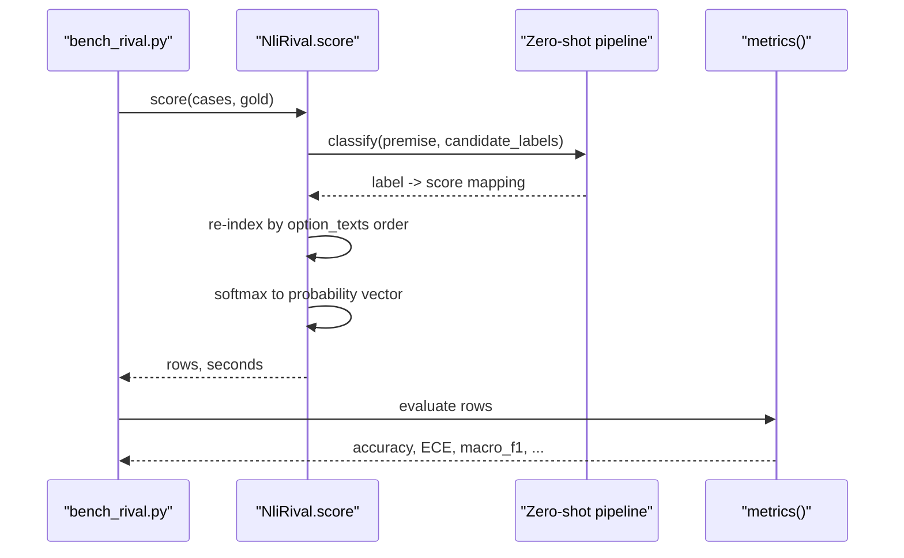

**Diagram sources**
- [nli.py:36-45](file://research/veyabench/rivals/nli.py#L36-L45)

**Section sources**
- [nli.py:1-45](file://research/veyabench/rivals/nli.py#L1-L45)

### ST Nearest-Centroid Rival Adapter
The ST rival is a lighter alternative. It encodes the premise and each option text, computes cosine similarity between the premise embedding and option embeddings, applies a fixed temperature, and returns a normalized distribution over options.

This approach is cheaper and does not require large zero-shot classification models, but it is weaker on nuanced judgments — which is why it is positioned as a fallback.

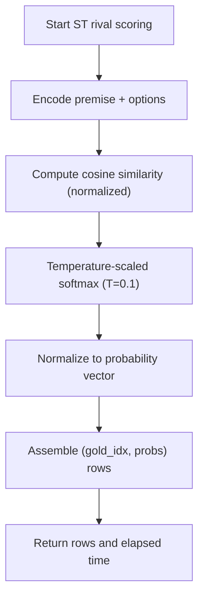

**Diagram sources**
- [st.py:32-39](file://research/veyabench/rivals/st.py#L32-L39)

**Section sources**
- [st.py:1-39](file://research/veyabench/rivals/st.py#L1-L39)

### Jev / TypeSafe Rival Adapter
The Jev adapter is dormant by default. It checks both the presence of the `typesafe_sdk` import and the `TYPESAFE_API_KEY` environment variable. If either is missing, it reports an explicit skip reason and the driver records it as not measured.

When credentials are available, it calls the documented sync API, extracts choice probabilities, noul probability, or per-level score probabilities, and maps them into the same row format used by Veya.

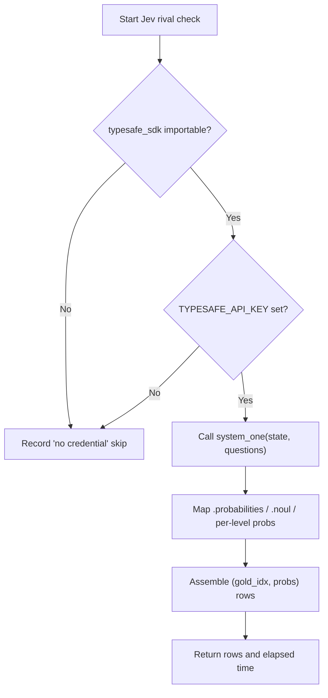

**Diagram sources**
- [jev.py:42-51](file://research/veyabench/rivals/jev.py#L42-L51)
- [jev.py:65-93](file://research/veyabench/rivals/jev.py#L65-L93)

**Section sources**
- [jev.py:1-102](file://research/veyabench/rivals/jev.py#L1-L102)

### Driver and Suite Integration
The driver imports `bench_apps`, calls `build()` once, and iterates over every registered suite. It runs Veya's three checkpoints plus every available rival over the same cases and gold labels.

For Veya, it applies temperature calibration exactly as the existing application benchmark does. For rivals, calibration is measured rather than applied, because rivals produce already-normalized probabilities.

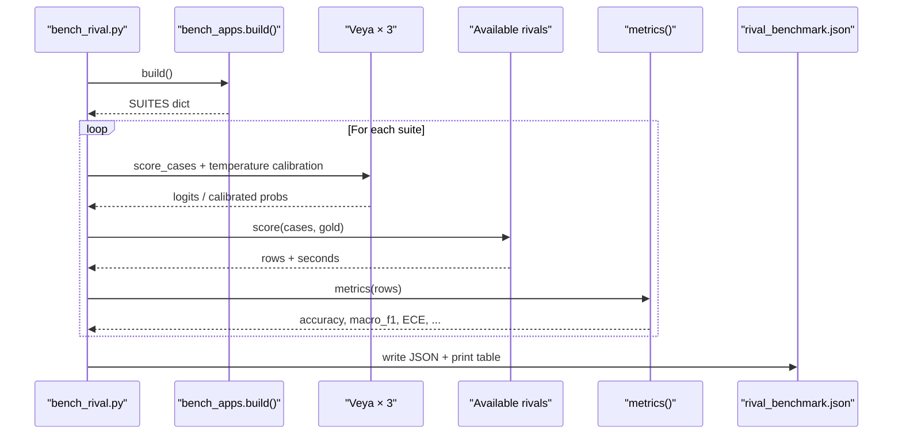

**Diagram sources**
- [bench_rival.py:103-159](file://research/scripts/bench_rival.py#L103-L159)
- [bench_apps.py:72-264](file://research/scripts/bench_apps.py#L72-L264)
- [bench_apps.py:267-297](file://research/scripts/bench_apps.py#L267-L297)

**Section sources**
- [bench_rival.py:1-180](file://research/scripts/bench_rival.py#L1-L180)
- [bench_apps.py:72-264](file://research/scripts/bench_apps.py#L72-L264)
- [bench_apps.py:267-297](file://research/scripts/bench_apps.py#L267-L297)

### Metrics Parity
The design requires parity between Veya and rivals by scoring through the same `metrics()` function. The function computes:
- Accuracy
- Macro F1
- Expected Calibration Error
- Brier score
- Negative log-likelihood
- Mean confidence
- Accuracy at coverage thresholds

This ensures that differences in results come from model behavior, not from different metric implementations.

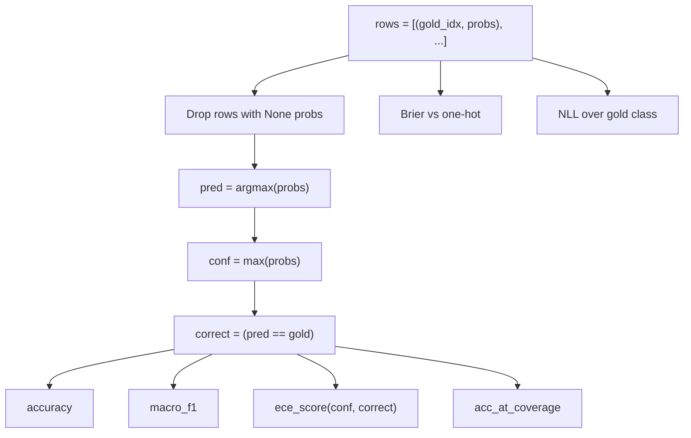

**Diagram sources**
- [bench_local.py:132-144](file://research/scripts/bench_local.py#L132-L144)

**Section sources**
- [bench_local.py:132-144](file://research/scripts/bench_local.py#L132-L144)

## Dependency Analysis
The implementation depends on several layers of existing infrastructure while remaining additive.

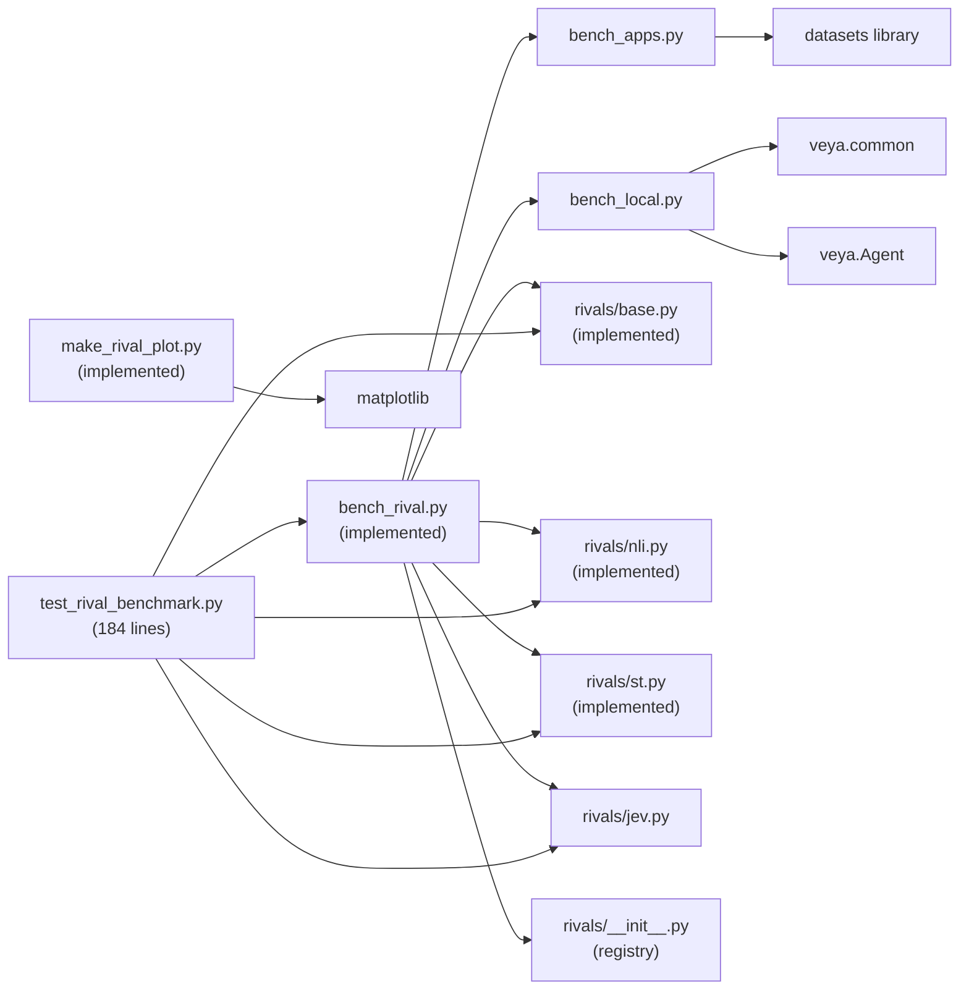

**Diagram sources**
- [bench_rival.py:31-33](file://research/scripts/bench_rival.py#L31-L33)
- [bench_apps.py:32-37](file://research/scripts/bench_apps.py#L32-L37)
- [bench_local.py:29-33](file://research/scripts/bench_local.py#L29-L33)
- [__init__.py:9](file://research/veyabench/rivals/__init__.py#L9)

Key dependency rules are enforced:
- `datasets` is required for suite construction; its absence triggers a clear install hint and early exit.
- Veya checkpoints are optional for the rival-only path; missing checkpoints are skipped gracefully.
- Jev activation requires both the SDK and an API key; otherwise it is recorded as skipped.
- Environment variables disable TensorFlow, enable PyTorch, and disable tokenizer parallelism to avoid known deadlocks.

**Section sources**
- [bench_rival.py:40-44](file://research/scripts/bench_rival.py#L40-L44)
- [bench_apps.py:25-37](file://research/scripts/bench_apps.py#L25-L37)
- [bench_local.py:22-33](file://research/scripts/bench_local.py#L22-L33)

## Performance Considerations
The implementation separates capability measurement from latency measurement. Capability is measured through `metrics(rows)` on identical cases; latency is reported per model and per suite as seconds and milliseconds per case.

Important performance characteristics:
- Veya latency is measured on the machine running the benchmark; cross-device claims are avoided.
- Routing overhead is already analyzed by `bench_latency.py`, which measures language detection, cold model loads, hot routing, cold swaps, and mixed-language workloads.
- The rival benchmark focuses on controlled accuracy and calibration parity; latency is included as metadata, not as a claim about hardware equivalence.
- Large model downloads, such as BART-MNLI, are acknowledged; the ST rival provides a lightweight path without downloading large zero-shot models.

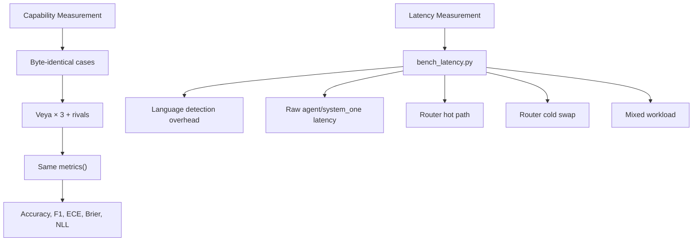

**Section sources**
- [bench_latency.py:66-162](file://research/scripts/bench_latency.py#L66-L162)

## Testing and Validation
The implementation includes a comprehensive test suite with 184 lines of tests ensuring integrity of the benchmarking system. The tests cover all major components and edge cases.

### Test Coverage Areas
- **Probability mapping parity**: Verifies that all rivals produce properly normalized probability vectors
- **Gold-index alignment**: Ensures correct mapping between labels and probability indices
- **NLI label sorting**: Guards against bugs where pipeline returns labels in wrong order
- **Dormancy validation**: Asserts Jev is unavailable without proper credentials
- **Graceful degradation**: Tests clean exits when dependencies are missing
- **Model-specific functionality**: Validates ST centroid calculations and NLI reindexing

### Key Test Scenarios
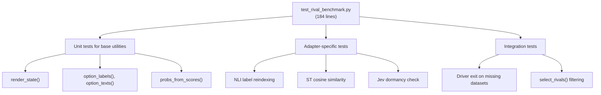

**Diagram sources**
- [test_rival_benchmark.py:1-185](file://tests/test_rival_benchmark.py#L1-L185)

**Section sources**
- [test_rival_benchmark.py:1-185](file://tests/test_rival_benchmark.py#L1-L185)

## Troubleshooting Guide
The implementation emphasizes graceful degradation and explicit reporting of missing capabilities.

| Symptom | Cause | Expected Behavior | Solution |
|---|---|---|---|
| Driver exits with install hint | `datasets` is not installed | Exit code indicates missing dependency; no opaque traceback | Install with `pip install 'veya[train]'` or `pip install datasets` |
| Some suites fail to build | Dataset download or parsing error | Suite logs failure and continues building others | Check network connectivity and dataset availability |
| Veya checkpoint missing | Local model path absent | Model is skipped; rival-only results still produced | Download checkpoints to specified models root |
| Jev shows "not measured" | No `TYPESAFE_API_KEY` or SDK missing | Adapter is dormant; result records skip reason | Set `TYPESAFE_API_KEY` and install `typesafe-sdk` |
| Rival returns empty or partial rows | Single case fails during scoring | Probabilities are dropped; per-suite dropped count recorded | Check input data quality and format |
| Network error during live Jev run | HTTP or rate-limit issue | Per-request error caught; nonzero error count surfaced in metadata | Retry with appropriate backoff or reduce case count |
| NLI model download fails | Transformers not installed or network issues | NLI rival marked as unavailable | Install transformers: `pip install transformers` |
| ST model download fails | Sentence-transformers not installed | ST rival marked as unavailable | Install sentence-transformers: `pip install sentence-transformers` |

The test strategy reinforces these behaviors through comprehensive coverage of all failure modes and edge cases.

**Section sources**
- [bench_rival.py:40-44](file://research/scripts/bench_rival.py#L40-L44)
- [jev.py:42-51](file://research/veyabench/rivals/jev.py#L42-L51)
- [test_rival_benchmark.py:165-185](file://tests/test_rival_benchmark.py#L165-L185)

## Conclusion
The Rival Head-to-Head Benchmark has been successfully implemented as a complete, research-only extension to the Veya benchmarking ecosystem. By introducing a robust `Rival` protocol, runnable local rivals (NLI and ST), a dormant Jev adapter, a comprehensive driver that reuses existing suites and metrics, and explicit skip handling, it preserves the repository's honesty while closing the gap between "Veya measured" and "rival published."

The implementation is intentionally conservative: it adds research-only code, reuses existing engines, avoids modifying audited runtime files, and keeps Veya's routing, latency analysis, and calibration discussion separate from the new rival measurement surface. With 184 lines of comprehensive tests ensuring integrity, the system transforms vague comparative statements into a single controlled experiment where every model answers the same cases through the same metrics pipeline.

The visualization tool generates publication-quality plots using the validated brand palette, making it easy to communicate results effectively. The entire system maintains backward compatibility while providing a foundation for future rival additions and enhanced analysis capabilities.

## Appendices

### Existing Benchmark Scripts Reference
The existing scripts provide the baseline context for the new design:

| Script | Role | Key Outputs | Status |
|---|---|---|---|
| `bench_apps.py` | Builds workflow and Jev-comparable suites | `app_benchmark_results.json` | Existing |
| `bench_local.py` | Extensive local benchmark across languages and typed decisions | `local_benchmark_results.json` | Existing |
| `bench_latency.py` | Measures routing, loading, and inference latency | `latency_benchmark_results.json` | Existing |
| `bench_rival.py` | **New**: Orchestrates head-to-head comparisons | `rival_benchmark.json` | **Implemented** |
| `make_rival_plot.py` | **New**: Generates publication-quality visualizations | `assets/veya_vs_rival.png` | **Implemented** |

**Section sources**
- [bench_apps.py:1-16](file://research/scripts/bench_apps.py#L1-L16)
- [bench_local.py:1-11](file://research/scripts/bench_local.py#L1-L11)
- [bench_rival.py:1-11](file://research/scripts/bench_rival.py#L1-L11)
- [make_rival_plot.py:1-7](file://research/scripts/make_rival_plot.py#L1-L7)

### Visualization Tool Details
The plot generation tool creates publication-quality figures using matplotlib with the validated brand palette. It reads the rival benchmark JSON and produces two-panel visualizations showing accuracy and calibration metrics side by side.

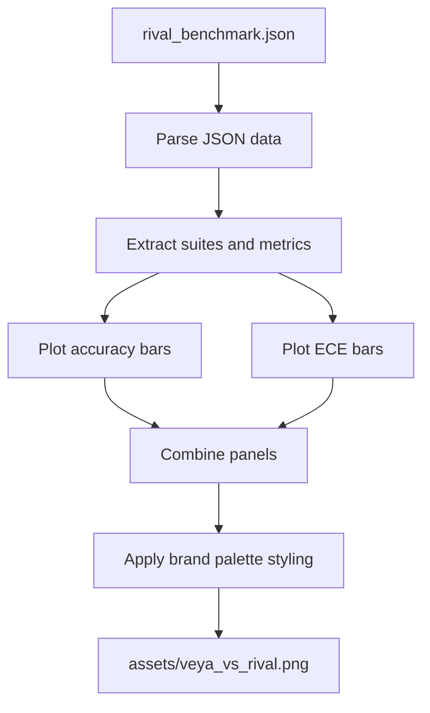

**Diagram sources**
- [make_rival_plot.py:41-81](file://research/scripts/make_rival_plot.py#L41-L81)

**Section sources**
- [make_rival_plot.py:1-81](file://research/scripts/make_rival_plot.py#L1-L81)

### Registry and Discovery Mechanism
The rival discovery mechanism uses a centralized registry pattern that allows for easy addition of new rivals while maintaining consistency across the system.

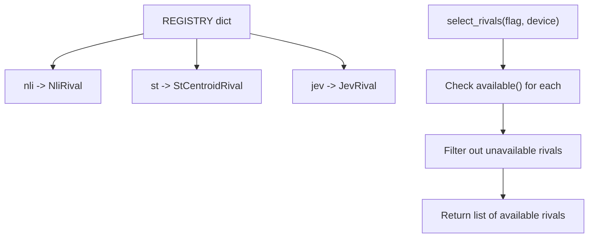

**Diagram sources**
- [__init__.py:9](file://research/veyabench/rivals/__init__.py#L9)
- [bench_rival.py:57-69](file://research/scripts/bench_rival.py#L57-L69)

**Section sources**
- [__init__.py:1-13](file://research/veyabench/rivals/__init__.py#L1-L13)
- [bench_rival.py:57-69](file://research/scripts/bench_rival.py#L57-L69)