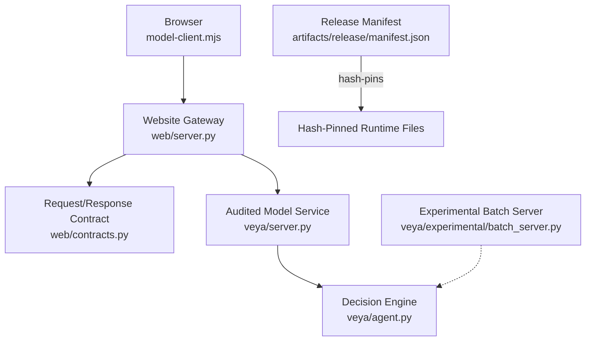
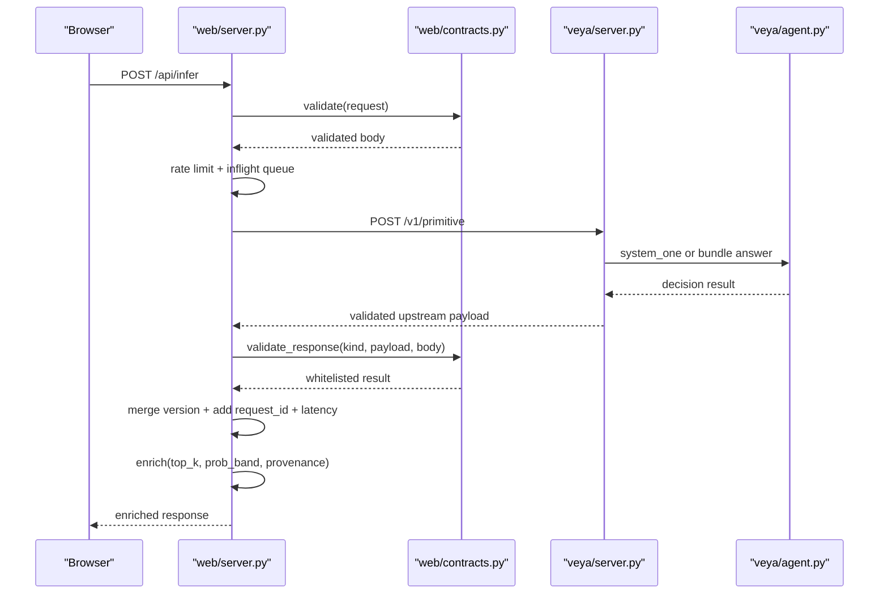
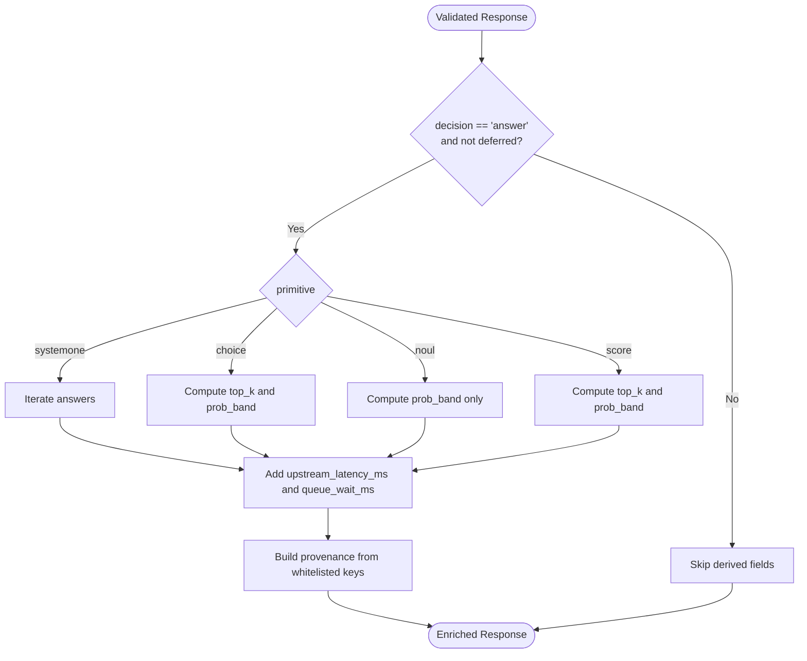
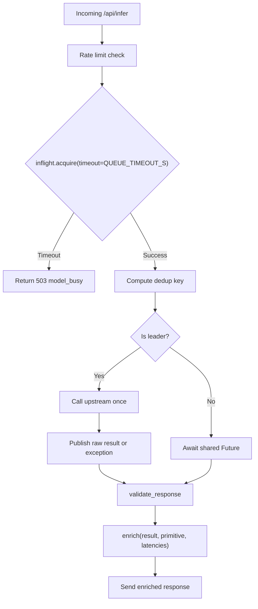
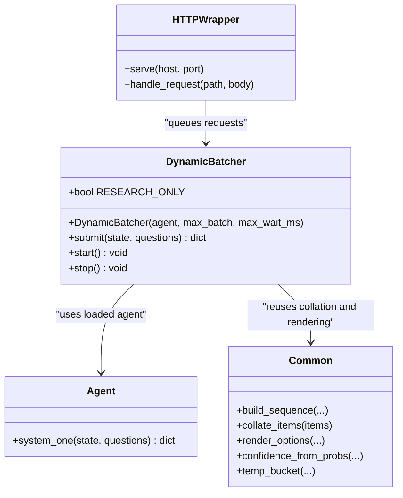
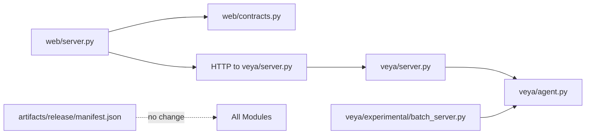

# Track A Runtime API Implementation Plan

<cite>
**Referenced Files in This Document**   
- [README.md](file://README.md)
- [2026-09-29-veya-track-a-runtime-api-design.md](file://docs/superpowers/specs/2026-09-29-veya-track-a-runtime-api-design.md)
- [2026-09-29-veya-track-a-runtime-api.md](file://docs/superpowers/plans/2026-09-29-veya-track-a-runtime-api.md)
- [server.py](file://veya/server.py)
- [model_server.py](file://web/model_server.py)
- [server.py](file://web/server.py)
- [contracts.py](file://web/contracts.py)
- [agent.py](file://veya/agent.py)
- [__init__.py](file://veya/__init__.py)
- [manifest.json](file://artifacts/release/manifest.json)
</cite>

## Table of Contents
1. [Introduction](#introduction)
2. [Project Structure](#project-structure)
3. [Core Components](#core-components)
4. [Architecture Overview](#architecture-overview)
5. [Detailed Component Analysis](#detailed-component-analysis)
6. [Dependency Analysis](#dependency-analysis)
7. [Performance Considerations](#performance-considerations)
8. [Troubleshooting Guide](#troubleshooting-guide)
9. [Conclusion](#conclusion)
10. [Appendices](#appendices)

## Introduction
This document describes the Track A runtime and API advancement plan for the Veya decision engine. The goal is to improve the developer-facing gateway response, make concurrent request handling more graceful, and introduce a research-only experimental batch server — without modifying any hash-pinned audited runtime files or the release manifest.

The plan is split into three parts:
- Part A: richer gateway responses derived from already-validated upstream data.
- Part B: bounded wait-queue concurrency grace and identical-request dedup coalescing.
- Part C: an experimental cross-state dynamic batcher under `veya/experimental/`, explicitly not wired into the audited path.

The project’s current production surface is a website gateway (`web/server.py`) that validates requests, forwards them to an audited model service (`veya/server.py`), and returns a constrained response envelope. The frozen release bundle is pinned by `artifacts/release/manifest.json`, which hashes every audited `veya/*.py` file.

**Section sources**
- [README.md:27-46](file://README.md#L27-L46)
- [2026-09-29-veya-track-a-runtime-api-design.md:1-27](file://docs/superpowers/specs/2026-09-29-veya-track-a-runtime-api-design.md#L1-L27)
- [2026-09-29-veya-track-a-runtime-api.md:1-23](file://docs/superpowers/plans/2026-09-29-veya-track-a-runtime-api.md#L1-L23)

## Project Structure
Track A work stays outside the audited runtime bundle:
- Audited runtime files are listed in `artifacts/release/manifest.json` under `runtime_files`.
- The website gateway lives in `web/`, which is not in `runtime_files`.
- Experimental acceleration belongs in `veya/experimental/`, also not referenced by the audited load path.

**Diagram sources**
- [server.py:408-543](file://web/server.py#L408-L543)
- [contracts.py:121-348](file://web/contracts.py#L121-L348)
- [server.py:137-235](file://veya/server.py#L137-L235)
- [agent.py:101-200](file://veya/agent.py#L101-L200)
- [manifest.json:27-43](file://artifacts/release/manifest.json#L27-L43)

**Section sources**
- [2026-09-29-veya-track-a-runtime-api-design.md:28-50](file://docs/superpowers/specs/2026-09-29-veya-track-a-runtime-api-design.md#L28-L50)
- [2026-09-29-veya-track-a-runtime-api.md:13-23](file://docs/superpowers/plans/2026-09-29-veya-track-a-runtime-api.md#L13-L23)
- [manifest.json:27-43](file://artifacts/release/manifest.json#L27-L43)

## Core Components
Track A touches these core components:

| Component | Role | Track A Impact |
|---|---|---|
| Website gateway | Validates browser input, rate-limits, forwards to model service, enriches response | Add enrichment helpers, bounded queue, dedup coalescing |
| Request/response contract | Defines allowed primitives, state size, criteria, and validated response shape | Used as input/output boundary; enrichment derives from validated fields |
| Audited model service | Serves `/v1/*` endpoints with one inference lock | Read-only for Track A |
| Decision engine agent | Loads checkpoint, builds sequences, runs forward pass | Read-only for Track A |
| Release manifest | Hash-pins audited runtime files | Must remain unchanged |
| Experimental batch server | Research-only dynamic batching and optional CPU acceleration | New module under `veya/experimental/` |

**Section sources**
- [server.py:408-647](file://web/server.py#L408-L647)
- [contracts.py:14-348](file://web/contracts.py#L14-L348)
- [server.py:1-243](file://veya/server.py#L1-L243)
- [agent.py:101-200](file://veya/agent.py#L101-L200)
- [manifest.json:27-43](file://artifacts/release/manifest.json#L27-L43)

## Architecture Overview
The production request flow remains:
1. Browser sends `/api/infer` with primitive, state, instructions, and criteria or questions.
2. Gateway validates through `web/contracts.validate`.
3. Gateway applies per-IP rate limiting.
4. Gateway acquires inflight capacity.
5. Gateway calls upstream `/v1/<primitive>`.
6. Gateway validates the upstream response through `validate_response`.
7. Gateway merges version metadata and adds product name, request ID, and total latency.
8. Track A adds additive enrichment: top-k options, confidence band, split latency, and provenance.

**Diagram sources**
- [server.py:408-543](file://web/server.py#L408-L543)
- [contracts.py:121-348](file://web/contracts.py#L121-L348)
- [server.py:173-235](file://veya/server.py#L173-L235)
- [agent.py:101-200](file://veya/agent.py#L101-L200)

## Detailed Component Analysis

### Part A: Gateway Richer Responses
Part A introduces gateway-side enrichment without changing the upstream contract. The spec defines four additive response features:
- Top-k options for `choice` and `score`.
- Wilson-score confidence band around the reported probability.
- Split latency metrics: `upstream_latency_ms`, `queue_wait_ms`, plus retained `gateway_latency_ms`.
- Consolidated `provenance` object containing calibration, route, reranker, model, release, and architecture metadata.

The implementation plan proposes a pure helper module at `web/enrich.py` that:
- Computes `top_k` from validated probabilities.
- Computes `prob_band` using a local Wilson interval formula.
- Adds latency and provenance fields.
- Never raises during enrichment so derivation failures do not fail the request.

**Diagram sources**
- [2026-09-29-veya-track-a-runtime-api-design.md:52-98](file://docs/superpowers/specs/2026-09-29-veya-track-a-runtime-api-design.md#L52-L98)
- [2026-09-29-veya-track-a-runtime-api.md:42-268](file://docs/superpowers/plans/2026-09-29-veya-track-a-runtime-api.md#L42-L268)

Key constraints:
- Enrichment is additive only.
- The gateway must not import hash-pinned `veya` modules.
- Confidence bands are labeled indicative, not production automation guarantees.
- Existing top-level provenance-like fields are retained for backward compatibility.

**Section sources**
- [2026-09-29-veya-track-a-runtime-api-design.md:52-98](file://docs/superpowers/specs/2026-09-29-veya-track-a-runtime-api-design.md#L52-L98)
- [2026-09-29-veya-track-a-runtime-api.md:42-268](file://docs/superpowers/plans/2026-09-29-veya-track-a-runtime-api.md#L42-L268)

### Part B: Gateway Concurrency Grace
Part B replaces the hard `503 model_busy` rejection on the third concurrent request with a bounded wait-queue and adds identical-request dedup coalescing.

Current behavior:
- `MAX_INFLIGHT = 2`.
- `inflight.acquire(blocking=False)` rejects immediately when no slot is available.
- The upstream process serializes inference via `_INFER_LOCK`.

Planned behavior:
- Replace non-blocking acquire with `inflight.acquire(blocking=True, timeout=QUEUE_TIMEOUT_S)`.
- Default `QUEUE_TIMEOUT_S = 2.0`, overridable via `VEYA_QUEUE_TIMEOUT_S`.
- Record `queue_wait_ms` for timing breakdown.
- Deduplicate identical validated requests by canonical JSON key.
- Leader issues one upstream call; waiters reuse the future result.
- Each waiter still gets its own `request_id` and independently validates/enriches.

**Diagram sources**
- [2026-09-29-veya-track-a-runtime-api-design.md:99-127](file://docs/superpowers/specs/2026-09-29-veya-track-a-runtime-api-design.md#L99-L127)
- [2026-09-29-veya-track-a-runtime-api.md:525-750](file://docs/superpowers/plans/2026-09-29-veya-track-a-runtime-api.md#L525-L750)
- [server.py:76-82](file://web/server.py#L76-L82)
- [server.py:496-520](file://web/server.py#L496-L520)

Important safety notes:
- Dedup is best-effort; if the map is full or a race misses, the request falls back to a normal call.
- Queue timeout retains existing error semantics.
- Rate limiting is unchanged and operates before queueing.

**Section sources**
- [2026-09-29-veya-track-a-runtime-api-design.md:99-127](file://docs/superpowers/specs/2026-09-29-veya-track-a-runtime-api-design.md#L99-L127)
- [2026-09-29-veya-track-a-runtime-api.md:525-750](file://docs/superpowers/plans/2026-09-29-veya-track-a-runtime-api.md#L525-L750)
- [server.py:76-82](file://web/server.py#L76-L82)
- [server.py:496-520](file://web/server.py#L496-L520)

### Part C: Experimental Accelerated Server
Part C introduces a research-only dynamic batch server under `veya/experimental/`. It is not imported by the audited load path and does not affect the release manifest.

Capabilities:
- Exposes the same `/v1/*` surface as `veya/server.py` for local comparison.
- Background worker batches `(state, question)` items up to `MAX_BATCH` or until `MAX_WAIT_MS` elapses.
- Uses `common.collate_items` to build one padded forward across different states.
- Requires numerical parity between batched output and serial `Agent.system_one`.
- Optional int8 dynamic quantization and ONNX export are flag-gated and disabled by default.
- Heavy dependencies like `torch`, `onnx`, and `onnxruntime` are imported lazily.

**Diagram sources**
- [2026-09-29-veya-track-a-runtime-api-design.md:128-161](file://docs/superpowers/specs/2026-09-29-veya-track-a-runtime-api-design.md#L128-L161)
- [2026-09-29-veya-track-a-runtime-api.md:754-800](file://docs/superpowers/plans/2026-09-29-veya-track-a-runtime-api.md#L754-L800)
- [agent.py:101-200](file://veya/agent.py#L101-L200)

Guardrails:
- Module docstring and `/version` banner mark it research-only.
- No import from `veya/__init__.py`, `veya/server.py`, `veya/release_bundle.py`, or `web/`.
- Accuracy and latency parity tests compare against fp32 baseline within documented tolerance.

**Section sources**
- [2026-09-29-veya-track-a-runtime-api-design.md:128-161](file://docs/superpowers/specs/2026-09-29-veya-track-a-runtime-api-design.md#L128-L161)
- [2026-09-29-veya-track-a-runtime-api.md:754-800](file://docs/superpowers/plans/2026-09-29-veya-track-a-runtime-api.md#L754-L800)

### Static Client Rendering
The static client should render new fields when present and degrade gracefully when absent:
- Extend `VeyaResponse` typedef with optional `top_k`, `prob_band`, `provenance`, `upstream_latency_ms`, and `queue_wait_ms`.
- Render top-k options and indicative confidence band in the playground.
- Feature-detect so older unenriched responses still render.

**Section sources**
- [2026-09-29-veya-track-a-runtime-api-design.md:94-98](file://docs/superpowers/specs/2026-09-29-veya-track-a-runtime-api-design.md#L94-L98)
- [2026-09-29-veya-track-a-runtime-api.md:448-521](file://docs/superpowers/plans/2026-09-29-veya-track-a-runtime-api.md#L448-L521)

## Dependency Analysis
Track A enforces strict dependency direction:
- `web/server.py` talks to `veya/server.py` over HTTP.
- `web/contracts.py` defines the public contract but does not import audited runtime code.
- `veya/experimental/batch_server.py` may import stable core functions, but stable core must never import experimental code.
- `artifacts/release/manifest.json` remains unchanged.

**Diagram sources**
- [server.py:23-30](file://web/server.py#L23-L30)
- [server.py:137-235](file://veya/server.py#L137-L235)
- [agent.py:101-200](file://veya/agent.py#L101-L200)
- [manifest.json:27-43](file://artifacts/release/manifest.json#L27-L43)

**Section sources**
- [2026-09-29-veya-track-a-runtime-api-design.md:28-50](file://docs/superpowers/specs/2026-09-29-veya-track-a-runtime-api-design.md#L28-L50)
- [2026-09-29-veya-track-a-runtime-api.md:13-23](file://docs/superpowers/plans/2026-09-29-veya-track-a-runtime-api.md#L13-L23)

## Performance Considerations
Track A performance goals:
- Keep single-request behavior unchanged where possible.
- Reduce immediate `503 model_busy` rejections by allowing bounded waiting.
- Avoid duplicate upstream calls for identical concurrent requests.
- Provide latency breakdown so consumers can distinguish queue wait time from upstream inference time.
- Ensure experimental batcher parity tests catch regression in numerical output.

Existing measurements show fast per-question latency and strong batch throughput on GPU. Track A does not change the underlying model; it improves how requests are admitted, deduplicated, and observed.

**Section sources**
- [README.md:277-290](file://README.md#L277-L290)
- [2026-09-29-veya-track-a-runtime-api-design.md:80-98](file://docs/superpowers/specs/2026-09-29-veya-track-a-runtime-api-design.md#L80-L98)
- [2026-09-29-veya-track-a-runtime-api.md:195-209](file://docs/superpowers/plans/2026-09-29-veya-track-a-runtime-api.md#L195-L209)

## Troubleshooting Guide
Common operational scenarios under Track A:

| Symptom | Likely Cause | Expected Behavior |
|---|---|---|
| Third concurrent request returns `503 model_busy` quickly | Non-blocking inflight acquire was used | With Track A, request waits up to `QUEUE_TIMEOUT_S`; timeout still returns `503 model_busy` with `Retry-After`. |
| Identical concurrent requests issue multiple upstream calls | Dedup coalescing not implemented | After Part B, identical validated bodies share one upstream call; each caller gets a distinct `request_id`. |
| Enriched fields missing | Older gateway or enrichment failed defensively | Enrichment is best-effort; missing derived fields do not fail the request. |
| Confidence band looks wide | Low effective sample size or extreme probability | Band is indicative; it reflects assumed calibration support, not a production guarantee. |
| Experimental batcher fails parity test | Padding leaked, attention mask incorrect, or batch order mismatch | Parity test compares batched vs serial `system_one` output within tight tolerance. |
| Release manifest verification fails | Accidental edit to hash-pinned runtime file | Do not modify `veya/*.py` files listed in `runtime_files`. |

**Section sources**
- [2026-09-29-veya-track-a-runtime-api-design.md:183-209](file://docs/superpowers/specs/2026-09-29-veya-track-a-runtime-api-design.md#L183-L209)
- [2026-09-29-veya-track-a-runtime-api.md:195-209](file://docs/superpowers/plans/2026-09-29-veya-track-a-runtime-api.md#L195-L209)
- [manifest.json:27-43](file://artifacts/release/manifest.json#L27-L43)

## Conclusion
Track A advances Veya’s runtime and API surface while preserving the audited release bundle. The most important boundaries are:
- Production changes live in `web/`.
- Response changes are additive.
- The gateway does not import hash-pinned runtime modules.
- Experimental acceleration is clearly separated and not part of the release path.
- Tests must verify backward compatibility, manifest integrity, and numerical parity for the experimental batcher.

When implemented correctly, consumers get richer observability, more graceful concurrency, and a safe research path for dynamic batching — without weakening the audit contract.

[No sources needed since this section summarizes without analyzing specific files]

## Appendices

### API Surface Summary
| Endpoint | Direction | Purpose |
|---|---|---|
| `POST /api/infer` | Browser → Gateway | Typed decision request |
| `GET /api/health` | Browser → Gateway | Proxy health check |
| `GET /api/version` | Browser → Gateway | Proxy version metadata |
| `POST /v1/choice` | Gateway → Model | Choice decision |
| `POST /v1/noul` | Gateway → Model | Binary calibrated probability |
| `POST /v1/score` | Gateway → Model | Categorical score distribution |
| `POST /v1/systemone` | Gateway → Model | Multi-question batch |
| `GET /version` | Internal | Model version and release metadata |

**Section sources**
- [server.py:408-647](file://web/server.py#L408-L647)
- [server.py:163-235](file://veya/server.py#L163-L235)

### Constraint Checklist
- Do not modify hash-pinned `veya/*.py` files.
- Do not modify `artifacts/release/manifest.json`.
- Additive response fields only.
- Gateway must not import `veya` modules.
- Experimental modules may import stable core; stable core must not import experimental modules.
- Heavy dependencies imported lazily.
- No state text or candidate text in logs.
- Tunable constants follow spec defaults unless overridden by environment.

**Section sources**
- [2026-09-29-veya-track-a-runtime-api.md:13-23](file://docs/superpowers/plans/2026-09-29-veya-track-a-runtime-api.md#L13-L23)