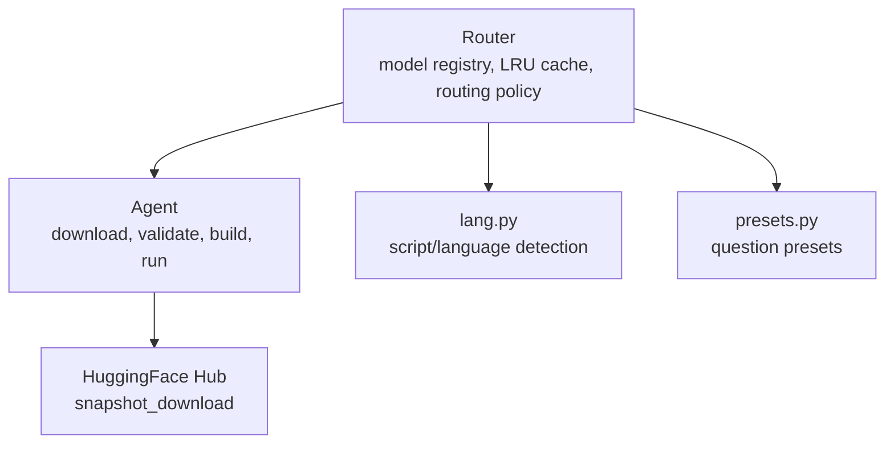
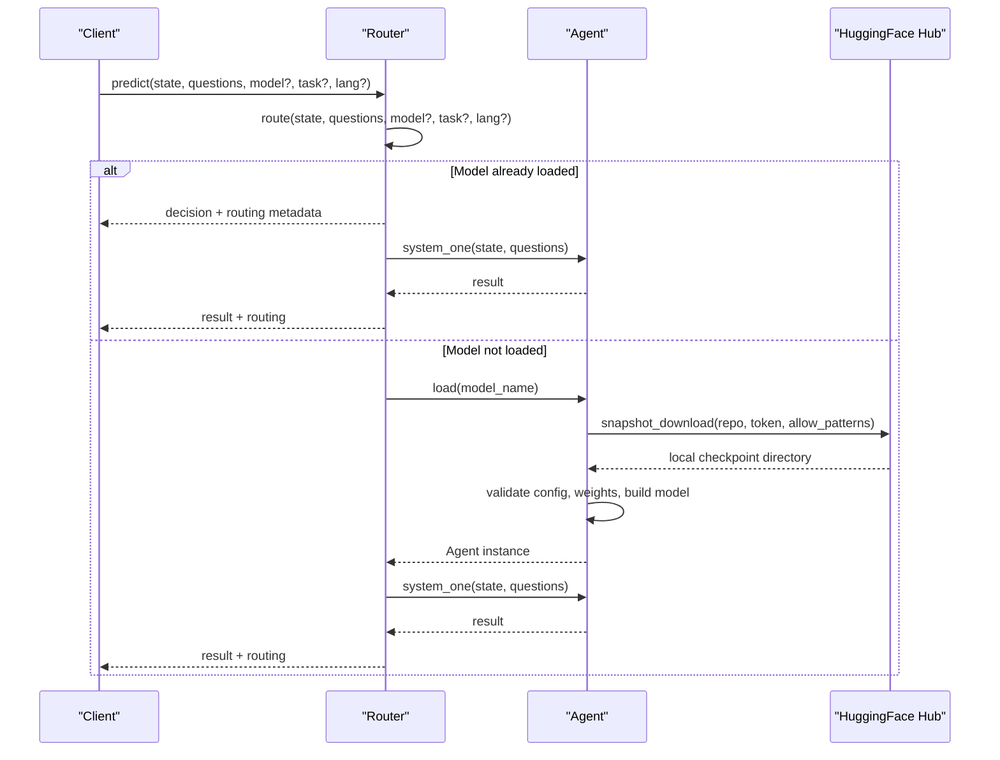
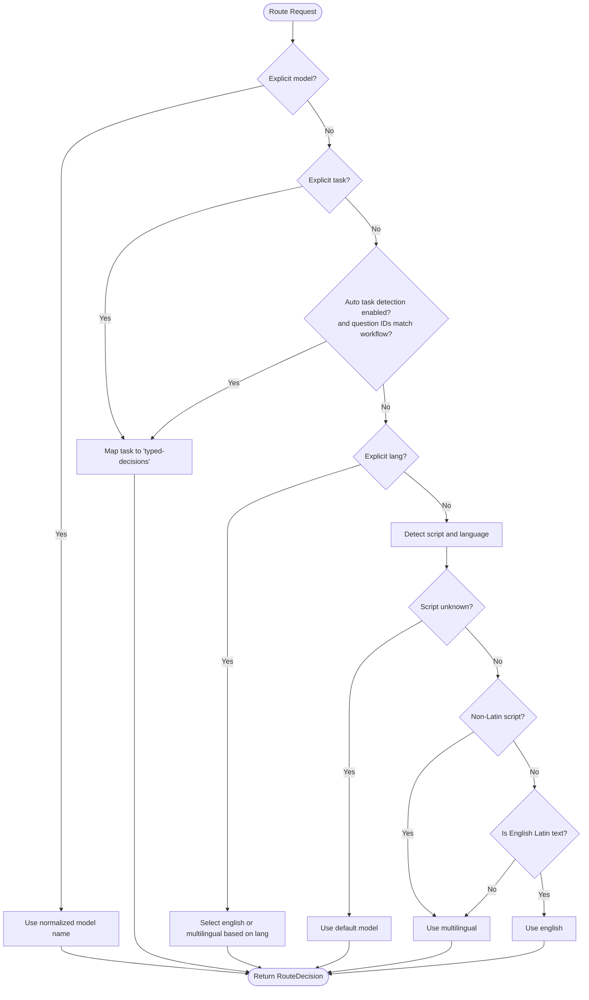
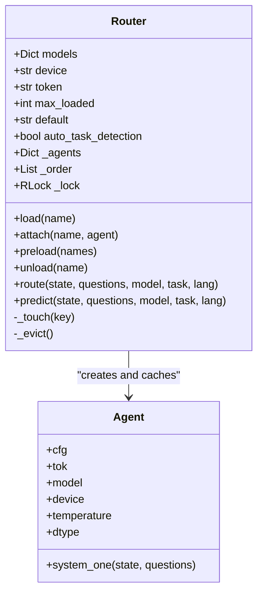
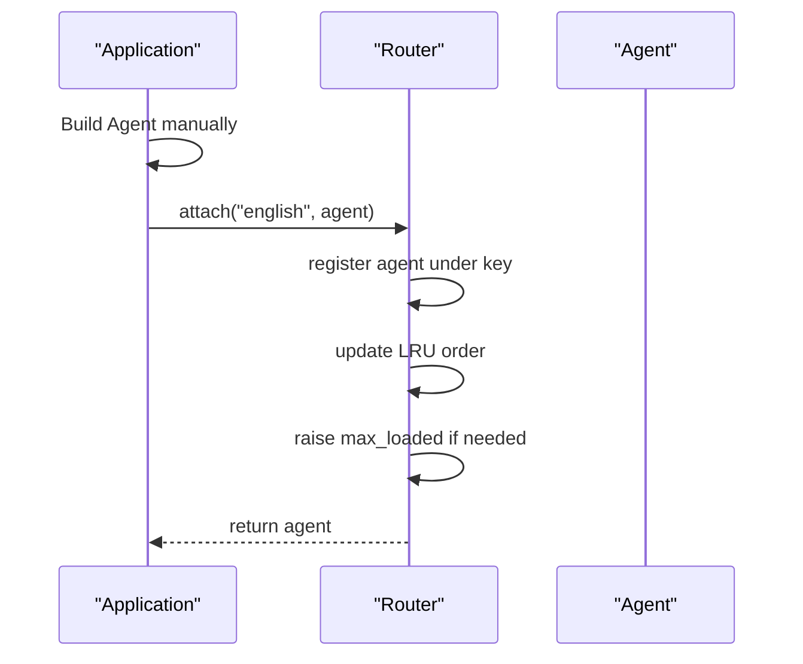
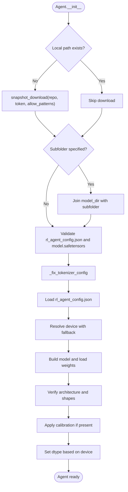
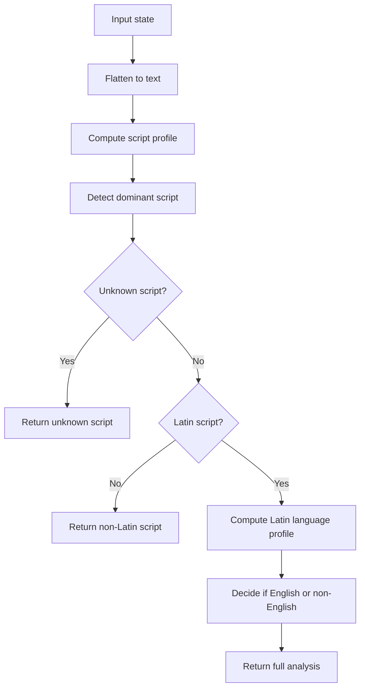
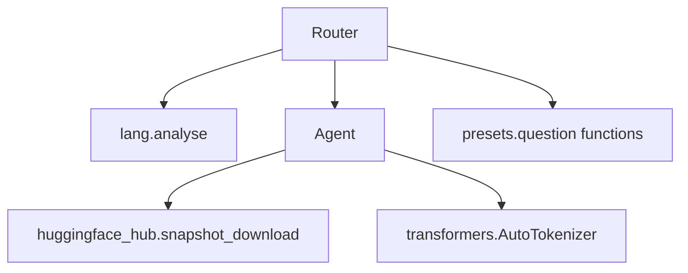

# Checkpoint Management & Loading

<cite>
**Referenced Files in This Document**
- [router.py](file://veya/router.py)
- [agent.py](file://veya/agent.py)
- [lang.py](file://veya/lang.py)
- [presets.py](file://veya/presets.py)
- [test_download.py](file://tests/test_download.py)
</cite>

## Table of Contents
1. [Introduction](#introduction)
2. [Project Structure](#project-structure)
3. [Core Components](#core-components)
4. [Architecture Overview](#architecture-overview)
5. [Detailed Component Analysis](#detailed-component-analysis)
6. [Dependency Analysis](#dependency-analysis)
7. [Performance Considerations](#performance-considerations)
8. [Troubleshooting Guide](#troubleshooting-guide)
9. [Conclusion](#conclusion)

## Introduction
This document explains Veya’s checkpoint management and loading system, focusing on how the Router selects among three model checkpoints, how models are lazily downloaded from HuggingFace Hub, and how existing Agent instances can be shared through `attach()`. It also covers model aliases, repository configuration options, token-based authentication for private models, custom model registration, multi-repository setups, and common loading issues such as network timeouts and permission errors.

The three production checkpoints are:
- `english`: optimized for English Latin text with a 512-token context window.
- `multilingual`: supports more than 100 languages and a 1024-token context window.
- `typed-decisions`: fine-tuned for four synthetic typed-decision workflows; it is not selected automatically unless explicitly opted in.

Routing decisions are based on explicit selection, task detection, language hints, or script/language analysis. The default behavior prefers the English checkpoint for safe English Latin text and falls back to multilingual otherwise.

## Project Structure
Checkpoint-related logic lives primarily in two modules:
- `veya/router.py` defines the Router, its model registry, aliases, LRU caching, and routing policy.
- `veya/agent.py` implements the Agent runtime that downloads, validates, builds, and runs a single Veya checkpoint.
- `veya/lang.py` provides dependency-free script and language detection used by the Router.
- `veya/presets.py` provides ready-to-use question schemas that often accompany Router usage.
- `tests/test_download.py` verifies download filtering, subfolder selection, and token propagation.

**Diagram sources**
- [router.py:123-337](file://veya/router.py#L123-L337)
- [agent.py:101-432](file://veya/agent.py#L101-L432)
- [lang.py:1-266](file://veya/lang.py#L1-L266)
- [presets.py:1-188](file://veya/presets.py#L1-L188)

**Section sources**
- [router.py:1-337](file://veya/router.py#L1-L337)
- [agent.py:1-432](file://veya/agent.py#L1-L432)
- [lang.py:1-266](file://veya/lang.py#L1-L266)
- [presets.py:1-188](file://veya/presets.py#L1-L188)

## Core Components
- **Router**: Manages model names, aliases, repository mappings, lazy loading, LRU eviction, preloading, and routing decisions.
- **Agent**: Loads a single checkpoint from a local path or HuggingFace Hub, validates compatibility, builds the model, and executes inference.
- **Language Detection**: Determines whether input is English Latin text, non-Latin script, or unknown, guiding automatic routing.
- **Presets**: Provide standardized question definitions commonly used with Router.predict().

Key responsibilities:
- Router normalizes model names, resolves repositories, and ensures only one Agent instance per model name is resident.
- Agent handles device selection, tokenizer configuration fixes, weight verification, and graceful fallbacks when GPU memory is insufficient.
- Language detection avoids sending non-Latin or non-English Latin text to the English checkpoint.

**Section sources**
- [router.py:36-71](file://veya/router.py#L36-L71)
- [router.py:123-337](file://veya/router.py#L123-L337)
- [agent.py:101-263](file://veya/agent.py#L101-L263)
- [lang.py:106-238](file://veya/lang.py#L106-L238)

## Architecture Overview
The Router acts as a gateway between user requests and specific Veya checkpoints. It decides which checkpoint to use, loads it lazily if needed, and forwards the request to the corresponding Agent.

**Diagram sources**
- [router.py:257-333](file://veya/router.py#L257-L333)
- [agent.py:120-197](file://veya/agent.py#L120-L197)

## Detailed Component Analysis

### Router: Model Registry, Aliases, and Routing Policy
The Router maintains:
- A default mapping of model names to bundled repositories and optional subfolders.
- A standalone mapping where each model has its own repository.
- A set of aliases (e.g., `en`, `multi`, `typed`) that normalize user input.
- An LRU cache of loaded Agent instances controlled by `max_loaded`.
- Optional automatic task detection for the `typed-decisions` workflow.

Model specification formats:
- Bundled repos: `(repo, subfolder)` tuples map multiple checkpoints into one repository.
- Standalone repos: plain repository strings map one checkpoint per repository.

Repository configuration options:
- `models`: override or extend the default mapping.
- `standalone_repos`: switch from bundled to standalone repository resolution.
- `preload`: eagerly load specified or all models at startup.
- `max_loaded`: cap the number of resident checkpoints; least-recently-used is evicted.
- `device`: target device (`cuda`, `mps`, `cpu`) with automatic fallback.
- `token`: HuggingFace token for private repositories; falls back to `HF_TOKEN`.
- `default`: default model when no letters are detected.
- `auto_task_detection`: enable automatic selection of `typed-decisions` based on question IDs.

Routing precedence:
1. Explicit `model`.
2. Explicit `task` (maps to `typed-decisions`).
3. Detected workflow (only when `auto_task_detection=True`).
4. Explicit `lang`.
5. Script/language detection via `lang.analyse`.
6. Default model.

**Diagram sources**
- [router.py:257-312](file://veya/router.py#L257-L312)
- [lang.py:209-238](file://veya/lang.py#L209-L238)

**Section sources**
- [router.py:36-71](file://veya/router.py#L36-L71)
- [router.py:123-337](file://veya/router.py#L123-L337)
- [lang.py:106-238](file://veya/lang.py#L106-L238)

### Lazy Loading and LRU Caching
The Router delays model construction until first use. When `load(name)` is called:
- It normalizes the model name.
- If the Agent is already cached, it updates the LRU order and returns the existing instance.
- Otherwise, it constructs an Agent using the resolved repository and subfolder.
- It adds the new Agent to the cache and evicts the least-recently-used entries if the cache exceeds `max_loaded`.

Concurrency is protected by a reentrant lock so concurrent callers share a single Agent rather than building duplicates. Inference itself is intentionally outside the lock to avoid serializing predictions.

**Diagram sources**
- [router.py:123-254](file://veya/router.py#L123-L254)
- [agent.py:101-263](file://veya/agent.py#L101-L263)

**Section sources**
- [router.py:174-254](file://veya/router.py#L174-L254)

### attach(): Sharing Existing Agent Instances
The `attach(name, agent)` method registers an already-built Agent under a given name without downloading or constructing another copy. This is useful when:
- A demo or server already instantiated a checkpoint directly.
- Multiple components need access to the same Agent instance.
- Memory must be conserved by avoiding duplicate model parameters.

When attaching, the Router updates the LRU order and raises `max_loaded` if necessary to keep attached agents resident.

**Diagram sources**
- [router.py:209-221](file://veya/router.py#L209-L221)

**Section sources**
- [router.py:209-221](file://veya/router.py#L209-L221)

### Agent: Downloading, Validation, and Execution
The Agent constructor performs:
- Local path validation.
- Conditional HuggingFace Hub download using `snapshot_download` with filtered patterns to avoid downloading sibling checkpoints.
- Subfolder resolution when bundling multiple checkpoints in one repository.
- Tokenizer configuration repair for compatibility across transformers versions.
- Configuration and weight existence checks.
- Device resolution with automatic fallback to CPU when CUDA/MPS is unavailable or memory is insufficient.
- Model construction and strict weight-shape verification.
- Calibration loading when present.
- Dtype selection based on device capability.

Inference uses a single forward pass over all questions, applies temperature scaling, computes probabilities, and returns structured answers with confidence scores.

**Diagram sources**
- [agent.py:101-263](file://veya/agent.py#L101-L263)

**Section sources**
- [agent.py:101-263](file://veya/agent.py#L101-L263)

### Language Detection and Routing Signals
The language module provides:
- Script detection using Unicode ranges.
- Latin-script language guessing using stopwords and diacritic rates.
- Full analysis returning script, language, English likelihood, and non-Latin fraction.

Routing relies on these signals to avoid sending non-Latin or non-English Latin text to the English checkpoint, which cannot read those scripts reliably.

**Diagram sources**
- [lang.py:106-238](file://veya/lang.py#L106-L238)

**Section sources**
- [lang.py:106-238](file://veya/lang.py#L106-L238)

### Model Aliases and Repository Configuration
Aliases simplify user input:
- `en`, `veya`, `default` map to `english`.
- `multi`, `ml`, `veya-multilingual` map to `multilingual`.
- `typed`, `typed_decisions`, `veya-typed-decisions`, `decisions` map to `typed-decisions`.

Repository configuration options include:
- `models`: custom mapping of normalized names to repository specs.
- `standalone_repos`: choose standalone repositories instead of bundled ones.
- `preload`: preload specific or all models.
- `max_loaded`: control resident model count.
- `device`: target device.
- `token`: HuggingFace token.
- `default`: default model for unknown inputs.
- `auto_task_detection`: enable automatic typed-decisions selection.

**Section sources**
- [router.py:36-71](file://veya/router.py#L36-L71)
- [router.py:145-173](file://veya/router.py#L145-L173)

### Custom Model Registration and Multi-Repository Setups
Custom model registration:
- Pass `models={"my_model": ("org/repo", "subfolder")}` to Router to add or override mappings.
- Use `normalise_name` internally to ensure alias consistency.

Multi-repository setups:
- Use `standalone_repos=True` to map each model to its own repository.
- Combine bundled and standalone configurations by overriding `models` after initialization.

Examples:
- Register a custom checkpoint under a friendly name.
- Serve both bundled and standalone repositories by mixing defaults and overrides.

**Section sources**
- [router.py:36-71](file://veya/router.py#L36-L71)
- [router.py:145-173](file://veya/router.py#L145-L173)

### Token-Based Authentication for Private Models
Authentication is handled by passing a token to Router and Agent:
- Router stores `token` or reads `HF_TOKEN` from the environment.
- Agent passes the token to `snapshot_download`.
- Tests verify that the token is forwarded correctly during download.

For private repositories:
- Provide `token="your-hf-token"` to Router.
- Or set `HF_TOKEN` in the environment before starting the process.

**Section sources**
- [router.py:145-173](file://veya/router.py#L145-L173)
- [agent.py:127-139](file://veya/agent.py#L127-L139)
- [test_download.py:88-93](file://tests/test_download.py#L88-L93)

## Dependency Analysis
The Router depends on:
- `lang.analyse` for script/language detection.
- `agent.Agent` for checkpoint loading and inference.
- `presets` for question schemas in typical usage.

The Agent depends on:
- `huggingface_hub.snapshot_download` for remote checkpoint retrieval.
- `transformers.AutoTokenizer` for tokenization.
- Internal utilities for model construction and calibration.

**Diagram sources**
- [router.py:34-35](file://veya/router.py#L34-L35)
- [router.py:185-187](file://veya/router.py#L185-L187)
- [agent.py:117-139](file://veya/agent.py#L117-L139)
- [presets.py:1-188](file://veya/presets.py#L1-L188)

**Section sources**
- [router.py:34-35](file://veya/router.py#L34-L35)
- [agent.py:117-139](file://veya/agent.py#L117-L139)

## Performance Considerations
- Cold loads cost seconds due to download and model construction; routing decisions cost microseconds.
- Preload all required checkpoints in server or demo environments to avoid per-request latency spikes.
- Tune `max_loaded` to balance memory usage and hot-cache hits.
- Use `device="cuda"` when available; the Agent will fall back to CPU if GPU memory is insufficient.
- Avoid unnecessary model duplication by using `attach()` when an Agent is already built elsewhere.

[No sources needed since this section provides general guidance]

## Troubleshooting Guide

Common loading issues and resolutions:

- Network timeouts during download:
  - Ensure stable internet connectivity.
  - Verify HuggingFace Hub availability.
  - Retry with appropriate timeout settings in your environment.

- Permission errors for private models:
  - Confirm that `HF_TOKEN` is set or pass `token` to Router.
  - Verify that the token has read access to the repository.
  - Check repository visibility and permissions on HuggingFace Hub.

- Missing files in local paths:
  - Ensure the local directory contains `rl_agent_config.json` and `model.safetensors`.
  - Verify training saved the model successfully.

- Subfolder not found:
  - Confirm the subfolder exists in the repository or local path.
  - Use correct subfolder names like `multilingual` or `typed-decisions`.

- Incompatible model configuration:
  - Ensure the checkpoint is a valid Veya RL Agent decision model.
  - Check that required keys exist in `rl_agent_config.json`.

- Weight shape mismatches:
  - Verify that the weights match the configured model architecture.
  - Rebuild or reload the correct checkpoint version.

- GPU memory errors:
  - Expect automatic fallback to CPU with reduced performance.
  - Reduce batch sizes or use a machine with more GPU memory.

**Section sources**
- [agent.py:120-146](file://veya/agent.py#L120-L146)
- [agent.py:150-165](file://veya/agent.py#L150-L165)
- [agent.py:167-184](file://veya/agent.py#L167-L184)
- [agent.py:238-262](file://veya/agent.py#L238-L262)
- [test_download.py:88-114](file://tests/test_download.py#L88-L114)

## Conclusion
Veya’s checkpoint management system centers on the Router’s intelligent selection among three specialized checkpoints and the Agent’s robust loading pipeline. The Router normalizes model names, supports aliases, manages repository mappings, and applies a clear routing policy based on explicit hints, task detection, and language analysis. The Agent ensures safe downloads, validates compatibility, and gracefully handles device and memory constraints. Together, they provide a flexible, efficient, and production-ready foundation for deploying Veya decision models across diverse languages and workflows.

[No sources needed since this section summarizes without analyzing specific files]