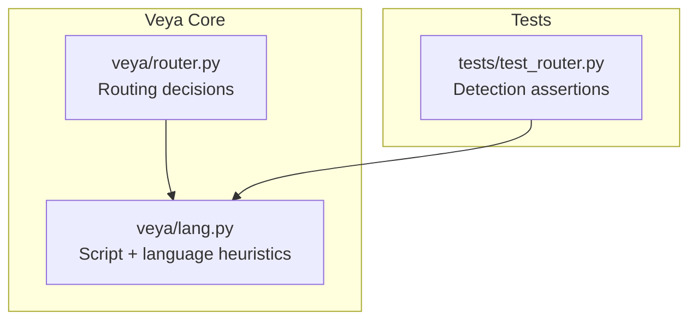
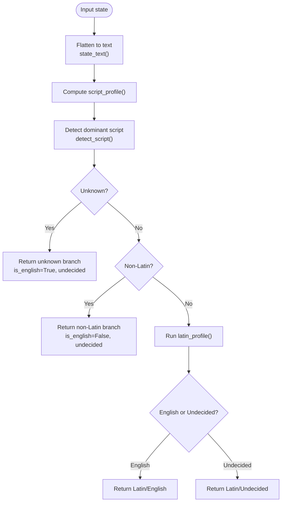
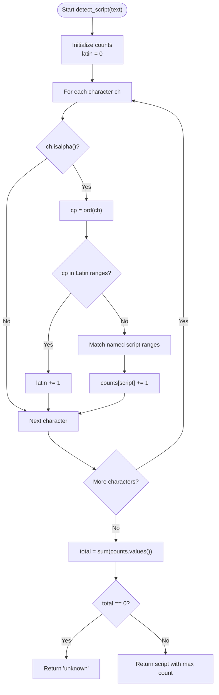
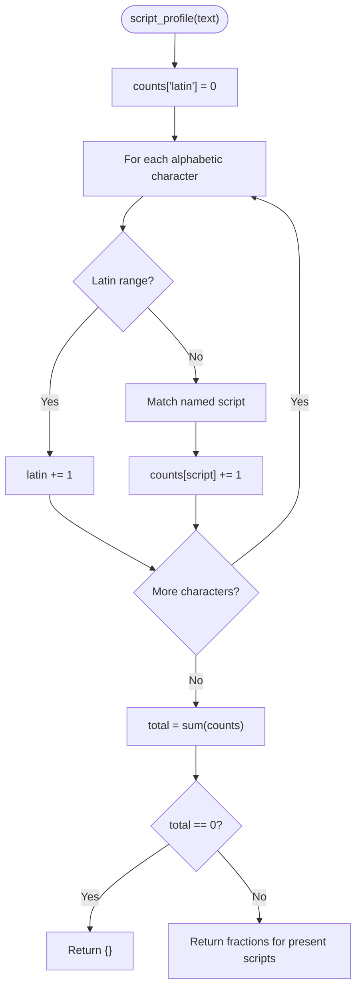
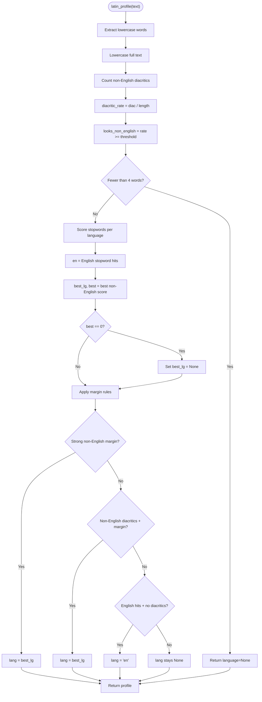
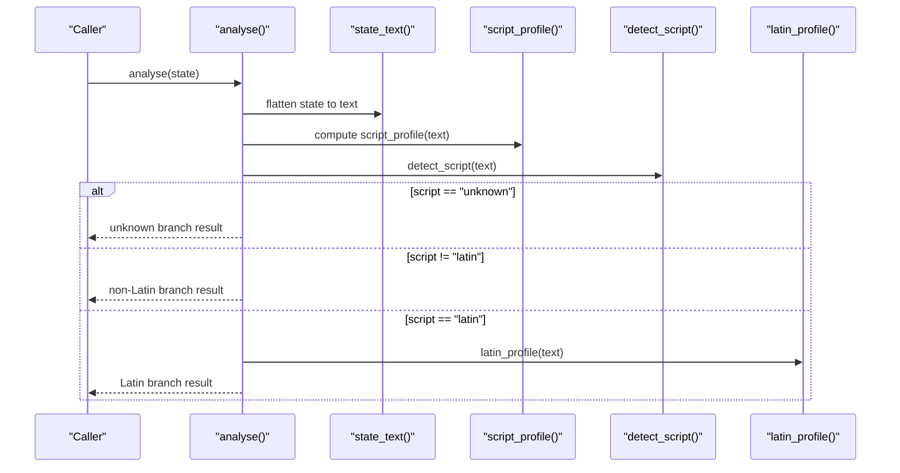
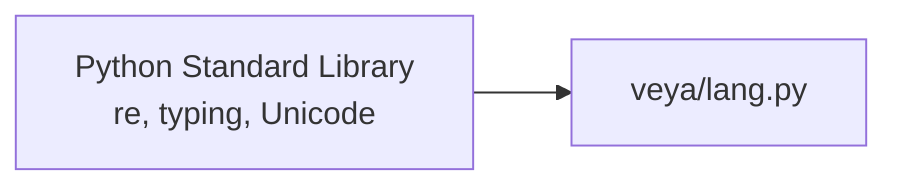

# Language Detection & Script Analysis

<cite>
**Referenced Files in This Document**
- [lang.py](file://veya/lang.py)
- [test_router.py](file://tests/test_router.py)
</cite>

## Table of Contents
1. [Introduction](#introduction)
2. [Project Structure](#project-structure)
3. [Core Components](#core-components)
4. [Architecture Overview](#architecture-overview)
5. [Detailed Component Analysis](#detailed-component-analysis)
6. [Dependency Analysis](#dependency-analysis)
7. [Performance Considerations](#performance-considerations)
8. [Troubleshooting Guide](#troubleshooting-guide)
9. [Conclusion](#conclusion)

## Introduction
This document explains Veya’s dependency-free language detection and script analysis system. It focuses on how the `analyse()` function decides whether input text should be routed to the English checkpoint, the multilingual checkpoint, or treated as undecided Latin-script text. The system uses:

- Exact Unicode-based script detection to distinguish Latin from non-Latin scripts.
- A stopword/diacritic heuristic for best-effort Latin-script language identification.
- Confidence-like metrics such as diacritic rate, non-Latin fraction, and script profile fractions.

The design is intentionally conservative: if the script is non-Latin, it is not sent to the English checkpoint; if Latin text cannot be confidently identified as English, it is routed to the multilingual checkpoint unless there is no evidence at all.

## Project Structure
The language detection logic lives in a single module and is exercised by routing tests.

**Diagram sources**
- [lang.py:1-266](file://veya/lang.py#L1-L266)
- [test_router.py:1-448](file://tests/test_router.py#L1-L448)

**Section sources**
- [lang.py:1-20](file://veya/lang.py#L1-L20)
- [test_router.py:1-20](file://tests/test_router.py#L1-L20)

## Core Components
The core API exposed by the module includes:

| Function | Purpose | Key Output / Behavior |
|---|---|---|
| `state_text(state)` | Flattens strings inside dicts/lists into one detection string, ignoring keys. | Returns up to a fixed number of characters for efficiency. |
| `detect_script(text)` | Determines dominant script using Unicode ranges. | Returns `"latin"`, a named non-Latin script, or `"unknown"`. |
| `script_profile(text)` | Computes per-script character fractions among alphabetic characters. | Returns a dict of script-to-fraction values. |
| `latin_profile(text)` | Scores stopwords and diacritics for Latin text. | Returns language guess, English hit count, diacritic rate, and non-English flag. |
| `guess_latin_language(text)` | Best-effort Latin language code. | Returns a language code or `None` when undecided. |
| `analyse(state)` | Full detection result used by routing. | Returns script, profile, language, `is_english`, `language_undecided`, diacritic rate, and non-Latin fraction. |
| `is_english(state)` | Boolean shortcut for English routing. | True when the English checkpoint can be expected to read the state. |
| `reads_non_latin(cfg)` | Checks whether the configured encoder reads non-Latin scripts. | Used to skip deferral for multilingual encoders. |
| `defer_reason(cfg, state)` | Explains why a checkpoint must not answer. | Returns a reason string or `None`. |

**Section sources**
- [lang.py:87-108](file://veya/lang.py#L87-L108)
- [lang.py:111-150](file://veya/lang.py#L111-L150)
- [lang.py:158-206](file://veya/lang.py#L158-L206)
- [lang.py:209-249](file://veya/lang.py#L209-L249)
- [lang.py:252-266](file://veya/lang.py#L252-L266)

## Architecture Overview
At a high level, `analyse()` composes three stages:

1. **State flattening**: Convert arbitrary nested state into a bounded text buffer.
2. **Script detection**: Decide whether the text is Latin, a known non-Latin script, or unknown.
3. **Latin-language profiling**: If Latin, apply stopword and diacritic signals to decide English vs non-English vs undecided.

**Diagram sources**
- [lang.py:106-108](file://veya/lang.py#L106-L108)
- [lang.py:111-150](file://veya/lang.py#L111-L150)
- [lang.py:158-206](file://veya/lang.py#L158-L206)
- [lang.py:209-238](file://veya/lang.py#L209-L238)

## Detailed Component Analysis

### Script Detection Algorithm
The script detection algorithm classifies each alphabetic character into either Latin or a named non-Latin script based on Unicode code-point ranges.

Key behaviors:

- Only alphabetic characters are counted; digits, punctuation, and whitespace are ignored.
- Latin includes basic Latin and Latin Extended Additional ranges.
- Non-Latin scripts include Greek, Cyrillic, Armenian, Hebrew, Arabic, Devanagari, Bengali, Gurmukhi, Gujarati, Oriya, Tamil, Telugu, Kannada, Malayalam, Sinhala, Thai, Lao, Tibetan, Myanmar, Georgian, Ethiopic, Khmer, Hangul, Kana, and Han.
- If no alphabetic characters are found, the script is reported as `"unknown"`.
- The dominant script is the one with the highest character count.

**Diagram sources**
- [lang.py:111-130](file://veya/lang.py#L111-L130)

**Section sources**
- [lang.py:16-43](file://veya/lang.py#L16-L43)
- [lang.py:111-130](file://veya/lang.py#L111-L130)
- [test_router.py:31-52](file://tests/test_router.py#L31-L52)

### Script Profile and Non-Latin Fraction
`script_profile()` returns the fraction of alphabetic characters belonging to each detected script. `analyse()` then derives `non_latin_fraction` as `1 - latin_fraction`.

Important implications:

- Mixed inputs produce fractional profiles rather than hard classifications.
- `non_latin_fraction` is useful for diagnostics and for understanding mixed-language or code-switching cases.
- For pure Latin text, `non_latin_fraction` is near zero.
- For pure non-Latin text, `non_latin_fraction` is near one.

**Diagram sources**
- [lang.py:133-150](file://veya/lang.py#L133-L150)

**Section sources**
- [lang.py:133-150](file://veya/lang.py#L133-L150)
- [lang.py:215-218](file://veya/lang.py#L215-L218)
- [test_router.py:129-131](file://tests/test_router.py#L129-L131)

### Latin-Language Identification via Stopwords and Diacritics
When the dominant script is Latin, `latin_profile()` applies two signals:

1. **Stopword scoring**: Each supported language has a set of function words. Words are lowercased and matched against these sets.
2. **Diacritic scoring**: Characters that ordinary English does not use are counted, producing a diacritic rate.

Decision rules:

- If fewer than four words are found, the language is undecided.
- If a non-English language has enough stopword hits relative to English, it may be selected.
- If the text looks non-English due to diacritics, a weaker stopword margin can still select a non-English language.
- If English stopword hits appear without significant non-English diacritics, the language is marked as English.
- Otherwise, the language remains undecided.

**Diagram sources**
- [lang.py:153-196](file://veya/lang.py#L153-L196)

**Section sources**
- [lang.py:45-84](file://veya/lang.py#L45-L84)
- [lang.py:153-196](file://veya/lang.py#L153-L196)
- [lang.py:199-206](file://veya/lang.py#L199-L206)
- [test_router.py:82-116](file://tests/test_router.py#L82-L116)

### The analyse() Decision Flow
`analyse()` is the main entry point used by routing. Its behavior can be summarized as follows:

| Input Condition | Resulting Fields | Routing Implication |
|---|---|---|
| No alphabetic characters | `script="unknown"`, `is_english=True`, `language_undecided=True` | Treated as safe for the English checkpoint because there is no readable script signal. |
| Dominant script is non-Latin | `script=detected script`, `is_english=False`, `language_undecided=True` | Sent to the multilingual checkpoint. |
| Dominant script is Latin and language is `"en"` | `script="latin"`, `is_english=True`, `language_undecided=False` | Sent to the English checkpoint. |
| Dominant script is Latin and language is undecided but text looks non-English | `script="latin"`, `is_english=False`, `language_undecided=True` | Sent to the multilingual checkpoint. |
| Dominant script is Latin and language is undecided but text does not look non-English | `script="latin"`, `is_english=True`, `language_undecided=True` | Sent to the English checkpoint. |

**Diagram sources**
- [lang.py:106-108](file://veya/lang.py#L106-L108)
- [lang.py:111-150](file://veya/lang.py#L111-L150)
- [lang.py:158-206](file://veya/lang.py#L158-L206)
- [lang.py:209-238](file://veya/lang.py#L209-L238)

**Section sources**
- [lang.py:209-238](file://veya/lang.py#L209-L238)
- [test_router.py:82-96](file://tests/test_router.py#L82-L96)

### Detection Metrics
The following metrics are available through `analyse()` and related functions:

| Metric | Meaning | Typical Use |
|---|---|---|
| `script` | Dominant script: `"latin"`, a named non-Latin script, or `"unknown"`. | High-level routing decision. |
| `script_profile` | Fraction of alphabetic characters per script. | Diagnostics and mixed-script analysis. |
| `language` | Best-effort language code or `None`. | Human-readable explanation and optional downstream logic. |
| `is_english` | Whether the English checkpoint can be expected to handle the input. | Primary routing gate. |
| `language_undecided` | Whether Latin text could not be confidently classified as English. | Explainability and fallback routing. |
| `diacritic_rate` | Fraction of non-English diacritic characters in lowered text. | Signal for non-English Latin text. |
| `non_latin_fraction` | Fraction of alphabetic characters outside Latin. | Mixed-language and code-switching diagnostics. |

**Section sources**
- [lang.py:153-155](file://veya/lang.py#L153-L155)
- [lang.py:158-196](file://veya/lang.py#L158-L196)
- [lang.py:209-238](file://veya/lang.py#L209-L238)
- [test_router.py:87-94](file://tests/test_router.py#L87-L94)

### Examples and Edge Cases
The test suite documents representative behaviors across languages and edge cases.

#### Script Detection Examples
- Plain English is classified as Latin.
- Armenian, Hindi, Japanese, Chinese, Korean, Arabic, Tamil, Russian, Thai, Greek, and Hebrew are classified as their respective scripts.
- Empty strings and digit-only strings return `"unknown"`.

#### English vs Non-English Examples
- Long French, German, Romanian, Polish, Czech, Turkish, and Vietnamese texts are not considered English.
- Short English phrases remain English.
- English with loanwords remains English unless strong non-English signals appear.

#### Undecided Latin Text
- Turkish text with shared function words can be flagged as undecided rather than misnamed as another Romance language.
- Undecided Latin text is not sent to the English checkpoint unless there is no evidence of non-English letters.

#### Known Limitation
- Very short Romanian-like text without diacritics and containing an English function word can still be read as English. This is documented as a known gap.

#### Mixed-Language and Code-Switching
- Mixed inputs produce fractional script profiles.
- `non_latin_fraction` captures the proportion of non-Latin characters, which is useful for detecting code-switching between Latin and non-Latin scripts.

#### Special Characters
- Digits, punctuation, and symbols are ignored by script counting.
- Keys in dictionary states are ignored during flattening, so English metadata around non-Latin content does not falsely make the input English.

**Section sources**
- [test_router.py:31-52](file://tests/test_router.py#L31-L52)
- [test_router.py:55-101](file://tests/test_router.py#L55-L101)
- [test_router.py:119-131](file://tests/test_router.py#L119-L131)

## Dependency Analysis
The detection module is intentionally lightweight and dependency-free. It depends only on Python’s standard library:

- Regular expressions for word extraction.
- Unicode properties and code points for script classification.
- Basic typing annotations for clarity.

**Diagram sources**
- [lang.py:13-14](file://veya/lang.py#L13-L14)
- [lang.py:16-84](file://veya/lang.py#L16-L84)

**Section sources**
- [lang.py:1-14](file://veya/lang.py#L1-L14)

## Performance Considerations
The detection pipeline is designed for low overhead:

- `state_text()` truncates flattened text to a fixed maximum, preventing unbounded processing.
- Script detection and profile computation iterate over characters once.
- Stopword matching operates on extracted words and small predefined dictionaries.
- Diacritic counting is a simple pass over lowered text.

Practical implications:

- Short inputs are fast and often return undecided Latin results by design.
- Mixed-language inputs are handled efficiently through character-level classification.
- The system avoids heavy model calls for routing decisions.

[No sources needed since this section provides general guidance]

## Troubleshooting Guide

### Common Symptoms and Causes

| Symptom | Likely Cause | Recommended Action |
|---|---|---|
| Non-Latin text is routed to the English checkpoint | Misconfiguration or explicit override bypassing detection. | Check encoder configuration and explicit `model` or `lang` parameters. |
| Latin text is routed to the multilingual checkpoint | Strong non-English diacritics or sufficient non-English stopword margin. | Inspect `diacritic_rate`, `language`, and `language_undecided`. |
| Short Latin text is undecided | Fewer than four words triggers undecided behavior. | Provide more context or explicitly set `lang=` when the language is known. |
| Romanian-like text without diacritics is read as English | Known limitation where lack of diacritics and presence of an English function word leads to English classification. | Treat as a known gap; consider a dedicated language identification model for production. |
| Mixed-language input appears ambiguous | Fractional script profile and non-Latin fraction indicate code-switching. | Use `script_profile` and `non_latin_fraction` for diagnostics; route conservatively to multilingual when uncertain. |

### Debugging Checklist
1. Call `analyse(state)` and inspect all returned fields.
2. Check `script` first: non-Latin means multilingual; unknown means safe for English but with no meaningful language signal.
3. For Latin text, check `language_undecided`:
   - If true and `looks_non_english` is true, prefer multilingual.
   - If true and `looks_non_english` is false, English is acceptable.
4. Review `diacritic_rate` for unexpected non-English Latin signals.
5. Review `non_latin_fraction` for mixed-script inputs.
6. Verify that dictionary keys are not driving detection; only values matter after flattening.

**Section sources**
- [lang.py:209-238](file://veya/lang.py#L209-L238)
- [test_router.py:82-101](file://tests/test_router.py#L82-L101)
- [test_router.py:119-131](file://tests/test_router.py#L119-L131)

## Conclusion
Veya’s language detection and script analysis system prioritizes safety and interpretability over aggressive guessing. Script detection is exact, while Latin-script language identification is best-effort and deliberately conservative. The `analyse()` function exposes rich diagnostic fields, including script, script profile, language, `is_english`, `language_undecided`, diacritic rate, and non-Latin fraction. This allows routing to avoid sending non-Latin or clearly non-English Latin text to the English checkpoint, while still allowing short or ambiguous Latin text to reach the English checkpoint when there is no evidence of non-English content.

For production systems requiring stronger language identification, the module’s documentation explicitly recommends passing an explicit model or language when already known, or using a dedicated language identification model rather than expanding stopwords indefinitely.

[No sources needed since this section summarizes without analyzing specific files]