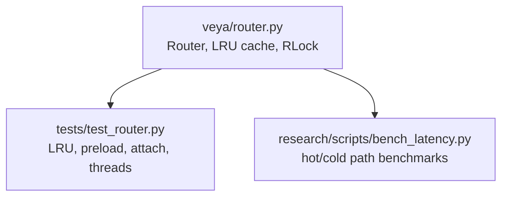
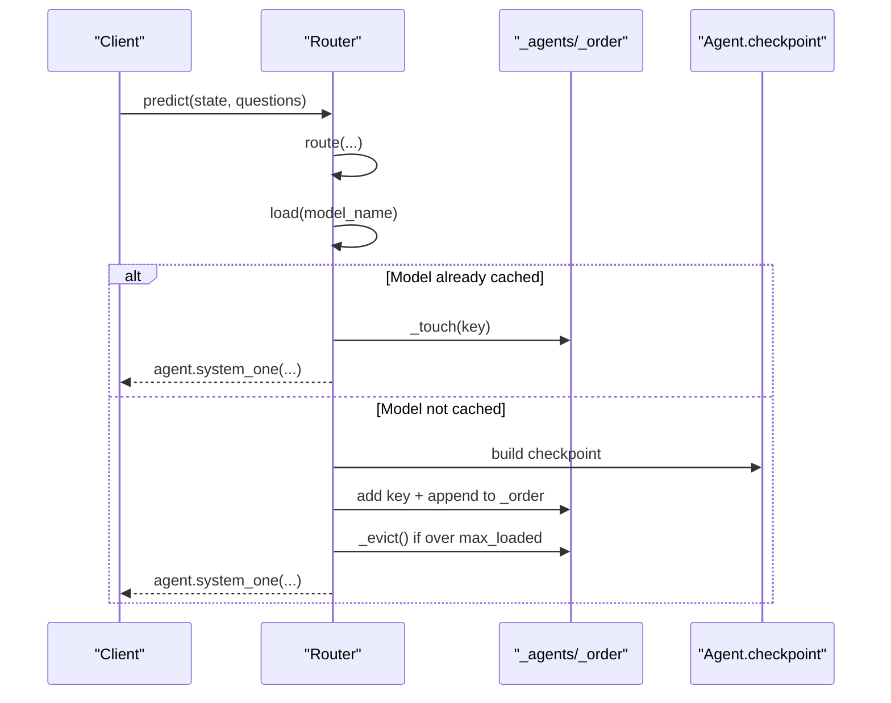
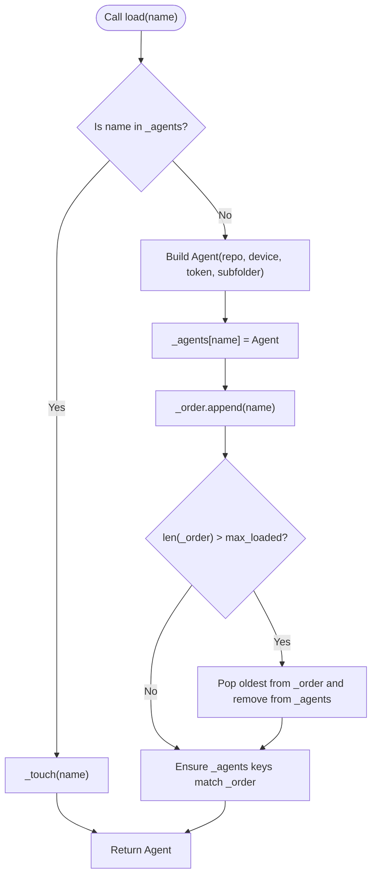
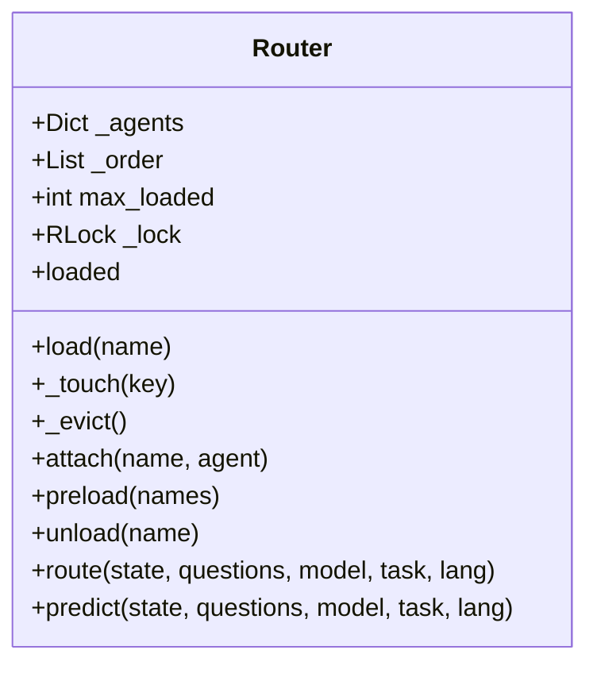
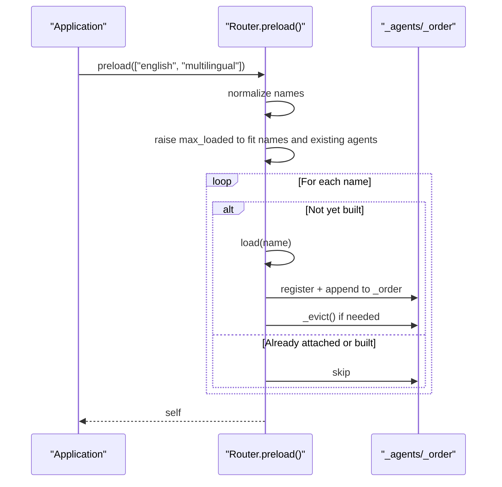
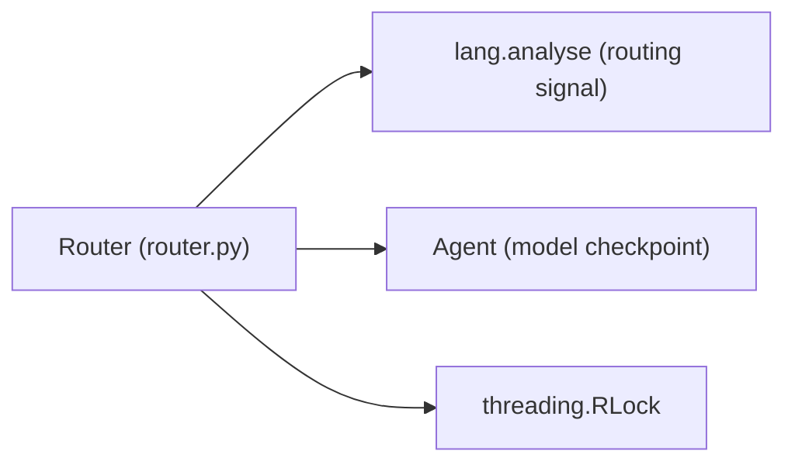

# Memory Management & LRU Eviction

<cite>
**Referenced Files in This Document**
- [router.py](file://veya/router.py)
- [test_router.py](file://tests/test_router.py)
- [bench_latency.py](file://research/scripts/bench_latency.py)
</cite>

## Table of Contents
1. [Introduction](#introduction)
2. [Project Structure](#project-structure)
3. [Core Components](#core-components)
4. [Architecture Overview](#architecture-overview)
5. [Detailed Component Analysis](#detailed-component-analysis)
6. [Dependency Analysis](#dependency-analysis)
7. [Performance Considerations](#performance-considerations)
8. [Troubleshooting Guide](#troubleshooting-guide)
9. [Conclusion](#conclusion)
10. [Appendices](#appendices)

## Introduction
This document explains Veya’s memory management and Least Recently Used (LRU) eviction strategy for model checkpoints. It focuses on how the `Router` controls concurrent resident models through `max_loaded`, how access order is maintained by `_touch()` and `_evict()`, and how a re-entrant lock (`RLock`) keeps the cache safe under concurrency. It also documents hot-loading with `preload()`, memory optimization strategies, performance implications of different `max_loaded` settings, and practical guidance for profiling, monitoring, and tuning memory usage across deployment scenarios.

## Project Structure
The memory and routing behavior relevant to this document lives primarily in:
- `veya/router.py`: Router implementation, LRU cache, threading safety, preload/attach/unload, and routing logic.
- `tests/test_router.py`: Behavioral tests for LRU eviction, preload, attach, and thread-safety guarantees.
- `research/scripts/bench_latency.py`: Benchmarks comparing hot-path and cold-path latency under different `max_loaded` configurations.

**Diagram sources**
- [router.py:123-337](file://veya/router.py#L123-L337)
- [test_router.py:256-448](file://tests/test_router.py#L256-L448)
- [bench_latency.py:104-162](file://research/scripts/bench_latency.py#L104-L162)

**Section sources**
- [router.py:123-337](file://veya/router.py#L123-L337)
- [test_router.py:256-448](file://tests/test_router.py#L256-L448)
- [bench_latency.py:104-162](file://research/scripts/bench_latency.py#L104-L162)

## Core Components
- Router: Lazily loads Veya checkpoints and routes requests to the appropriate model. It maintains an in-process cache of built agents with LRU eviction.
- LRU Cache: Implemented via an ordered list `_order` (least recently used first) and a dictionary `_agents`. Access updates order; capacity is enforced by `max_loaded`.
- Threading Safety: A single `threading.RLock` protects all cache mutations and reads that must be consistent. Inference is intentionally outside the lock to avoid serializing predictions.
- Preload: Hot-loads one or more checkpoints at startup so routing is effectively free during request time.
- Attach: Registers an externally built agent into the router’s cache without duplicating it in memory.

Key responsibilities:
- Control resident model count via `max_loaded`.
- Maintain access order via `_touch()`.
- Enforce capacity via `_evict()`.
- Provide safe concurrent access via `RLock`.
- Support production hot-loading via `preload()`.

**Section sources**
- [router.py:123-237](file://veya/router.py#L123-L237)

## Architecture Overview
At runtime, each incoming request goes through routing and optional loading before inference:

**Diagram sources**
- [router.py:257-331](file://veya/router.py#L257-L331)
- [router.py:175-208](file://veya/router.py#L175-L208)

## Detailed Component Analysis

### Router Memory Lifecycle and LRU Strategy
The Router uses:
- `_agents`: maps model name to built Agent instance.
- `_order`: list of model names from least recently used to most recently used.
- `max_loaded`: maximum number of concurrently resident models.

Access patterns:
- `load(name)`: If present, touch and return; otherwise build, register, append to `_order`, then evict if needed.
- `_touch(key)`: Moves key to the end (most recently used).
- `_evict()`: Removes oldest entries until length equals `max_loaded`; also ensures `_agents` and `_order` stay consistent.

**Diagram sources**
- [router.py:175-208](file://veya/router.py#L175-L208)

**Section sources**
- [router.py:175-208](file://veya/router.py#L175-L208)

### Threading Safety with RLock
- The Router uses a single `threading.RLock` to guard:
  - Loading and unloading models.
  - Attaching external agents.
  - Preloading subsets.
  - Updating `_order` and `_agents`.
- Public methods call private helpers like `_touch()` and `_evict()` safely because the lock is re-entrant.
- Inference (`Agent.system_one`) runs outside the lock, allowing concurrent predictions on the same checkpoint without serialization.

Concurrency guarantees validated by tests:
- Concurrent `load()` of the same checkpoint builds exactly one Agent and shares it among callers.
- Concurrent hot-path loads keep `_order` and `_agents` consistent.

**Diagram sources**
- [router.py:123-337](file://veya/router.py#L123-L337)

**Section sources**
- [router.py:164-170](file://veya/router.py#L164-L170)
- [test_router.py:359-432](file://tests/test_router.py#L359-L432)

### Preload Functionality for Hot-Loading
- `preload(names=None)` downloads and builds specified checkpoints up front.
- It raises `max_loaded` to fit what was preloaded, preventing immediate LRU eviction.
- Useful in servers or demos where cold loads would cause unacceptable latency spikes.

Behavioral expectations verified by tests:
- Preloading multiple models keeps them resident.
- Preloading a subset keeps only those models resident.
- Touching an already-resident model does not evict others.

**Diagram sources**
- [router.py:223-237](file://veya/router.py#L223-L237)
- [router.py:175-208](file://veya/router.py#L175-L208)

**Section sources**
- [router.py:223-237](file://veya/router.py#L223-L237)
- [test_router.py:320-341](file://tests/test_router.py#L320-L341)

### Attach for External Agents
- `attach(name, agent)` registers an already-built Agent into the Router’s cache.
- Prevents duplicate copies of large checkpoints when another part of the process already owns one.
- Automatically raises `max_loaded` to ensure the attached agent remains resident.

Use cases:
- Demo processes that already loaded a checkpoint can hand it to the Router.
- Shared services that manage model lifecycles externally can integrate with Router caching.

**Section sources**
- [router.py:209-221](file://veya/router.py#L209-L221)
- [test_router.py:344-356](file://tests/test_router.py#L344-L356)

### Unload and Monitoring
- `unload(name=None)`: Frees one model or all models.
- `loaded`: Returns current list of resident models in LRU order.

Monitoring tips:
- Inspect `router.loaded` to see which checkpoints are resident.
- Compare `len(router.loaded)` with `router.max_loaded` to understand capacity pressure.
- Use `router.__repr__` for a quick summary including default model.

**Section sources**
- [router.py:239-254](file://veya/router.py#L239-L254)
- [router.py:335-337](file://veya/router.py#L335-L337)

## Dependency Analysis
The Router depends on:
- Language analysis module for routing decisions.
- Agent module for building and running model checkpoints.
- Threading primitives for concurrency control.

**Diagram sources**
- [router.py:30-34](file://veya/router.py#L30-L34)
- [router.py:185-187](file://veya/router.py#L185-L187)
- [router.py:166-170](file://veya/router.py#L166-L170)

**Section sources**
- [router.py:30-34](file://veya/router.py#L30-L34)
- [router.py:166-170](file://veya/router.py#L166-L170)
- [router.py:185-187](file://veya/router.py#L185-L187)

## Performance Considerations
- Cold vs Hot Path:
  - Cold path: switching checkpoints incurs model load cost; with `max_loaded=1`, every language flip may trigger a swap.
  - Hot path: target model already resident; routing overhead is minimal.
- Mixed Workloads:
  - Realistic latency sits between hot and cold extremes depending on traffic distribution and `max_loaded`.
- Benchmark Evidence:
  - The benchmark script measures detection overhead, per-model raw latency, hot-path routing overhead, cold-path swaps, and mixed-language workloads across capacities.

Recommendations:
- For servers handling mixed languages, set `max_loaded` high enough to cover frequently accessed checkpoints (e.g., English and multilingual).
- Use `preload=True` or `preload([...])` to eliminate cold starts.
- Monitor `router.loaded` and adjust `max_loaded` based on observed traffic patterns.

**Section sources**
- [bench_latency.py:1-10](file://research/scripts/bench_latency.py#L1-L10)
- [bench_latency.py:104-162](file://research/scripts/bench_latency.py#L104-L162)

## Troubleshooting Guide
Common issues and resolutions:
- Models being evicted immediately after preload:
  - Ensure `max_loaded` is raised to accommodate preloaded models.
  - Verify that preload sets `max_loaded` appropriately.
- Unexpected evictions when touching resident models:
  - Confirm that `_touch()` is called for existing keys and that `_evict()` respects `max_loaded`.
- Concurrency anomalies:
  - Validate that all cache mutations occur under the Router’s `RLock`.
  - Ensure inference is not serialized by locks; only cache operations should be locked.

Validation references:
- LRU eviction and touch semantics are covered by tests.
- Thread-safety guarantees are explicitly tested for concurrent loads and hot paths.

**Section sources**
- [test_router.py:273-295](file://tests/test_router.py#L273-L295)
- [test_router.py:359-432](file://tests/test_router.py#L359-L432)

## Conclusion
Veya’s Router provides robust memory management for model checkpoints using an LRU strategy controlled by `max_loaded`. The `_touch()` and `_evict()` methods maintain accurate access order and enforce capacity, while a re-entrant lock ensures thread-safe operations. Production deployments benefit from `preload()` to hot-load models and avoid cold-start latency. Tuning `max_loaded` and using preload strategically balances memory usage against latency, especially in mixed-language environments. Monitoring `router.loaded` and benchmarking with realistic workloads helps optimize performance and resource utilization.

## Appendices

### Memory Profiling and Monitoring Examples
- Profile memory growth:
  - Track `len(router.loaded)` and compare with `router.max_loaded`.
  - Observe peak memory usage when switching between checkpoints with low `max_loaded`.
- Monitor resident models:
  - Print `router.loaded` periodically to detect churn and potential thrashing.
- Tune memory usage:
  - Increase `max_loaded` for frequently accessed models.
  - Use `preload([...])` to pin critical models.
  - Use `unload()` to release unused models during maintenance windows.

[No sources needed since this section provides general guidance]