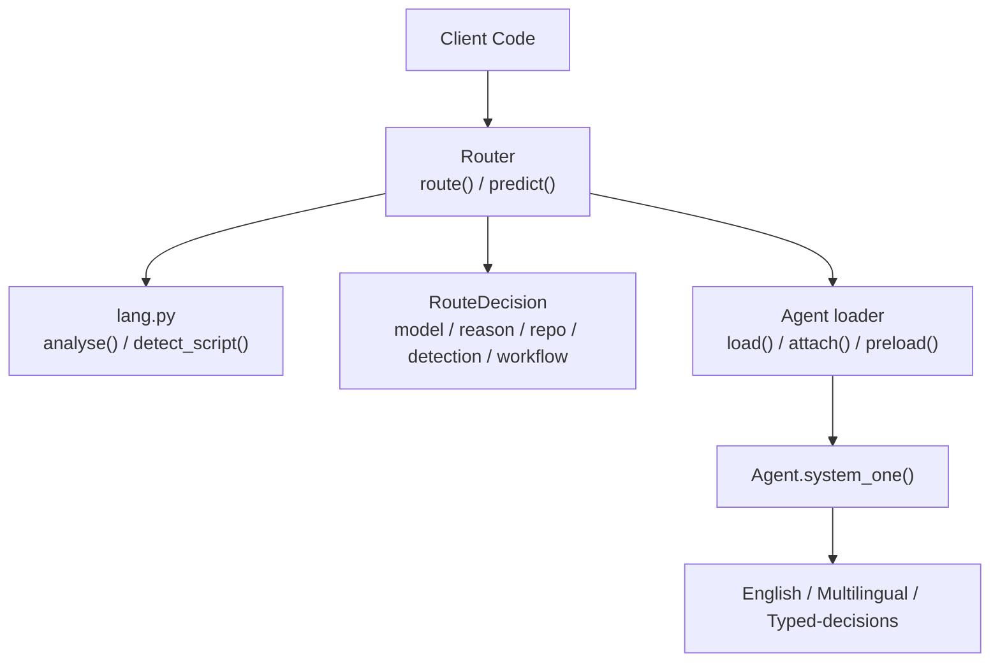
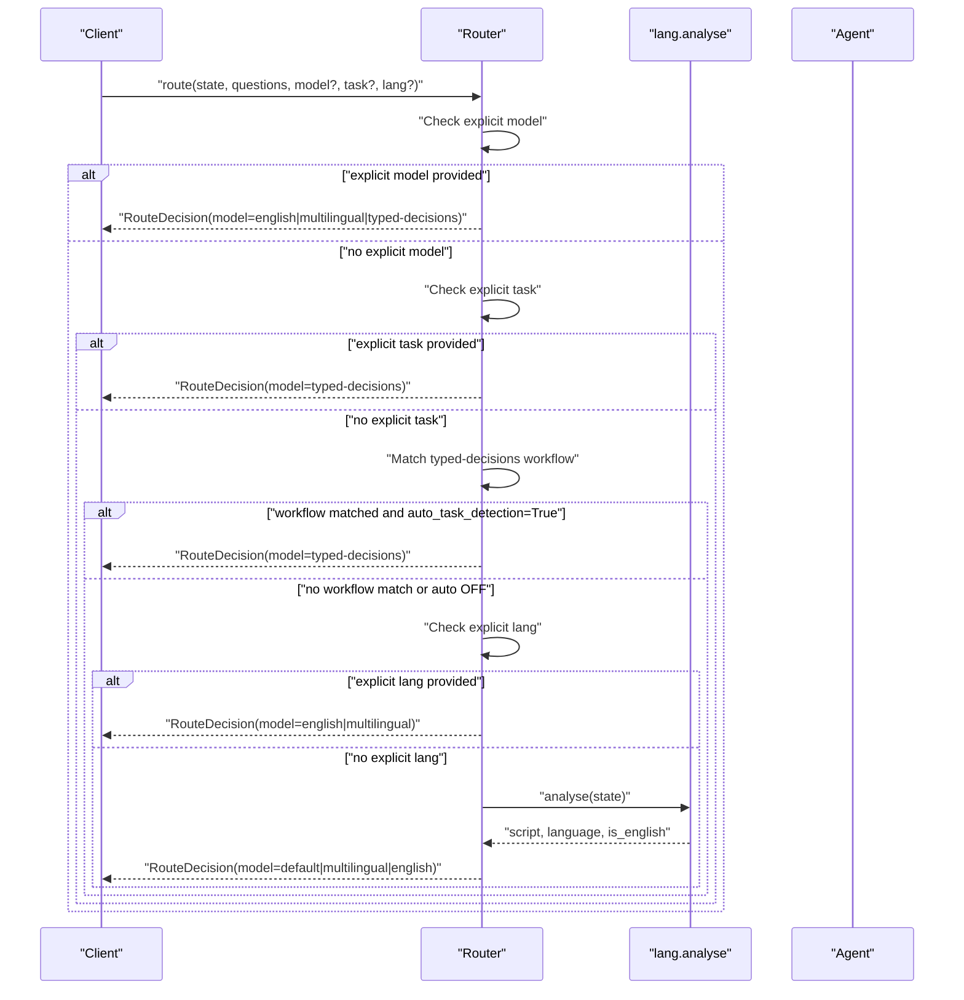
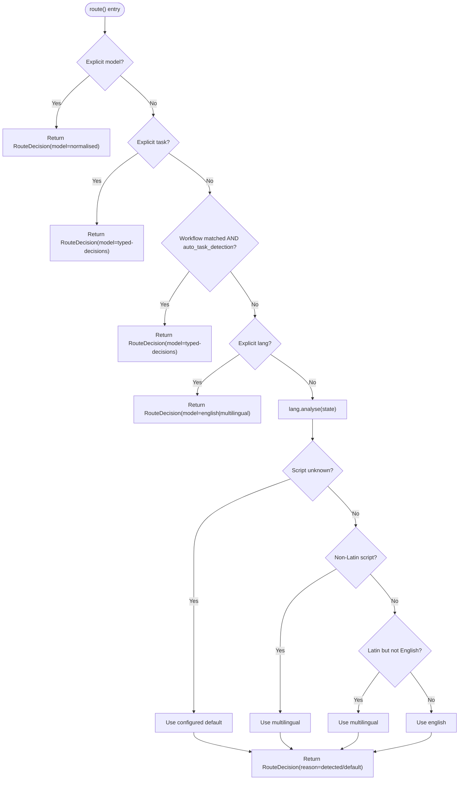
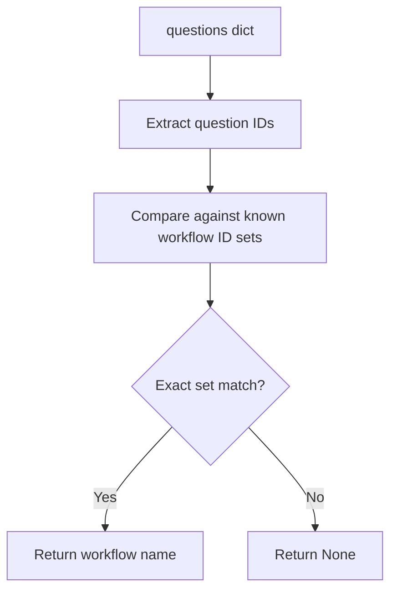
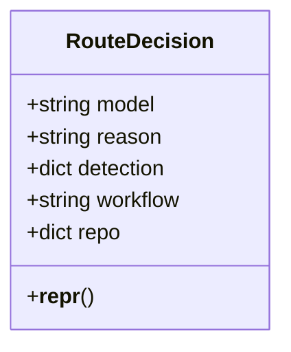
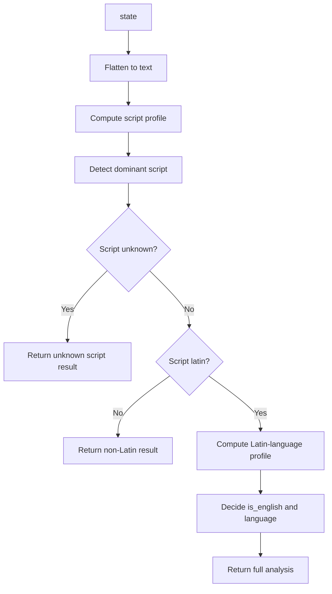
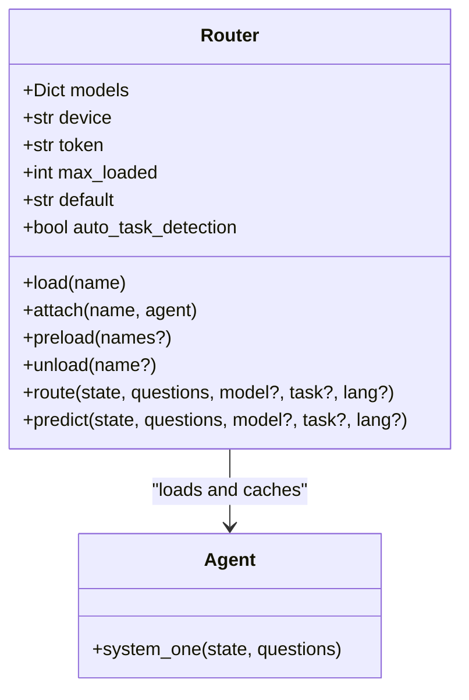
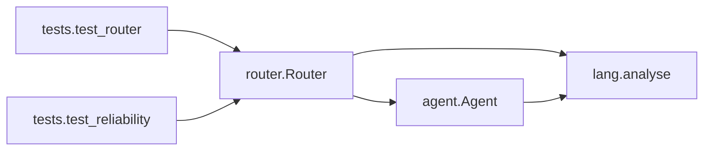

# Routing Strategies & Decision Logic

<cite>
**Referenced Files in This Document**   
- [router.py](file://veya/router.py)
- [lang.py](file://veya/lang.py)
- [agent.py](file://veya/agent.py)
- [test_router.py](file://tests/test_router.py)
- [test_reliability.py](file://tests/test_reliability.py)
- [README.md](file://README.md)
</cite>

## Table of Contents
1. [Introduction](#introduction)
2. [Project Structure](#project-structure)
3. [Core Components](#core-components)
4. [Architecture Overview](#architecture-overview)
5. [Detailed Component Analysis](#detailed-component-analysis)
6. [Dependency Analysis](#dependency-analysis)
7. [Performance Considerations](#performance-considerations)
8. [Troubleshooting Guide](#troubleshooting-guide)
9. [Conclusion](#conclusion)
10. [Appendices](#appendices)

## Introduction
This document explains Veya’s routing decision logic and strategy selection. It focuses on how the system chooses between the English, multilingual, and typed-decisions checkpoints for a given request, and how that choice is exposed through `Router.route()` and the `RouteDecision` object.

The routing priority is:
1. Explicit model override
2. Explicit task override
3. Auto-detected typed-decisions workflow (opt-in)
4. Explicit language hint
5. Detected script/language
6. Default checkpoint

Typed-decisions workflow detection is based on exact question ID schemas. The route method implements a strict decision tree, and language/script detection is implemented independently in the language module. Manual overrides, custom strategies, and integration patterns are also covered to support complex routing scenarios such as conditional business rules, A/B testing, and fallback mechanisms when detections fail.

## Project Structure
Routing lives primarily in the `veya` package:
- `veya/router.py`: Router, RouteDecision, model aliases, typed-decisions workflow signatures, and the route() decision tree.
- `veya/lang.py`: Dependency-free script and Latin-script language heuristics used by the router.
- `veya/agent.py`: Inference runtime; it integrates with routing indirectly through Router.predict(), which loads the chosen Agent and runs inference.
- `tests/test_router.py`: Tests for normalisation, workflow matching, precedence, default overrides, and unknown-Latin routing behavior.
- `tests/test_reliability.py`: Reliability checks including auto-task detection routing and JSON serialisability of the decision payload.
- `README.md`: Public quickstart showing Router usage and explicit overrides.

**Diagram sources**
- [router.py:123-337](file://veya/router.py#L123-L337)
- [lang.py:209-238](file://veya/lang.py#L209-L238)
- [agent.py:291-414](file://veya/agent.py#L291-L414)

**Section sources**
- [router.py:1-337](file://veya/router.py#L1-L337)
- [lang.py:1-266](file://veya/lang.py#L1-L266)
- [agent.py:1-432](file://veya/agent.py#L1-L432)
- [test_router.py:133-225](file://tests/test_router.py#L133-L225)
- [test_reliability.py:88-98](file://tests/test_reliability.py#L88-L98)
- [README.md:68-125](file://README.md#L68-L125)

## Core Components
- **Router**: Lazily loads checkpoints, manages an LRU cache, and decides which checkpoint to use. It exposes `route()` for pure decisions and `predict()` for decision plus inference.
- **RouteDecision**: A dict-like object representing the routing outcome, including selected model, repository specification, human-readable reason, detection metadata, and detected workflow name.
- **Language detector**: Provides script detection, Latin-script language guessing, and analysis results used by the router when no explicit hints are provided.
- **Agent**: Loads and runs a specific checkpoint. Router uses it after deciding which checkpoint to call.

Key responsibilities:
- Normalise model names and aliases.
- Match typed-decisions workflows by exact question ID sets.
- Apply the precedence hierarchy in `route()`.
- Fall back to script/language detection or the configured default.
- Provide safe inference through Agent, including defer reasons for unsupported inputs.

**Section sources**
- [router.py:38-80](file://veya/router.py#L38-L80)
- [router.py:83-107](file://veya/router.py#L83-L107)
- [router.py:123-173](file://veya/router.py#L123-L173)
- [lang.py:16-84](file://veya/lang.py#L16-L84)
- [lang.py:111-238](file://veya/lang.py#L111-L238)
- [agent.py:101-251](file://veya/agent.py#L101-L251)

## Architecture Overview
The routing architecture separates decision from execution:
- `Router.route()` computes the best checkpoint without loading models.
- `Router.predict()` calls `route()`, loads the chosen Agent, executes `system_one()`, and attaches the routing decision to the result.
- Language detection is independent and can be reused elsewhere.
- Typed-decisions workflow detection is opt-in and relies only on question IDs.

**Diagram sources**
- [router.py:257-312](file://veya/router.py#L257-L312)
- [lang.py:209-238](file://veya/lang.py#L209-L238)

**Section sources**
- [router.py:257-337](file://veya/router.py#L257-L337)
- [lang.py:209-238](file://veya/lang.py#L209-L238)

## Detailed Component Analysis

### Precedence Hierarchy and Decision Tree
The router applies these steps in order:
1. If `model` is provided, normalise it and return an explicit-model decision.
2. If `task` is provided, map `typed_decisions` to `typed-decisions` and return an explicit-task decision.
3. If `auto_task_detection` is enabled and the question IDs exactly match one of the four typed-decisions workflows, select `typed-decisions`.
4. If `lang` is provided, map English variants to `english`; otherwise choose `multilingual`.
5. Otherwise, call `lang.analyse(state)` and decide based on script and language signals:
   - Unknown script: use the configured default.
   - Non-Latin script: use multilingual.
   - Latin but not English: use multilingual.
   - English Latin text: use english.

**Diagram sources**
- [router.py:257-312](file://veya/router.py#L257-L312)
- [lang.py:209-238](file://veya/lang.py#L209-L238)

**Section sources**
- [router.py:257-312](file://veya/router.py#L257-L312)

### Typed-Decisions Workflow Detection
Typed-decisions workflow detection is schema-based:
- Four supported workflows are defined by exact question ID sets.
- Matching requires an exact set equality; partial overlap or extra IDs do not match.
- Detection is only applied when `auto_task_detection=True`.

Supported workflows:
- `agent_trace_observability`
- `customer_service`
- `invoice_processing`
- `security_incidents`

**Diagram sources**
- [router.py:73-80](file://veya/router.py#L73-L80)
- [router.py:110-120](file://veya/router.py#L110-L120)

**Section sources**
- [router.py:73-80](file://veya/router.py#L73-L80)
- [router.py:110-120](file://veya/router.py#L110-L120)
- [test_router.py:133-143](file://tests/test_router.py#L133-L143)

### RouteDecision Object Structure
`RouteDecision` behaves like a dictionary and provides convenient properties:
- `model`: Selected checkpoint name.
- `reason`: Human-readable explanation of why this checkpoint was chosen.
- Additional keys include `repo`, `detection`, and `workflow`, making it suitable for API responses and logging.

Typical fields:
- `model`: One of `english`, `multilingual`, or `typed-decisions`.
- `repo`: Repository identifier, possibly including a subfolder.
- `reason`: Explanation such as explicit model/task/lang, detected script, or default fallback.
- `detection`: Result of `lang.analyse(state)` when automatic detection is used.
- `workflow`: Detected typed-decisions workflow name when applicable.

**Diagram sources**
- [router.py:83-98](file://veya/router.py#L83-L98)

**Section sources**
- [router.py:83-98](file://veya/router.py#L83-L98)
- [test_router.py:198-204](file://tests/test_router.py#L198-L204)

### Language and Script Detection
The language module provides:
- Script detection across Unicode blocks.
- Latin-script language guessing using stopwords and diacritic rates.
- An `analyse()` function returning script, language, English likelihood, and related metrics.

Important behaviors:
- Script detection is exact; if no letters are found, script is `unknown`.
- Latin-script language guessing is best-effort and may return `None` when undecided.
- Undecided Latin text is treated as non-English unless there is strong evidence it is English.
- Non-Latin scripts are routed to multilingual because the English checkpoint cannot read them reliably.

**Diagram sources**
- [lang.py:87-108](file://veya/lang.py#L87-L108)
- [lang.py:111-150](file://veya/lang.py#L111-L150)
- [lang.py:158-238](file://veya/lang.py#L158-L238)

**Section sources**
- [lang.py:111-238](file://veya/lang.py#L111-L238)

### Model Loading and Lifecycle
Router manages model lifecycle:
- Lazy loading via `load()`.
- LRU eviction controlled by `max_loaded`.
- Optional preloading via `preload()`.
- Ability to attach externally built Agents.

Concurrency:
- A re-entrant lock protects model lifecycle and LRU bookkeeping.
- Inference is intentionally outside the lock so concurrent predictions can share a loaded checkpoint without serialising.

**Diagram sources**
- [router.py:123-254](file://veya/router.py#L123-L254)
- [agent.py:101-251](file://veya/agent.py#L101-L251)

**Section sources**
- [router.py:123-254](file://veya/router.py#L123-L254)
- [agent.py:101-251](file://veya/agent.py#L101-L251)

### Manual Routing Overrides
Manual overrides allow you to bypass automatic detection:
- `model="english"` forces the English checkpoint.
- `model="multilingual"` forces the multilingual checkpoint.
- `model="typed-decisions"` forces the typed-decisions checkpoint.
- `task="typed_decisions"` is mapped to `typed-decisions`.
- `lang="en"` or other language hints force English or multilingual depending on whether the language is English.

Examples from tests:
- Explicit model overrides auto-detected workflow.
- Custom default changes fallback behavior.
- Unknown-Latin text routes to multilingual with a reason mentioning undetected language.

**Section sources**
- [router.py:270-289](file://veya/router.py#L270-L289)
- [test_router.py:179-196](file://tests/test_router.py#L179-L196)
- [test_router.py:206-225](file://tests/test_router.py#L206-L225)

### Custom Routing Strategies
While the built-in Router follows a fixed precedence, you can implement custom routing by:
- Wrapping `Router.route()` and applying business rules before calling it.
- Using `Router.attach()` to inject your own Agent under a custom key and then selecting it via `model`.
- Building a higher-level dispatcher that inspects state, questions, user context, feature flags, or external services and returns a `RouteDecision`.

Recommended pattern:
- Compute a routing score or rule result.
- Map the result to one of the known model names or a custom alias.
- Call `Router.route()` with `model=` to enforce the decision.
- Log the custom rule and its inputs for auditability.

This approach supports:
- Conditional routing based on tenant, region, product tier, or risk level.
- A/B testing by randomly selecting among allowed models.
- Fallback chains where multiple detectors are tried in order.

[No sources needed since this section provides general guidance]

### Integration Patterns for Complex Routing Scenarios

#### Conditional Routing Based on Business Rules
- Inspect state or questions for domain-specific signals.
- If a rule matches, call `Router.route(..., model="...")` to enforce the chosen checkpoint.
- If no rule matches, fall back to `Router.route()` without `model` to let automatic detection decide.

#### A/B Testing Configurations
- Maintain a configuration that maps users or sessions to routing variants.
- For each request, resolve the variant and pass `model=` accordingly.
- Record the variant and the final `routing.model` in telemetry.

#### Fallback Mechanisms for Failed Detections
- If automatic detection is uncertain, apply a secondary heuristic (for example, confidence thresholds from previous runs).
- If both heuristics fail, route to multilingual as a safer default for non-English content.
- Always capture `routing.reason` and `routing.detection` for diagnostics.

[No sources needed since this section provides general guidance]

### Error Handling and Defer Behavior
When the Agent receives input it cannot safely process:
- Invalid schema or empty state returns a defer decision.
- Unsupported language or script returns a defer decision with a reason.
- GPU memory errors trigger a fallback to CPU during inference.

These behaviors complement routing by ensuring that even after choosing a checkpoint, the Agent can refuse to answer unsafe or unsupported inputs.

**Section sources**
- [agent.py:291-321](file://veya/agent.py#L291-L321)
- [agent.py:338-361](file://veya/agent.py#L338-L361)
- [lang.py:246-265](file://veya/lang.py#L246-L265)

## Dependency Analysis
The routing subsystem has clear boundaries:
- `router.py` depends on `lang.py` for detection.
- `router.py` imports `Agent` lazily inside `load()`.
- `agent.py` uses `lang.defer_reason()` to block unsupported inputs.
- Tests validate workflow matching, precedence, defaults, and serialization.

**Diagram sources**
- [router.py:34-35](file://veya/router.py#L34-L35)
- [router.py:185-191](file://veya/router.py#L185-L191)
- [agent.py:24-24](file://veya/agent.py#L24-L24)
- [test_router.py:17-196](file://tests/test_router.py#L17-L196)
- [test_reliability.py:88-98](file://tests/test_reliability.py#L88-L98)

**Section sources**
- [router.py:34-35](file://veya/router.py#L34-L35)
- [router.py:185-191](file://veya/router.py#L185-L191)
- [agent.py:24-24](file://veya/agent.py#L24-L24)
- [test_router.py:17-196](file://tests/test_router.py#L17-L196)
- [test_reliability.py:88-98](file://tests/test_reliability.py#L88-L98)

## Performance Considerations
- Cold model loads cost seconds; language detection costs microseconds.
- Preloading all checkpoints makes routing effectively free at the cost of memory.
- `max_loaded` controls how many checkpoints stay resident; LRU eviction avoids unbounded growth.
- Concurrency is handled by a re-entrant lock around lifecycle operations; inference itself is not locked.
- GPU memory errors fall back to CPU, which is significantly slower but preserves availability.

Best practices:
- Use `Router(preload=True)` in servers or demos.
- Tune `max_loaded` to balance memory and latency.
- Avoid alternating languages frequently with `max_loaded=1`, as it causes repeated cold loads.

**Section sources**
- [router.py:123-173](file://veya/router.py#L123-L173)
- [router.py:175-237](file://veya/router.py#L175-L237)
- [agent.py:238-262](file://veya/agent.py#L238-L262)

## Troubleshooting Guide
Common issues and resolutions:
- **Unexpected multilingual routing**: Check whether the input contains non-Latin characters or Latin text that is not clearly English. Review `routing.reason` and `routing.detection.script`.
- **Typed-decisions not selected automatically**: Ensure `auto_task_detection=True` and that the question IDs exactly match one of the supported workflows.
- **Unknown model name**: Use one of the supported names or aliases; invalid names raise a validation error.
- **High latency**: Consider preloading models or increasing `max_loaded`.
- **GPU memory errors**: The Agent falls back to CPU; monitor performance and consider hardware upgrades or batching strategies.

Validation references:
- Workflow matching requires exact ID set equality.
- Unknown-Latin text routes to multilingual and includes a reason indicating undetected language.
- Default overrides work as expected.

**Section sources**
- [router.py:101-107](file://veya/router.py#L101-L107)
- [router.py:110-120](file://veya/router.py#L110-L120)
- [test_router.py:133-143](file://tests/test_router.py#L133-L143)
- [test_router.py:206-225](file://tests/test_router.py#L206-L225)
- [agent.py:338-361](file://veya/agent.py#L338-L361)

## Conclusion
Veya’s routing system prioritises safety and clarity:
- Explicit overrides take precedence over everything.
- Typed-decisions workflow detection is opt-in and schema-exact.
- Automatic detection prefers multilingual for non-English or non-Latin content.
- The `RouteDecision` object provides transparent reasoning and detection metadata.
- Manual overrides and custom dispatchers enable complex business logic, A/B testing, and robust fallbacks.

For production-grade deployments, prefer explicit routing or well-tested custom strategies, and always inspect `routing.reason` and `routing.detection` to understand why a checkpoint was selected.

[No sources needed since this section summarizes without analyzing specific files]

## Appendices

### Quickstart Reference
The README demonstrates:
- Creating a Router.
- Defining state and typed questions.
- Routing English and non-English inputs.
- Overriding to `typed-decisions`.

**Section sources**
- [README.md:68-125](file://README.md#L68-L125)