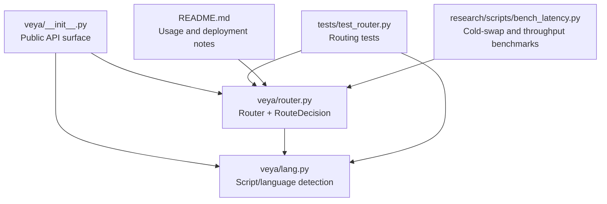
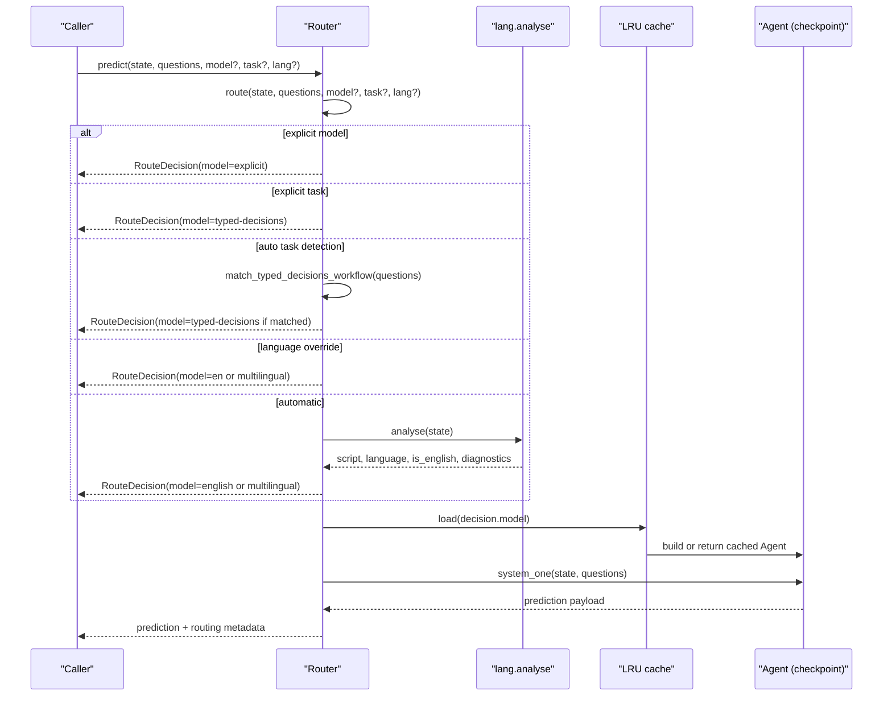
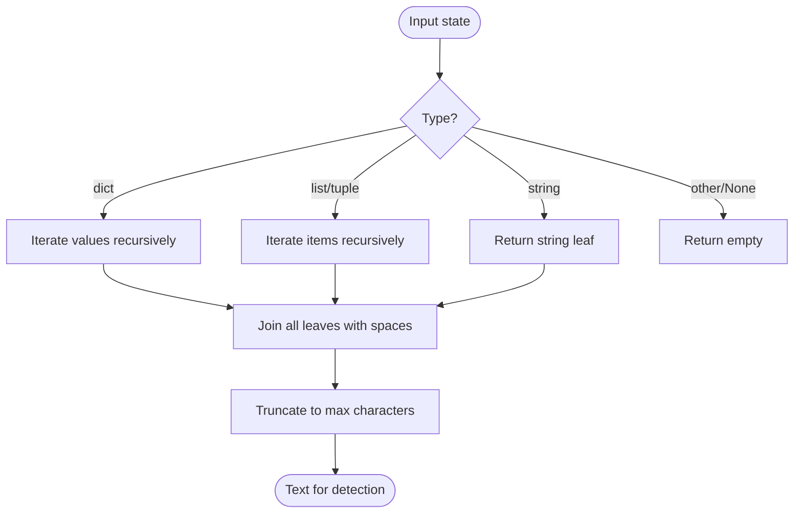
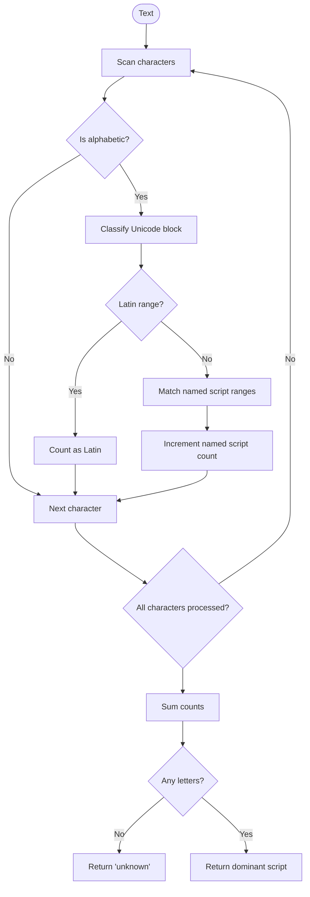
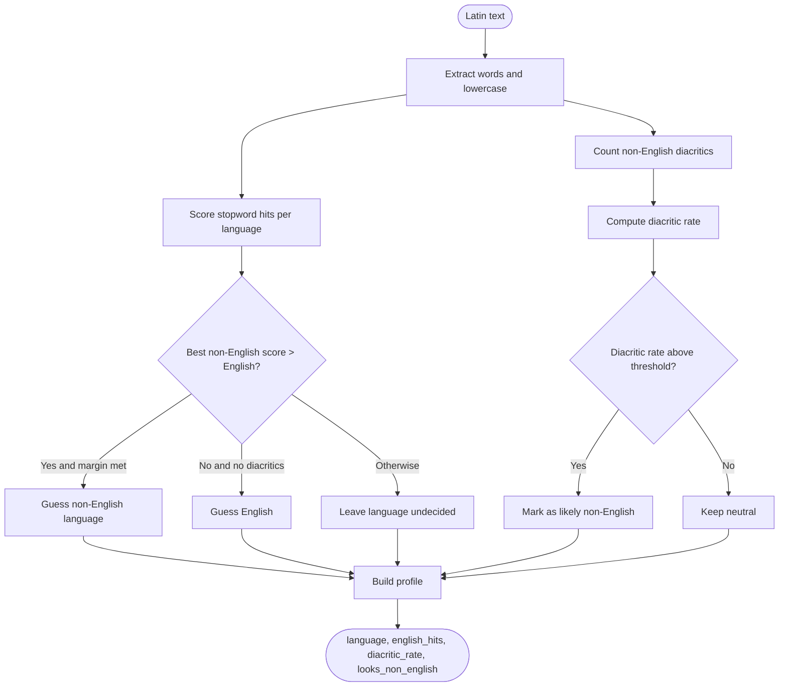
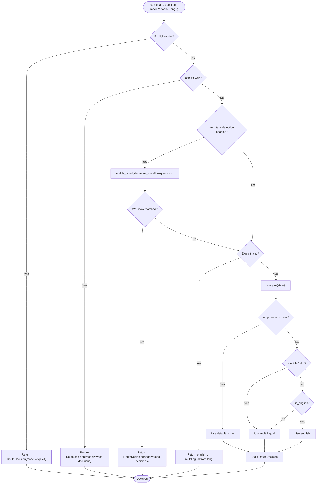
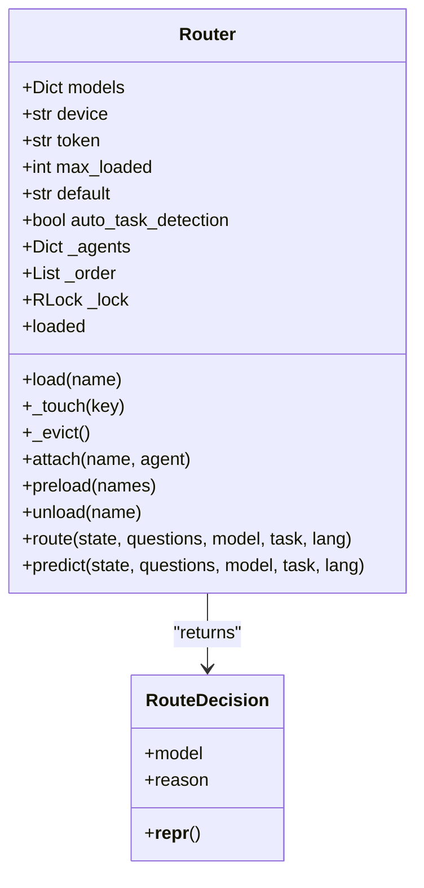
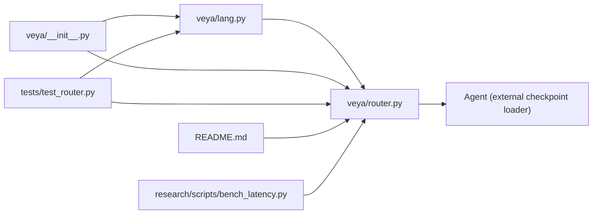

# Routing System

<cite>
**Referenced Files in This Document**
- [router.py](file://veya/router.py)
- [lang.py](file://veya/lang.py)
- [__init__.py](file://veya/__init__.py)
- [test_router.py](file://tests/test_router.py)
- [README.md](file://README.md)
- [bench_latency.py](file://research/scripts/bench_latency.py)
</cite>

## Table of Contents
1. [Introduction](#introduction)
2. [Project Structure](#project-structure)
3. [Core Components](#core-components)
4. [Architecture Overview](#architecture-overview)
5. [Detailed Component Analysis](#detailed-component-analysis)
6. [Dependency Analysis](#dependency-analysis)
7. [Performance Considerations](#performance-considerations)
8. [Troubleshooting Guide](#troubleshooting-guide)
9. [Conclusion](#conclusion)

## Introduction
Veya’s routing system selects among three production checkpoints for each request:

| Checkpoint | Purpose | Core characteristics |
|---|---|---|
| `english` | English-only decision engine | ModernBERT-large, optimized for English Latin text |
| `multilingual` | Non-English and mixed-language input | mmBERT-base, supports many scripts and languages |
| `typed-decisions` | Synthetic typed workflows | Fine-tuned on four specific question schemas; not a silent default |

The router does not run inference during routing. It inspects the request state, detects script and language signals, optionally matches a typed-decisions workflow, and returns a lightweight routing decision. Inference is performed only after the chosen checkpoint is loaded.

This design exists because the English checkpoint does not degrade gracefully outside English: benchmarks show near-random performance on non-Latin scripts while still reporting high confidence. Script detection is therefore the primary routing signal, with Latin-script language heuristics as a secondary safety layer.

**Section sources**
- [router.py:1-29](file://veya/router.py#L1-L29)

## Project Structure
The routing system lives under the Veya package and exposes both low-level detection utilities and a higher-level model router.

**Diagram sources**
- [__init__.py:1-24](file://veya/__init__.py#L1-L24)
- [router.py:1-30](file://veya/router.py#L1-L30)
- [lang.py:1-12](file://veya/lang.py#L1-L12)
- [test_router.py:1-19](file://tests/test_router.py#L1-L19)
- [README.md:68-125](file://README.md#L68-L125)
- [bench_latency.py:126-139](file://research/scripts/bench_latency.py#L126-L139)

**Section sources**
- [__init__.py:1-24](file://veya/__init__.py#L1-L24)
- [router.py:1-30](file://veya/router.py#L1-L30)
- [lang.py:1-12](file://veya/lang.py#L1-L12)

## Core Components
The routing system has two main layers:

1. **Language and script detection** (`veya.lang`)
   - Flattens nested state into text.
   - Detects dominant Unicode script.
   - Estimates whether Latin text is English using stopwords and diacritic signals.
   - Produces a structured analysis result used by the router.

2. **Model router** (`veya.router`)
   - Normalizes model names and aliases.
   - Optionally matches typed-decisions workflows based on question IDs.
   - Applies a precedence-based routing policy.
   - Lazily loads or preloads checkpoints.
   - Manages memory through LRU eviction.
   - Exposes `route`, `predict`, `preload`, `attach`, and `unload`.

Key public exports include `Router`, `RouteDecision`, `DEFAULT_MODELS`, `detect_language`, `detect_script`, and `is_english`.

**Section sources**
- [__init__.py:14-24](file://veya/__init__.py#L14-L24)
- [router.py:36-71](file://veya/router.py#L36-L71)
- [lang.py:87-108](file://veya/lang.py#L87-L108)

## Architecture Overview
At runtime, a request flows through detection first, then routing, then model loading and inference.

**Diagram sources**
- [router.py:257-333](file://veya/router.py#L257-L333)
- [lang.py:209-238](file://veya/lang.py#L209-L238)

## Detailed Component Analysis

### Language Detection Pipeline
Detection is dependency-free and designed to be fast enough to run per request.

#### State Flattening
State can be a string, dict, list, or nested combination. Keys are ignored so that English field names do not bias detection toward English when the values are non-English.

**Diagram sources**
- [lang.py:87-108](file://veya/lang.py#L87-L108)

#### Script Detection
The detector counts alphabetic characters and classifies them into known Unicode blocks. If no letters are found, the script is reported as unknown. The dominant script wins by character count.

**Diagram sources**
- [lang.py:16-43](file://veya/lang.py#L16-L43)
- [lang.py:111-130](file://veya/lang.py#L111-L130)

#### Latin-Language Heuristic
For Latin text, the detector uses two signals:

1. Stopword overlap across supported languages.
2. Diacritic rate against characters ordinary English does not use.

A non-English language must beat English by a margin and should not rely on a single shared function word. Short inputs often remain undecided intentionally.

**Diagram sources**
- [lang.py:45-84](file://veya/lang.py#L45-L84)
- [lang.py:153-196](file://veya/lang.py#L153-L196)

#### Full Analysis Output
The full analysis result includes:

| Field | Meaning |
|---|---|
| `script` | Dominant script: `latin`, `han`, `devanagari`, etc., or `unknown` |
| `script_profile` | Fraction of characters per script |
| `language` | Best-effort language code or `None` |
| `is_english` | Whether the English checkpoint is considered safe |
| `language_undecided` | Whether Latin text could not be confidently classified |
| `diacritic_rate` | Fraction of non-English diacritics |
| `non_latin_fraction` | Fraction of non-Latin characters |

**Section sources**
- [lang.py:87-108](file://veya/lang.py#L87-L108)
- [lang.py:111-130](file://veya/lang.py#L111-L130)
- [lang.py:153-196](file://veya/lang.py#L153-L196)
- [lang.py:209-238](file://veya/lang.py#L209-L238)

### Routing Decision Logic
The router applies this precedence order:

1. Explicit `model` parameter.
2. Explicit `task` parameter.
3. Auto-detected typed-decisions workflow (opt-in).
4. Explicit `lang` parameter.
5. Automatic script and language detection.
6. Default model.

**Diagram sources**
- [router.py:257-312](file://veya/router.py#L257-L312)
- [router.py:110-120](file://veya/router.py#L110-L120)
- [lang.py:209-238](file://veya/lang.py#L209-L238)

#### Typed-Decisions Workflow Matching
Typed-decisions routing is opt-in via `auto_task_detection=True`. Matching requires an exact set of question IDs; partial overlaps or extra fields do not trigger it. This prevents unrelated schemas from accidentally selecting the specialized checkpoint.

Supported workflow signatures include:

| Workflow | Question ID signature |
|---|---|
| `agent_trace_observability` | `action`, `needs_review`, `outcome`, `risk`, `urgency` |
| `customer_service` | `action`, `category`, `churn_risk`, `needs_human`, `urgency` |
| `invoice_processing` | `discrepancy_severity`, `disposition`, `duplicate`, `matches_order`, `urgency` |
| `security_incidents` | `credential_compromise`, `disposition`, `severity`, `true_positive`, `urgency` |

**Section sources**
- [router.py:73-80](file://veya/router.py#L73-L80)
- [router.py:110-120](file://veya/router.py#L110-L120)
- [test_router.py:129-143](file://tests/test_router.py#L129-L143)

### Memory Management and LRU Eviction
The router maintains:

- `_agents`: mapping from normalized model name to loaded agent.
- `_order`: least-recently-used-first list.
- `max_loaded`: maximum number of agents kept resident.
- `_lock`: reentrant lock protecting lifecycle and LRU bookkeeping.

When a model is accessed:

1. The key is normalized.
2. If already loaded, it is moved to the most-recent position.
3. If not loaded, an `Agent` is constructed and stored.
4. Eviction removes the oldest entries until the cache fits within `max_loaded`.

**Diagram sources**
- [router.py:83-99](file://veya/router.py#L83-L99)
- [router.py:123-254](file://veya/router.py#L123-L254)

#### Eviction Behavior
- `max_loaded=1` keeps only the most recently used checkpoint.
- Repeated access moves a checkpoint to the end of `_order`.
- Eviction pops from the front until capacity is satisfied.
- `preload` raises `max_loaded` so preloaded checkpoints are not immediately evicted.
- `attach` registers an externally built agent and participates in LRU ordering.

**Section sources**
- [router.py:164-170](file://veya/router.py#L164-L170)
- [router.py:175-208](file://veya/router.py#L175-L208)
- [router.py:209-237](file://veya/router.py#L209-L237)
- [test_router.py:247-295](file://tests/test_router.py#L247-L295)

### Preload Strategies
Preloading downloads and builds checkpoints before any request arrives. This avoids cold-load latency on the hot path.

Recommended strategies:

| Strategy | When to use | Trade-off |
|---|---|---|
| `Router(preload=True)` | Servers or demos where all checkpoints may be needed | Highest memory usage; fastest routing |
| `Router(preload=["english", "multilingual"])` | Known workload without typed-decisions traffic | Lower memory; still fast for common cases |
| Lazy loading with tuned `max_loaded` | Low-memory environments or infrequent multi-model traffic | Risk of reload latency on language switches |
| `attach` | Process already owns a checkpoint instance | Avoids duplicate weights and memory duplication |

**Section sources**
- [router.py:123-143](file://veya/router.py#L123-L143)
- [router.py:223-237](file://veya/router.py#L223-L237)
- [README.md:68-125](file://README.md#L68-L125)
- [README.md:163-180](file://README.md#L163-L180)

### Manual Routing Overrides
Manual overrides take precedence over automatic detection:

| Override | Effect |
|---|---|
| `model="english"` | Forces the English checkpoint regardless of detected script |
| `model="multilingual"` | Forces the multilingual checkpoint regardless of detected script |
| `model="typed-decisions"` | Forces the typed-decisions checkpoint |
| `task="typed_decisions"` | Maps to the typed-decisions checkpoint |
| `lang="en"` | Routes to English |
| `lang="de"` or other non-English codes | Routes to multilingual |

These overrides are useful for testing, controlled experiments, or when upstream systems already know the language or task.

**Section sources**
- [router.py:257-289](file://veya/router.py#L257-L289)
- [test_router.py:165-196](file://tests/test_router.py#L165-L196)

### Custom Routing Strategies
The current implementation does not expose a pluggable strategy interface. However, custom behavior can be achieved through:

1. **Explicit parameters**: Pass `model`, `task`, or `lang` to bypass automatic routing.
2. **Custom defaults**: Construct `Router(default="multilingual")` to change fallback behavior.
3. **External orchestration**: Inspect `Router.route()` output and decide at the application layer before calling `predict`.
4. **Attached agents**: Use `attach` to inject prebuilt agents and control which checkpoint serves which logical model.
5. **Model spec overrides**: Pass `models={"english": "...", "multilingual": "..."}` to point to local paths or alternative repositories.

If a fully custom routing policy is required, wrap `Router.route` or subclass the routing logic externally rather than modifying the core router.

**Section sources**
- [router.py:145-172](file://veya/router.py#L145-L172)
- [router.py:209-237](file://veya/router.py#L209-L237)
- [test_router.py:306-317](file://tests/test_router.py#L306-L317)

### Production Deployment Patterns
For high-throughput deployments:

- Prefer `Router(preload=True)` or preload only the checkpoints you serve.
- Set `device="cuda"` when GPU acceleration is available.
- Tune `max_loaded` based on observed traffic patterns.
- Monitor `router.loaded` to verify resident checkpoints.
- Use `router.unload()` to free memory during maintenance or scaling events.
- Record the `routing` field in responses for observability and auditability.

Benchmarks indicate that cold checkpoint builds cost seconds, while language detection costs microseconds. At `max_loaded=1`, alternating languages can force a reload on every switch.

**Section sources**
- [README.md:163-180](file://README.md#L163-L180)
- [README.md:185-186](file://README.md#L185-L186)
- [bench_latency.py:126-139](file://research/scripts/bench_latency.py#L126-L139)
- [router.py:315-333](file://veya/router.py#L315-L333)

## Dependency Analysis
The routing system has clear boundaries between detection and model management.

**Diagram sources**
- [__init__.py:14-24](file://veya/__init__.py#L14-L24)
- [router.py:30-34](file://veya/router.py#L30-L34)
- [lang.py:1-12](file://veya/lang.py#L1-L12)
- [test_router.py:1-19](file://tests/test_router.py#L1-L19)
- [README.md:68-125](file://README.md#L68-L125)
- [bench_latency.py:126-139](file://research/scripts/bench_latency.py#L126-L139)

### Coupling and Cohesion
- `lang.py` is self-contained and dependency-free for detection.
- `router.py` depends on `lang.py` but not directly on model weights during routing.
- `Router.load` imports `Agent` lazily to avoid unnecessary initialization.
- Tests validate routing decisions, LRU behavior, aliasing, bundle vs standalone repos, preload behavior, attach behavior, and thread safety.

### External Dependencies
- Hugging Face Hub repositories are referenced through `BUNDLE_REPO` and `STANDALONE_MODELS`.
- The bundled configuration points subfolders inside a shared repository.
- Standalone mode allows separate repositories for each checkpoint.

**Section sources**
- [router.py:36-49](file://veya/router.py#L36-L49)
- [router.py:175-191](file://veya/router.py#L175-L191)
- [test_router.py:298-317](file://tests/test_router.py#L298-L317)

## Performance Considerations
The routing system separates two distinct costs:

| Operation | Typical cost | Notes |
|---|---:|---|
| Language/script detection | Microseconds | Pure Python, no model weights |
| Hot-path routing | Near-zero | Already-resident checkpoint |
| Cold checkpoint load | Seconds | Download, build, and initialize model |
| Inference | Milliseconds to hundreds of milliseconds | Depends on hardware, batch size, and checkpoint |

Key implications:

- With `max_loaded=1`, language alternation can cause repeated cold loads.
- Preloading eliminates cold-load latency on subsequent requests.
- LRU eviction protects memory but can increase latency under mixed workloads.
- Thread safety ensures concurrent callers share one constructed agent, but inference itself is outside the lock.

Observed benchmark behavior includes cold-swap latency when `max_loaded=1` forces a swap on every language flip.

**Section sources**
- [README.md:163-186](file://README.md#L163-L186)
- [bench_latency.py:126-139](file://research/scripts/bench_latency.py#L126-L139)
- [router.py:123-143](file://veya/router.py#L123-L143)
- [router.py:164-170](file://veya/router.py#L164-L170)

## Troubleshooting Guide

### Symptom: Requests alternate between models and feel slow
**Likely cause:** `max_loaded=1` with mixed-language traffic causes repeated cold loads.

**Actions:**
- Enable preloading: `Router(preload=True)`.
- Or preload only needed checkpoints: `router.preload(["english", "multilingual"])`.
- Increase `max_loaded` if memory allows.

**Section sources**
- [README.md:163-180](file://README.md#L163-L180)
- [router.py:223-237](file://veya/router.py#L223-L237)

### Symptom: Non-English text is routed to the English checkpoint
**Likely cause:** Very short Latin text without strong diacritic or stopword signals can remain undecided and fall back to English.

**Actions:**
- Provide more context in the state.
- Use explicit `lang` override when upstream knows the language.
- Use explicit `model="multilingual"` for safety-critical cases.

**Section sources**
- [lang.py:199-206](file://veya/lang.py#L199-L206)
- [lang.py:227-238](file://veya/lang.py#L227-L238)
- [test_router.py:82-101](file://tests/test_router.py#L82-L101)

### Symptom: Typed-decisions checkpoint is not selected automatically
**Likely cause:** Auto task detection is disabled by default.

**Actions:**
- Enable `auto_task_detection=True`.
- Ensure the question schema exactly matches one of the typed-decisions workflow signatures.
- Use explicit `task="typed_decisions"` or `model="typed-decisions"` for deterministic routing.

**Section sources**
- [router.py:26-28](file://veya/router.py#L26-L28)
- [router.py:110-120](file://veya/router.py#L110-L120)
- [test_router.py:188-196](file://tests/test_router.py#L188-L196)

### Symptom: Memory usage grows unexpectedly
**Likely cause:** Too many checkpoints are preloaded or attached.

**Actions:**
- Check `router.loaded`.
- Reduce `max_loaded`.
- Call `router.unload("model_name")` or `router.unload()` to free all.
- Avoid attaching multiple duplicate agents unless necessary.

**Section sources**
- [router.py:239-254](file://veya/router.py#L239-L254)
- [test_router.py:292-295](file://tests/test_router.py#L292-L295)

### Symptom: Concurrent requests behave inconsistently
**Likely cause:** Misunderstanding of concurrency guarantees.

**Behavior:**
- Model loading and LRU bookkeeping are protected by a reentrant lock.
- Concurrent calls to load the same checkpoint construct one agent and share it.
- Inference is deliberately outside the lock so concurrent predictions can run in parallel.

**Section sources**
- [router.py:164-170](file://veya/router.py#L164-L170)
- [test_router.py:359-432](file://tests/test_router.py#L359-L432)

## Conclusion
Veya’s routing system is a focused bridge between lightweight language detection and heavyweight model execution. Its design prioritizes safety: script detection prevents the English checkpoint from processing non-Latin text, and Latin-script language heuristics provide a best-effort guardrail. Typed-decisions routing is opt-in and schema-exact to avoid accidental specialization.

For production, the most important operational choice is memory versus latency: preload all needed checkpoints for consistent low-latency routing, or use lazy loading with carefully tuned `max_loaded` for constrained environments. Always inspect the `routing` metadata in responses to understand why a particular checkpoint was selected.