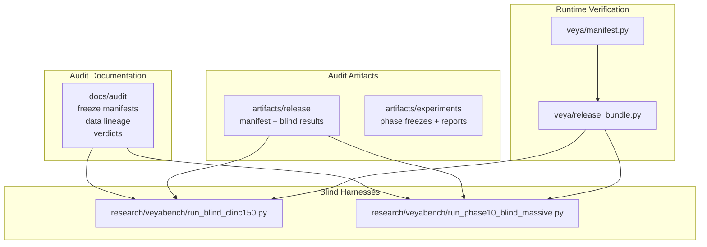
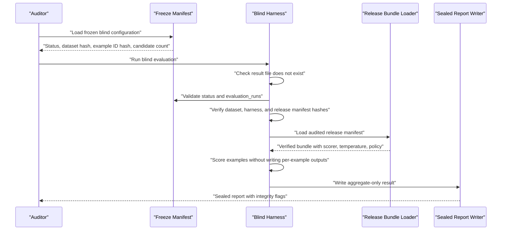
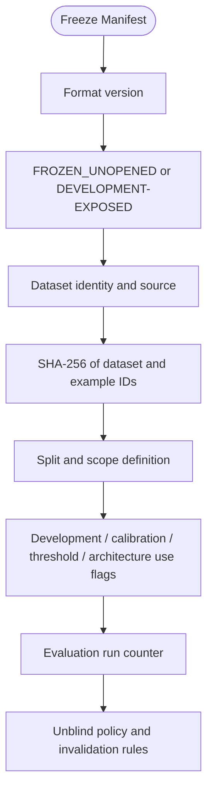
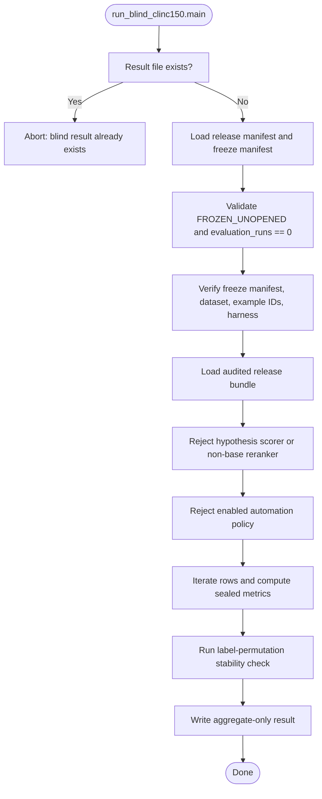
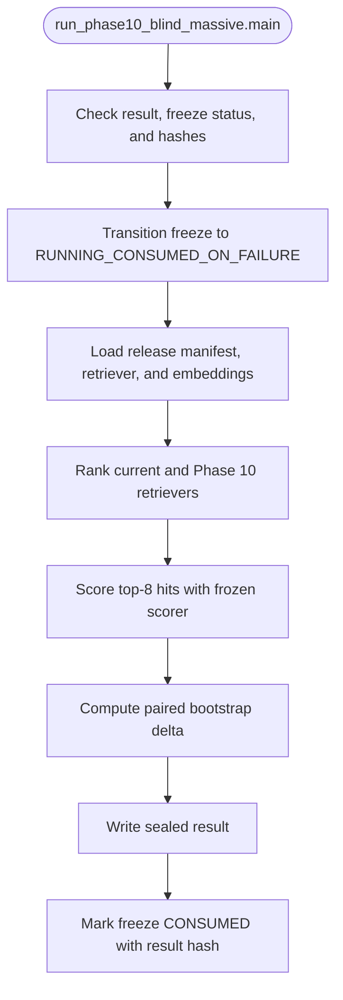
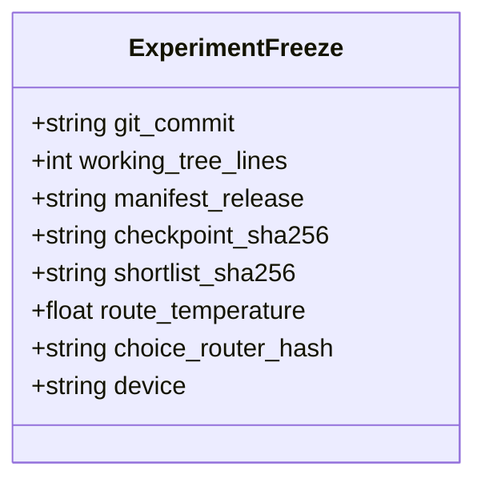
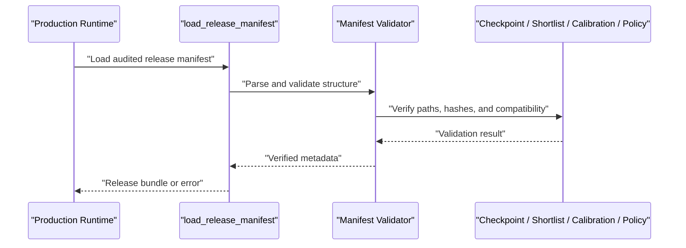
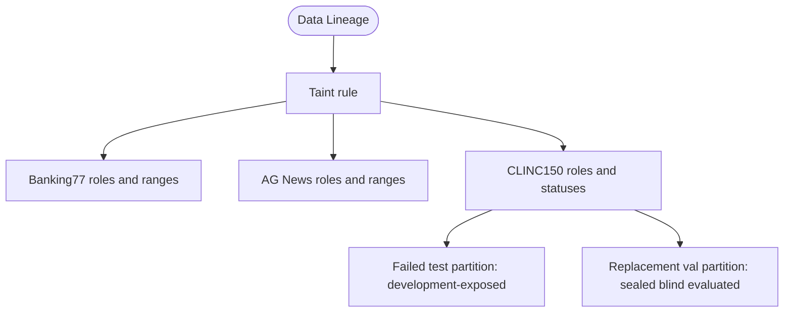
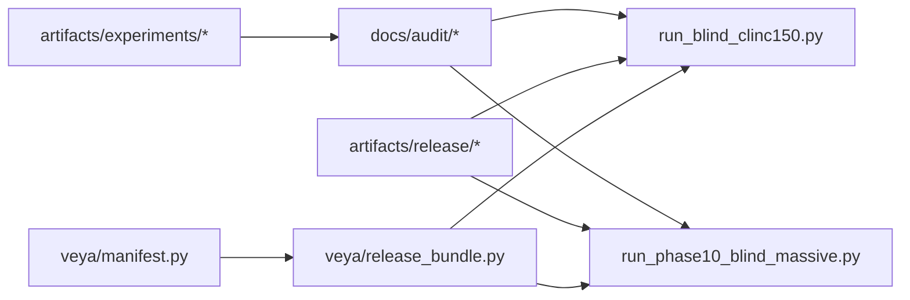

# Audit & Compliance Testing

<cite>
**Referenced Files in This Document**
- [README.md](file://README.md)
- [release_verdict.md](file://docs/audit/release_verdict.md)
- [phase_1_9_matrix.md](file://docs/audit/phase_1_9_matrix.md)
- [data_lineage.json](file://docs/audit/data_lineage.json)
- [blind_clinc150_freeze.json](file://docs/audit/blind_clinc150_freeze.json)
- [blind_clinc150_val_freeze.json](file://docs/audit/blind_clinc150_val_freeze.json)
- [freeze.json](file://artifacts/experiments/phase6/freeze.json)
- [run_blind_clinc150.py](file://research/veyabench/run_blind_clinc150.py)
- [run_phase10_blind_massive.py](file://research/veyabench/run_phase10_blind_massive.py)
- [release_bundle.py](file://veya/release_bundle.py)
- [manifest.py](file://veya/manifest.py)
</cite>

## Table of Contents
1. [Introduction](#introduction)
2. [Project Structure](#project-structure)
3. [Core Components](#core-components)
4. [Architecture Overview](#architecture-overview)
5. [Detailed Component Analysis](#detailed-component-analysis)
6. [Dependency Analysis](#dependency-analysis)
7. [Performance Considerations](#performance-considerations)
8. [Troubleshooting Guide](#troubleshooting-guide)
9. [Conclusion](#conclusion)
10. [Appendices](#appendices)

## Introduction
This document explains Veya’s audit and compliance testing processes with a focus on blind evaluation, release verification, artifact management, and reproducibility guarantees. It covers how frozen datasets and harnesses are protected, how audit trails are recorded, how automated compliance checks are enforced, and how production deployments should be interpreted under the current research-release status.

The audited English Choice path is a research release. Automation is disabled, calibration must not be treated as a production risk guarantee, and high-cardinality retrieval remains the primary bottleneck. Blind results are intentionally aggregate-only to prevent leakage or post-hoc selection.

**Section sources**
- [README.md:27-46](file://README.md#L27-L46)
- [release_verdict.md:1-22](file://docs/audit/release_verdict.md#L1-L22)

## Project Structure
Veya separates audited release artifacts, experimental research runs, and compliance documentation into distinct areas:

- `artifacts/release`: sealed release manifest and blind result outputs.
- `artifacts/experiments`: phase-scoped experiments, freeze snapshots, and research reports.
- `docs/audit`: blind freeze manifests, data lineage, forensic matrices, and release verdicts.
- `research/veyabench`: deterministic harness scripts that enforce blind protocols and produce sealed reports.
- `veya`: runtime components that load and verify the audited release bundle.

**Diagram sources**
- [run_blind_clinc150.py:1-272](file://research/veyabench/run_blind_clinc150.py#L1-L272)
- [run_phase10_blind_massive.py:1-307](file://research/veyabench/run_phase10_blind_massive.py#L1-L307)
- [release_bundle.py](file://veya/release_bundle.py)
- [manifest.py](file://veya/manifest.py)
- [data_lineage.json:1-51](file://docs/audit/data_lineage.json#L1-L51)

**Section sources**
- [README.md:27-46](file://README.md#L27-L46)
- [phase_1_9_matrix.md:1-35](file://docs/audit/phase_1_9_matrix.md#L1-L35)

## Core Components
The audit system relies on five core mechanisms:

1. **Blind freeze manifests**: JSON documents that lock dataset identity, split, example IDs, candidate universe, allowed usage, and run state.
2. **Harness integrity checks**: Evaluation scripts refuse reruns, validate hashes for data, harness, release manifest, and model artifacts, and transition freeze state only once.
3. **Aggregate-only output**: Blind results contain metrics and integrity flags but never per-example predictions or class-level breakdowns.
4. **Release bundle verification**: The runtime loads the audited manifest and rejects incompatible checkpoints, shortlists, policies, scorers, routers, or code cutoffs.
5. **Data lineage tracking**: A central record labels each dataset partition by role and taint status, distinguishing sealed blind data from development-exposed data.

Key responsibilities:

| Component | Responsibility |
|---|---|
| Freeze manifest | Locks inputs, records intent, and constrains reruns |
| Blind harness | Enforces protocol, validates hashes, computes sealed metrics |
| Release bundle loader | Verifies served architecture and policy at startup |
| Data lineage | Documents exposure history and blind replacement logic |
| Release verdict | Summarizes audited scope, limitations, and verification commands |

**Section sources**
- [blind_clinc150_val_freeze.json:1-25](file://docs/audit/blind_clinc150_val_freeze.json#L1-L25)
- [run_blind_clinc150.py:122-158](file://research/veyabench/run_blind_clinc150.py#L122-L158)
- [release_verdict.md:22-22](file://docs/audit/release_verdict.md#L22-L22)
- [data_lineage.json:1-51](file://docs/audit/data_lineage.json#L1-L51)

## Architecture Overview
The blind evaluation flow protects three layers: data, harness, and runtime.

**Diagram sources**
- [run_blind_clinc150.py:122-267](file://research/veyabench/run_blind_clinc150.py#L122-L267)
- [run_phase10_blind_massive.py:156-301](file://research/veyabench/run_phase10_blind_massive.py#L156-L301)
- [release_bundle.py](file://veya/release_bundle.py)

**Section sources**
- [run_blind_clinc150.py:1-272](file://research/veyabench/run_blind_clinc150.py#L1-L272)
- [run_phase10_blind_massive.py:1-307](file://research/veyabench/run_phase10_blind_massive.py#L1-L307)

## Detailed Component Analysis

### Blind Freeze Manifests
A blind freeze manifest defines the contract for an untouched evaluation. For CLINC150, two manifests illustrate the evolution from a failed test partition to a replacement validation partition:

- The original CLINC150 `test` partition was scored once but failed during final persistence; it is permanently development-exposed and cannot certify release readiness.
- The CLINC150 `val` partition was frozen afterward, evaluated once, and sealed with aggregate-only output. Its unblind policy explicitly forbids reruns after any later model, route, calibration, policy, or harness change.

Important fields include format version, status, frozen timestamp, dataset source, local file, SHA-256, split, scope, example count, candidate count, example ID hash, usage restrictions, evaluation run count, invalidation notes, and unblind policy.

**Diagram sources**
- [blind_clinc150_freeze.json:1-26](file://docs/audit/blind_clinc150_freeze.json#L1-L26)
- [blind_clinc150_val_freeze.json:1-25](file://docs/audit/blind_clinc150_val_freeze.json#L1-L25)

**Section sources**
- [blind_clinc150_freeze.json:1-26](file://docs/audit/blind_clinc150_freeze.json#L1-L26)
- [blind_clinc150_val_freeze.json:1-25](file://docs/audit/blind_clinc150_val_freeze.json#L1-L25)
- [phase_1_9_matrix.md:30-35](file://docs/audit/phase_1_9_matrix.md#L30-L35)

### CLINC150 Blind Evaluation Harness
The CLINC150 blind harness enforces a one-shot, aggregate-only protocol:

- Refuses to run if a result already exists.
- Loads the release manifest and the blind freeze manifest.
- Validates that the blind protocol is still `FROZEN_UNOPENED` and has zero prior evaluations.
- Checks the freeze manifest hash against the release manifest’s blind section.
- Verifies the dataset file hash and example ID hash.
- Confirms the harness script itself is frozen in the release manifest.
- Loads the audited release bundle and rejects non-frozen scorers or enabled automation.
- Computes recall, conditional accuracy, end-to-end accuracy, NLL/Brier, ECE, latency, and permutation stability.
- Writes only aggregate metrics and integrity flags.

**Diagram sources**
- [run_blind_clinc150.py:122-267](file://research/veyabench/run_blind_clinc150.py#L122-L267)

**Section sources**
- [run_blind_clinc150.py:1-272](file://research/veyabench/run_blind_clinc150.py#L1-L272)

### Phase 10 MASSIVE Blind Evaluation Harness
The Phase 10 blind harness evaluates an experimental retriever against an untouched Amazon MASSIVE English test set while preserving the audited release manifest:

- Refuses reruns and requires `FROZEN_UNOPENED` with zero evaluations.
- Validates dataset, retriever artifact, release manifest, and harness hashes before scoring.
- Transitions the freeze manifest to a running state immediately after pre-run checks, so a crash consumes the run.
- Loads the release bundle and the frozen retriever artifact.
- Computes retrieval rankings, paired bootstrap deltas, and end-to-end accuracy for both the current and Phase 10 retrievers.
- Records permutation stability and explicitly retains no per-example predictions, errors, scores, ranks, confidence, or class metrics.

**Diagram sources**
- [run_phase10_blind_massive.py:156-301](file://research/veyabench/run_phase10_blind_massive.py#L156-L301)

**Section sources**
- [run_phase10_blind_massive.py:1-307](file://research/veyabench/run_phase10_blind_massive.py#L1-L307)

### Experiment Freeze Snapshots
Experiment freezes capture a reproducible snapshot of code, artifacts, and runtime settings. The Phase 6 experiment freeze includes git commit, working tree line count, manifest release tag, checkpoint and shortlist hashes, route temperature, router hash, and device. These fields support reproduction and regression checks even when the experiment is not part of the served release.

**Diagram sources**
- [freeze.json:1-11](file://artifacts/experiments/phase6/freeze.json#L1-L11)

**Section sources**
- [freeze.json:1-11](file://artifacts/experiments/phase6/freeze.json#L1-L11)

### Release Bundle and Manifest Verification
The audited startup path is `veya.release_bundle.load_release_manifest`. It verifies the served architecture and rejects:

- Path traversal
- File-hash mismatch
- Incompatible checkpoint, shortlist, calibration, or policy
- Scorer mismatch
- Router or code cutoff mismatch

The release verdict confirms that this verified startup path is the authoritative entry point for production behavior.

**Diagram sources**
- [release_bundle.py](file://veya/release_bundle.py)
- [manifest.py](file://veya/manifest.py)
- [release_verdict.md:22-22](file://docs/audit/release_verdict.md#L22-L22)

**Section sources**
- [release_verdict.md:22-22](file://docs/audit/release_verdict.md#L22-L22)
- [release_bundle.py](file://veya/release_bundle.py)
- [manifest.py](file://veya/manifest.py)

### Data Lineage and Taint Rules
The data lineage document defines the audit rule that any labels or errors inspected before later architecture, loss, K, routing, candidate-text, negative-mining, calibration, or automation decisions make a set development-exposed. It then enumerates dataset roles, ranges, hashes, and statuses.

For CLINC150, it distinguishes:

- The failed first blind high-cardinality choice partition, marked development-exposed.
- The replacement fresh blind high-cardinality choice partition, marked sealed blind evaluated, with its result path and result hash.

**Diagram sources**
- [data_lineage.json:1-51](file://docs/audit/data_lineage.json#L1-L51)

**Section sources**
- [data_lineage.json:1-51](file://docs/audit/data_lineage.json#L1-L51)

## Dependency Analysis
The audit pipeline connects documentation, harnesses, artifacts, and runtime verification.

**Diagram sources**
- [run_blind_clinc150.py:1-272](file://research/veyabench/run_blind_clinc150.py#L1-L272)
- [run_phase10_blind_massive.py:1-307](file://research/veyabench/run_phase10_blind_massive.py#L1-L307)
- [release_bundle.py](file://veya/release_bundle.py)
- [manifest.py](file://veya/manifest.py)

**Section sources**
- [phase_1_9_matrix.md:1-35](file://docs/audit/phase_1_9_matrix.md#L1-L35)
- [release_verdict.md:90-95](file://docs/audit/release_verdict.md#L90-L95)

## Performance Considerations
Blind evaluation performance is reported alongside metrics:

- CLINC150 blind evaluation records latency percentiles, throughput, cold load time, platform, Python version, device, and RSS.
- Phase 10 blind evaluation records model load time, retrieval embedding time, platform, Python version, Torch version, and device.
- The release verdict includes runtime evidence for small packed Choice, high-N Choice, Noul, categorical Score, and SystemOne calls, noting that hardware and filesystem cache state materially affect load and hash stages.

Practical implications:

- Blind results are not latency SLAs; they are audit observations.
- Cold model loads can dominate runtime cost.
- Reproducing blind metrics requires matching the documented environment where possible, but the primary audit guarantee is cryptographic hashing and aggregate-only output, not identical timing.

**Section sources**
- [run_blind_clinc150.py:247-256](file://research/veyabench/run_blind_clinc150.py#L247-L256)
- [run_phase10_blind_massive.py:267-274](file://research/veyabench/run_phase10_blind_massive.py#L267-L274)
- [release_verdict.md:68-80](file://docs/audit/release_verdict.md#L68-L80)

## Troubleshooting Guide
Common audit failures and their meanings:

| Symptom | Likely Cause | Resolution |
|---|---|---|
| Blind harness aborts because result already exists | Previous sealed run produced output | Do not rerun; treat existing result as consumed |
| Blind protocol is not frozen-unopened | Freeze manifest was opened, rerun, or modified | Restore the original freeze manifest and reset evaluation state |
| Freeze manifest hash mismatch | Release manifest references a different freeze file | Rebuild the release manifest to match the intended freeze |
| Dataset hash mismatch | Underlying data changed | Restore the exact dataset referenced by the freeze |
| Example ID hash mismatch | Split order or filtering changed | Confirm split and example ID generation match the freeze |
| Candidate universe changed | Label set changed | Restore the exact candidate list used by the freeze |
| Harness hash mismatch | Evaluation script changed | Use the harness version frozen in the release manifest |
| Non-frozen scorer or hypothesis loaded | Bundle configuration changed | Restore the base decision head and disable automation |
| Automation unexpectedly enabled | Selective policy changed | Disable automation and reload the audited policy |
| Phase 10 harness reports retriever or manifest changed | Frozen artifact or manifest replaced | Restore the exact retriever artifact and release manifest hashes |

Interpreting audit results:

- Treat blind metrics as sealed evidence, not tuning targets.
- Do not inspect per-example outputs from blind partitions unless the protocol explicitly permits it.
- If any component changes after freezing, the blind partition becomes development-exposed.
- Use the release verdict’s verification commands as a baseline for compliance checks.

**Section sources**
- [run_blind_clinc150.py:122-158](file://research/veyabench/run_blind_clinc150.py#L122-L158)
- [run_phase10_blind_massive.py:156-181](file://research/veyabench/run_phase10_blind_massive.py#L156-L181)
- [release_verdict.md:97-112](file://docs/audit/release_verdict.md#L97-L112)

## Conclusion
Veya’s audit and compliance framework centers on immutable freeze manifests, hash-checked harnesses, aggregate-only blind outputs, strict release bundle verification, and explicit data lineage. The current audited production path is a research release for English Choice with automation disabled and calibrated probabilities not treated as production risk guarantees. Blind evaluation demonstrates that retrieval quality dominates end-to-end performance, and future improvements should preserve the frozen release manifest while improving domain-general shortlist retrieval.

For production deployments, maintain compliance by:

- Keeping the audited release manifest unchanged.
- Running blind harnesses only in their frozen state.
- Recording all audit artifacts, hashes, and verdicts.
- Treating development-exposed data as unsuitable for release certification.
- Validating runtime startup through the verified release bundle loader.

**Section sources**
- [README.md:27-46](file://README.md#L27-L46)
- [release_verdict.md:1-22](file://docs/audit/release_verdict.md#L1-L22)
- [phase_1_9_matrix.md:21-29](file://docs/audit/phase_1_9_matrix.md#L21-L29)

## Appendices

### Appendix A: Blind Protocol Checklist
- Freeze manifest is present and in the expected state.
- Dataset, example IDs, candidate universe, harness, and release manifest hashes match.
- Result file does not exist before the first run.
- No per-example outputs are written.
- Automation is disabled.
- Integrity flags confirm one evaluation run.
- Any post-freeze change invalidates the blind claim.

**Section sources**
- [run_blind_clinc150.py:122-267](file://research/veyabench/run_blind_clinc150.py#L122-L267)
- [run_phase10_blind_massive.py:156-301](file://research/veyabench/run_phase10_blind_massive.py#L156-L301)

### Appendix B: Interpretation Guidance
- Recall@8 measures whether the true label reached the reranker.
- Conditional accuracy measures reranker correctness given retrieval success.
- End-to-end accuracy combines retrieval and reranking.
- ECE measures calibration reliability; do not interpret it as a safety guarantee.
- Descriptive selective-policy thresholds show observed coverage and risk but do not establish production guarantees.
- Permutation stability checks detect sensitivity to label ordering.

**Section sources**
- [run_blind_clinc150.py:213-263](file://research/veyabench/run_blind_clinc150.py#L213-L263)
- [release_verdict.md:37-66](file://docs/audit/release_verdict.md#L37-L66)