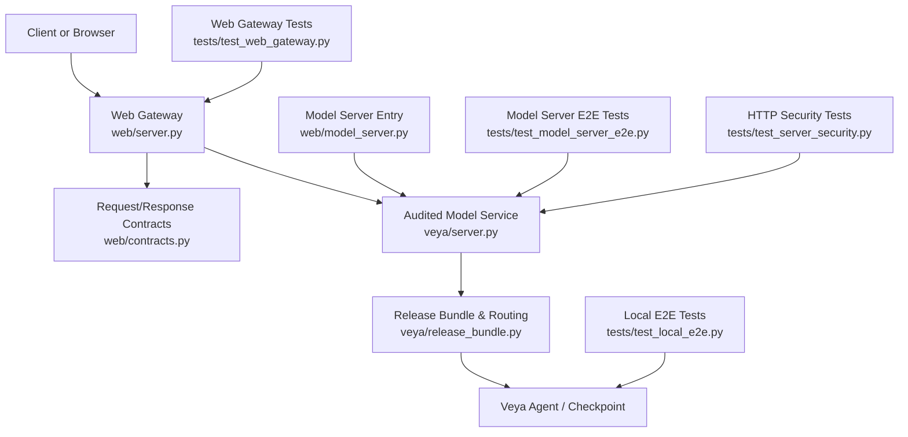
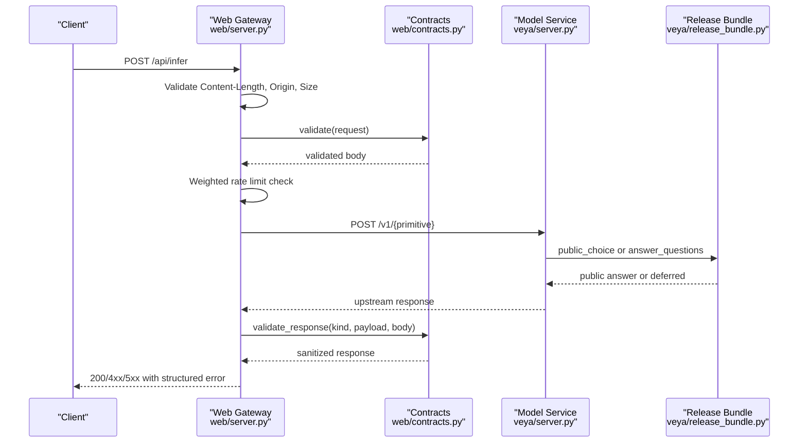
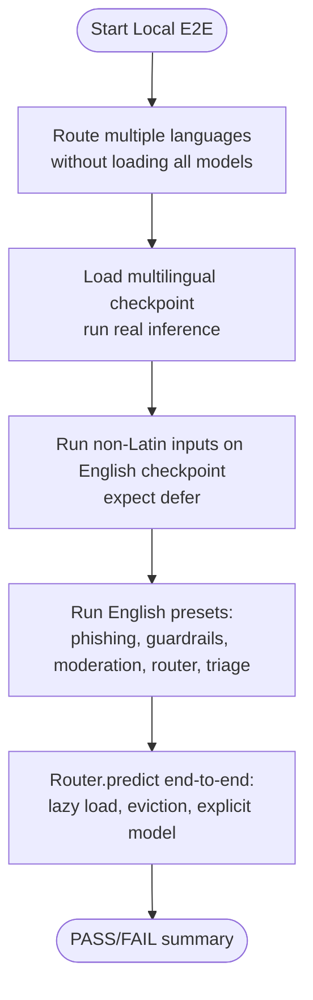
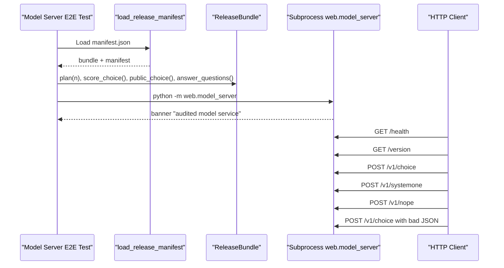
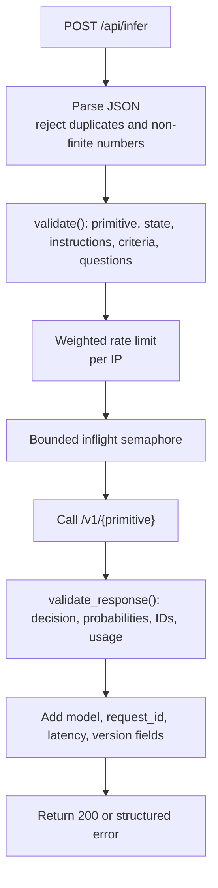
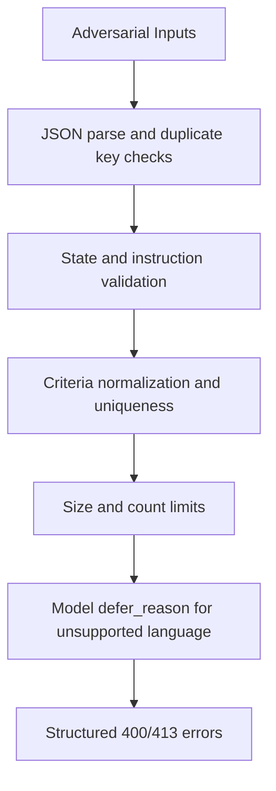
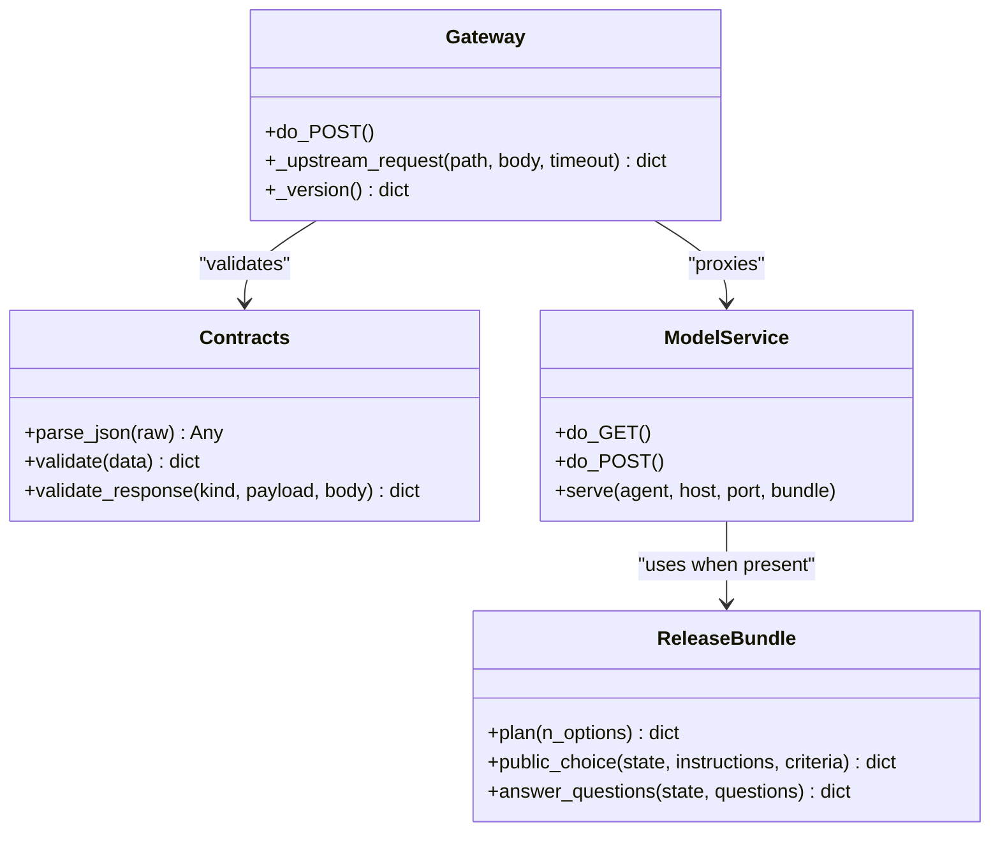
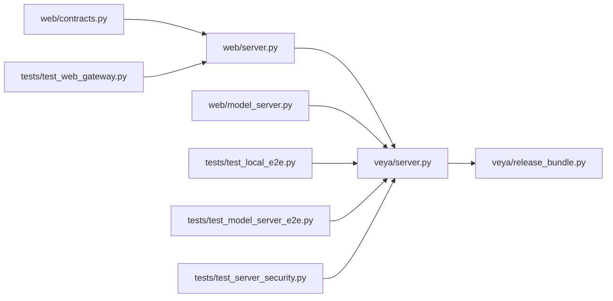

# End-to-End Validation

<cite>
**Referenced Files in This Document**
- [README.md](file://README.md)
- [test_local_e2e.py](file://tests/test_local_e2e.py)
- [test_model_server_e2e.py](file://tests/test_model_server_e2e.py)
- [test_web_gateway.py](file://tests/test_web_gateway.py)
- [test_server_security.py](file://tests/test_server_security.py)
- [web/server.py](file://web/server.py)
- [web/model_server.py](file://web/model_server.py)
- [veya/server.py](file://veya/server.py)
- [veya/release_bundle.py](file://veya/release_bundle.py)
- [web/contracts.py](file://web/contracts.py)
</cite>

## Table of Contents
1. [Introduction](#introduction)
2. [Project Structure](#project-structure)
3. [Core Components](#core-components)
4. [Architecture Overview](#architecture-overview)
5. [Detailed Component Analysis](#detailed-component-analysis)
6. [Dependency Analysis](#dependency-analysis)
7. [Performance Considerations](#performance-considerations)
8. [Troubleshooting Guide](#troubleshooting-guide)
9. [Conclusion](#conclusion)

## Introduction
This document explains Veya’s end-to-end validation strategy across three layers:
- Local E2E testing with real model weights and routing decisions.
- Model server integration tests that start the audited HTTP service and exercise it over a real network boundary.
- Web gateway validation that enforces request/response contracts, security boundaries, rate limiting, and upstream failure handling.

The goal is to validate full system behavior from client requests through model inference to response delivery, while ensuring release integrity, security, performance, and regression safety.

## Project Structure
The repository separates production code, website components, and test suites:
- `veya/*` contains the core agent, HTTP server, release bundle loading, and runtime APIs.
- `web/*` provides the public website gateway, contract validators, and the audited model server entry point.
- `tests/*` includes local checkpoint tests, model server subprocess tests, web gateway boundary tests, and HTTP security regressions.
- `artifacts/release/*` holds the audited manifest and sealed evaluation artifacts used by the release path.

**Diagram sources**
- [web/server.py:1-660](file://web/server.py#L1-L660)
- [web/contracts.py:1-349](file://web/contracts.py#L1-L349)
- [veya/server.py:1-243](file://veya/server.py#L1-L243)
- [veya/release_bundle.py:1-503](file://veya/release_bundle.py#L1-L503)
- [web/model_server.py:1-18](file://web/model_server.py#L1-L18)
- [tests/test_local_e2e.py:1-232](file://tests/test_local_e2e.py#L1-L232)
- [tests/test_model_server_e2e.py:1-225](file://tests/test_model_server_e2e.py#L1-L225)
- [tests/test_web_gateway.py:1-512](file://tests/test_web_gateway.py#L1-L512)
- [tests/test_server_security.py:1-114](file://tests/test_server_security.py#L1-L114)

**Section sources**
- [README.md:27-46](file://README.md#L27-L46)
- [README.md:58-64](file://README.md#L58-L64)
- [README.md:68-187](file://README.md#L68-L187)

## Core Components
- **Local E2E harness**: Loads real checkpoints, validates language routing, exercises English application presets, and verifies Router eviction behavior.
- **Model server E2E harness**: Loads the audited release manifest, starts the model service as a subprocess, and asserts health, version metadata, choice/systemone endpoints, and error responses.
- **Web gateway**: Serves the website, proxies `/api/infer` to the upstream model service, validates inputs and outputs, applies rate limits, and sanitizes telemetry.
- **Contracts layer**: Enforces bounded primitives, candidate counts, state sizes, JSON structure, probability distributions, and SystemOne answer identity constraints.
- **Release bundle**: Verifies file hashes, loads router, shortlist, route calibration, and selective policy; plans packed vs shortlist Choice paths; exposes public Choice and multi-question answers.
- **Model HTTP server**: Exposes `/health`, `/version`, `/v1/choice`, `/v1/noul`, `/v1/score`, and `/v1/systemone`; serializes inference behind an inference lock.

**Section sources**
- [tests/test_local_e2e.py:1-232](file://tests/test_local_e2e.py#L1-L232)
- [tests/test_model_server_e2e.py:1-225](file://tests/test_model_server_e2e.py#L1-L225)
- [web/server.py:1-660](file://web/server.py#L1-L660)
- [web/contracts.py:1-349](file://web/contracts.py#L1-L349)
- [veya/release_bundle.py:1-503](file://veya/release_bundle.py#L1-L503)
- [veya/server.py:1-243](file://veya/server.py#L1-L243)

## Architecture Overview
The validated request flow is:
1. The browser or external client calls the web gateway at `/api/infer`.
2. The gateway parses JSON, enforces origin and size limits, validates the public contract, and applies weighted rate limiting.
3. The gateway forwards the validated request to the upstream model service under `/v1/{primitive}`.
4. The model service uses the release bundle when present to plan Choice routing, apply calibrated probabilities, and return a public answer.
5. The gateway validates the upstream response, enriches it with gateway metadata, and returns a safe result to the client.

**Diagram sources**
- [web/server.py:408-647](file://web/server.py#L408-L647)
- [web/contracts.py:121-176](file://web/contracts.py#L121-L176)
- [web/contracts.py:246-349](file://web/contracts.py#L246-L349)
- [veya/server.py:173-234](file://veya/server.py#L173-L234)
- [veya/release_bundle.py:260-392](file://veya/release_bundle.py#L260-L392)

## Detailed Component Analysis

### Local E2E Testing
The local E2E test validates:
- Language routing without loading all models.
- Real forward passes on multilingual input for intent and Noul questions.
- English checkpoint deferral on non-Latin scripts.
- Application presets: phishing detection, guardrails, moderation, router preset, and support triage.
- Router lazy load, eviction, explicit model override, and routing payload serialization.

**Diagram sources**
- [tests/test_local_e2e.py:54-77](file://tests/test_local_e2e.py#L54-L77)
- [tests/test_local_e2e.py:78-122](file://tests/test_local_e2e.py#L78-L122)
- [tests/test_local_e2e.py:124-203](file://tests/test_local_e2e.py#L124-L203)
- [tests/test_local_e2e.py:205-223](file://tests/test_local_e2e.py#L205-L223)

**Section sources**
- [tests/test_local_e2e.py:1-232](file://tests/test_local_e2e.py#L1-L232)

### Model Server Integration Tests
The model server E2E test validates:
- Release manifest loading and hash verification.
- Bundle planning for packed vs shortlist Choice.
- Public Choice and multi-question answers.
- Subprocess startup of `web.model_server`.
- Health, version metadata, `/v1/choice`, `/v1/systemone`, unknown routes, and invalid JSON handling.

**Diagram sources**
- [tests/test_model_server_e2e.py:67-127](file://tests/test_model_server_e2e.py#L67-L127)
- [tests/test_model_server_e2e.py:129-217](file://tests/test_model_server_e2e.py#L129-L217)
- [veya/release_bundle.py:428-502](file://veya/release_bundle.py#L428-L502)
- [web/model_server.py:1-18](file://web/model_server.py#L1-L18)

**Section sources**
- [tests/test_model_server_e2e.py:1-225](file://tests/test_model_server_e2e.py#L1-L225)
- [veya/release_bundle.py:428-502](file://veya/release_bundle.py#L428-L502)

### Web Gateway Validation
The web gateway validates:
- Request parsing, duplicate keys, field allowlists, state size, instructions length, candidate uniqueness after Unicode normalization, and question count limits.
- Response validation: decision enum, deferred consistency, probability sums, allowed labels, SystemOne answer IDs, confidence bounds, usage token bounds.
- Security: HTTPS-only public origin, cross-origin rejection, oversized request rejection, safe telemetry, and strict HTTP headers.
- Operational behavior: upstream timeout, 5xx mapping, 429 propagation, capacity gating, weighted high-N rate limiting, and model outage exposure.

**Diagram sources**
- [web/server.py:408-647](file://web/server.py#L408-L647)
- [web/contracts.py:49-79](file://web/contracts.py#L49-L79)
- [web/contracts.py:90-176](file://web/contracts.py#L90-L176)
- [web/contracts.py:179-349](file://web/contracts.py#L179-L349)

**Section sources**
- [web/server.py:1-660](file://web/server.py#L1-L660)
- [web/contracts.py:1-349](file://web/contracts.py#L1-L349)
- [tests/test_web_gateway.py:1-512](file://tests/test_web_gateway.py#L1-L512)

### Security Testing Methodologies
Security regressions are covered by:
- Invalid JSON, duplicate keys, empty state, near-duplicate candidates, Unicode-equivalent duplicates, malformed criteria, excessive option counts, and oversized payloads.
- Injection-style state and candidate text treated as data.
- Unsupported language deferral through the model layer.
- Strict content type enforcement and maximum request bytes.

**Diagram sources**
- [tests/test_server_security.py:61-114](file://tests/test_server_security.py#L61-L114)
- [veya/server.py:114-134](file://veya/server.py#L114-L134)
- [veya/server.py:152-161](file://veya/server.py#L152-L161)

**Section sources**
- [tests/test_server_security.py:1-114](file://tests/test_server_security.py#L1-L114)
- [veya/server.py:114-161](file://veya/server.py#L114-L161)

### Performance Benchmarking Under Realistic Loads
Performance and reliability are exercised by:
- Local E2E timing prints for multilingual inference.
- Model server E2E startup and endpoint latency expectations.
- Web gateway weighted rate limiting and capacity control.
- Research runtime audit utilities that compute percentiles, cold-start stages, and HTTP suite results.

Key behaviors:
- Gateway capacity and window-based rate limiting protect the model service.
- High-cardinality Choice increases weight and may trigger rate limiting sooner.
- Inference lock serializes model calls to avoid unsafe concurrent execution.

**Section sources**
- [tests/test_local_e2e.py:98-106](file://tests/test_local_e2e.py#L98-L106)
- [web/server.py:74-84](file://web/server.py#L74-L84)
- [web/server.py:174-206](file://web/server.py#L174-L206)
- [veya/server.py:16-16](file://veya/server.py#L16-L16)

### Regression Testing for API Contracts
Contract regression coverage includes:
- Request schema validation for Choice, Noul, Score, and SystemOne.
- Response validation for probabilities, confidence, answer identity, and usage tokens.
- Upstream contract violations mapped to structured 502 errors.
- Version metadata validation and caching.

**Diagram sources**
- [web/contracts.py:49-176](file://web/contracts.py#L49-L176)
- [web/contracts.py:179-349](file://web/contracts.py#L179-L349)
- [web/server.py:94-171](file://web/server.py#L94-L171)
- [web/server.py:408-647](file://web/server.py#L408-L647)
- [veya/server.py:137-243](file://veya/server.py#L137-L243)
- [veya/release_bundle.py:127-392](file://veya/release_bundle.py#L127-L392)

**Section sources**
- [web/contracts.py:1-349](file://web/contracts.py#L1-L349)
- [web/server.py:1-660](file://web/server.py#L1-L660)
- [veya/server.py:1-243](file://veya/server.py#L1-L243)
- [veya/release_bundle.py:1-503](file://veya/release_bundle.py#L1-L503)

## Dependency Analysis
High-level dependencies:
- `web/server.py` depends on `web/contracts.py` for request/response validation and on `veya/server.py` via HTTP proxying.
- `web/model_server.py` depends on `veya/release_bundle.py` and `veya/server.py` to start the audited service.
- `veya/server.py` depends on `veya/release_bundle.py` when a bundle is provided.
- Tests depend on these modules directly to simulate clients, subprocesses, and controlled doubles.

**Diagram sources**
- [web/contracts.py:1-349](file://web/contracts.py#L1-L349)
- [web/server.py:1-660](file://web/server.py#L1-L660)
- [veya/server.py:1-243](file://veya/server.py#L1-L243)
- [veya/release_bundle.py:1-503](file://veya/release_bundle.py#L1-L503)
- [web/model_server.py:1-18](file://web/model_server.py#L1-L18)
- [tests/test_local_e2e.py:1-232](file://tests/test_local_e2e.py#L1-L232)
- [tests/test_model_server_e2e.py:1-225](file://tests/test_model_server_e2e.py#L1-L225)
- [tests/test_web_gateway.py:1-512](file://tests/test_web_gateway.py#L1-L512)
- [tests/test_server_security.py:1-114](file://tests/test_server_security.py#L1-L114)

**Section sources**
- [web/server.py:1-660](file://web/server.py#L1-L660)
- [web/model_server.py:1-18](file://web/model_server.py#L1-L18)
- [veya/server.py:1-243](file://veya/server.py#L1-L243)
- [veya/release_bundle.py:1-503](file://veya/release_bundle.py#L1-L503)

## Performance Considerations
- Prefer preloaded checkpoints in production to avoid per-request reloads.
- Use the web gateway’s weighted rate limiting to protect against expensive high-cardinality Choice requests.
- Keep request bodies within the configured limits to avoid 413 rejections.
- Monitor gateway telemetry for latency, route, and error codes without exposing raw state.
- For large label sets, prefer the shortlist path or split questions to reduce token pressure and improve accuracy.

[No sources needed since this section provides general guidance]

## Troubleshooting Guide
Common issues and diagnostics:
- **Manifest or bundle failures**: Verify that `artifacts/release/manifest.json` exists and matches the expected format and hashes.
- **Model service not starting**: Ensure `VEYA_MODEL_PORT` is free and the process prints the audited banner.
- **Upstream timeouts or 502 errors**: Check upstream availability, response size, and JSON validity; inspect gateway logs for structured error codes.
- **Rate limiting**: Increase capacity or back off according to `Retry-After`; high-cardinality Choice costs more weight.
- **Cross-origin or oversized requests**: Confirm `Origin` is allowed and request size is below limits.
- **Unsupported language**: Expect `defer_reason` such as unsupported language; route to a capable model or use the multilingual checkpoint.

**Section sources**
- [tests/test_model_server_e2e.py:67-166](file://tests/test_model_server_e2e.py#L67-L166)
- [web/server.py:439-495](file://web/server.py#L439-L495)
- [web/server.py:550-635](file://web/server.py#L550-L635)
- [veya/release_bundle.py:428-502](file://veya/release_bundle.py#L428-L502)

## Conclusion
Veya’s E2E validation spans local checkpoint routing, audited model server startup, and web gateway contract enforcement. Together, these tests ensure:
- Correct routing between English and multilingual checkpoints.
- Integrity of the release manifest and bundled artifacts.
- Safe, bounded, and observable HTTP behavior.
- Robust handling of malformed input, upstream failures, and rate limits.
- Regression protection for API contracts and security boundaries.

For production deployments, combine preloaded models, conservative rate limits, strict origins, and continuous E2E runs to maintain reliability and correctness.