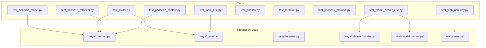
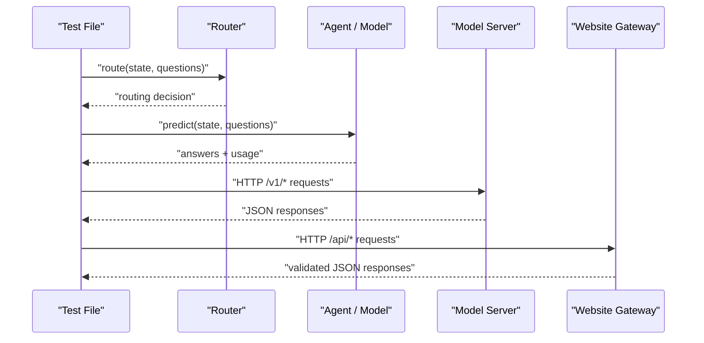
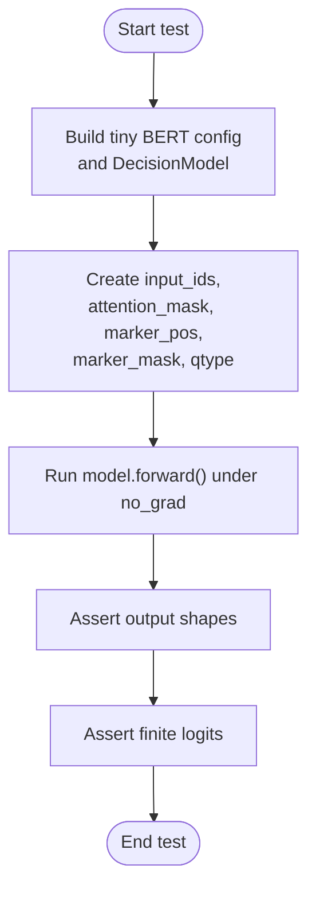
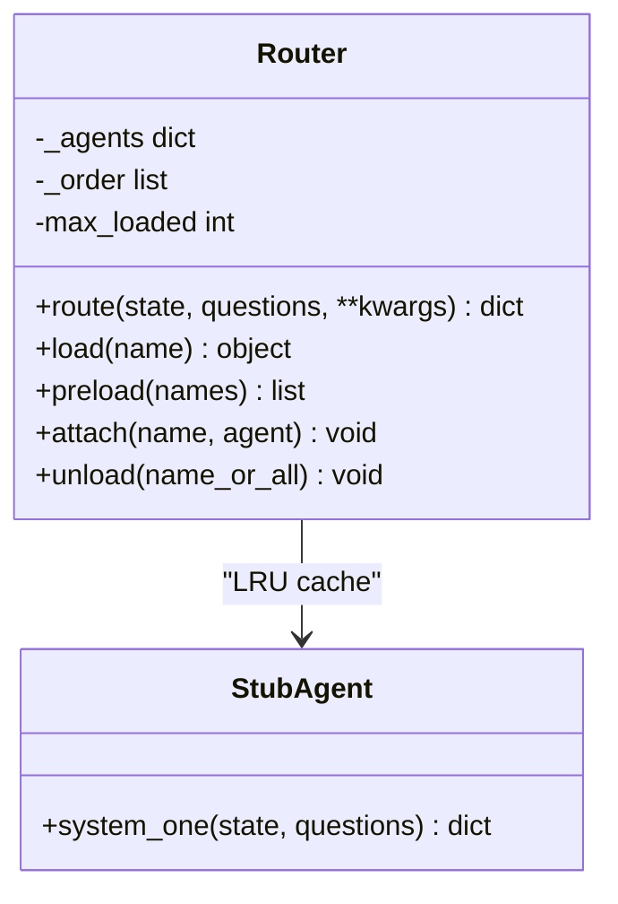
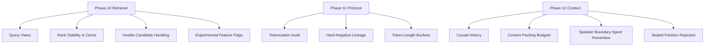
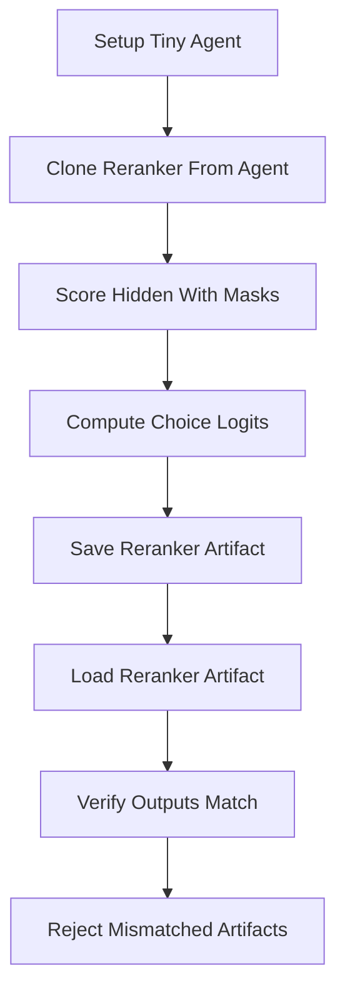
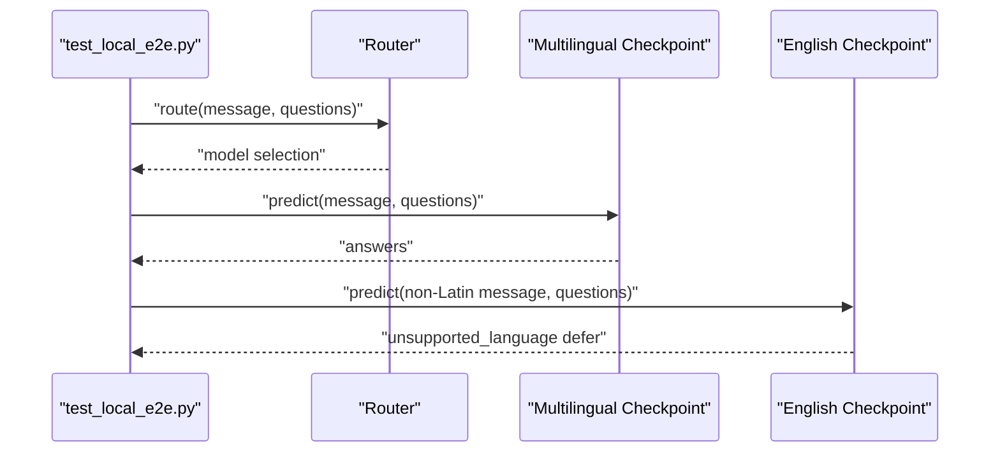
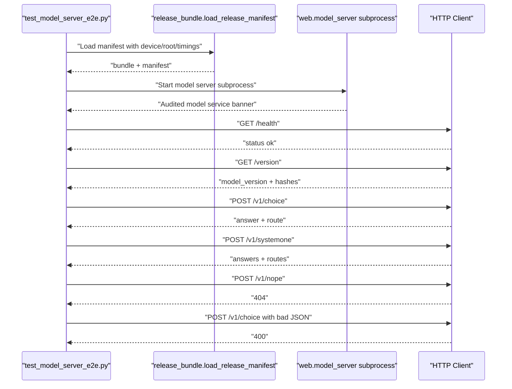
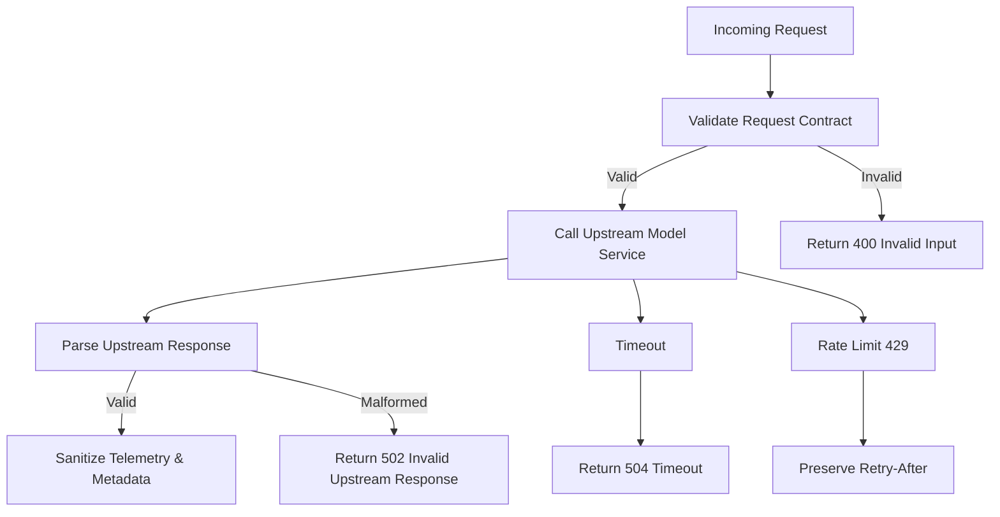
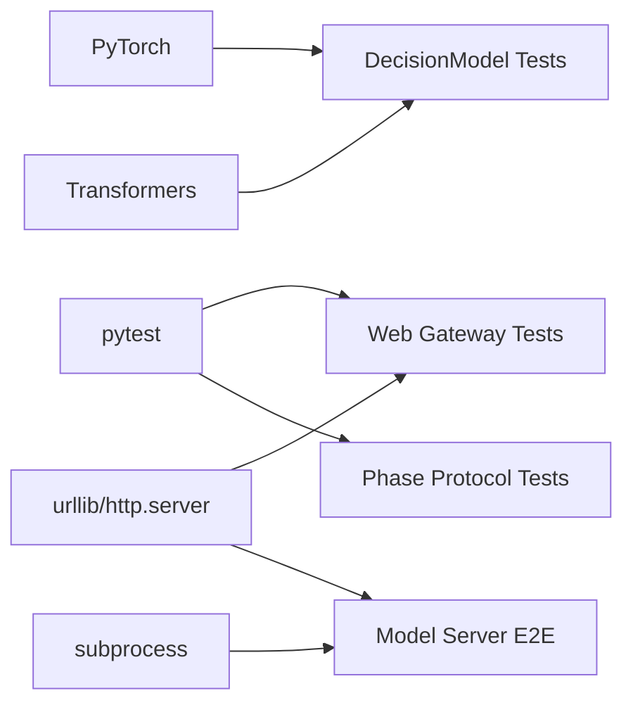

# Test Suite Organization

<cite>
**Referenced Files in This Document**
- [README.md](file://README.md)
- [pyproject.toml](file://pyproject.toml)
- [tests/test_decision_model.py](file://tests/test_decision_model.py)
- [tests/test_router.py](file://tests/test_router.py)
- [tests/test_local_e2e.py](file://tests/test_local_e2e.py)
- [tests/test_model_server_e2e.py](file://tests/test_model_server_e2e.py)
- [tests/test_web_gateway.py](file://tests/test_web_gateway.py)
- [tests/test_phase6.py](file://tests/test_phase6.py)
- [tests/test_phase10_retriever.py](file://tests/test_phase10_retriever.py)
- [tests/test_phase11_protocol.py](file://tests/test_phase11_protocol.py)
- [tests/test_phase12_context.py](file://tests/test_phase12_context.py)
- [tests/test_reranker.py](file://tests/test_reranker.py)
- [veya/common.py](file://veya/common.py)
- [veya/router.py](file://veya/router.py)
- [veya/reranker.py](file://veya/reranker.py)
- [veya/release_bundle.py](file://veya/release_bundle.py)
- [web/model_server.py](file://web/model_server.py)
- [web/server.py](file://web/server.py)
</cite>

## Table of Contents
1. [Introduction](#introduction)
2. [Project Structure](#project-structure)
3. [Core Components](#core-components)
4. [Architecture Overview](#architecture-overview)
5. [Detailed Component Analysis](#detailed-component-analysis)
6. [Dependency Analysis](#dependency-analysis)
7. [Performance Considerations](#performance-considerations)
8. [Troubleshooting Guide](#troubleshooting-guide)
9. [Conclusion](#conclusion)

## Introduction
This document explains how Veya organizes its test suite, the testing philosophy behind it, and the conventions used for naming, fixtures, and coverage across unit, integration, and end-to-end tests. It focuses on core components such as `DecisionModel` and `Router`, phase-specific research features, and web service boundaries. The goal is to help contributors add new tests that follow established patterns while maintaining clarity, determinism, and safety around heavy dependencies like model weights and network access.

The repository’s README documents the audited release scope and routing behavior, which directly informs why certain tests are offline-only, why others require real checkpoints, and why HTTP-level boundary tests exist for the website and model server.

**Section sources**
- [README.md:27-55](file://README.md#L27-L55)
- [README.md:68-181](file://README.md#L68-L181)

## Project Structure
Veya places all tests under a single `tests/` directory. Tests are organized by feature area and development phase rather than by strict layering. Common patterns include:

- Unit tests for pure logic or lightweight PyTorch paths (for example, decision-model forward regression checks).
- Phase-specific tests aligned with research milestones (`test_phase6.py`, `test_phase10_retriever.py`, `test_phase11_protocol.py`, `test_phase12_context.py`).
- Integration tests that exercise routing, reranking, and shortlist artifacts without requiring production deployment.
- End-to-end tests that load real checkpoints or start subprocesses for the model server and website gateway.

**Diagram sources**
- [tests/test_decision_model.py:1-15](file://tests/test_decision_model.py#L1-L15)
- [tests/test_router.py:1-19](file://tests/test_router.py#L1-L19)
- [tests/test_local_e2e.py:1-30](file://tests/test_local_e2e.py#L1-L30)
- [tests/test_model_server_e2e.py:1-36](file://tests/test_model_server_e2e.py#L1-L36)
- [tests/test_web_gateway.py:1-22](file://tests/test_web_gateway.py#L1-L22)
- [tests/test_phase10_retriever.py:1-16](file://tests/test_phase10_retriever.py#L1-L16)
- [tests/test_phase12_context.py:1-5](file://tests/test_phase12_context.py#L1-L5)
- [tests/test_reranker.py:1-34](file://tests/test_reranker.py#L1-L34)
- [veya/common.py](file://veya/common.py)
- [veya/router.py](file://veya/router.py)
- [veya/reranker.py](file://veya/reranker.py)
- [veya/release_bundle.py](file://veya/release_bundle.py)
- [web/model_server.py](file://web/model_server.py)
- [web/server.py](file://web/server.py)

**Section sources**
- [tests/test_decision_model.py:1-15](file://tests/test_decision_model.py#L1-L15)
- [tests/test_router.py:1-19](file://tests/test_router.py#L1-L19)
- [tests/test_local_e2e.py:1-30](file://tests/test_local_e2e.py#L1-L30)
- [tests/test_model_server_e2e.py:1-36](file://tests/test_model_server_e2e.py#L1-L36)
- [tests/test_web_gateway.py:1-22](file://tests/test_web_gateway.py#L1-L22)
- [tests/test_phase10_retriever.py:1-16](file://tests/test_phase10_retriever.py#L1-L16)
- [tests/test_phase12_context.py:1-5](file://tests/test_phase12_context.py#L1-L5)
- [tests/test_reranker.py:1-34](file://tests/test_reranker.py#L1-L34)

## Core Components
The test suite covers three primary areas:

- Decision model regression tests: These validate forward-pass behavior using tiny local models so they run fast and offline.
- Router tests: These verify language/script detection, routing decisions, temperature clamping, LRU eviction, preload behavior, attachment semantics, and thread-safety properties.
- Web and model-server end-to-end tests: These validate HTTP contracts, request validation, upstream error handling, rate limiting, SEO metadata, and the audited model-server startup path.

Key implementation targets include:

- `DecisionModel` in `veya/common.py`.
- `Router` and related utilities in `veya/router.py`.
- Reranker and artifact round-trip logic in `veya/reranker.py`.
- Release manifest loading and bundle scoring in `veya/release_bundle.py`.
- Website gateway and model server in `web/server.py` and `web/model_server.py`.

**Section sources**
- [tests/test_decision_model.py:1-15](file://tests/test_decision_model.py#L1-L15)
- [tests/test_router.py:1-19](file://tests/test_router.py#L1-L19)
- [tests/test_reranker.py:1-34](file://tests/test_reranker.py#L1-L34)
- [tests/test_model_server_e2e.py:1-36](file://tests/test_model_server_e2e.py#L1-L36)
- [tests/test_web_gateway.py:1-22](file://tests/test_web_gateway.py#L1-L22)
- [veya/common.py](file://veya/common.py)
- [veya/router.py](file://veya/router.py)
- [veya/reranker.py](file://veya/reranker.py)
- [veya/release_bundle.py](file://veya/release_bundle.py)
- [web/server.py](file://web/server.py)
- [web/model_server.py](file://web/model_server.py)

## Architecture Overview
The testing architecture separates concerns by cost and risk:

- Fast, deterministic unit tests use small synthetic inputs or tiny local models.
- Phase-specific tests validate research protocols, data construction, and protocol invariants.
- Integration tests exercise routing, reranking, and artifact serialization without starting full services.
- End-to-end tests launch real processes or load real checkpoints to validate production-like behavior.

**Diagram sources**
- [tests/test_router.py:159-208](file://tests/test_router.py#L159-L208)
- [tests/test_local_e2e.py:54-121](file://tests/test_local_e2e.py#L54-L121)
- [tests/test_model_server_e2e.py:129-213](file://tests/test_model_server_e2e.py#L129-L213)
- [tests/test_web_gateway.py:301-346](file://tests/test_web_gateway.py#L301-L346)

## Detailed Component Analysis

### DecisionModel Regression Tests
These tests focus on numerical stability and shape correctness for `DecisionModel.forward`. They construct a tiny encoder from configuration and avoid pretrained downloads, ensuring fast, offline execution.

Key behaviors validated:

- Single-option question paths do not crash.
- Softmax over one valid marker produces expected probability behavior.
- Multi-option paths remain unaffected by single-option fixes.

**Diagram sources**
- [tests/test_decision_model.py:17-38](file://tests/test_decision_model.py#L17-L38)
- [tests/test_decision_model.py:41-93](file://tests/test_decision_model.py#L41-L93)

**Section sources**
- [tests/test_decision_model.py:1-15](file://tests/test_decision_model.py#L1-L15)
- [tests/test_decision_model.py:17-38](file://tests/test_decision_model.py#L17-L38)
- [tests/test_decision_model.py:41-93](file://tests/test_decision_model.py#L41-L93)
- [veya/common.py](file://veya/common.py)

### Router Tests
Router tests cover language detection, script detection, workflow matching, name normalization, routing decisions, temperature clamping, LRU cache behavior, preload and attach semantics, and thread safety.

Important aspects:

- Language and script detection functions are exercised with many languages and edge cases.
- Routing respects explicit overrides and auto task detection.
- Temperature clamping rejects pathological values and preserves neutral defaults.
- LRU eviction and touch semantics are verified with stubbed agents.
- Concurrent loads deduplicate agent construction and keep internal state consistent.

**Diagram sources**
- [tests/test_router.py:247-295](file://tests/test_router.py#L247-L295)
- [tests/test_router.py:344-357](file://tests/test_router.py#L344-L357)
- [tests/test_router.py:359-432](file://tests/test_router.py#L359-L432)

**Section sources**
- [tests/test_router.py:1-19](file://tests/test_router.py#L1-L19)
- [tests/test_router.py:31-101](file://tests/test_router.py#L31-L101)
- [tests/test_router.py:129-143](file://tests/test_router.py#L129-L143)
- [tests/test_router.py:146-157](file://tests/test_router.py#L146-L157)
- [tests/test_router.py:159-208](file://tests/test_router.py#L159-L208)
- [tests/test_router.py:211-245](file://tests/test_router.py#L211-L245)
- [tests/test_router.py:247-295](file://tests/test_router.py#L247-L295)
- [tests/test_router.py:298-317](file://tests/test_router.py#L298-L317)
- [tests/test_router.py:320-341](file://tests/test_router.py#L320-L341)
- [tests/test_router.py:344-357](file://tests/test_router.py#L344-L357)
- [tests/test_router.py:359-432](file://tests/test_router.py#L359-L432)
- [veya/router.py](file://veya/router.py)

### Phase-Specific Protocol and Data Tests
Phase-specific tests validate research protocols, data construction, and invariants without relying on production deployments.

Highlights:

- Phase 6 split guards and promotion rules ensure training IDs and evaluation slices are handled correctly.
- Phase 10 retriever tests validate query views, candidate ranking stability, caching, hostile candidate handling, and experimental feature flags.
- Phase 11 protocol tests validate tokenization audit, hard-negative lineage tamper evidence, and token-length bucketing.
- Phase 12 context tests enforce causal history, packing budgets, speaker-boundary spoof prevention, and sealed partition rejection.

**Diagram sources**
- [tests/test_phase10_retriever.py:59-103](file://tests/test_phase10_retriever.py#L59-L103)
- [tests/test_phase10_retriever.py:117-178](file://tests/test_phase10_retriever.py#L117-L178)
- [tests/test_phase10_retriever.py:180-287](file://tests/test_phase10_retriever.py#L180-L287)
- [tests/test_phase11_protocol.py:29-66](file://tests/test_phase11_protocol.py#L29-L66)
- [tests/test_phase12_context.py:17-81](file://tests/test_phase12_context.py#L17-L81)

**Section sources**
- [tests/test_phase6.py:1-64](file://tests/test_phase6.py#L1-L64)
- [tests/test_phase10_retriever.py:1-287](file://tests/test_phase10_retriever.py#L1-L287)
- [tests/test_phase11_protocol.py:1-67](file://tests/test_phase11_protocol.py#L1-L67)
- [tests/test_phase12_context.py:1-82](file://tests/test_phase12_context.py#L1-L82)

### Reranker Artifact Round-Trip Tests
These tests validate the K=8 packed reranker, including cloning from an agent, hidden-state scoring, choice-logits generation, save/load round trips, artifact metadata, and mismatched-artifact rejection.

**Diagram sources**
- [tests/test_reranker.py:43-69](file://tests/test_reranker.py#L43-L69)
- [tests/test_reranker.py:74-131](file://tests/test_reranker.py#L74-L131)
- [tests/test_reranker.py:133-177](file://tests/test_reranker.py#L133-L177)
- [tests/test_reranker.py:179-183](file://tests/test_reranker.py#L179-L183)

**Section sources**
- [tests/test_reranker.py:1-34](file://tests/test_reranker.py#L1-L34)
- [tests/test_reranker.py:43-69](file://tests/test_reranker.py#L43-L69)
- [tests/test_reranker.py:74-131](file://tests/test_reranker.py#L74-L131)
- [tests/test_reranker.py:133-177](file://tests/test_reranker.py#L133-L177)
- [tests/test_reranker.py:179-183](file://tests/test_reranker.py#L179-L183)
- [veya/reranker.py](file://veya/reranker.py)

### Local End-to-End Tests
Local end-to-end tests load real checkpoints and exercise routing plus inference across languages and application presets. They skip when imported as a module and require running the file directly with a model root.

Key flows:

- Routing decisions across languages without loading weights.
- Real multilingual checkpoint inference for multiple languages.
- Contrast with English checkpoint deferral on non-Latin input.
- Application presets for phishing, guardrails, moderation, router, and triage.
- Router.predict end-to-end behavior including lazy loading, eviction, and routing payload serialization.

**Diagram sources**
- [tests/test_local_e2e.py:54-121](file://tests/test_local_e2e.py#L54-L121)
- [tests/test_local_e2e.py:124-203](file://tests/test_local_e2e.py#L124-L203)
- [tests/test_local_e2e.py:205-222](file://tests/test_local_e2e.py#L205-L222)

**Section sources**
- [tests/test_local_e2e.py:1-30](file://tests/test_local_e2e.py#L1-L30)
- [tests/test_local_e2e.py:54-121](file://tests/test_local_e2e.py#L54-L121)
- [tests/test_local_e2e.py:124-203](file://tests/test_local_e2e.py#L124-L203)
- [tests/test_local_e2e.py:205-222](file://tests/test_local_e2e.py#L205-L222)

### Model Server End-to-End Tests
These tests validate the audited release manifest loading path and the model server subprocess over HTTP. They check:

- Manifest format, hashes, calibration policy attachment, and route temperature.
- Bundle planning and scoring for packed vs shortlist routes.
- Public choice API contract.
- Subprocess startup, health endpoint, version endpoint, choice endpoint, systemone endpoint, unknown route handling, invalid JSON handling, and process cleanup.

**Diagram sources**
- [tests/test_model_server_e2e.py:66-81](file://tests/test_model_server_e2e.py#L66-L81)
- [tests/test_model_server_e2e.py:84-127](file://tests/test_model_server_e2e.py#L84-L127)
- [tests/test_model_server_e2e.py:129-213](file://tests/test_model_server_e2e.py#L129-L213)

**Section sources**
- [tests/test_model_server_e2e.py:1-36](file://tests/test_model_server_e2e.py#L1-L36)
- [tests/test_model_server_e2e.py:66-81](file://tests/test_model_server_e2e.py#L66-L81)
- [tests/test_model_server_e2e.py:84-127](file://tests/test_model_server_e2e.py#L84-L127)
- [tests/test_model_server_e2e.py:129-213](file://tests/test_model_server_e2e.py#L129-L213)
- [veya/release_bundle.py](file://veya/release_bundle.py)
- [web/model_server.py](file://web/model_server.py)

### Website Gateway Tests
Website boundary tests validate request validation, response validation, SEO metadata, public binding requirements, benchmark summary integrity, upstream error handling, rate limiting, origin validation, oversized request rejection, and model outage behavior.

**Diagram sources**
- [tests/test_web_gateway.py:32-55](file://tests/test_web_gateway.py#L32-L55)
- [tests/test_web_gateway.py:93-119](file://tests/test_web_gateway.py#L93-L119)
- [tests/test_web_gateway.py:301-346](file://tests/test_web_gateway.py#L301-L346)
- [tests/test_web_gateway.py:443-511](file://tests/test_web_gateway.py#L443-L511)

**Section sources**
- [tests/test_web_gateway.py:1-22](file://tests/test_web_gateway.py#L1-L22)
- [tests/test_web_gateway.py:32-55](file://tests/test_web_gateway.py#L32-L55)
- [tests/test_web_gateway.py:93-119](file://tests/test_web_gateway.py#L93-L119)
- [tests/test_web_gateway.py:301-346](file://tests/test_web_gateway.py#L301-L346)
- [tests/test_web_gateway.py:443-511](file://tests/test_web_gateway.py#L443-L511)
- [web/server.py](file://web/server.py)

## Dependency Analysis
The test suite depends on both Python packages and runtime resources:

- PyTorch and transformers are used for lightweight model construction and tensor assertions.
- pytest is used for parameterized tests and fixture-based HTTP doubles.
- subprocess and HTTP clients are used to start and interact with the model server and website gateway.
- Real checkpoints are required only for end-to-end tests; unit and phase tests avoid them.

**Diagram sources**
- [tests/test_decision_model.py:7-14](file://tests/test_decision_model.py#L7-L14)
- [tests/test_phase10_retriever.py:1-16](file://tests/test_phase10_retriever.py#L1-L16)
- [tests/test_web_gateway.py:1-22](file://tests/test_web_gateway.py#L1-L22)
- [tests/test_model_server_e2e.py:14-36](file://tests/test_model_server_e2e.py#L14-L36)

**Section sources**
- [tests/test_decision_model.py:7-14](file://tests/test_decision_model.py#L7-L14)
- [tests/test_phase10_retriever.py:1-16](file://tests/test_phase10_retriever.py#L1-L16)
- [tests/test_web_gateway.py:1-22](file://tests/test_web_gateway.py#L1-L22)
- [tests/test_model_server_e2e.py:14-36](file://tests/test_model_server_e2e.py#L14-L36)

## Performance Considerations
Testing performance is intentionally tiered:

- Fast unit tests use tiny models or pure-Python helpers to avoid heavy initialization.
- Phase-specific tests focus on deterministic algorithms and data invariants.
- Integration tests avoid network calls and large model loads where possible.
- End-to-end tests explicitly skip when imported and require manual invocation with model roots or manifests.

Recommendations:

- Prefer synthetic inputs and tiny local models for regression tests.
- Avoid loading pretrained weights unless the test purpose requires real inference.
- Use subprocess isolation for server tests to prevent shared state leakage.
- Keep HTTP doubles minimal and focused on contract boundaries.

[No sources needed since this section provides general guidance]

## Troubleshooting Guide
Common issues and their typical resolutions:

- Deadlocks during model construction due to TensorFlow probes: Set environment variables to disable TensorFlow probing and force torch usage.
- Missing model roots: Provide the correct model root path or use the default location expected by the end-to-end test.
- Manifest or artifact mismatches: Ensure the release manifest and production artifacts are present and unmodified.
- HTTP contract failures: Validate request payloads against the gateway contract and inspect upstream response validation errors.
- Thread-safety regressions: Use concurrent-load tests to detect duplicate agent construction or inconsistent LRU state.

**Section sources**
- [tests/test_local_e2e.py:15-21](file://tests/test_local_e2e.py#L15-L21)
- [tests/test_model_server_e2e.py:23-26](file://tests/test_model_server_e2e.py#L23-L26)
- [tests/test_model_server_e2e.py:35-37](file://tests/test_model_server_e2e.py#L35-L37)
- [tests/test_web_gateway.py:32-55](file://tests/test_web_gateway.py#L32-L55)
- [tests/test_router.py:359-432](file://tests/test_router.py#L359-L432)

## Conclusion
Veya’s test suite balances speed, safety, and realism. Unit and phase tests provide deterministic coverage of core logic and research protocols. Integration tests validate routing, reranking, and artifact contracts. End-to-end tests ensure that real checkpoints and deployed services behave as intended. Contributors should follow these patterns: isolate heavy dependencies, prefer synthetic inputs, validate contracts at boundaries, and document any new fixtures or subprocess interactions clearly.

[No sources needed since this section summarizes without analyzing specific files]