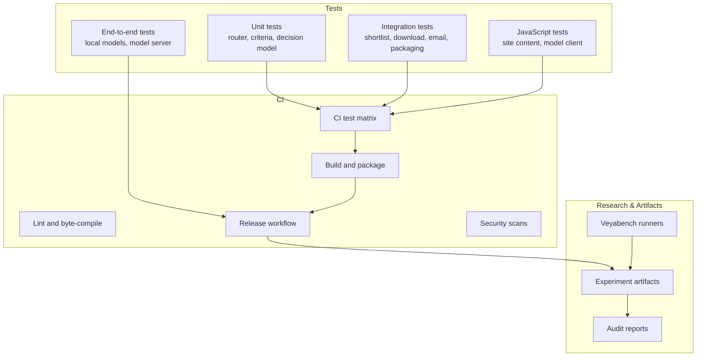
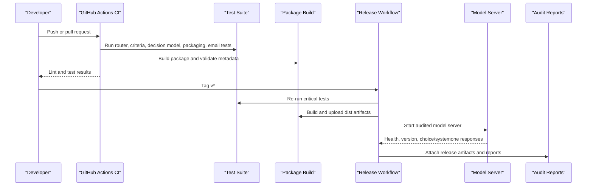
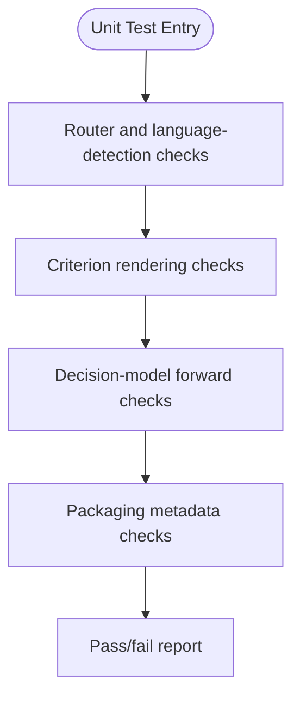
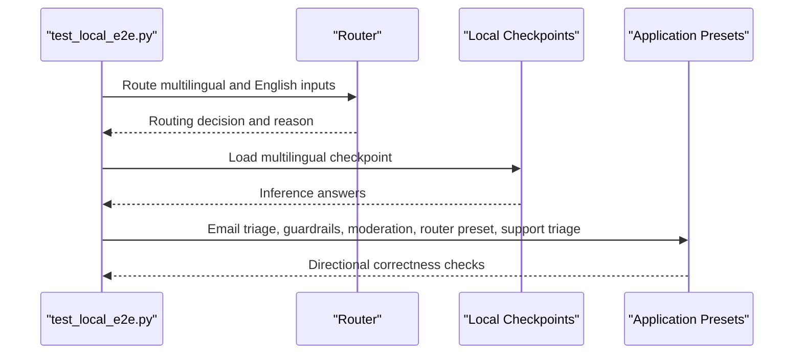
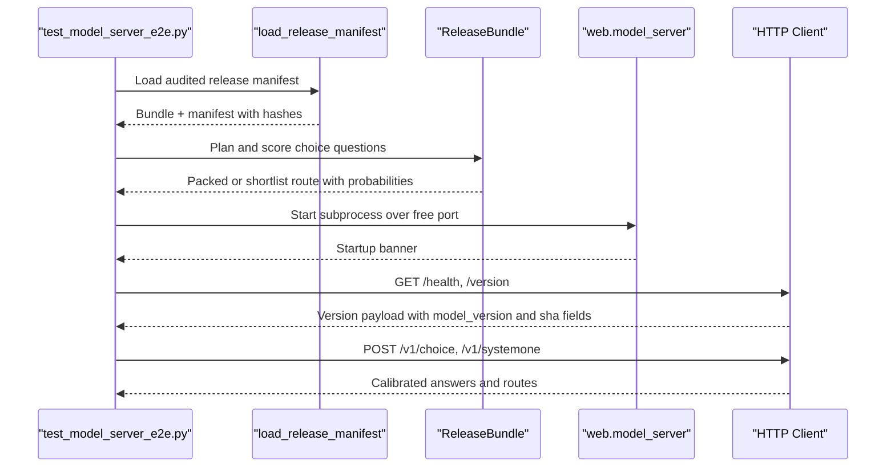
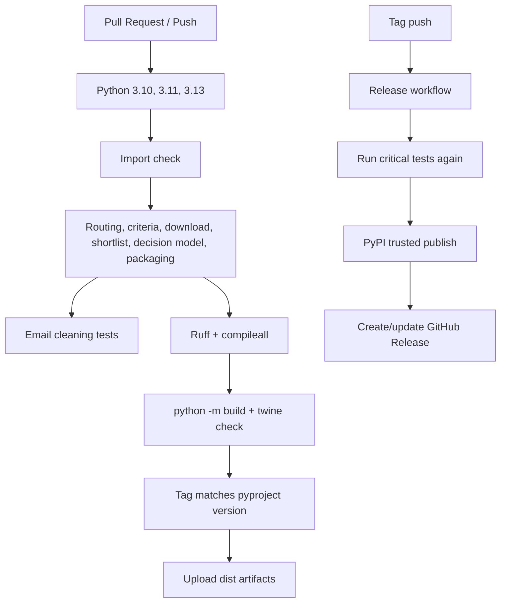
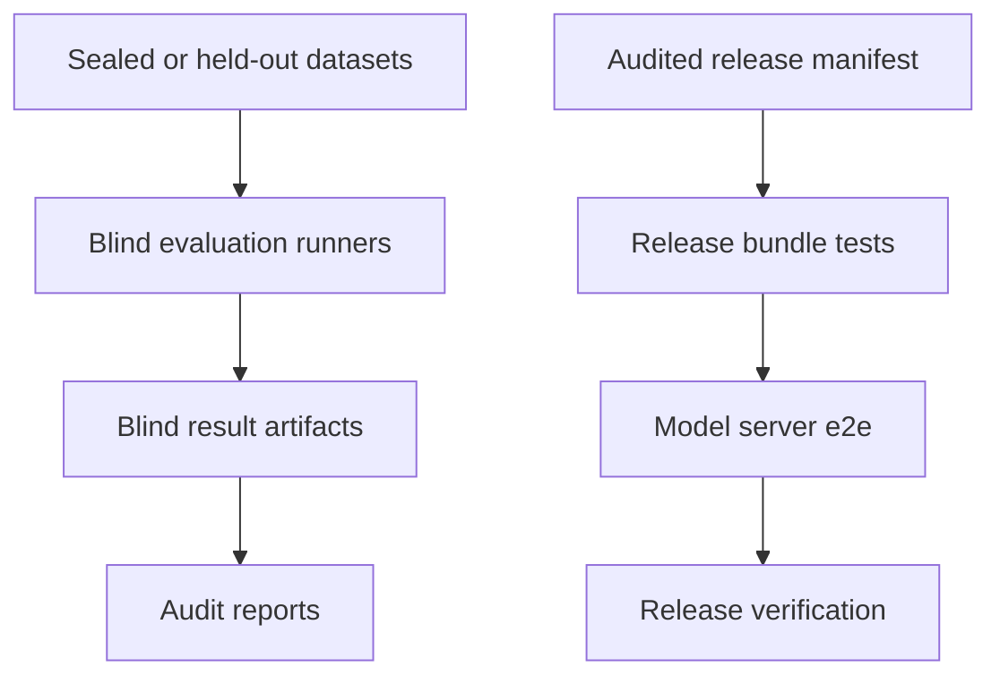
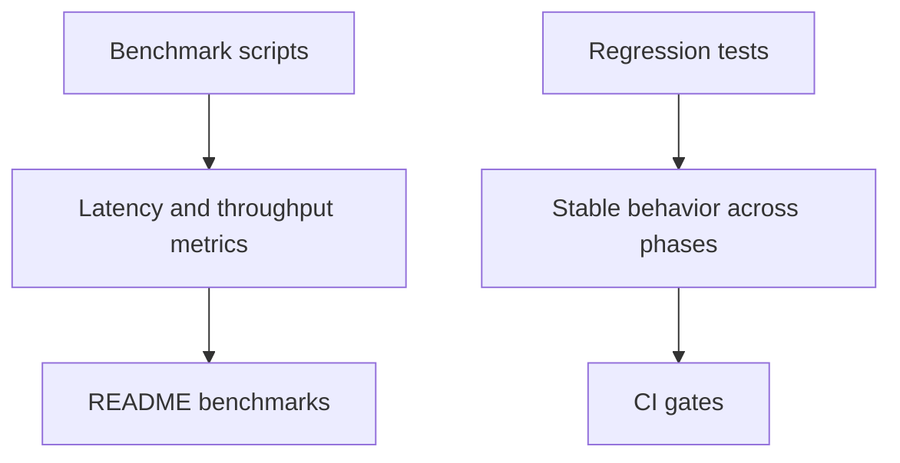
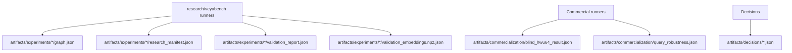
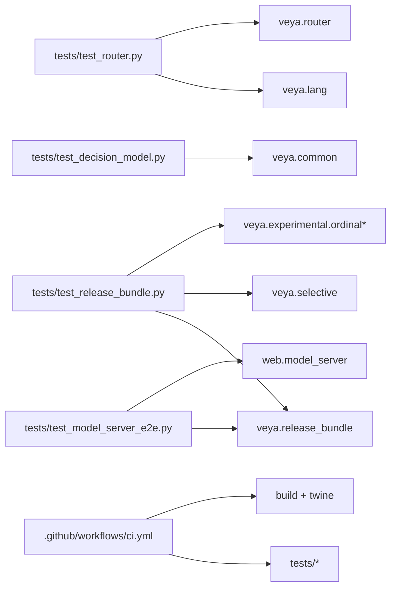

# Testing & Quality Assurance

<cite>
**Referenced Files in This Document**
- [README.md](file://README.md)
- [pyproject.toml](file://pyproject.toml)
- [setup.py](file://setup.py)
- [.github/workflows/ci.yml](file://.github/workflows/ci.yml)
- [.github/workflows/release.yml](file://.github/workflows/release.yml)
- [.github/workflows/security.yml](file://.github/workflows/security.yml)
- [tests/test_router.py](file://tests/test_router.py)
- [tests/test_criteria.py](file://tests/test_criteria.py)
- [tests/test_decision_model.py](file://tests/test_decision_model.py)
- [tests/test_local_e2e.py](file://tests/test_local_e2e.py)
- [tests/test_model_server_e2e.py](file://tests/test_model_server_e2e.py)
- [tests/test_release_bundle.py](file://tests/test_release_bundle.py)
- [tests/test_packaging.py](file://tests/test_packaging.py)
- [tests/test_manifest.py](file://tests/test_manifest.py)
- [tests/test_phase11_noise.py](file://tests/test_phase11_noise.py)
- [tests/test_phase11_protocol.py](file://tests/test_phase11_protocol.py)
- [tests/test_phase12_context.py](file://tests/test_phase12_context.py)
- [tests/test_phase12_sparse_scorer.py](file://tests/test_phase12_sparse_scorer.py)
- [tests/test_commercialization.py](file://tests/test_commercialization.py)
- [tests/test_shortlist.py](file://tests/test_shortlist.py)
- [tests/test_download.py](file://tests/test_download.py)
- [tests/test_email.py](file://tests/test_email.py)
- [tests/test_reliability.py](file://tests/test_reliability.py)
- [tests/test_reranker.py](file://tests/test_reranker.py)
- [tests/test_selective_extra.py](file://tests/test_selective_extra.py)
- [tests/test_server_security.py](file://tests/test_server_security.py)
- [tests/test_site_content.mjs](file://tests/test_site_content.mjs)
- [tests/test_top8.py](file://tests/test_top8.py)
- [tests/test_web_gateway.py](file://tests/test_web_gateway.py)
- [tests/test_model_client.mjs](file://tests/test_model_client.mjs)
- [research/veyabench/run_release_eval.py](file://research/veyabench/run_release_eval.py)
- [research/veyabench/run_phase10_validate.py](file://research/veyabench/run_phase10_validate.py)
- [research/veyabench/run_phase11_validate.py](file://research/veyabench/run_phase11_validate.py)
- [research/veyabench/run_phase6_final.py](file://research/veyabench/run_phase6_final.py)
- [research/veyabench/run_phase9_hypothesis.py](file://research/veyabench/run_phase9_hypothesis.py)
- [research/veyabench/run_runtime_audit.py](file://research/veyabench/run_runtime_audit.py)
- [research/veyabench/run_route_gap_audit.py](file://research/veyabench/run_route_gap_audit.py)
- [research/veyabench/run_commercial_blind_hwu64.py](file://research/veyabench/run_commercial_blind_hwu64.py)
- [research/veyabench/run_phase10_blind_massive.py](file://research/veyabench/run_phase10_blind_massive.py)
- [research/veyabench/run_phase12_candidate_access.py](file://research/veyabench/run_phase12_candidate_access.py)
- [research/veyabench/run_phase12_context_audit.py](file://research/veyabench/run_phase12_context_audit.py)
- [research/veyabench/run_phase12_sparse_compare.py](file://research/veyabench/run_phase12_sparse_compare.py)
- [research/veyabench/run_phase12_sparse_scorer.py](file://research/veyabench/run_phase12_sparse_scorer.py)
- [research/veyabench/run_phase12_sgd_baseline.py](file://research/veyabench/run_phase12_sgd_baseline.py)
- [research/veyabench/run_commercial_query_robustness.py](file://research/veyabench/run_commercial_query_robustness.py)
- [research/veyabench/run_phase11_train.py](file://research/veyabench/run_phase11_train.py)
- [research/veyabench/run_phase11b_backbone_capacity.py](file://research/veyabench/run_phase11b_backbone_capacity.py)
- [research/veyabench/run_phase7_update_audit.py](file://research/veyabench/run_phase7_update_audit.py)
- [research/veyabench/run_phase8_eval.py](file://research/veyabench/run_phase8_eval.py)
- [research/veyabench/run_phase3_eval.py](file://research/veyabench/run_phase3_eval.py)
- [research/veyabench/run_phase4_banking.py](file://research/veyabench/run_phase4_banking.py)
- [research/veyabench/run_phase5_release.py](file://research/veyabench/run_phase5_release.py)
- [research/veyabench/run_phase6_baseline.py](file://research/veyabench/run_phase6_baseline.py)
- [research/veyabench/run_phase6_interaction.py](file://research/veyabench/run_phase6_interaction.py)
- [research/veyabench/run_phase7_adapt.py](file://research/veyabench/run_phase7_adapt.py)
- [research/veyabench/run_phase9_integrate.py](file://research/veyabench/run_phase9_integrate.py)
- [research/veyabench/build_phase8_semantics.py](file://research/veyabench/build_phase8_semantics.py)
- [research/veyabench/freeze_phase12_context.py](file://research/veyabench/freeze_phase12_context.py)
- [research/veyabench/phase10_data.py](file://research/veyabench/phase10_data.py)
- [research/veyabench/phase11_noise.py](file://research/veyabench/phase11_noise.py)
- [research/veyabench/phase11_protocol.py](file://research/veyabench/phase11_protocol.py)
- [research/veyabench/phase12_context.py](file://research/veyabench/phase12_context.py)
- [research/veyabench/phase12_sgd_inventory.py](file://research/veyabench/phase12_sgd_inventory.py)
- [research/veyabench/prepare_phase12_label_review.py](file://research/veyabench/prepare_phase12_label_review.py)
- [research/veyabench/protocol.py](file://research/veyabench/protocol.py)
- [research/veyabench/run_blind_clinc150.py](file://research/veyabench/run_blind_clinc150.py)
- [research/veyabench/write_baseline.py](file://research/veyabench/write_baseline.py)
- [research/scripts/bench_apps.py](file://research/scripts/bench_apps.py)
- [research/scripts/bench_latency.py](file://research/scripts/bench_latency.py)
- [research/scripts/bench_local.py](file://research/scripts/bench_local.py)
- [research/results/t4_colab_benchmark.json](file://research/results/t4_colab_benchmark.json)
- [research/results/cpu_51_language_sweep.json](file://research/results/cpu_51_language_sweep.json)
- [artifacts/experiments/phase10/graph.json](file://artifacts/experiments/phase10/graph.json)
- [artifacts/experiments/phase10/research_manifest.json](file://artifacts/experiments/phase10/research_manifest.json)
- [artifacts/experiments/phase10/validation_report.json](file://artifacts/experiments/phase10/validation_report.json)
- [artifacts/experiments/phase11/training_report.json](file://artifacts/experiments/phase11/training_report.json)
- [artifacts/experiments/phase11/validation_embeddings.npz.json](file://artifacts/experiments/phase11/validation_embeddings.npz.json)
- [artifacts/experiments/phase12/context_regression.json](file://artifacts/experiments/phase12/context_regression.json)
- [artifacts/experiments/phase12/sparse_scorer_development.json](file://artifacts/experiments/phase12/sparse_scorer_development.json)
- [artifacts/commercialization/blind_hwu64_result.json](file://artifacts/commercialization/blind_hwu64_result.json)
- [artifacts/commercialization/query_robustness.json](file://artifacts/commercialization/query_robustness.json)
- [docs/audit/release_verdict.md](file://docs/audit/release_verdict.md)
- [docs/audit/phase_1_9_matrix.md](file://docs/audit/phase_1_9_matrix.md)
- [docs/phase10/final_report.md](file://docs/phase10/final_report.md)
- [docs/phase11/verification_report.md](file://docs/phase11/verification_report.md)
</cite>

## Table of Contents
1. [Introduction](#introduction)
2. [Project Structure](#project-structure)
3. [Core Components](#core-components)
4. [Architecture Overview](#architecture-overview)
5. [Detailed Component Analysis](#detailed-component-analysis)
6. [Dependency Analysis](#dependency-analysis)
7. [Performance Considerations](#performance-considerations)
8. [Troubleshooting Guide](#troubleshooting-guide)
9. [Conclusion](#conclusion)
10. [Appendices](#appendices)

## Introduction
This document explains Veya’s testing and quality assurance system. It covers the test suite organization, continuous integration, release verification, audit methodology, blind testing, performance validation, regression testing, artifact management, and experiment tracking. The goal is to make it clear how correctness, safety, reproducibility, and production readiness are enforced across unit tests, integration tests, end-to-end validations, and audited research runs.

Veya’s public status emphasizes that the audited English Choice path is a research release, not a global production-ready claim. The repository therefore pairs lightweight automated checks with heavier offline audits and sealed-blind evaluations.

**Section sources**
- [README.md:27-46](file://README.md#L27-L46)

## Project Structure
The testing and QA surface spans several areas:

- Python unit and integration tests under `tests/`.
- JavaScript site and model-client tests under `tests/`.
- Continuous integration workflows under `.github/workflows/`.
- Audited experiments and artifacts under `artifacts/` and `docs/audit/`.
- Research evaluation scripts under `research/veyabench/` and `research/scripts/`.
- Package metadata under `pyproject.toml` and `setup.py`.

**Diagram sources**
- [.github/workflows/ci.yml:20-54](file://.github/workflows/ci.yml#L20-L54)
- [.github/workflows/release.yml:38-64](file://.github/workflows/release.yml#L38-L64)
- [tests/test_local_e2e.py:1-27](file://tests/test_local_e2e.py#L1-L27)
- [tests/test_model_server_e2e.py:1-13](file://tests/test_model_server_e2e.py#L1-L13)
- [research/veyabench/run_release_eval.py](file://research/veyabench/run_release_eval.py)

**Section sources**
- [pyproject.toml:1-45](file://pyproject.toml#L1-L45)
- [setup.py:1-4](file://setup.py#L1-L4)
- [.github/workflows/ci.yml:1-92](file://.github/workflows/ci.yml#L1-L92)
- [.github/workflows/release.yml:1-111](file://.github/workflows/release.yml#L1-L111)
- [.github/workflows/security.yml:1-101](file://.github/workflows/security.yml#L1-L101)

## Core Components
Veya’s QA system has five core components:

1. **Unit and regression tests**: Fast, deterministic checks for routing, language detection, criterion rendering, decision-model forward behavior, packaging metadata, and protocol invariants.
2. **Integration tests**: Tests that load small or local models, exercise shortlisting, downloads, email preprocessing, reliability, reranking, selective thresholds, and web gateway contracts.
3. **End-to-end tests**: Local checkpoint inference and HTTP model-server startup against the audited release manifest.
4. **Continuous integration**: Multi-Python test matrix, linting, build validation, version-tag enforcement, PyPI publishing, and security scanning.
5. **Audited research pipeline**: Phase-based runners, blind datasets, artifact manifests, and audit reports.

Key responsibilities:

- Routing and language detection must be correct without loading weights.
- Criterion rendering must never leak Python reprs.
- Decision-model forward paths must remain stable on tiny synthetic inputs.
- Release bundles must validate hashes, plan packed vs shortlist routes, and attach policies.
- Model server endpoints must respond with calibrated, auditable payloads.

**Section sources**
- [tests/test_router.py:1-20](file://tests/test_router.py#L1-L20)
- [tests/test_criteria.py:1-14](file://tests/test_criteria.py#L1-L14)
- [tests/test_decision_model.py:1-15](file://tests/test_decision_model.py#L1-L15)
- [tests/test_release_bundle.py:1-17](file://tests/test_release_bundle.py#L1-L17)
- [tests/test_model_server_e2e.py:1-13](file://tests/test_model_server_e2e.py#L1-L13)

## Architecture Overview
The QA architecture connects development-time checks with release-time guarantees.

**Diagram sources**
- [.github/workflows/ci.yml:20-92](file://.github/workflows/ci.yml#L20-L92)
- [.github/workflows/release.yml:38-111](file://.github/workflows/release.yml#L38-L111)
- [tests/test_model_server_e2e.py:129-217](file://tests/test_model_server_e2e.py#L129-L217)

## Detailed Component Analysis

### Unit Test Layer
Unit tests focus on fast, deterministic behavior:

- Router routing rules, script detection, English/non-English classification, Latin language guessing, state flattening, workflow signatures, name normalization, temperature clamping, LRU eviction, preload behavior, attachment semantics, and thread-safety of concurrent loads.
- Criterion rendering for structured values, ensuring no Python repr leakage and valid JSON round-trips.
- Decision-model forward stability on tiny BERT encoders without pretrained weights.
- Packaging metadata consistency between `pyproject.toml`, classifiers, and runtime requirements.

**Diagram sources**
- [tests/test_router.py:21-245](file://tests/test_router.py#L21-L245)
- [tests/test_criteria.py:15-101](file://tests/test_criteria.py#L15-L101)
- [tests/test_decision_model.py:17-38](file://tests/test_decision_model.py#L17-L38)
- [tests/test_packaging.py:37-50](file://tests/test_packaging.py#L37-L50)

**Section sources**
- [tests/test_router.py:1-448](file://tests/test_router.py#L1-L448)
- [tests/test_criteria.py:1-130](file://tests/test_criteria.py#L1-L130)
- [tests/test_decision_model.py:1-38](file://tests/test_decision_model.py#L1-L38)
- [tests/test_packaging.py:1-50](file://tests/test_packaging.py#L1-L50)

### Integration Test Layer
Integration tests bridge unit logic and real components:

- Shortlist planning and artifact handling.
- Checkpoint download behavior and subfolder independence.
- Email cleaning and recorded-check assertions.
- Reliability, reranker, selective thresholds, top-8 behavior, and web-gateway contracts.
- Phase-specific protocol and noise invariants for Phase 11 and Phase 12.

These tests often use small fixtures, local data, or frozen artifacts rather than full network-dependent training.

**Section sources**
- [tests/test_shortlist.py](file://tests/test_shortlist.py)
- [tests/test_download.py:97-103](file://tests/test_download.py#L97-L103)
- [tests/test_email.py:107-107](file://tests/test_email.py#L107-L107)
- [tests/test_reliability.py](file://tests/test_reliability.py)
- [tests/test_reranker.py](file://tests/test_reranker.py)
- [tests/test_selective_extra.py](file://tests/test_selective_extra.py)
- [tests/test_top8.py](file://tests/test_top8.py)
- [tests/test_web_gateway.py](file://tests/test_web_gateway.py)
- [tests/test_phase11_noise.py:17-45](file://tests/test_phase11_noise.py#L17-L45)
- [tests/test_phase11_protocol.py:29-65](file://tests/test_phase11_protocol.py#L29-L65)
- [tests/test_phase12_context.py](file://tests/test_phase12_context.py)
- [tests/test_phase12_sparse_scorer.py:5-5](file://tests/test_phase12_sparse_scorer.py#L5-L5)

### End-to-End Validation Layer
Two major end-to-end paths exist:

1. **Local model inference**: Loads real checkpoints from disk, validates routing decisions across languages, exercises application presets, and confirms Router lazy-load and eviction behavior.
2. **Model server e2e**: Starts the audited model server subprocess, verifies health and version endpoints, sends `/v1/choice` and `/v1/systemone` requests, and asserts error handling for unknown routes and invalid JSON.

**Diagram sources**
- [tests/test_local_e2e.py:54-106](file://tests/test_local_e2e.py#L54-L106)
- [tests/test_local_e2e.py:124-203](file://tests/test_local_e2e.py#L124-L203)
- [tests/test_local_e2e.py:205-222](file://tests/test_local_e2e.py#L205-L222)

**Diagram sources**
- [tests/test_model_server_e2e.py:66-81](file://tests/test_model_server_e2e.py#L66-L81)
- [tests/test_model_server_e2e.py:84-127](file://tests/test_model_server_e2e.py#L84-L127)
- [tests/test_model_server_e2e.py:129-217](file://tests/test_model_server_e2e.py#L129-L217)

**Section sources**
- [tests/test_local_e2e.py:1-232](file://tests/test_local_e2e.py#L1-L232)
- [tests/test_model_server_e2e.py:1-225](file://tests/test_model_server_e2e.py#L1-L225)

### Continuous Integration Practices
The CI workflow runs a multi-Python test matrix, imports the package, executes routing, criteria, download, shortlist, decision-model, and packaging tests, and also runs email cleaning tests. Linting uses Ruff and compiles every module. The build job packages the distribution, validates metadata, enforces tag-version matching, and uploads artifacts.

The release workflow requires tests to pass before publishing, builds the package, checks the version against the Git tag, validates the distribution, publishes to PyPI through trusted publishing, and creates or updates a GitHub Release with attached artifacts.

The security workflow performs secret scanning, dependency CVE auditing, CodeQL analysis, and supply-chain checks that forbid unsafe deserialization and dynamic execution in the shipped package.

**Diagram sources**
- [.github/workflows/ci.yml:20-92](file://.github/workflows/ci.yml#L20-L92)
- [.github/workflows/release.yml:38-111](file://.github/workflows/release.yml#L38-L111)
- [.github/workflows/security.yml:13-101](file://.github/workflows/security.yml#L13-L101)

**Section sources**
- [.github/workflows/ci.yml:1-92](file://.github/workflows/ci.yml#L1-L92)
- [.github/workflows/release.yml:1-111](file://.github/workflows/release.yml#L1-L111)
- [.github/workflows/security.yml:1-101](file://.github/workflows/security.yml#L1-L101)

### Audit Methodology, Blind Testing, and Release Verification
Veya’s audit process is phase-oriented and artifact-driven. The README documents the audited release status, blind CLINC150 results, Phase 10 experimental retriever outcome, and calibration caveats. The audit directory contains the release verdict and the Phase 1–9 matrix. Phase 10’s final report explains why the experimental retriever was kept as research due to robustness failures.

Blind testing appears in both research runners and commercialization artifacts:

- Blind MASSIVE evaluation for Phase 10.
- Blind CLINC150 evaluation runner.
- Commercial blind HWU64 result artifact.
- Query robustness artifact for commercialization.

Release verification is exercised by:

- `test_model_server_e2e.py`, which loads the audited release manifest, validates bundle fields, plans choices, and validates the HTTP model server.
- `test_release_bundle.py`, which validates cutoff rules, router planning, threshold selection, manifest path safety, shipped router constants, and ordinal artifact constraints.
- `test_manifest.py`, which checks manifest fields, defaults, multilingual behavior, missing-weight hash behavior, and recorded checks.

**Diagram sources**
- [README.md:27-46](file://README.md#L27-L46)
- [docs/audit/release_verdict.md](file://docs/audit/release_verdict.md)
- [docs/audit/phase_1_9_matrix.md](file://docs/audit/phase_1_9_matrix.md)
- [docs/phase10/final_report.md](file://docs/phase10/final_report.md)
- [tests/test_model_server_e2e.py:66-127](file://tests/test_model_server_e2e.py#L66-L127)
- [tests/test_release_bundle.py:25-91](file://tests/test_release_bundle.py#L25-L91)
- [tests/test_manifest.py:37-79](file://tests/test_manifest.py#L37-L79)

**Section sources**
- [README.md:27-46](file://README.md#L27-L46)
- [docs/audit/release_verdict.md](file://docs/audit/release_verdict.md)
- [docs/audit/phase_1_9_matrix.md](file://docs/audit/phase_1_9_matrix.md)
- [docs/phase10/final_report.md](file://docs/phase10/final_report.md)
- [tests/test_model_server_e2e.py:1-225](file://tests/test_model_server_e2e.py#L1-L225)
- [tests/test_release_bundle.py:1-139](file://tests/test_release_bundle.py#L1-L139)
- [tests/test_manifest.py](file://tests/test_manifest.py)

### Performance Validation and Regression Testing
Performance validation is documented in the README benchmarks and supported by research benchmark scripts. The repository includes latency and app benchmarks, plus historical JSON results. Regression testing is embedded throughout:

- Decision-model forward regression tests.
- Routing and language-detection regression tests.
- Criterion rendering regression tests.
- Release-bundle cutoff and planner stability tests.
- Protocol and noise invariants for Phase 11.
- Context and sparse scorer invariants for Phase 12.
- Commercialization graph completeness and freeze-artifact alignment.

**Diagram sources**
- [README.md:265-319](file://README.md#L265-L319)
- [research/scripts/bench_latency.py](file://research/scripts/bench_latency.py)
- [research/scripts/bench_apps.py](file://research/scripts/bench_apps.py)
- [research/scripts/bench_local.py](file://research/scripts/bench_local.py)
- [research/results/t4_colab_benchmark.json](file://research/results/t4_colab_benchmark.json)
- [research/results/cpu_51_language_sweep.json](file://research/results/cpu_51_language_sweep.json)

**Section sources**
- [README.md:265-319](file://README.md#L265-L319)
- [tests/test_decision_model.py:1-38](file://tests/test_decision_model.py#L1-L38)
- [tests/test_router.py:1-448](file://tests/test_router.py#L1-L448)
- [tests/test_criteria.py:1-130](file://tests/test_criteria.py#L1-L130)
- [tests/test_release_bundle.py:25-91](file://tests/test_release_bundle.py#L25-L91)
- [tests/test_phase11_noise.py:17-45](file://tests/test_phase11_noise.py#L17-L45)
- [tests/test_phase12_context.py](file://tests/test_phase12_context.py)
- [tests/test_commercialization.py:14-60](file://tests/test_commercialization.py#L14-L60)

### Artifact Management and Experiment Tracking
Artifacts are organized by purpose:

- `artifacts/experiments/`: Phase-by-phase experiment graphs, manifests, validation reports, embeddings, tokenization audits, and candidate access records.
- `artifacts/commercialization/`: Blind HWU64 results, query robustness, and related policy or graph artifacts.
- `artifacts/decisions/`: Decisions such as automation policy, calibration, candidate semantics, candidate set, choice routing, commercialization, domain general retrieval, encoder adaptation, hypothesis scoring, K=8 reranker, noise robust retrieval, and score architecture.
- `docs/audit/`: Audited verdicts, data lineage, phase matrices, and retired-experiment notes.

Experiment tracking is driven by `research/veyabench` runners and supporting protocol/data modules. Examples include release evaluation, Phase 10 validation and blind MASSIVE runs, Phase 11 training and validation, Phase 12 context and sparse scorer runs, commercial blind and robustness runs, runtime and route-gap audits, and baseline writing.

**Diagram sources**
- [artifacts/experiments/phase10/graph.json](file://artifacts/experiments/phase10/graph.json)
- [artifacts/experiments/phase10/research_manifest.json](file://artifacts/experiments/phase10/research_manifest.json)
- [artifacts/experiments/phase10/validation_report.json](file://artifacts/experiments/phase10/validation_report.json)
- [artifacts/experiments/phase11/training_report.json](file://artifacts/experiments/phase11/training_report.json)
- [artifacts/experiments/phase11/validation_embeddings.npz.json](file://artifacts/experiments/phase11/validation_embeddings.npz.json)
- [artifacts/experiments/phase12/context_regression.json](file://artifacts/experiments/phase12/context_regression.json)
- [artifacts/experiments/phase12/sparse_scorer_development.json](file://artifacts/experiments/phase12/sparse_scorer_development.json)
- [artifacts/commercialization/blind_hwu64_result.json](file://artifacts/commercialization/blind_hwu64_result.json)
- [artifacts/commercialization/query_robustness.json](file://artifacts/commercialization/query_robustness.json)

**Section sources**
- [artifacts/experiments/phase10/graph.json](file://artifacts/experiments/phase10/graph.json)
- [artifacts/experiments/phase10/research_manifest.json](file://artifacts/experiments/phase10/research_manifest.json)
- [artifacts/experiments/phase10/validation_report.json](file://artifacts/experiments/phase10/validation_report.json)
- [artifacts/experiments/phase11/training_report.json](file://artifacts/experiments/phase11/training_report.json)
- [artifacts/experiments/phase11/validation_embeddings.npz.json](file://artifacts/experiments/phase11/validation_embeddings.npz.json)
- [artifacts/experiments/phase12/context_regression.json](file://artifacts/experiments/phase12/context_regression.json)
- [artifacts/experiments/phase12/sparse_scorer_development.json](file://artifacts/experiments/phase12/sparse_scorer_development.json)
- [artifacts/commercialization/blind_hwu64_result.json](file://artifacts/commercialization/blind_hwu64_result.json)
- [artifacts/commercialization/query_robustness.json](file://artifacts/commercialization/query_robustness.json)
- [research/veyabench/run_release_eval.py](file://research/veyabench/run_release_eval.py)
- [research/veyabench/run_phase10_validate.py](file://research/veyabench/run_phase10_validate.py)
- [research/veyabench/run_phase11_validate.py](file://research/veyabench/run_phase11_validate.py)
- [research/veyabench/run_phase12_context_audit.py](file://research/veyabench/run_phase12_context_audit.py)
- [research/veyabench/run_commercial_blind_hwu64.py](file://research/veyabench/run_commercial_blind_hwu64.py)
- [research/veyabench/run_phase10_blind_massive.py](file://research/veyabench/run_phase10_blind_massive.py)

## Dependency Analysis
Testing dependencies map cleanly to code areas:

- Router and language detection depend on `veya.lang` and `veya.router`.
- Decision-model tests depend on `veya.common.DecisionModel`.
- Release-bundle tests depend on `veya.release_bundle`, `veya.selective`, and ordinal artifacts.
- Model-server e2e depends on `veya.release_bundle.load_release_manifest` and `web.model_server`.
- CI depends on Python versions, CPU-only torch installation, Ruff, setuptools, twine, and GitHub Actions.

**Diagram sources**
- [tests/test_router.py:9-19](file://tests/test_router.py#L9-L19)
- [tests/test_decision_model.py:7-15](file://tests/test_decision_model.py#L7-L15)
- [tests/test_release_bundle.py:11-16](file://tests/test_release_bundle.py#L11-L16)
- [tests/test_model_server_e2e.py:69-73](file://tests/test_model_server_e2e.py#L69-L73)
- [.github/workflows/ci.yml:34-54](file://.github/workflows/ci.yml#L34-L54)

**Section sources**
- [tests/test_router.py:1-448](file://tests/test_router.py#L1-L448)
- [tests/test_decision_model.py:1-38](file://tests/test_decision_model.py#L1-L38)
- [tests/test_release_bundle.py:1-139](file://tests/test_release_bundle.py#L1-L139)
- [tests/test_model_server_e2e.py:1-225](file://tests/test_model_server_e2e.py#L1-L225)
- [.github/workflows/ci.yml:1-92](file://.github/workflows/ci.yml#L1-L92)

## Performance Considerations
Performance validation combines measured benchmarks with CI-friendly constraints:

- The README documents single-question and batched latency measurements on a T4 GPU.
- CI installs CPU-only torch to keep jobs fast and avoid CUDA wheel overhead.
- The local e2e test supports environment-controlled device selection.
- Research benchmark scripts provide additional latency and app-level measurements.
- Historical JSON results capture CPU and T4 benchmark outputs.

Recommendations:

- Keep fast unit tests free of heavy model loads.
- Use local checkpoints or tiny synthetic models for deterministic regression tests.
- Reserve full checkpoint e2e runs for release verification or dedicated performance jobs.
- Track latency changes alongside accuracy and calibration metrics.

[No sources needed since this section provides general guidance]

## Troubleshooting Guide
Common failure categories and debugging strategies:

1. **Router or language-detection failures**:
   - Inspect script detection, English/non-English classification, Latin language guessing, and temperature clamping.
   - Confirm that undecided Latin cases route to multilingual and do not falsely claim English.
   - Verify LRU eviction, preload sizing, attachment behavior, and thread-safety under concurrent loads.

2. **Criterion rendering failures**:
   - Ensure structured criteria render as JSON strings, not Python reprs.
   - Validate that all rendered options are strings and parse back to JSON.

3. **Decision-model forward failures**:
   - Reproduce with tiny BERT encoders and fixed input shapes.
   - Check marker positions, attention masks, question types, and option counts.

4. **Packaging or metadata failures**:
   - Confirm `requires-python`, classifier versions, and setup shim behavior.
   - Ensure CI tag version matches `pyproject.toml`.

5. **Release manifest or server failures**:
   - Verify `load_release_manifest` returns a valid bundle and manifest.
   - Check checkpoint hash, shortlist SHA, selective policy, route temperature, and manifest SHA.
   - Validate `/health`, `/version`, `/v1/choice`, and `/v1/systemone` endpoints.

6. **Phase-specific protocol or noise failures**:
   - For Phase 11, verify tokenization audit detection, hard-negative lineage filtering, tamper evidence, token-length buckets, and noise determinism.
   - For Phase 12, verify context mode preservation, sparse scorer behavior, and context regression invariants.

7. **Security scan failures**:
   - Remove unsafe deserialization (`pickle`, `torch.load`, `joblib.load`, `yaml.load`).
   - Remove shell-out or dynamic execution (`os.system`, `subprocess`, `shell=True`, `eval`, `exec`) except where explicitly allowed.

**Section sources**
- [tests/test_router.py:211-433](file://tests/test_router.py#L211-L433)
- [tests/test_criteria.py:43-117](file://tests/test_criteria.py#L43-L117)
- [tests/test_decision_model.py:17-38](file://tests/test_decision_model.py#L17-L38)
- [tests/test_packaging.py:37-50](file://tests/test_packaging.py#L37-L50)
- [tests/test_model_server_e2e.py:66-217](file://tests/test_model_server_e2e.py#L66-L217)
- [tests/test_phase11_protocol.py:29-65](file://tests/test_phase11_protocol.py#L29-L65)
- [tests/test_phase11_noise.py:17-45](file://tests/test_phase11_noise.py#L17-L45)
- [tests/test_phase12_context.py](file://tests/test_phase12_context.py)
- [tests/test_phase12_sparse_scorer.py:5-5](file://tests/test_phase12_sparse_scorer.py#L5-L5)
- [.github/workflows/security.yml:78-101](file://.github/workflows/security.yml#L78-L101)

## Conclusion
Veya’s testing and quality assurance system balances speed, safety, and reproducibility. Fast unit tests protect routing, language detection, criterion rendering, and decision-model behavior. Integration tests cover shortlisting, downloads, email processing, reliability, reranking, selective thresholds, and web contracts. End-to-end tests validate real checkpoint inference and the audited model server. CI enforces multi-Python compatibility, linting, packaging, tag-version matching, and security scanning. Audited research pipelines produce sealed-blind results, phase artifacts, and audit reports. Together, these layers ensure that releases are traceable, verifiable, and aligned with Veya’s research-release posture.

[No sources needed since this section summarizes without analyzing specific files]

## Appendices

### Writing New Tests
Guidance:

- Prefer deterministic, fast unit tests for pure logic.
- Use tiny synthetic models for neural-path regressions.
- Use local checkpoints only when necessary; skip or mark integration-heavy tests appropriately.
- Record expected behavior in assertions, not just logs.
- Add phase-specific tests when protocol or data assumptions change.
- Keep security-sensitive checks explicit and reviewable.

[No sources needed since this section provides general guidance]

### Maintaining Test Coverage
Recommended practices:

- Cover routing decisions, language detection, and temperature clamping.
- Cover criterion rendering for all structured value types.
- Cover release-bundle planning, threshold selection, and manifest safety.
- Cover model-server endpoints and error paths.
- Cover Phase 11 noise and protocol invariants.
- Cover Phase 12 context and sparse scorer invariants.
- Include commercialization graph and freeze-artifact alignment.

**Section sources**
- [tests/test_router.py:1-448](file://tests/test_router.py#L1-L448)
- [tests/test_criteria.py:1-130](file://tests/test_criteria.py#L1-L130)
- [tests/test_release_bundle.py:1-139](file://tests/test_release_bundle.py#L1-L139)
- [tests/test_model_server_e2e.py:1-225](file://tests/test_model_server_e2e.py#L1-L225)
- [tests/test_phase11_noise.py:17-45](file://tests/test_phase11_noise.py#L17-L45)
- [tests/test_phase11_protocol.py:29-65](file://tests/test_phase11_protocol.py#L29-L65)
- [tests/test_phase12_context.py](file://tests/test_phase12_context.py)
- [tests/test_phase12_sparse_scorer.py:5-5](file://tests/test_phase12_sparse_scorer.py#L5-L5)
- [tests/test_commercialization.py:14-60](file://tests/test_commercialization.py#L14-L60)

### Debugging Test Failures
Steps:

1. Identify the failing layer: unit, integration, e2e, CI, or audit.
2. Reduce to minimal reproduction:
   - For routing, isolate script detection and language guessing.
   - For criteria, isolate one structured criterion type.
   - For decision models, use tiny encoder inputs.
   - For release bundle, isolate plan and threshold logic.
   - For server e2e, isolate health/version endpoints first.
3. Check environment variables:
   - `TOKENIZERS_PARALLELISM=false`
   - `USE_TF=0`
   - `USE_TORCH=1`
   - `VEYA_DEVICE` for local e2e.
4. Inspect CI logs for Python version differences, import errors, or build mismatches.
5. Review security scan output for unsafe deserialization or dynamic execution.

**Section sources**
- [tests/test_local_e2e.py:15-21](file://tests/test_local_e2e.py#L15-L21)
- [tests/test_model_server_e2e.py:23-26](file://tests/test_model_server_e2e.py#L23-L26)
- [.github/workflows/ci.yml:12-17](file://.github/workflows/ci.yml#L12-L17)
- [.github/workflows/security.yml:78-101](file://.github/workflows/security.yml#L78-L101)