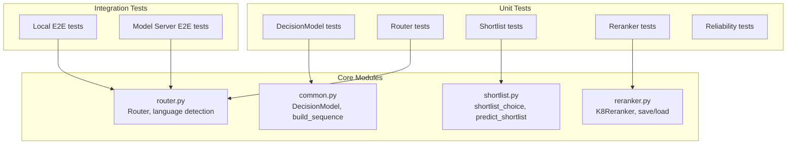
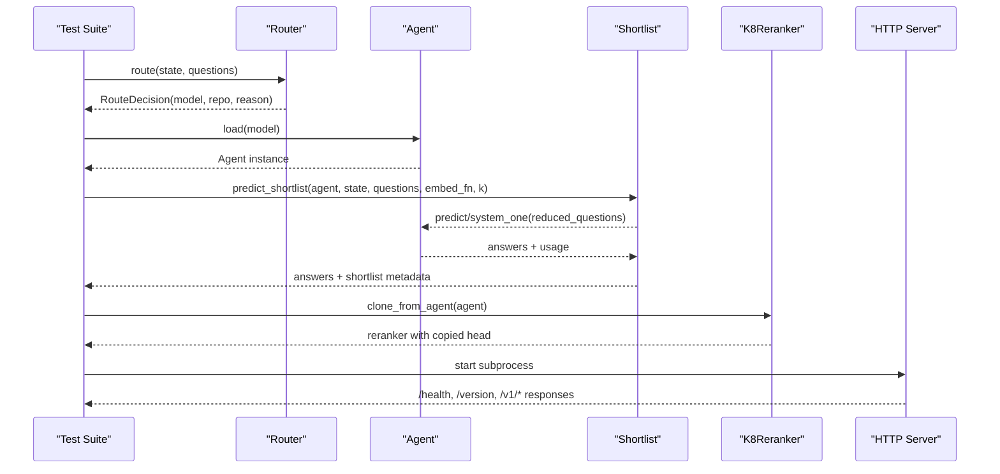
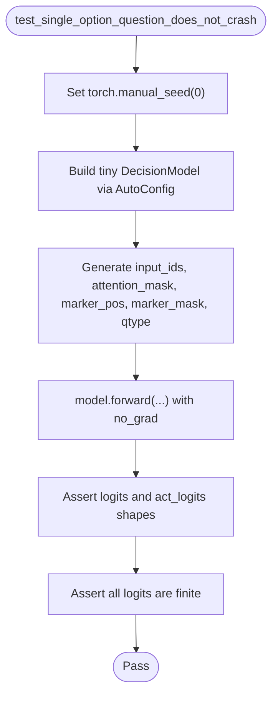
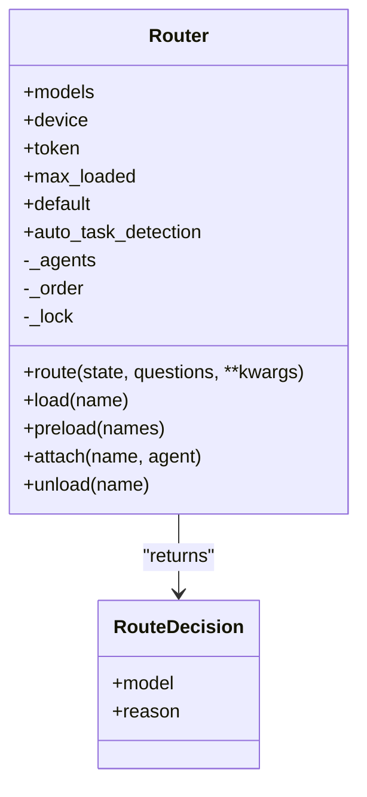
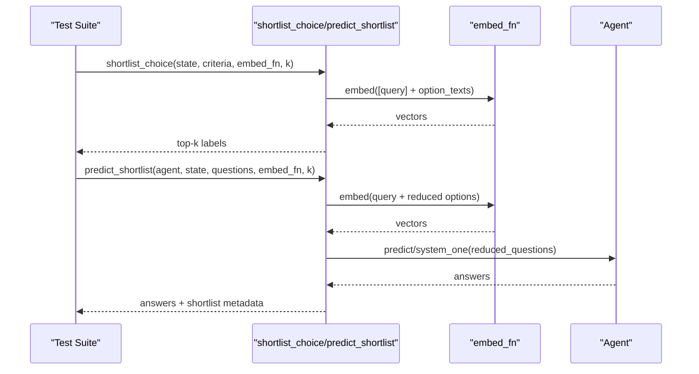
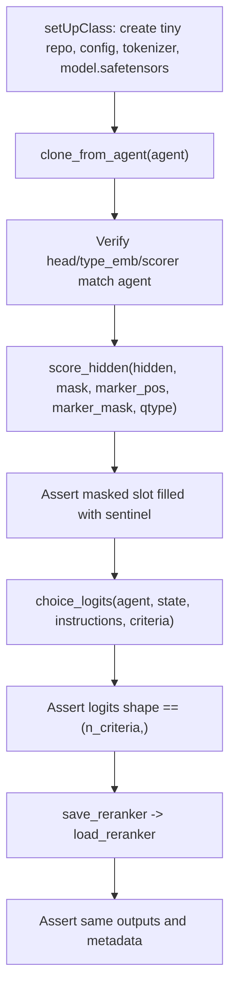
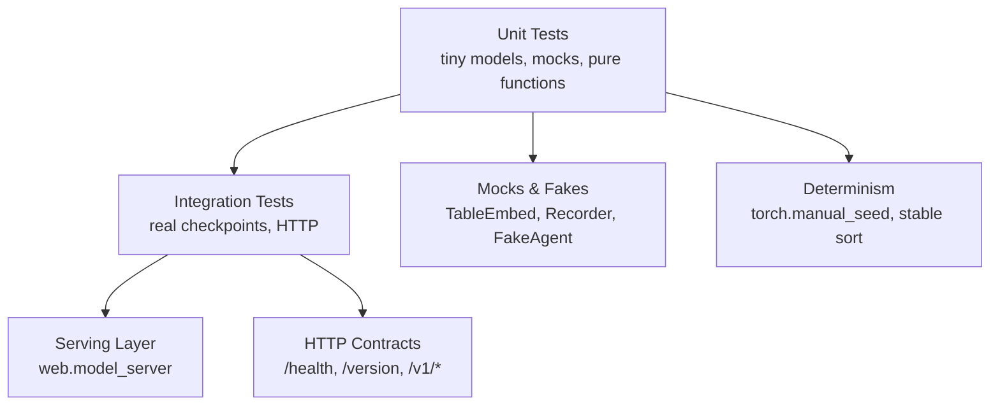
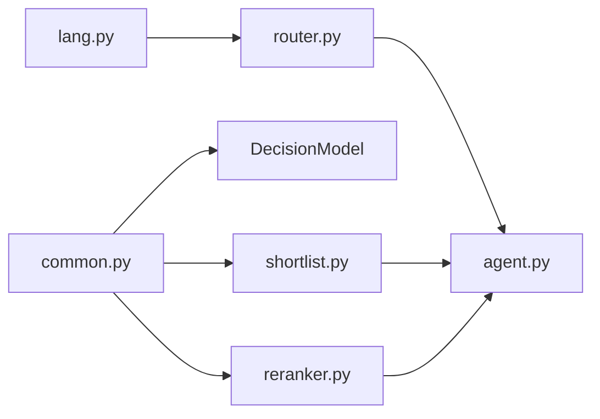

# Unit & Integration Tests

<cite>
**Referenced Files in This Document**   
- [test_decision_model.py](file://tests/test_decision_model.py)
- [test_router.py](file://tests/test_router.py)
- [test_shortlist.py](file://tests/test_shortlist.py)
- [test_reranker.py](file://tests/test_reranker.py)
- [test_local_e2e.py](file://tests/test_local_e2e.py)
- [test_model_server_e2e.py](file://tests/test_model_server_e2e.py)
- [test_reliability.py](file://tests/test_reliability.py)
- [common.py](file://veya/common.py)
- [router.py](file://veya/router.py)
- [shortlist.py](file://veya/shortlist.py)
- [reranker.py](file://veya/reranker.py)
</cite>

## Table of Contents
1. [Introduction](#introduction)
2. [Project Structure](#project-structure)
3. [Core Components](#core-components)
4. [Architecture Overview](#architecture-overview)
5. [Detailed Component Analysis](#detailed-component-analysis)
6. [Dependency Analysis](#dependency-analysis)
7. [Performance Considerations](#performance-considerations)
8. [Troubleshooting Guide](#troubleshooting-guide)
9. [Conclusion](#conclusion)

## Introduction
This document explains Veya’s unit and integration testing strategy for core ML components: DecisionModel, Router, Shortlist, and Reranker. It covers how each component is tested in isolation, how they are combined in multi-component workflows, how test data and mocks are managed, and how non-deterministic behavior is controlled. It also documents integration tests that exercise real checkpoints, HTTP endpoints, release manifests, and external service dependencies.

The goal is to help you write effective tests for ML components, handle randomization safely, validate model outputs and calibration results, and reason about integration flows across routing, shortlisting, reranking, and serving layers.

## Project Structure
Veya separates fast offline unit tests from heavier integration tests:

- Fast offline unit tests use tiny local models, fake embedders, or pure functions. They avoid network access and large checkpoint downloads.
- Integration tests load real production checkpoints, start a subprocess server, and verify end-to-end behavior over HTTP.

**Diagram sources**
- [test_decision_model.py:1-102](file://tests/test_decision_model.py#L1-L102)
- [test_router.py:1-448](file://tests/test_router.py#L1-L448)
- [test_shortlist.py:1-496](file://tests/test_shortlist.py#L1-L496)
- [test_reranker.py:1-204](file://tests/test_reranker.py#L1-L204)
- [test_local_e2e.py:1-200](file://tests/test_local_e2e.py#L1-L200)
- [test_model_server_e2e.py:1-200](file://tests/test_model_server_e2e.py#L1-L200)
- [common.py:114-161](file://veya/common.py#L114-L161)
- [router.py:123-200](file://veya/router.py#L123-L200)
- [shortlist.py:67-148](file://veya/shortlist.py#L67-L148)
- [reranker.py:26-77](file://veya/reranker.py#L26-L77)

**Section sources**
- [test_decision_model.py:1-102](file://tests/test_decision_model.py#L1-L102)
- [test_router.py:1-448](file://tests/test_router.py#L1-L448)
- [test_shortlist.py:1-496](file://tests/test_shortlist.py#L1-L496)
- [test_reranker.py:1-204](file://tests/test_reranker.py#L1-L204)
- [test_local_e2e.py:1-200](file://tests/test_local_e2e.py#L1-L200)
- [test_model_server_e2e.py:1-200](file://tests/test_model_server_e2e.py#L1-L200)

## Core Components
This section summarizes the core components under test and their responsibilities.

- DecisionModel: A transformer encoder plus typed decision heads. It builds sequences, scores options, computes entropy, and handles single-option edge cases.
- Router: Language and task routing with LRU caching, thread safety, temperature clamping, and alias resolution.
- Shortlist: Embedding-based candidate reduction for high-cardinality choice questions, with deterministic ranking and mockable prediction paths.
- Reranker: K=8 packed reranker that clones head weights from an agent, validates artifacts, and provides score_hidden and choice_logits.

Key behaviors validated by tests include:
- Deterministic top-k selection and tie-breaking order.
- Safe handling of zero-budget truncation and masked positions.
- Thread-safe concurrent loading and hot-path consistency.
- Artifact integrity checks for reranker save/load.

**Section sources**
- [common.py:114-161](file://veya/common.py#L114-L161)
- [router.py:123-200](file://veya/router.py#L123-L200)
- [shortlist.py:67-148](file://veya/shortlist.py#L67-L148)
- [reranker.py:26-77](file://veya/reranker.py#L26-L77)

## Architecture Overview
The testing architecture mirrors the runtime pipeline:

- Routing selects the correct checkpoint based on language/script and optional explicit overrides.
- Shortlist reduces large choice sets using embeddings before calling predict/system_one.
- Reranker optionally re-scores shortlisted candidates with a learned head.
- End-to-end tests verify real inference and HTTP serving.

**Diagram sources**
- [test_router.py:159-208](file://tests/test_router.py#L159-L208)
- [test_shortlist.py:223-329](file://tests/test_shortlist.py#L223-L329)
- [test_reranker.py:74-152](file://tests/test_reranker.py#L74-L152)
- [test_model_server_e2e.py:129-200](file://tests/test_model_server_e2e.py#L129-L200)

## Detailed Component Analysis

### DecisionModel Testing Strategy
DecisionModel tests focus on forward pass correctness, single-option edge cases, and numerical stability.

- Tiny local encoder: Tests construct a minimal BERT-like encoder via configuration and wrap it in DecisionModel. This avoids downloading pretrained weights and keeps tests fast and offline.
- Input generation: Randomized inputs are seeded deterministically to ensure reproducibility.
- Assertions: Shape checks, finiteness checks, and probability properties (e.g., softmax over one option equals 1.0).

**Diagram sources**
- [test_decision_model.py:41-56](file://tests/test_decision_model.py#L41-L56)
- [common.py:114-161](file://veya/common.py#L114-L161)

Key patterns:
- Seeded randomness: `torch.manual_seed` ensures deterministic behavior across runs.
- Edge-case validation: Single-option questions must not crash; the implementation pads missing top-2 entries so the action head receives a fully decided signal.
- Multi-option path preservation: Tests assert that the >=2-marker path remains unchanged after fixes.

**Section sources**
- [test_decision_model.py:17-38](file://tests/test_decision_model.py#L17-L38)
- [test_decision_model.py:41-93](file://tests/test_decision_model.py#L41-L93)
- [common.py:114-161](file://veya/common.py#L114-L161)

### Router Testing Strategy
Router tests cover language detection, script detection, workflow matching, name normalization, routing decisions, temperature clamping, LRU bookkeeping, preload behavior, attach semantics, and thread safety.

- Pure function tests: Many assertions check pure logic without loading models.
- Mocked agents: A lightweight `_Stub` implements `system_one`, enabling LRU and preload tests without real checkpoints.
- Concurrency tests: Multiple threads concurrently call `load`, verifying deduplication and consistent LRU state.

**Diagram sources**
- [router.py:83-107](file://veya/router.py#L83-L107)
- [router.py:123-200](file://veya/router.py#L123-L200)

Key patterns:
- Alias normalization: `normalise_name` maps user-friendly names to canonical keys.
- Workflow signature matching: `match_typed_decisions_workflow` requires exact question-id set matches.
- Temperature clamping: Extreme temperatures are clamped to safe bounds; bucketing prevents pathological sharpening.
- LRU eviction: `_touch` and `_evict` maintain least-recently-used ordering under lock.

Thread safety highlights:
- Concurrent loads share one Agent instance.
- Hot-path loads keep `_order` and `_agents` consistent.
- Lock granularity excludes inference to avoid serializing predictions.

**Section sources**
- [test_router.py:24-97](file://tests/test_router.py#L24-L97)
- [test_router.py:146-208](file://tests/test_router.py#L146-L208)
- [test_router.py:228-244](file://tests/test_router.py#L228-L244)
- [test_router.py:247-295](file://tests/test_router.py#L247-L295)
- [test_router.py:298-356](file://tests/test_router.py#L298-L356)
- [test_router.py:359-432](file://tests/test_router.py#L359-L432)
- [router.py:101-120](file://veya/router.py#L101-L120)
- [router.py:123-200](file://veya/router.py#L123-L200)

### Shortlist Testing Strategy
Shortlist tests validate embedding-based candidate reduction, deterministic ranking, mock predict integration, and encoder mean-pooling helpers.

- Fake embedders: `TableEmbed` returns precomputed vectors keyed by text; `BoomEmbed` raises when called to assert shortlist bypasses embedding when k >= n.
- Mock agent: `Recorder` captures calls to `predict` and `system_one`, ensuring only top-k criteria are forwarded.
- Determinism: Tie-breaking preserves original label order; zero vectors do not outrank earlier labels.
- Encoder helper: `embed_fn_from_agent` uses tokenizer and encoder without running the decision head.

**Diagram sources**
- [test_shortlist.py:51-119](file://tests/test_shortlist.py#L51-L119)
- [test_shortlist.py:136-178](file://tests/test_shortlist.py#L136-L178)
- [test_shortlist.py:223-329](file://tests/test_shortlist.py#L223-L329)
- [shortlist.py:67-148](file://veya/shortlist.py#L67-L148)

Key patterns:
- Pass-through when k >= n: No embedding is called; full label set is returned in original order.
- Internal question transformation: `Agent._to_internal` accepts shortlisted criteria; tests assert internal key order matches shortlist.
- Error validation: Invalid k types, empty criteria, duplicate labels, and bad embedder shapes raise appropriate exceptions.
- Torch tensor support: Embedders returning tensors are accepted.

**Section sources**
- [test_shortlist.py:51-119](file://tests/test_shortlist.py#L51-L119)
- [test_shortlist.py:136-178](file://tests/test_shortlist.py#L136-L178)
- [test_shortlist.py:181-215](file://tests/test_shortlist.py#L181-L215)
- [test_shortlist.py:217-329](file://tests/test_shortlist.py#L217-L329)
- [test_shortlist.py:331-388](file://tests/test_shortlist.py#L331-L388)
- [test_shortlist.py:391-469](file://tests/test_shortlist.py#L391-L469)
- [shortlist.py:67-148](file://veya/shortlist.py#L67-L148)
- [shortlist.py:151-200](file://veya/shortlist.py#L151-L200)

### Reranker Testing Strategy
Reranker tests validate cloning head weights from an agent, masking padded positions, choice logits shape and finiteness, artifact save/load round-trips, and mismatched artifact refusal.

- Local checkpoint construction: Tests create a small BertConfig, tokenizer, and DecisionModel, then load it via `veya.load`.
- Cloning verification: Head, type embedding, and scorer weights are copied without mutating the agent.
- Masking: Padded slots receive a sentinel value; valid slots remain finite.
- Artifact integrity: Save writes side JSON with file SHA-256; load refuses wrong checkpoint hash, wrong shortlist SHA, or unsupported format.

**Diagram sources**
- [test_reranker.py:43-69](file://tests/test_reranker.py#L43-L69)
- [test_reranker.py:74-152](file://tests/test_reranker.py#L74-L152)
- [reranker.py:26-77](file://veya/reranker.py#L26-L77)
- [reranker.py:80-121](file://veya/reranker.py#L80-L121)

Key patterns:
- Validation of markers: `choice_logits` raises if packed head drops options.
- Hash verification: `file_sha256` matches hashlib; side JSON records checksums.
- Strict loading: Load refuses incompatible formats, routes, or hashes.

**Section sources**
- [test_reranker.py:43-69](file://tests/test_reranker.py#L43-L69)
- [test_reranker.py:74-152](file://tests/test_reranker.py#L74-L152)
- [test_reranker.py:154-183](file://tests/test_reranker.py#L154-L183)
- [reranker.py:26-77](file://veya/reranker.py#L26-L77)
- [reranker.py:80-121](file://veya/reranker.py#L80-L121)

### Conceptual Overview
Conceptually, Veya’s testing strategy follows these principles:

- Isolate ML components with tiny local models or pure functions.
- Mock external dependencies (embedders, agents, HTTP servers).
- Control randomness explicitly via seeds.
- Validate both functional correctness and robustness (edge cases, errors, concurrency).
- Exercise integration paths with real checkpoints and HTTP endpoints.

[No sources needed since this diagram shows conceptual workflow, not actual code structure]

## Dependency Analysis
Component-level dependencies and relationships:

- DecisionModel depends on a transformer encoder and typed heads.
- Router depends on language analysis utilities and may load Agents lazily.
- Shortlist depends on common rendering utilities and can use an embedder callable.
- Reranker depends on common sequence building and collation utilities.

**Diagram sources**
- [common.py:114-161](file://veya/common.py#L114-L161)
- [router.py:123-200](file://veya/router.py#L123-L200)
- [shortlist.py:67-148](file://veya/shortlist.py#L67-L148)
- [reranker.py:26-77](file://veya/reranker.py#L26-L77)

**Section sources**
- [common.py:114-161](file://veya/common.py#L114-L161)
- [router.py:123-200](file://veya/router.py#L123-L200)
- [shortlist.py:67-148](file://veya/shortlist.py#L67-L148)
- [reranker.py:26-77](file://veya/reranker.py#L26-L77)

## Performance Considerations
Testing performance focuses on minimizing overhead while preserving realism:

- Tiny local encoders and tokenizers avoid network latency and large downloads.
- Batched embedding in `embed_fn_from_agent` reduces repeated encoder calls.
- LRU caching in Router prevents redundant model construction.
- Preload mode warms up multiple checkpoints to eliminate cold-start latency during routing.

Recommendations:
- Use `embed_fn_from_agent` with appropriate `batch_size` and `max_length` to balance memory and speed.
- Prefer `Router(preload=True)` in server scenarios where routing alternates languages frequently.
- Keep unit tests offline and deterministic; reserve integration tests for real checkpoints.

[No sources needed since this section provides general guidance]

## Troubleshooting Guide
Common issues and how tests address them:

- Non-deterministic outputs: Always seed RNGs (`torch.manual_seed`) in tests involving random tensors.
- Crashes on single-option questions: Ensure topk logic handles fewer than two options; pad missing entries to compute action features.
- Zero-budget truncation: Validate that `build_sequence` respects max_len and truncate_left flags.
- Thread safety: Verify concurrent loads deduplicate Agent construction and keep LRU views consistent.
- Artifact mismatches: Refuse reranker loads with wrong checkpoint hash, shortlist SHA, or unsupported format.
- HTTP schema boundaries: Use fake agents and strict request/response validation in server security tests.

Actionable checks:
- For DecisionModel: Assert finiteness and shapes after forward passes.
- For Router: Check alias normalization, temperature clamping bounds, and LRU eviction order.
- For Shortlist: Confirm pass-through behavior when k >= n and that embed_fn is not invoked unnecessarily.
- For Reranker: Validate masked slots and choice_logits shapes; verify save/load round-trip metadata.
- For Integration: Confirm `/health` and `/version` endpoints return expected fields; assert probabilities sum to 1.0.

**Section sources**
- [test_decision_model.py:41-93](file://tests/test_decision_model.py#L41-L93)
- [test_router.py:228-244](file://tests/test_router.py#L228-L244)
- [test_router.py:359-432](file://tests/test_router.py#L359-L432)
- [test_shortlist.py:217-329](file://tests/test_shortlist.py#L217-L329)
- [test_reranker.py:154-183](file://tests/test_reranker.py#L154-L183)
- [test_model_server_e2e.py:129-200](file://tests/test_model_server_e2e.py#L129-L200)

## Conclusion
Veya’s testing strategy combines fast, deterministic unit tests with targeted integration tests. Core components are exercised with tiny local models, mocked dependencies, and explicit randomization control. Integration tests validate real checkpoints, release manifests, and HTTP endpoints. The patterns documented here—seeded randomness, careful mocking, strict artifact validation, and concurrency checks—provide a robust foundation for writing effective tests for ML components and multi-component workflows.

[No sources needed since this section summarizes without analyzing specific files]