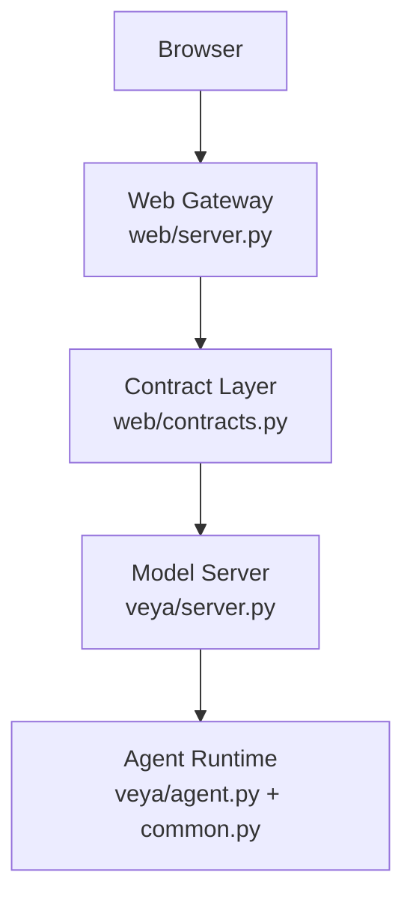
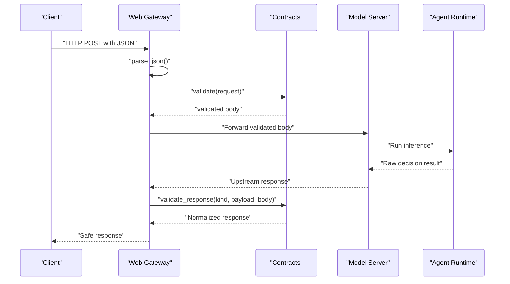
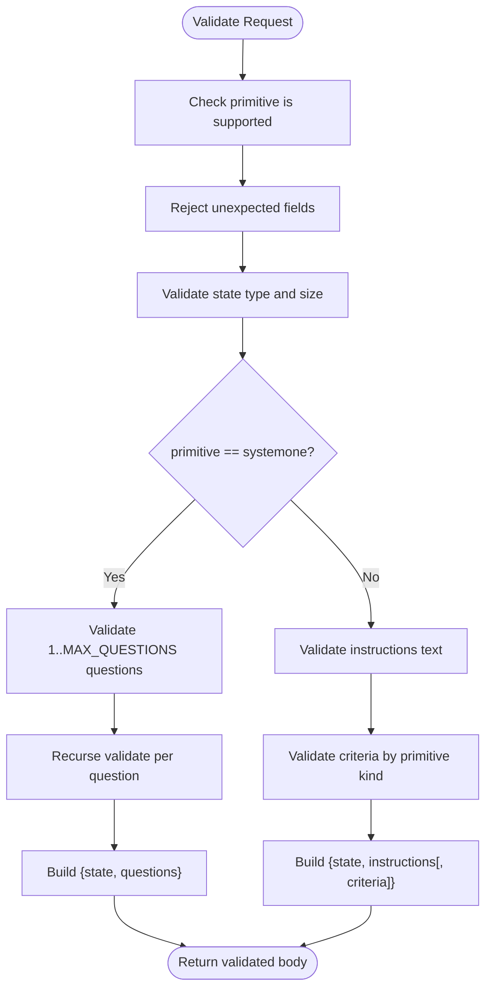
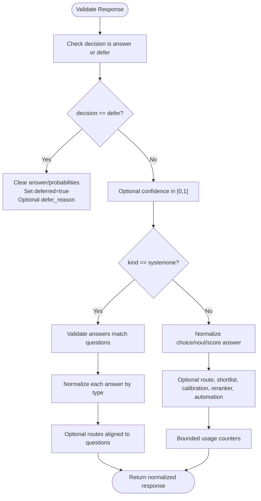
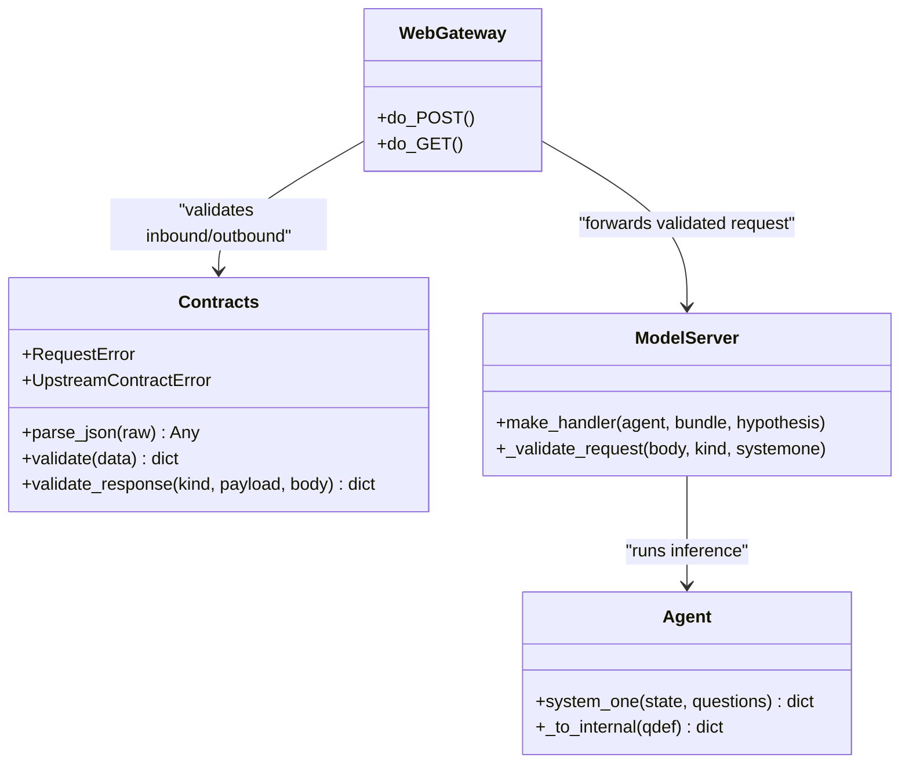
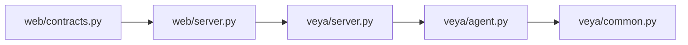

# Contract Validation System

<cite>
**Referenced Files in This Document**
- [contracts.py](file://web/contracts.py)
- [server.py](file://web/server.py)
- [agent.py](file://veya/agent.py)
- [common.py](file://veya/common.py)
- [server.py](file://veya/server.py)
- [test_web_gateway.py](file://tests/test_web_gateway.py)
</cite>

## Table of Contents
1. [Introduction](#introduction)
2. [Project Structure](#project-structure)
3. [Core Components](#core-components)
4. [Architecture Overview](#architecture-overview)
5. [Detailed Component Analysis](#detailed-component-analysis)
6. [Dependency Analysis](#dependency-analysis)
7. [Performance Considerations](#performance-considerations)
8. [Troubleshooting Guide](#troubleshooting-guide)
9. [Conclusion](#conclusion)

## Introduction
This document explains Veya’s contract validation system that protects the boundary between the public web gateway and the model server. The system enforces a small, safe request schema, validates upstream responses, sanitizes untrusted data, and raises explicit error types so callers can distinguish client-side request problems from upstream contract violations.

The validated primitives are:
- `choice`: select one candidate from a bounded set of labeled options.
- `score`: rank or score across an ordered list of labels.
- `noul`: binary probability that a statement holds.
- `systemone`: a batched multi-question request that reuses state and runs multiple typed questions together.

The gateway accepts only a bounded subset of the model API. Candidate text is not rewritten into instructions, and all inputs are size-limited, type-checked, and normalized before reaching the model runtime.

## Project Structure
The contract layer lives under the web package and is used by the website HTTP server to proxy requests to either the bundled model bundle or the local inference server.

**Diagram sources**
- [server.py:23-30](file://web/server.py#L23-L30)
- [contracts.py:1-177](file://web/contracts.py#L1-L177)
- [server.py:137-235](file://veya/server.py#L137-L235)
- [agent.py:265-414](file://veya/agent.py#L265-L414)

**Section sources**
- [server.py:1-30](file://web/server.py#L1-L30)
- [contracts.py:1-177](file://web/contracts.py#L1-L177)
- [server.py:137-235](file://veya/server.py#L137-L235)
- [agent.py:265-414](file://veya/agent.py#L265-L414)

## Core Components
- **Primitive types**: A literal union of supported primitives.
- **Request validation**: Converts browser-facing JSON into the exact body consumed by the model service.
- **Response validation**: Whitelists and normalizes model output before it reaches the browser.
- **Error types**:
  - `RequestError`: Client input violates the public contract.
  - `UpstreamContractError`: Upstream response violates the expected contract.
- **Sanitization helpers**: Enforce limits for state, text, criteria, probabilities, numbers, and optional metadata.

Key responsibilities:
- Reject unknown fields.
- Normalize and deduplicate identifiers.
- Bound sizes for state, candidates, labels, and optional strings.
- Validate numeric ranges and probability distributions.
- Map internal model answers back to a stable public shape.

**Section sources**
- [contracts.py:14-34](file://web/contracts.py#L14-L34)
- [contracts.py:20-25](file://web/contracts.py#L20-L25)
- [contracts.py:49-177](file://web/contracts.py#L49-L177)
- [contracts.py:179-349](file://web/contracts.py#L179-L349)

## Architecture Overview
The end-to-end flow enforces contracts at two boundaries:

1. **Inbound request**: The web gateway parses JSON, then calls `validate` to produce a model-service-safe payload.
2. **Outbound response**: The gateway calls `validate_response` to normalize and constrain model output before returning it to the browser.

**Diagram sources**
- [server.py:152-182](file://web/server.py#L152-L182)
- [contracts.py:49-177](file://web/contracts.py#L49-L177)
- [server.py:173-235](file://veya/server.py#L173-L235)
- [contracts.py:246-349](file://web/contracts.py#L246-L349)

## Detailed Component Analysis

### Primitive Types and Request Schema
Supported primitives:
- `choice`: Requires `criteria` as a dictionary mapping candidate IDs to descriptions.
- `score`: Requires `criteria` as an ordered list of label strings.
- `noul`: Does not accept criteria in this website interface.
- `systemone`: Batched multi-question request; each question has its own primitive type, instructions, and optional criteria.

Validation rules:
- Only allowed top-level fields are accepted per primitive.
- `state` must be nonempty and bounded in serialized size.
- `instructions` must be nonempty text with a maximum length.
- Duplicate JSON keys are rejected early.
- Non-finite JSON numbers are rejected during parsing.

**Diagram sources**
- [contracts.py:121-177](file://web/contracts.py#L121-L177)

**Section sources**
- [contracts.py:14-34](file://web/contracts.py#L14-L34)
- [contracts.py:49-177](file://web/contracts.py#L49-L177)

### Data Sanitization Rules

#### State
- Must be a nonempty string, object, or list.
- Serialized UTF-8 size is limited to 12 KB.
- Invalid JSON structures raise a request error.

#### Text Fields
- `instructions` must be nonempty and bounded.
- Optional metadata strings such as `model`, `calibration_version`, `defer_reason`, `route`, and `automation` are bounded and optional.

#### Criteria
- `choice`:
  - Dictionary with 2–100 entries.
  - Keys are candidate IDs (bounded).
  - Values are descriptions (bounded).
  - IDs are unique after Unicode normalization.
- `score`:
  - List of 2–10 labels.
  - Labels are bounded text.
  - Labels are unique after Unicode normalization.
- `noul`:
  - No criteria accepted through the website endpoint.

#### Parsing Safety
- JSON parsing rejects duplicate keys.
- Non-finite numbers are rejected.
- Unicode normalization is applied where uniqueness matters.

**Section sources**
- [contracts.py:36-87](file://web/contracts.py#L36-L87)
- [contracts.py:90-118](file://web/contracts.py#L90-L118)
- [contracts.py:211-216](file://web/contracts.py#L211-L216)

### Response Validation and Normalization
The response validator whitelists fields and converts raw model output into a stable public shape.

Key behaviors:
- `decision` must be `answer` or `defer`.
- `deferred` is derived from `decision`; conflicting values are rejected.
- For `answer`:
  - `confidence` is optional and bounded to `[0, 1]`.
  - Per-primitive answer structure is enforced.
  - Probabilities are validated as finite floats in `[0, 1]`, sum close to 1, and restricted to allowed labels.
  - Shortlist metadata for `choice` is bounded and constrained to provided criteria.
  - Usage counters are bounded integers.
- For `defer`:
  - Answer and probabilities are cleared.
  - Defer reason is optional but bounded.
- For `systemone`:
  - Answers must match question IDs and types.
  - Each answer is validated using the same per-primitive logic.
  - Optional routes must align with question IDs.

**Diagram sources**
- [contracts.py:246-349](file://web/contracts.py#L246-L349)

**Section sources**
- [contracts.py:179-243](file://web/contracts.py#L179-L243)
- [contracts.py:246-349](file://web/contracts.py#L246-L349)

### Error Types and Failure Semantics
- `RequestError`: Indicates malformed or disallowed client input. Examples include invalid JSON, unsupported primitive, unexpected fields, missing or oversized state, invalid criteria, and non-finite numbers.
- `UpstreamContractError`: Indicates that the upstream model response does not conform to the expected contract. Examples include invalid decision, conflicting defer state, missing or invalid probability distribution, unexpected probability labels, absent answer, out-of-range numbers, mismatched SystemOne answers, invalid shortlist, and invalid usage counters.

These errors allow the gateway to return precise HTTP status codes and user-visible defer reasons without leaking unsafe model internals.

**Section sources**
- [contracts.py:20-25](file://web/contracts.py#L20-L25)
- [contracts.py:49-177](file://web/contracts.py#L49-L177)
- [contracts.py:179-349](file://web/contracts.py#L179-L349)

### Integration with the Model Server and Agent Runtime
The web gateway forwards validated requests to the model server. The model server performs additional lightweight validation and then invokes the agent runtime.

- Model server request validation ensures the body is a dict, state has content, and question definitions are valid.
- Agent runtime converts question definitions to an internal representation, builds token sequences, runs inference, and returns structured answers.

**Diagram sources**
- [contracts.py:49-177](file://web/contracts.py#L49-L177)
- [server.py:137-235](file://veya/server.py#L137-L235)
- [agent.py:265-414](file://veya/agent.py#L265-L414)

**Section sources**
- [server.py:114-135](file://veya/server.py#L114-L135)
- [agent.py:265-414](file://veya/agent.py#L265-L414)

### Example Payloads and Validation Scenarios

#### Valid Choice Request
A valid choice request includes:
- `primitive: "choice"`
- Nonempty `state`
- Nonempty `instructions`
- `criteria` as a dictionary with 2–100 candidate IDs and descriptions

Expected behavior:
- `validate` returns a body containing `state`, `instructions`, and `criteria`.
- The model server executes inference and returns a response with a chosen candidate and a probability distribution over the provided criteria.

#### Valid Score Request
A valid score request includes:
- `primitive: "score"`
- Nonempty `state`
- Nonempty `instructions`
- `criteria` as an ordered list of 2–10 labels

Expected behavior:
- `validate` returns a body containing `state`, `instructions`, and `criteria`.
- The response contains a numeric score within the label range and a probability distribution over integer levels.

#### Valid Noul Request
A valid noul request includes:
- `primitive: "noul"`
- Nonempty `state`
- Nonempty `instructions`
- No criteria

Expected behavior:
- `validate` returns a body containing `state` and `instructions`.
- The response contains a probability in `[0, 1]`.

#### Valid SystemOne Request
A valid systemone request includes:
- `primitive: "systemone"`
- Nonempty `state`
- `questions` as a dictionary with 1–8 question IDs
- Each question has `type` (`choice`, `noul`, or `score`), `instructions`, and optional `criteria`

Expected behavior:
- `validate` recursively validates each question and returns a normalized body with `state` and `questions`.
- The response contains per-question answers aligned to the original question IDs.

#### Invalid Payload Examples
- Unknown primitive: raises `RequestError`.
- Unexpected top-level field: raises `RequestError`.
- Empty or oversized state: raises `RequestError`.
- Missing or empty instructions: raises `RequestError`.
- Invalid criteria shape or bounds: raises `RequestError`.
- Duplicate candidate IDs after normalization: raises `RequestError`.
- Non-finite JSON number: raises `RequestError`.
- Upstream response with invalid decision or conflicting defer state: raises `UpstreamContractError`.
- Probability distribution missing, invalid, or not summing to one: raises `UpstreamContractError`.
- Choice answer not present in distribution: raises `UpstreamContractError`.
- Score levels missing or answer out of range: raises `UpstreamContractError`.
- SystemOne answers not matching question IDs or types: raises `UpstreamContractError`.

**Section sources**
- [contracts.py:121-177](file://web/contracts.py#L121-L177)
- [contracts.py:179-349](file://web/contracts.py#L179-L349)
- [test_web_gateway.py:371-411](file://tests/test_web_gateway.py#L371-L411)

### Extending the Contract System for Custom Primitives
To add a new primitive safely:

1. Extend the primitive literal and update validation routing.
2. Add request validation for the new primitive’s fields and constraints.
3. Add response normalization for the new primitive’s answer shape.
4. Update SystemOne handling if the primitive supports batched questions.
5. Add tests covering valid payloads, boundary values, and error cases.

Guidelines:
- Keep the public surface minimal and auditable.
- Always bound text, counts, and numeric ranges.
- Normalize identifiers when uniqueness matters.
- Never promote candidate text into instructions.
- Treat upstream responses as untrusted until fully validated.

[No sources needed since this section provides extension guidance without analyzing specific files]

## Dependency Analysis
The contract layer depends on Python standard library modules for JSON parsing, Unicode normalization, math checks, and typing. It is imported by the web gateway and used to wrap both inbound and outbound traffic.

**Diagram sources**
- [contracts.py:1-349](file://web/contracts.py#L1-L349)
- [server.py:23-30](file://web/server.py#L23-L30)
- [server.py:137-235](file://veya/server.py#L137-L235)
- [agent.py:265-414](file://veya/agent.py#L265-L414)
- [common.py:11-111](file://veya/common.py#L11-L111)

**Section sources**
- [contracts.py:1-349](file://web/contracts.py#L1-L349)
- [server.py:23-30](file://web/server.py#L23-L30)
- [server.py:137-235](file://veya/server.py#L137-L235)
- [agent.py:265-414](file://veya/agent.py#L265-L414)
- [common.py:11-111](file://veya/common.py#L11-L111)

## Performance Considerations
- JSON parsing uses a strict object pairs hook to reject duplicate keys and non-finite numbers early.
- State serialization is bounded to prevent large payloads.
- Probability validation enforces finite floats and near-sum-one constraints.
- Optional metadata is bounded to avoid excessive response growth.
- The model server serializes inference with a lock to protect shared model state.

[No sources needed since this section provides general guidance]

## Troubleshooting Guide

### Diagnosing Request Errors
Common causes:
- Invalid JSON body or non-finite numbers.
- Unsupported primitive or unexpected fields.
- Missing or empty state/instructions.
- Criteria outside allowed bounds or with duplicates after normalization.

Actions:
- Inspect the error message from `RequestError`.
- Verify primitive selection and required fields.
- Check state size and text limits.
- Ensure criteria shapes and uniqueness rules are satisfied.

**Section sources**
- [contracts.py:49-177](file://web/contracts.py#L49-L177)

### Diagnosing Upstream Contract Errors
Common causes:
- Invalid decision value or conflicting defer state.
- Missing or invalid probability distribution.
- Choice answer not in distribution.
- Score levels missing or answer out of range.
- SystemOne answers not matching question IDs or types.
- Invalid shortlist, route, calibration, reranker, automation, or usage metadata.

Actions:
- Inspect the error message from `UpstreamContractError`.
- Compare the upstream response against the expected normalized shape.
- Validate probability sums and label sets.
- Confirm SystemOne answer alignment with the original questions.

**Section sources**
- [contracts.py:179-349](file://web/contracts.py#L179-L349)

### Debugging Validation Failures
- Use the test suite patterns to construct minimal valid and invalid payloads.
- Reproduce failures with `validate` and `validate_response` directly.
- Log the validated request body and the upstream response for comparison.
- Confirm that the model server path matches the selected primitive.

**Section sources**
- [test_web_gateway.py:93-119](file://tests/test_web_gateway.py#L93-L119)
- [test_web_gateway.py:371-411](file://tests/test_web_gateway.py#L371-L411)

## Conclusion
Veya’s contract validation system provides a strong security boundary between the web gateway and the model server. It enforces a small set of primitives, validates and sanitizes all inputs, normalizes upstream outputs, and distinguishes client request errors from upstream contract violations. By keeping the public surface bounded and treating all external data as untrusted, the system reduces attack surfaces for malformed or malicious payloads while preserving clear debugging signals for developers.

[No sources needed since this section summarizes without analyzing specific files]