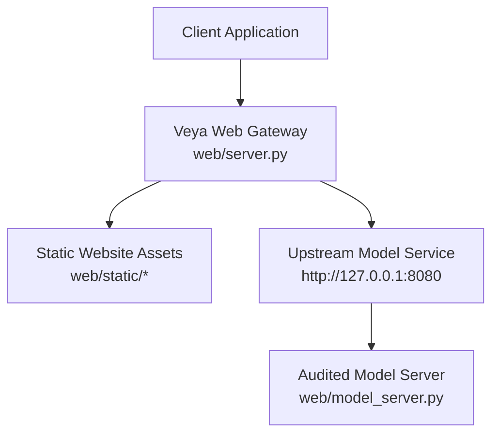
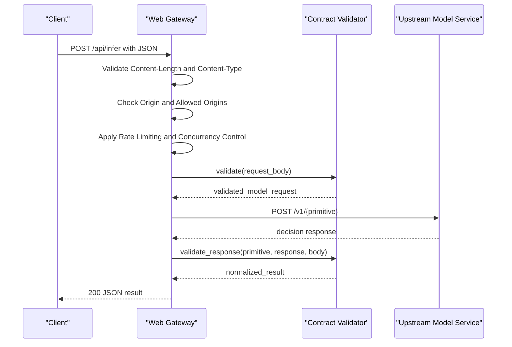
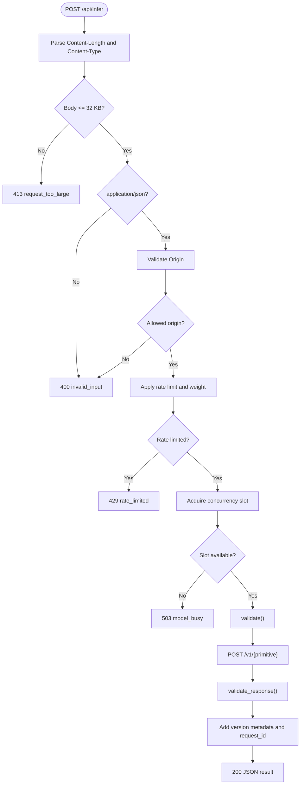
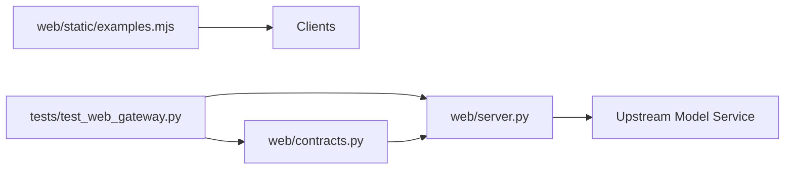

# HTTP API Reference

<cite>
**Referenced Files in This Document**
- [web/server.py](file://web/server.py)
- [web/contracts.py](file://web/contracts.py)
- [web/model_server.py](file://web/model_server.py)
- [web/static/examples.mjs](file://web/static/examples.mjs)
- [tests/test_web_gateway.py](file://tests/test_web_gateway.py)
</cite>

## Table of Contents
1. [Introduction](#introduction)
2. [Project Structure](#project-structure)
3. [Core Components](#core-components)
4. [Architecture Overview](#architecture-overview)
5. [Detailed Component Analysis](#detailed-component-analysis)
6. [Dependency Analysis](#dependency-analysis)
7. [Performance Considerations](#performance-considerations)
8. [Troubleshooting Guide](#troubleshooting-guide)
9. [Conclusion](#conclusion)

## Introduction
This document describes the HTTP API exposed by Veya’s web interface. The gateway provides a bounded, audited surface for model inference and service metadata. It accepts JSON requests, validates them against a strict contract, forwards them to an upstream model service, validates responses, and returns structured results to clients.

The documented endpoints are:
- `POST /api/infer` — Run a model primitive such as choice, noul, score, or systemone.
- `GET /api/health` — Check whether the upstream model service is healthy.
- `GET /api/version` — Return public version and capability metadata.
- `GET /api/benchmark` — Return sealed benchmark summary data from release artifacts.

Authentication is not required at the gateway boundary; instead, security is enforced through request validation, origin checks, rate limiting, concurrency limits, response size limits, and security headers. If configured, the gateway forwards an authorization token to the upstream model service.

## Project Structure
The web gateway is implemented as a lightweight Python HTTP server that serves static website assets and exposes the REST endpoints above. A separate model server process hosts the audited model service on localhost.

**Diagram sources**
- [web/server.py:32-36](file://web/server.py#L32-L36)
- [web/server.py:650-659](file://web/server.py#L650-L659)
- [web/model_server.py:9-17](file://web/model_server.py#L9-L17)

**Section sources**
- [web/server.py:32-36](file://web/server.py#L32-L36)
- [web/server.py:650-659](file://web/server.py#L650-L659)
- [web/model_server.py:9-17](file://web/model_server.py#L9-L17)

## Core Components
- **Gateway handler**: Processes HTTP requests, enforces content type and payload size, validates origins, applies rate limiting and concurrency control, calls the upstream model service, validates responses, and returns structured JSON.
- **Contract validator**: Defines allowed primitives, request fields, field types, length limits, uniqueness rules, and response shape validation.
- **Benchmark endpoint**: Reads precomputed benchmark metrics from a sealed artifact file.
- **Health and version endpoints**: Proxy health checks and cache public version metadata.

Key configuration values:
- Request body limit: 32 KB.
- Response body limit: 512 KB.
- Inference timeout: 20 seconds.
- Rate-limit window: 60 seconds.
- Capacity: 12 weighted units per client IP within the window.
- Maximum concurrent upstream calls: 2.

**Section sources**
- [web/server.py:74-85](file://web/server.py#L74-L85)
- [web/contracts.py:14-18](file://web/contracts.py#L14-L18)
- [web/contracts.py:121-176](file://web/contracts.py#L121-L176)
- [web/server.py:304-346](file://web/server.py#L304-L346)

## Architecture Overview
The request processing pipeline for `/api/infer` follows these steps:

**Diagram sources**
- [web/server.py:408-543](file://web/server.py#L408-L543)
- [web/contracts.py:121-176](file://web/contracts.py#L121-L176)
- [web/contracts.py:246-348](file://web/contracts.py#L246-L348)

## Detailed Component Analysis

### Endpoint: POST /api/infer
Purpose: Submit a model primitive and receive a normalized decision.

Supported primitives:
- `choice`: Select one candidate from a set.
- `noul`: Binary probability judgment.
- `score`: Ordinal scoring over ordered labels.
- `systemone`: Multi-question workflow combining supported question types.

Request schema:
- Required top-level field: `primitive`.
- Optional shared field: `state`, which may be a nonempty string, object, or list up to 12 KB when serialized.
- For `choice`, `noul`, and `score`:
  - `instructions`: Nonempty text up to 500 characters.
  - `criteria`:
    - `choice`: Object mapping candidate IDs to descriptions. Candidate IDs must be unique after Unicode normalization, each ID up to 80 characters, each description up to 240 characters, and total candidates between 2 and 100.
    - `score`: List of 2 to 10 unique label strings, each up to 100 characters.
    - `noul`: Must be absent.
- For `systemone`:
  - `questions`: Object with 1 to 8 question IDs. Each question has `type` (`choice`, `noul`, or `score`), `instructions`, and optional `criteria` following the same rules as the corresponding primitive.

Content requirements:
- Method: `POST`.
- Path: `/api/infer`.
- Content-Type: `application/json`.
- Body size: up to 32 KB.

Response schema:
- Common fields:
  - `decision`: `"answer"` or `"defer"`.
  - `deferred`: Boolean derived from decision.
  - `primitive`: Echoed primitive name.
  - `model`: Public product name, always `"Veya Core"`.
  - `request_id`: Unique request identifier.
  - `gateway_latency_ms`: Milliseconds spent in the gateway.
  - Optional metadata: `model_version`, `release`, `architecture_version`, `supported_languages`, `release_status`.
- Answer fields:
  - `choice`: `answer` and `probabilities` distribution over criteria keys. May include `shortlist`, `candidate_count`, `calibration`, `reranker_id`, and `automation`.
  - `noul`: `answer` as a number between 0 and 1, plus `probabilities` set to `null`.
  - `score`: `answer` as a number between 0 and `levels - 1`, `probabilities` over integer level strings, and `legend` mapping levels to labels.
  - `systemone`: `answers` object keyed by question ID, each answer matching the question type and containing `type`, `answer`/`choice`/`noul`/`score`, optional `confidence`, and optional `route`. May also include `routes` aligned with questions.
- Deferred responses:
  - `answer` and `probabilities` are `null`.
  - `defer_reason` is a short string explaining why the model deferred.

Error codes:
- `400 invalid_input`: Invalid JSON, missing or malformed fields, unsupported primitive, duplicate keys, or disallowed cross-origin request.
- `413 request_too_large`: Request exceeds 32 KB.
- `429 rate_limited`: Client exceeded rate capacity; includes `retry_after` and `Retry-After` header.
- `503 model_busy`: Too many concurrent inference calls; includes `retry_after`.
- `400 model_rejected`: Upstream rejected input; may include `defer_reason`.
- `429 rate_limited`: Upstream returned 429; preserves `Retry-After`.
- `502 model_error`: Upstream returned a generic error.
- `504 timeout`: Upstream call timed out.
- `503 model_unavailable`: Upstream connection failure or unhealthy health check.
- `502 invalid_upstream_response`: Upstream response failed contract validation.

Security and validation behavior:
- Only `application/json` is accepted.
- Cross-origin requests are blocked unless the `Origin` matches the current host or `VEYA_ALLOWED_ORIGINS`.
- State serialization is limited to 12 KB.
- Duplicate JSON keys are rejected.
- Non-finite numbers are rejected during parsing.
- Response probabilities must sum approximately to 1.0 and contain only allowed labels.

Example payloads:
- See [web/static/examples.mjs:2-31](file://web/static/examples.mjs#L2-L31).

Client integration examples:
- See [web/static/examples.mjs:37-41](file://web/static/examples.mjs#L37-L41).

Processing flow:

**Diagram sources**
- [web/server.py:408-543](file://web/server.py#L408-L543)
- [web/contracts.py:121-176](file://web/contracts.py#L121-L176)
- [web/contracts.py:246-348](file://web/contracts.py#L246-L348)

**Section sources**
- [web/server.py:408-647](file://web/server.py#L408-L647)
- [web/contracts.py:14-18](file://web/contracts.py#L14-L18)
- [web/contracts.py:49-79](file://web/contracts.py#L49-L79)
- [web/contracts.py:90-176](file://web/contracts.py#L90-L176)
- [web/contracts.py:179-348](file://web/contracts.py#L179-L348)
- [web/static/examples.mjs:2-41](file://web/static/examples.mjs#L2-L41)
- [tests/test_web_gateway.py:32-55](file://tests/test_web_gateway.py#L32-L55)
- [tests/test_web_gateway.py:371-411](file://tests/test_web_gateway.py#L371-L411)
- [tests/test_web_gateway.py:428-489](file://tests/test_web_gateway.py#L428-L489)
- [tests/test_web_gateway.py:492-511](file://tests/test_web_gateway.py#L492-L511)

### Endpoint: GET /api/health
Purpose: Verify that the upstream model service is reachable and reports a healthy status.

Behavior:
- Proxies to upstream `/health`.
- Requires upstream status to be `"ok"`.
- Returns the upstream health payload on success.
- Returns `503 unavailable` with code `model_unavailable` if the upstream is unreachable, times out, or reports an unhealthy status.

Response schema:
- Depends on upstream health implementation; typically includes a `status` field.

**Section sources**
- [web/server.py:334-346](file://web/server.py#L334-L346)
- [tests/test_web_gateway.py:141-155](file://tests/test_web_gateway.py#L141-L155)

### Endpoint: GET /api/version
Purpose: Return public version and capability metadata about the deployed model.

Behavior:
- Caches version metadata for 60 seconds.
- Calls upstream `/version`.
- Whitelists and validates fields such as `model_version`, `release`, `architecture_version`, `checkpoint`, `calibration_version`, `reranker_id`, `hypothesis_scorer_id`, `supported_languages`, `supported_primitives`, and `release_status`.
- Rejects oversized or malformed metadata.

Response schema:
- Subset of upstream version fields, all validated as strings, lists of short strings, or small status objects.

**Section sources**
- [web/server.py:117-171](file://web/server.py#L117-L171)
- [tests/test_web_gateway.py:141-155](file://tests/test_web_gateway.py#L141-L155)

### Endpoint: GET /api/benchmark
Purpose: Return a sealed benchmark summary from release artifacts.

Behavior:
- Reads a predefined artifact file under `artifacts/release`.
- Extracts dataset, sample count, candidate count, release identifier, split status, architecture, recall-at-8, conditional accuracy, end-to-end accuracy, expected calibration error, retrieval misses, shortlist hits, correct-on-hit counts, and reranker misses.
- Returns `503 benchmark_unavailable` if the artifact cannot be read or parsed.

Response schema:
- `dataset`, `n`, `candidate_count`, `release`, `split_status`, `architecture`, `recall_at_8`, `conditional_accuracy`, `accuracy`, `ece`, `retrieval_misses`, `shortlist_hits`, `correct_on_hit`, `scoring_misses`.

**Section sources**
- [web/server.py:304-333](file://web/server.py#L304-L333)
- [tests/test_web_gateway.py:330-345](file://tests/test_web_gateway.py#L330-L345)

## Dependency Analysis
The gateway depends on:
- Contract validation module for request and response schemas.
- Upstream model service for inference and metadata.
- Static site configuration for page routing and SEO.
- Environment variables for port, host, upstream URL, public origin, allowed origins, and optional authentication token.

**Diagram sources**
- [web/server.py:23-30](file://web/server.py#L23-L30)
- [web/contracts.py:121-176](file://web/contracts.py#L121-L176)
- [web/static/examples.mjs:1-41](file://web/static/examples.mjs#L1-L41)
- [tests/test_web_gateway.py:15-22](file://tests/test_web_gateway.py#L15-L22)

**Section sources**
- [web/server.py:23-30](file://web/server.py#L23-L30)
- [web/contracts.py:121-176](file://web/contracts.py#L121-L176)
- [web/static/examples.mjs:1-41](file://web/static/examples.mjs#L1-L41)
- [tests/test_web_gateway.py:15-22](file://tests/test_web_gateway.py#L15-L22)

## Performance Considerations
- Payload size: Keep requests under 32 KB. Large payloads are rejected immediately.
- Inference timeout: Default is 20 seconds. Clients should implement retry logic with exponential backoff and respect `Retry-After`.
- Concurrency: At most 2 simultaneous upstream calls. Excess requests receive `503 model_busy`.
- Rate limiting: Per-client IP sliding window of 60 seconds with capacity 12 weighted units. Complex requests (e.g., large `choice` sets) cost more than simple ones.
- Benchmark data: Precomputed and cached; no runtime model dependency.
- Version metadata: Cached for 60 seconds to reduce upstream calls.

Optimization tips:
- Batch user interactions into fewer, larger requests where appropriate, but stay within limits.
- Implement client-side retries with jitter and bounded maximum attempts.
- Monitor `gateway_latency_ms` and `request_id` for observability.
- Avoid unnecessary re-sending of identical state when it does not change.

**Section sources**
- [web/server.py:74-85](file://web/server.py#L74-L85)
- [web/server.py:188-206](file://web/server.py#L188-L206)
- [web/server.py:496-508](file://web/server.py#L496-L508)
- [web/server.py:513-518](file://web/server.py#L513-L518)
- [web/server.py:521-538](file://web/server.py#L521-L538)

## Troubleshooting Guide
Common issues and resolutions:

- Invalid JSON or duplicate keys:
  - Symptom: `400 invalid_input`.
  - Cause: Malformed JSON or duplicate keys.
  - Resolution: Ensure valid JSON and unique keys.

- Missing or malformed fields:
  - Symptom: `400 invalid_input`.
  - Cause: Unsupported primitive, missing `instructions`, invalid `criteria`, or invalid `state`.
  - Resolution: Follow the request schema and constraints.

- Cross-origin request blocked:
  - Symptom: `400 invalid_input`.
  - Cause: `Origin` header not allowed.
  - Resolution: Set `Origin` to the current host or configure `VEYA_ALLOWED_ORIGINS`.

- Request too large:
  - Symptom: `413 request_too_large`.
  - Cause: Body exceeds 32 KB.
  - Resolution: Reduce payload size.

- Rate limited:
  - Symptom: `429 rate_limited`.
  - Cause: Exceeded capacity within the sliding window.
  - Resolution: Respect `Retry-After` and back off.

- Model busy:
  - Symptom: `503 model_busy`.
  - Cause: Concurrent upstream calls exceeded.
  - Resolution: Retry after the suggested interval.

- Model rejected input:
  - Symptom: `400 model_rejected`.
  - Cause: Upstream validation failed.
  - Resolution: Inspect `defer_reason` and adjust input.

- Timeout:
  - Symptom: `504 timeout`.
  - Cause: Upstream call exceeded timeout.
  - Resolution: Retry with backoff; investigate upstream performance.

- Model unavailable:
  - Symptom: `503 model_unavailable`.
  - Cause: Upstream connection failure or unhealthy health check.
  - Resolution: Check upstream service availability.

- Invalid upstream response:
  - Symptom: `502 invalid_upstream_response`.
  - Cause: Upstream response failed contract validation.
  - Resolution: Investigate upstream implementation.

Security headers applied to all JSON responses:
- `X-Content-Type-Options: nosniff`
- `Referrer-Policy: strict-origin-when-cross-origin`
- `X-Frame-Options: DENY`
- `Permissions-Policy: camera=(), microphone=(), geolocation=()`
- `Content-Security-Policy` restricting default sources to self and allowing specific resource types.
- `Cache-Control` varies by asset type; JSON responses use `no-store`.

**Section sources**
- [web/server.py:244-268](file://web/server.py#L244-L268)
- [web/server.py:421-647](file://web/server.py#L421-L647)
- [tests/test_web_gateway.py:428-511](file://tests/test_web_gateway.py#L428-L511)

## Conclusion
Veya’s web gateway provides a secure, bounded HTTP API for model inference. It enforces strict request and response contracts, protects against unsafe inputs and cross-origin misuse, and controls load through rate limiting and concurrency caps. Clients should send well-formed JSON, handle structured error responses, respect retry guidance, and monitor latency and request identifiers for robust integration.