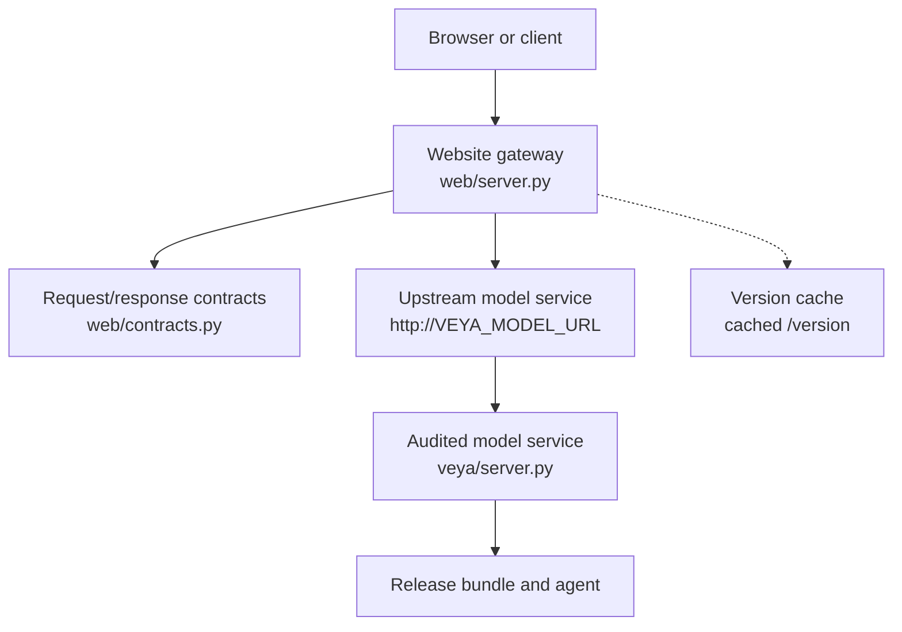
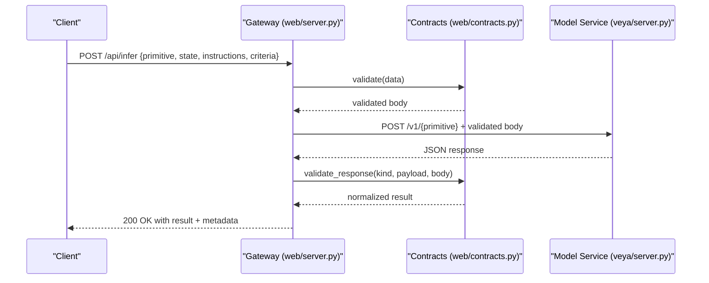
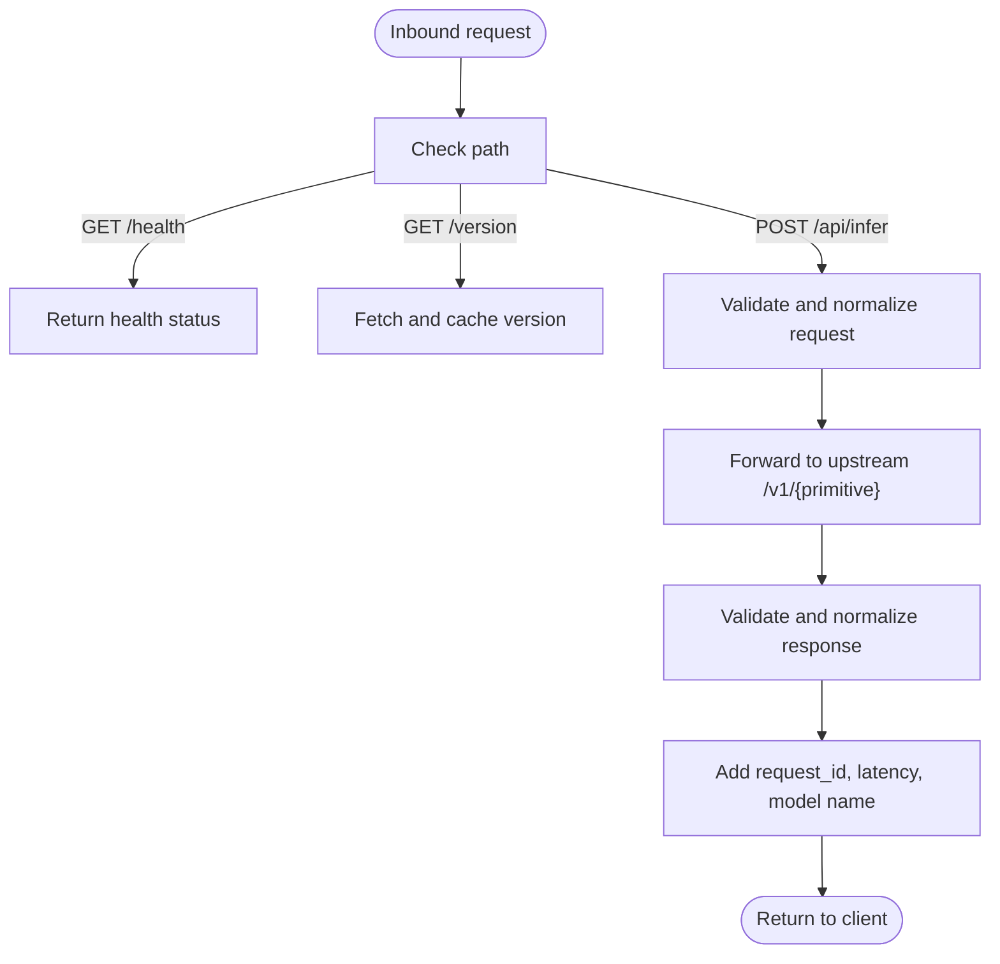
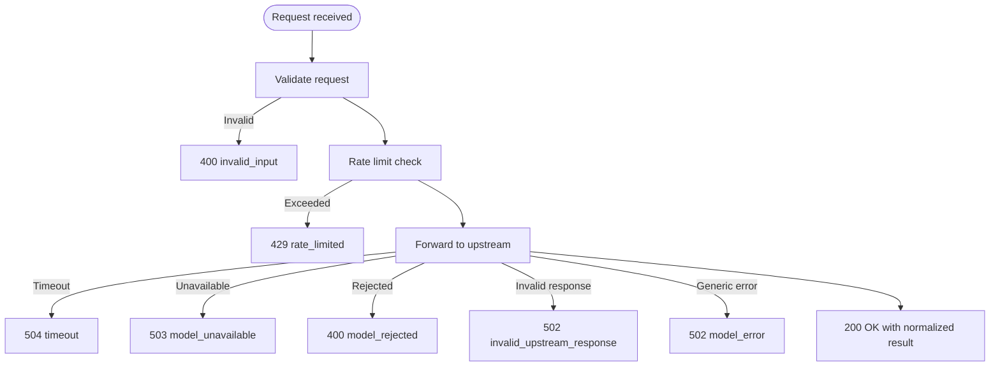
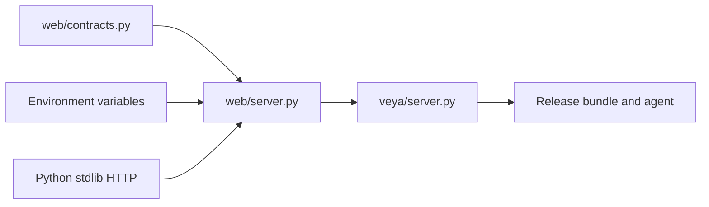

# Model Server Integration

<cite>
**Referenced Files in This Document**
- [veya/server.py](file://veya/server.py)
- [web/model_server.py](file://web/model_server.py)
- [web/server.py](file://web/server.py)
- [web/contracts.py](file://web/contracts.py)
- [web/README.md](file://web/README.md)
- [tests/test_model_server_e2e.py](file://tests/test_model_server_e2e.py)
- [tests/test_web_gateway.py](file://tests/test_web_gateway.py)
</cite>

## Table of Contents
1. [Introduction](#introduction)
2. [Project Structure](#project-structure)
3. [Core Components](#core-components)
4. [Architecture Overview](#architecture-overview)
5. [Detailed Component Analysis](#detailed-component-analysis)
6. [Dependency Analysis](#dependency-analysis)
7. [Performance Considerations](#performance-considerations)
8. [Troubleshooting Guide](#troubleshooting-guide)
9. [Conclusion](#conclusion)
10. [Appendices](#appendices)

## Introduction
This document explains how Veya’s web gateway integrates with the audited model server, focusing on the upstream model protocol, health checking, version management, request validation, error handling, timeouts, rate limiting, and operational configuration. It also provides deployment guidance, monitoring recommendations, scaling considerations, and troubleshooting steps for connectivity and reliability issues.

The integration consists of:
- A standalone audited model service that exposes a bounded HTTP API.
- A same-origin website gateway that validates requests, forwards them to the model service, validates responses, and returns safe, user-facing results.
- Environment-driven configuration for upstream URL, optional bearer token, ports, and public origin.

## Project Structure
At runtime, two processes are typically involved:
- The model service process loads the release bundle and serves inference endpoints.
- The website gateway process serves static assets and proxies validated inference requests to the model service.

**Diagram sources**
- [web/server.py:33-114](file://web/server.py#L33-L114)
- [web/contracts.py:121-176](file://web/contracts.py#L121-L176)
- [veya/server.py:137-235](file://veya/server.py#L137-L235)

**Section sources**
- [web/README.md:1-14](file://web/README.md#L1-L14)
- [web/server.py:33-114](file://web/server.py#L33-L114)
- [veya/server.py:137-235](file://veya/server.py#L137-L235)

## Core Components
- Audited model service: Implements the internal HTTP API used by the gateway. It exposes health, version, and inference endpoints under `/v1/*`.
- Website gateway: Validates inbound requests, enforces size limits, applies per-client rate limiting, forwards requests to the upstream model service, validates responses, and adds request metadata such as request ID and latency.
- Contracts: Define strict schemas for both incoming and outgoing payloads, including primitives, state, instructions, criteria, probabilities, and deferred answers.

Key responsibilities:
- Request validation and sanitization.
- Safe forwarding to the upstream model service.
- Response whitelisting and normalization.
- Health and version exposure through the gateway.
- Telemetry logging for observability.

**Section sources**
- [web/contracts.py:14-176](file://web/contracts.py#L14-L176)
- [web/server.py:94-114](file://web/server.py#L94-L114)
- [veya/server.py:137-235](file://veya/server.py#L137-L235)

## Architecture Overview
The gateway is a thin, security-focused boundary between clients and the model service. It does not implement inference logic; it only validates, forwards, and normalizes data.

**Diagram sources**
- [web/server.py:408-543](file://web/server.py#L408-L543)
- [web/contracts.py:121-176](file://web/contracts.py#L121-L176)
- [web/contracts.py:246-348](file://web/contracts.py#L246-L348)
- [veya/server.py:173-235](file://veya/server.py#L173-L235)

## Detailed Component Analysis

### Upstream Model Protocol
The model service exposes:
- GET `/health`: Returns `{"status": "ok"}` when healthy.
- GET `/version`: Returns model metadata including `model_version`, checkpoint identifiers, calibration version, supported languages/primitives, and release status.
- POST `/v1/choice`, `/v1/noul`, `/v1/score`: Inference endpoints accepting a JSON body with `state` and `instructions`, plus optional `criteria`.
- POST `/v1/systemone`: Batched multi-question endpoint.

The gateway accepts a smaller, bounded subset of this API via `/api/infer` and maps it to the appropriate upstream path.

**Diagram sources**
- [veya/server.py:163-171](file://veya/server.py#L163-L171)
- [veya/server.py:173-235](file://veya/server.py#L173-L235)
- [web/server.py:334-346](file://web/server.py#L334-L346)
- [web/server.py:408-543](file://web/server.py#L408-L543)

**Section sources**
- [veya/server.py:163-235](file://veya/server.py#L163-L235)
- [web/server.py:334-346](file://web/server.py#L334-L346)
- [web/server.py:408-543](file://web/server.py#L408-L543)

### Health Checking Mechanisms
- The model service responds to `/health` with a simple status object.
- The gateway proxies `/api/health` to the upstream and returns 503 with `model_unavailable` if the upstream is unreachable or unhealthy.
- The gateway caches `/version` for one minute to reduce upstream load while still exposing current release metadata.

Operational implications:
- Use `/api/health` for readiness checks at the gateway layer.
- Use `/health` directly against the model service for liveness checks.
- Monitor 503 responses from `/api/health` to detect upstream outages.

**Section sources**
- [veya/server.py:163-171](file://veya/server.py#L163-L171)
- [web/server.py:334-346](file://web/server.py#L334-L346)
- [web/server.py:117-171](file://web/server.py#L117-L171)

### Version Management
- The model service reports `model_version`, `checkpoint_sha256`, `shortlist_sha256`, `release`, `architecture_version`, `calibration_version`, and capability lists.
- The gateway caches `/version` for 60 seconds using a lock-guarded global cache.
- Successful inference responses include selected fields from the cached version, such as `model_version`, `release`, `architecture_version`, `supported_languages`, and `release_status`.

Best practices:
- Track `model_version` and `architecture_version` in logs and metrics.
- Use `supported_languages` and `supported_primitives` to gate feature availability.
- Avoid exposing internal checkpoint identifiers to clients; the gateway sets the public product name to `Veya Core`.

**Section sources**
- [veya/server.py:57-111](file://veya/server.py#L57-L111)
- [web/server.py:117-171](file://web/server.py#L117-L171)
- [web/server.py:521-536](file://web/server.py#L521-L536)

### Load Balancing and Concurrency Controls
- The gateway uses an in-process semaphore (`inflight`) to limit concurrent inference calls. If the semaphore cannot be acquired, it returns 503 with `model_busy`.
- Per-client rate limiting is implemented using a sliding window keyed by client IP. Requests exceeding capacity receive 429 with a `Retry-After` header.
- Weighting considers the number of candidates or choice questions to scale cost appropriately.

Important notes:
- There is no built-in multi-upstream load balancing across multiple model servers.
- For horizontal scaling, deploy multiple model services behind a reverse proxy and configure `VEYA_MODEL_URL` accordingly.
- Tune `CAPACITY`, `WINDOW_S`, and `INFER_TIMEOUT_S` based on observed throughput and latency.

**Section sources**
- [web/server.py:174-206](file://web/server.py#L174-L206)
- [web/server.py:496-508](file://web/server.py#L496-L508)
- [tests/test_web_gateway.py:443-462](file://tests/test_web_gateway.py#L443-L462)

### Error Handling Patterns
The gateway distinguishes several error categories:
- Invalid input: 400 with `invalid_input`.
- Model rejected input: 400 with `model_rejected`, optionally carrying `defer_reason`.
- Rate limited: 429 with `rate_limited` and `retry_after`.
- Timeout: 504 with `timeout`.
- Unavailable upstream: 503 with `model_unavailable`.
- Invalid upstream response: 502 with `invalid_upstream_response`.
- Generic upstream failure: 502 with `model_error`.

The model service also returns structured errors for invalid JSON, oversized requests, and schema mismatches.

**Diagram sources**
- [web/server.py:544-635](file://web/server.py#L544-L635)
- [veya/server.py:173-235](file://veya/server.py#L173-L235)

**Section sources**
- [web/server.py:544-635](file://web/server.py#L544-L635)
- [veya/server.py:173-235](file://veya/server.py#L173-L235)

### Timeouts and Circuit Breaker Behavior
- The gateway uses a configurable inference timeout (`INFER_TIMEOUT_S`) when calling the upstream.
- Socket-level timeouts map to 504 `timeout`; network-level unavailability maps to 503 `model_unavailable`.
- There is no explicit circuit breaker implementation in the gateway code. Instead, concurrency limiting and rate limiting provide backpressure.
- Health checks can be used externally to stop routing traffic to unhealthy instances.

Recommendations:
- Set `INFER_TIMEOUT_S` based on p95/p99 latency targets.
- Use external circuit breakers at the reverse proxy or orchestrator level.
- Monitor 504 and 503 rates to trigger failover or scaling actions.

**Section sources**
- [web/server.py:94-114](file://web/server.py#L94-L114)
- [web/server.py:601-625](file://web/server.py#L601-L625)
- [tests/test_web_gateway.py:443-462](file://tests/test_web_gateway.py#L443-L462)

### Connection Pooling Strategies
- The gateway uses Python’s standard library HTTP client without persistent connection pooling.
- Each request opens a new connection to the upstream unless reused by the underlying transport.
- For high-throughput deployments, consider placing a reverse proxy (for example, Nginx or HAProxy) in front of the model service to manage keep-alive connections and connection reuse.

Scaling guidance:
- Increase model service replicas and balance traffic at the proxy layer.
- Tune gateway concurrency (`inflight`) and rate limiting parameters to match upstream capacity.
- Monitor memory usage and CPU utilization of both gateway and model service processes.

**Section sources**
- [web/server.py:94-114](file://web/server.py#L94-L114)

### Configuration Options and Environment Variables
- `VEYA_MODEL_URL`: Base URL of the upstream model service. Defaults to `http://127.0.0.1:8080`.
- `VEYA_MODEL_TOKEN`: Optional bearer token sent in the `Authorization` header when present.
- `VEYA_MODEL_PORT`: Port for the model service process. Defaults to `8080`.
- `VEYA_WEB_PORT`: Port for the website gateway. Defaults to `3000`.
- `VEYA_WEB_HOST`: Host binding for the gateway. Loopback is default; public binding requires `VEYA_PUBLIC_ORIGIN`.
- `VEYA_PUBLIC_ORIGIN`: Canonical HTTPS origin required when binding to non-loopback addresses.
- `VEYA_ALLOWED_ORIGINS`: Comma-separated list of allowed origins for cross-origin model requests.
- `VEYA_DEVICE`: Device selection for loading the release bundle (for example, `cpu`).

Security notes:
- `VEYA_MODEL_TOKEN` is read only in the gateway and never included in browser assets or responses.
- Public binding requires HTTPS origin validation to prevent mixed-content and CSRF risks.

**Section sources**
- [web/server.py:33-50](file://web/server.py#L33-L50)
- [web/server.py:98-100](file://web/server.py#L98-L100)
- [web/model_server.py:14-15](file://web/model_server.py#L14-L15)
- [web/README.md:1-14](file://web/README.md#L1-L14)

### Deployment Examples
- Start the audited model service:
  - Run the model service module with `VEYA_MODEL_PORT` and `VEYA_DEVICE` set as needed.
  - The process loads the release manifest and binds the model HTTP API.
- Start the website gateway:
  - Run the gateway module with `VEYA_WEB_PORT`, `VEYA_WEB_HOST`, and `VEYA_PUBLIC_ORIGIN` configured.
  - Ensure `VEYA_MODEL_URL` points to the running model service.

Verification:
- Use `/api/health` and `/api/version` to verify gateway-to-model connectivity.
- Use `/health` and `/version` directly against the model service for deeper diagnostics.

**Section sources**
- [web/model_server.py:9-17](file://web/model_server.py#L9-L17)
- [web/server.py:657-659](file://web/server.py#L657-L659)
- [tests/test_model_server_e2e.py:129-167](file://tests/test_model_server_e2e.py#L129-L167)

### Monitoring Setup
- Log each inference request with request ID, primitive, candidate count, route, deferred flag, status, latency, model version, and error code.
- Expose `/api/benchmark` for dataset-level performance summaries when available.
- Collect 5xx and 4xx error codes, especially `model_error`, `timeout`, `model_unavailable`, and `invalid_upstream_response`.
- Track latency percentiles and throughput per replica.

Recommended metrics:
- Upstream health success rate.
- Rate-limited request ratio.
- Timeout and unavailable error rates.
- P50/P95/P99 latency for `/api/infer`.
- Version drift detection by comparing `model_version` across instances.

**Section sources**
- [web/server.py:209-235](file://web/server.py#L209-L235)
- [web/server.py:304-333](file://web/server.py#L304-L333)

### Troubleshooting Guide
Common issues and resolutions:
- Model service unreachable:
  - Verify `VEYA_MODEL_URL` and network reachability.
  - Check `/health` directly against the model service.
  - Inspect gateway logs for `model_unavailable`.
- Model rejects input:
  - Validate request schema using the contract rules.
  - Check `defer_reason` returned by the model service.
- Rate limited:
  - Respect `Retry-After` headers.
  - Adjust client-side retry backoff.
  - Review per-client request patterns.
- Timeout:
  - Increase `INFER_TIMEOUT_S` if upstream latency is high.
  - Investigate model service resource saturation.
- Invalid upstream response:
  - Confirm model service version compatibility.
  - Check for malformed JSON or unexpected fields.

Diagnostic steps:
- Compare `/api/version` and upstream `/version` outputs.
- Reproduce requests with minimal payloads to isolate schema issues.
- Use test utilities to simulate upstream failures and confirm error mapping.

**Section sources**
- [web/server.py:544-635](file://web/server.py#L544-L635)
- [tests/test_web_gateway.py:443-462](file://tests/test_web_gateway.py#L443-L462)
- [tests/test_model_server_e2e.py:151-167](file://tests/test_model_server_e2e.py#L151-L167)

## Dependency Analysis
The gateway depends on:
- Contract validation for request and response safety.
- Environment variables for upstream configuration and security.
- Standard library HTTP client for upstream communication.

The model service depends on:
- Release bundle loading and verification.
- Agent inference logic serialized by an internal lock.

**Diagram sources**
- [web/server.py:23-30](file://web/server.py#L23-L30)
- [web/server.py:94-114](file://web/server.py#L94-L114)
- [veya/server.py:137-235](file://veya/server.py#L137-L235)

**Section sources**
- [web/server.py:23-30](file://web/server.py#L23-L30)
- [veya/server.py:137-235](file://veya/server.py#L137-L235)

## Performance Considerations
- Concurrency control:
  - Limit concurrent inference calls to protect the model service.
  - Tune the semaphore and rate limiter based on observed throughput.
- Request weighting:
  - Choice-heavy requests incur higher weight due to candidate processing.
  - SystemOne batches multiple questions; weight accounts for nested choice counts.
- Latency targets:
  - Set `INFER_TIMEOUT_S` to align with SLOs.
  - Monitor gateway latency and upstream latency separately.
- Memory and CPU:
  - Keep model service replicas sized appropriately for batch sizes and candidate counts.
  - Use reverse proxy connection reuse to reduce overhead.

[No sources needed since this section provides general guidance]

## Conclusion
Veya’s web gateway provides a secure, validated boundary around the audited model service. It enforces strict request/response contracts, implements per-client rate limiting and concurrency controls, and surfaces health and version information. While there is no built-in multi-upstream load balancing or circuit breaker, operators can achieve robust scaling and resilience by combining these components with reverse proxies and orchestration tools. Proper configuration of environment variables, timeouts, and telemetry enables reliable operation and clear troubleshooting paths.

[No sources needed since this section summarizes without analyzing specific files]

## Appendices

### API Surface Summary
- Gateway endpoints:
  - GET `/api/health`: Proxies upstream health.
  - GET `/api/version`: Returns cached upstream version metadata.
  - POST `/api/infer`: Accepts `{primitive, state, instructions, criteria}` and returns normalized results.
- Model service endpoints:
  - GET `/health`: Liveness check.
  - GET `/version`: Rich model metadata.
  - POST `/v1/choice`, `/v1/noul`, `/v1/score`, `/v1/systemone`: Inference endpoints.

**Section sources**
- [web/server.py:334-346](file://web/server.py#L334-L346)
- [web/server.py:408-543](file://web/server.py#L408-L543)
- [veya/server.py:163-235](file://veya/server.py#L163-L235)