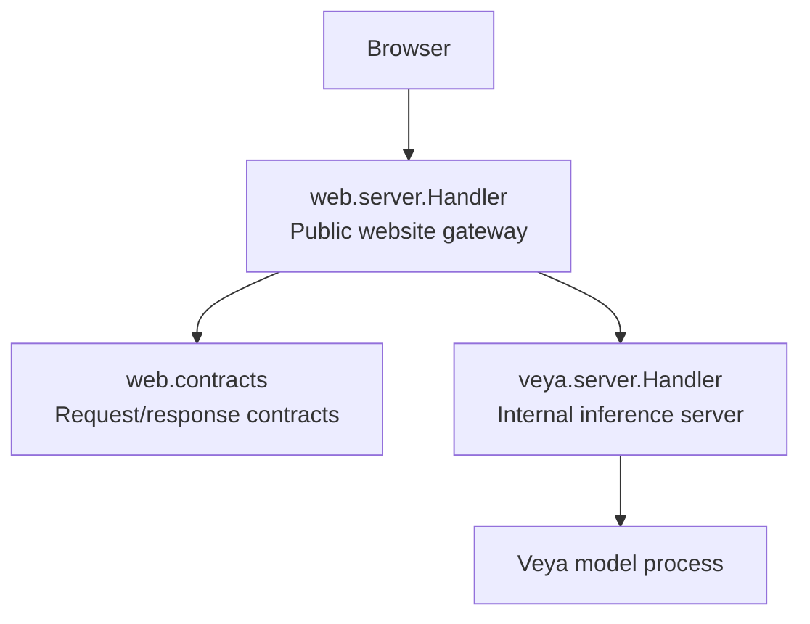
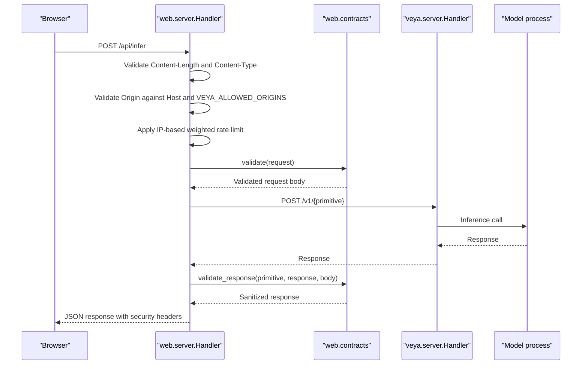
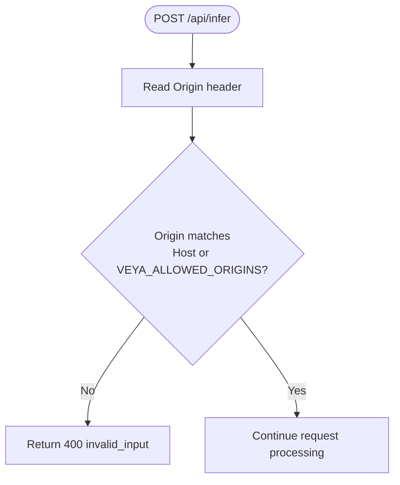
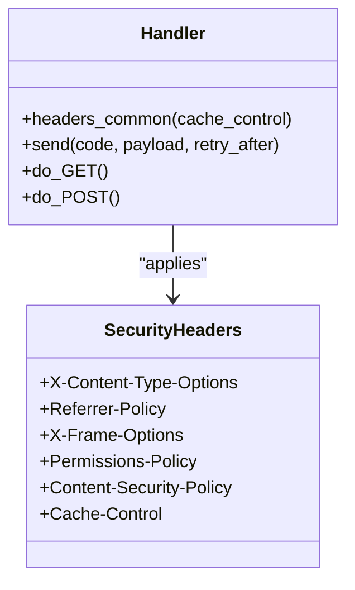
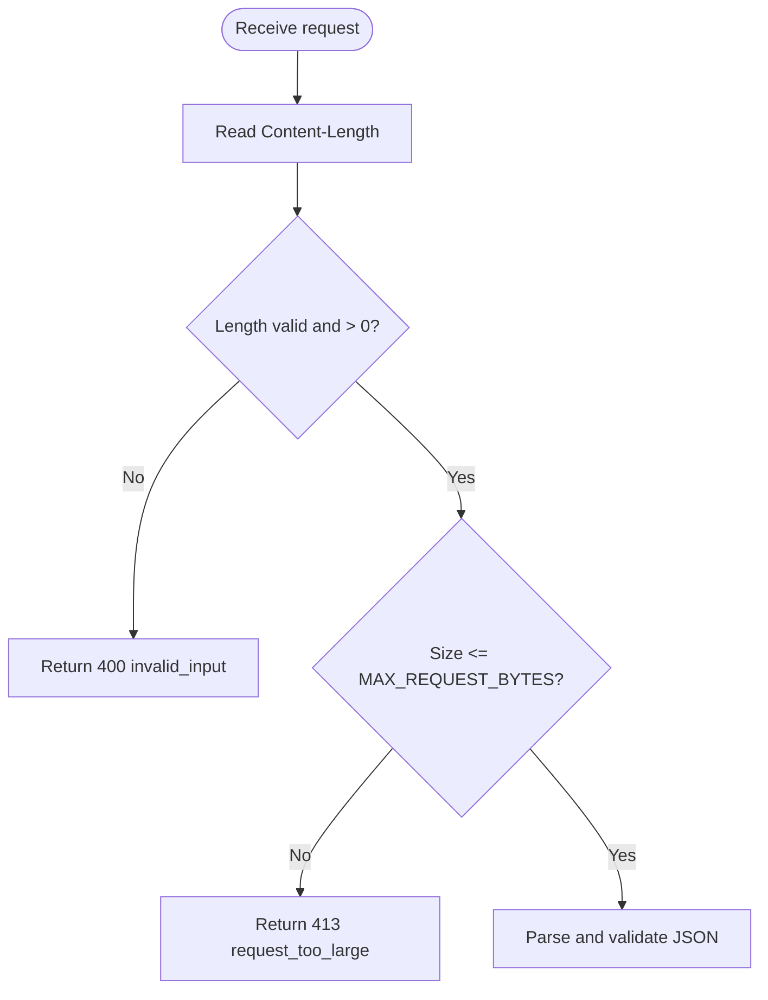
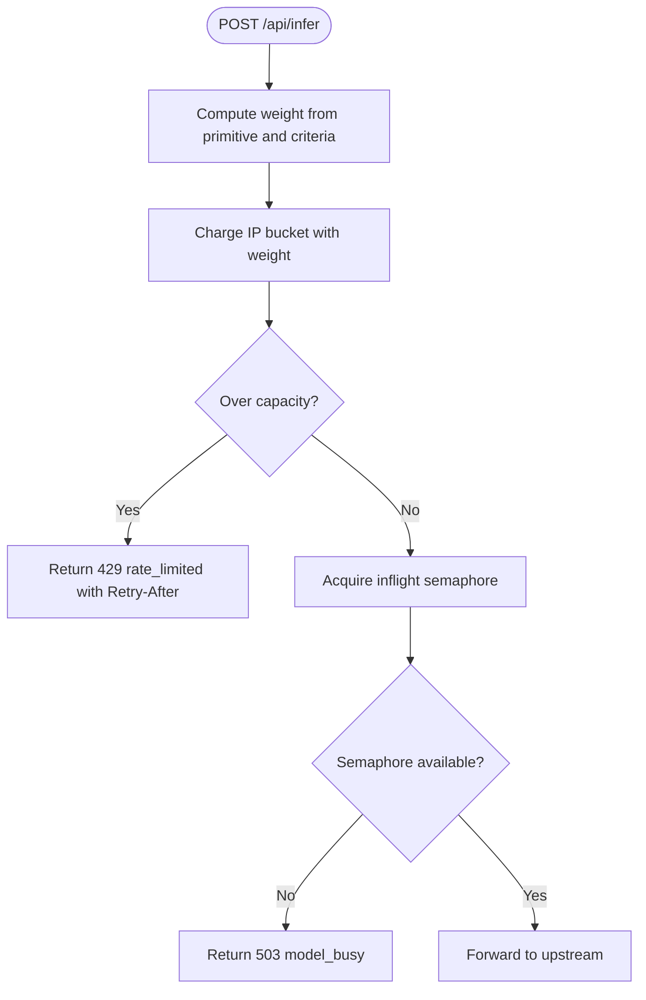
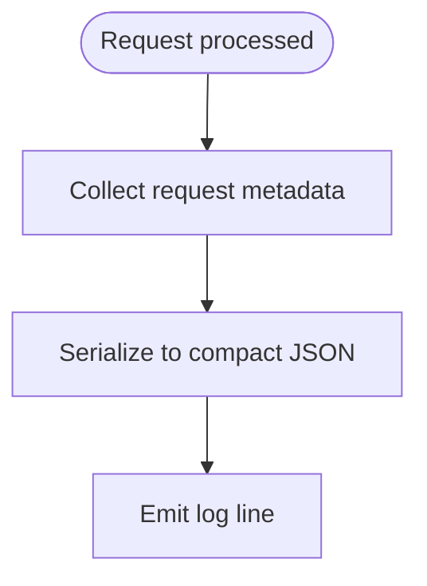
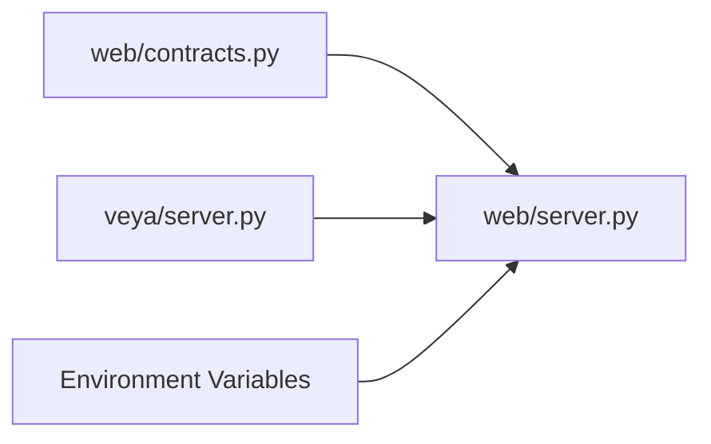

# Security & Configuration

<cite>
**Referenced Files in This Document**
- [web/server.py](file://web/server.py)
- [veya/server.py](file://veya/server.py)
- [web/contracts.py](file://web/contracts.py)
- [web/README.md](file://web/README.md)
- [web/PRELAUNCH_AUDIT.md](file://web/PRELAUNCH_AUDIT.md)
- [web/VERIFICATION_REPORT.md](file://web/VERIFICATION_REPORT.md)
- [docs/WEBSITE_ARCHITECTURE.md](file://docs/WEBSITE_ARCHITECTURE.md)
- [tests/test_web_gateway.py](file://tests/test_web_gateway.py)
</cite>

## Table of Contents
1. [Introduction](#introduction)
2. [Project Structure](#project-structure)
3. [Core Components](#core-components)
4. [Architecture Overview](#architecture-overview)
5. [Detailed Component Analysis](#detailed-component-analysis)
6. [Dependency Analysis](#dependency-analysis)
7. [Performance Considerations](#performance-considerations)
8. [Troubleshooting Guide](#troubleshooting-guide)
9. [Conclusion](#conclusion)
10. [Appendices](#appendices)

## Introduction
This document provides comprehensive security documentation for Veya’s web interface and its model gateway. It covers cross-origin request handling, origin validation, rate limiting, request size restrictions, security headers, environment-based configuration, capacity controls, audit logging, production deployment considerations, firewall guidance, and monitoring recommendations. The goal is to help operators, integrators, and auditors understand how the public website protects users while forwarding requests to the internal Veya model service.

## Project Structure
The relevant security surface is split between:
- The website gateway that serves HTML, static assets, and the `/api/infer` endpoint.
- The internal Veya HTTP inference server used by the gateway as an upstream.
- Shared contract validation for both inbound requests and outbound responses.

**Diagram sources**
- [web/server.py:238-659](file://web/server.py#L238-L659)
- [veya/server.py:137-242](file://veya/server.py#L137-L242)
- [web/contracts.py:1-349](file://web/contracts.py#L1-L349)

**Section sources**
- [docs/WEBSITE_ARCHITECTURE.md:1-3](file://docs/WEBSITE_ARCHITECTURE.md#L1-L3)
- [web/README.md:1-14](file://web/README.md#L1-L14)

## Core Components
- Public website gateway (`web/server.py`)
  - Serves pages, static assets, health/version endpoints, and the `/api/infer` endpoint.
  - Enforces security headers, origin validation, request size limits, IP-based weighted rate limiting, and concurrent request caps.
  - Forwards validated requests to the internal model service with optional bearer token authentication.
- Internal inference server (`veya/server.py`)
  - Provides `/health`, `/version`, and model inference endpoints.
  - Enforces request body size limits and JSON schema validation before calling the model.
- Contract layer (`web/contracts.py`)
  - Defines allowed primitives, field whitelisting, state size limits, candidate/label constraints, and strict response validation.

Key security responsibilities:
- Origin validation and CORS-like restriction at the gateway.
- Strict Content-Security-Policy and related headers on all responses.
- Request size limits at both gateway and upstream.
- Weighted IP-based rate limiting with retry guidance.
- Bounded concurrency to protect the model backend.
- Audit telemetry for successful and failed requests.

**Section sources**
- [web/server.py:32-90](file://web/server.py#L32-L90)
- [web/server.py:238-268](file://web/server.py#L238-L268)
- [web/server.py:408-647](file://web/server.py#L408-L647)
- [veya/server.py:17-22](file://veya/server.py#L17-L22)
- [veya/server.py:152-161](file://veya/server.py#L152-L161)
- [web/contracts.py:14-18](file://web/contracts.py#L14-L18)
- [web/contracts.py:121-176](file://web/contracts.py#L121-L176)
- [web/contracts.py:246-349](file://web/contracts.py#L246-L349)

## Architecture Overview
The browser interacts only with the same-origin website. Cross-origin calls are rejected unless explicitly allowed. The website forwards requests to the internal model service using a trusted loopback address by default. A bearer token can be configured for gateway-to-model authentication.

**Diagram sources**
- [web/server.py:408-647](file://web/server.py#L408-L647)
- [web/contracts.py:121-176](file://web/contracts.py#L121-L176)
- [web/contracts.py:246-349](file://web/contracts.py#L246-L349)
- [veya/server.py:173-234](file://veya/server.py#L173-L234)

## Detailed Component Analysis

### CORS Policies and Origin Validation
- The gateway does not implement a general CORS preflight handler. Instead, it enforces a stricter policy:
  - If an `Origin` header is present, it must match either `http://{Host}` or `https://{Host}`, plus any additional origins listed in `VEYA_ALLOWED_ORIGINS`.
  - Requests from disallowed origins receive a 400 error with code `invalid_input`.
- This approach avoids exposing broad CORS policies and keeps cross-origin access explicit and controlled.
- Tests verify that cross-origin requests are rejected and that oversized requests are rejected with appropriate status codes.

**Diagram sources**
- [web/server.py:444-452](file://web/server.py#L444-L452)
- [tests/test_web_gateway.py:465-481](file://tests/test_web_gateway.py#L465-L481)

**Section sources**
- [web/server.py:36-50](file://web/server.py#L36-L50)
- [web/server.py:444-452](file://web/server.py#L444-L452)
- [web/README.md:32-32](file://web/README.md#L32-L32)
- [tests/test_web_gateway.py:465-481](file://tests/test_web_gateway.py#L465-L481)

### Security Headers Implementation
All responses from the website gateway include a consistent set of security headers:
- `X-Content-Type-Options: nosniff`
- `Referrer-Policy: strict-origin-when-cross-origin`
- `X-Frame-Options: DENY`
- `Permissions-Policy: camera=(), microphone=(), geolocation()`
- `Content-Security-Policy`: restricts default script/style/image/connect sources to self; blocks objects and frames; prevents base URI override.
- `Cache-Control`: varies by asset type; API responses use `no-store`; images may use short-lived caching.

These headers mitigate clickjacking, MIME sniffing, sensitive referrer leakage, unnecessary permissions, and content injection risks.

**Diagram sources**
- [web/server.py:244-255](file://web/server.py#L244-L255)
- [web/server.py:257-268](file://web/server.py#L257-L268)

**Section sources**
- [web/server.py:244-255](file://web/server.py#L244-L255)
- [web/server.py:257-268](file://web/server.py#L257-L268)

### Request Size Restrictions
- Website gateway:
  - Maximum request body size is enforced before parsing JSON.
  - Oversized requests return 413 with code `request_too_large`.
- Upstream inference server:
  - Also enforces a maximum request body size and returns 413 when exceeded.
- Contract layer:
  - State serialization size is limited to prevent excessive payloads even if the raw body passes the initial check.

**Diagram sources**
- [web/server.py:422-438](file://web/server.py#L422-L438)
- [veya/server.py:152-161](file://veya/server.py#L152-L161)
- [web/contracts.py:62-79](file://web/contracts.py#L62-L79)

**Section sources**
- [web/server.py:74-74](file://web/server.py#L74-L74)
- [web/server.py:422-438](file://web/server.py#L422-L438)
- [veya/server.py:17-17](file://veya/server.py#L17-L17)
- [veya/server.py:152-161](file://veya/server.py#L152-L161)
- [web/contracts.py:62-79](file://web/contracts.py#L62-L79)

### Rate Limiting and Capacity Controls
- The gateway implements an in-memory, per-IP, sliding-window rate limiter:
  - Window duration and capacity are configurable via constants.
  - Requests are weighted based on primitive type and criteria count.
  - Excess load returns 429 with `rate_limited` and a `Retry-After` value.
- Concurrent request cap:
  - A bounded semaphore limits simultaneous upstream calls to protect the model backend.
  - When full, the gateway returns 503 with `model_busy`.
- Upstream rate limiting:
  - If the upstream responds with 429, the gateway preserves `Retry-After` and surfaces it to the client.

**Diagram sources**
- [web/server.py:174-206](file://web/server.py#L174-L206)
- [web/server.py:453-508](file://web/server.py#L453-L508)
- [tests/test_web_gateway.py:492-503](file://tests/test_web_gateway.py#L492-L503)

**Section sources**
- [web/server.py:77-82](file://web/server.py#L77-L82)
- [web/server.py:174-206](file://web/server.py#L174-L206)
- [web/server.py:453-508](file://web/server.py#L453-L508)
- [tests/test_web_gateway.py:443-462](file://tests/test_web_gateway.py#L443-L462)
- [tests/test_web_gateway.py:492-503](file://tests/test_web_gateway.py#L492-L503)

### Environment Variable Configuration
- `VEYA_MODEL_URL`: Upstream model service URL (default loopback).
- `VEYA_WEB_PORT`: Port for the website gateway.
- `VEYA_WEB_HOST`: Bind address; loopback by default.
- `VEYA_PUBLIC_ORIGIN`: Canonical HTTPS origin required for public binding; validated strictly.
- `VEYA_ALLOWED_ORIGINS`: Comma-separated list of additional allowed browser origins.
- `VEYA_MODEL_TOKEN`: Optional bearer token sent only by the gateway to the upstream model service.

Security implications:
- Public binding without `VEYA_PUBLIC_ORIGIN` fails startup.
- `VEYA_PUBLIC_ORIGIN` must be HTTPS and must not contain path/query/fragment/userinfo.
- `VEYA_MODEL_TOKEN` is never included in browser assets or responses.

**Section sources**
- [web/server.py:33-50](file://web/server.py#L33-L50)
- [web/server.py:98-100](file://web/server.py#L98-L100)
- [web/server.py:446-450](file://web/server.py#L446-L450)
- [web/README.md:14-14](file://web/README.md#L14-L14)
- [web/README.md:32-32](file://web/README.md#L32-L32)
- [web/README.md:51-51](file://web/README.md#L51-L51)
- [tests/test_web_gateway.py:70-90](file://tests/test_web_gateway.py#L70-L90)

### Cross-Origin Request Handling
- The gateway treats the presence of an `Origin` header as a signal that the request is cross-origin.
- Only the current host’s HTTP and HTTPS schemes are implicitly allowed; other origins must be explicitly listed in `VEYA_ALLOWED_ORIGINS`.
- This is stricter than standard CORS and reduces risk of accidental cross-site data exposure.

**Section sources**
- [web/server.py:444-452](file://web/server.py#L444-L452)
- [web/README.md:32-32](file://web/README.md#L32-L32)

### Audit Logging and Telemetry
- The gateway logs structured JSON telemetry for each request, including:
  - `request_id`, `primitive`, `candidate_count`, `route`, `deferred`, `status`, `latency_ms`, `model_version`, `error_code`.
- This supports operational monitoring, incident investigation, and anomaly detection.
- The logger is configured to write to stdout with a simple formatter.

**Diagram sources**
- [web/server.py:209-235](file://web/server.py#L209-L235)
- [web/server.py:637-647](file://web/server.py#L637-L647)

**Section sources**
- [web/server.py:85-90](file://web/server.py#L85-L90)
- [web/server.py:209-235](file://web/server.py#L209-L235)
- [web/server.py:637-647](file://web/server.py#L637-L647)

### Production Deployment Security Considerations
- TLS termination:
  - Use a reverse proxy or load balancer to terminate TLS and enforce HTTPS.
  - Set `VEYA_PUBLIC_ORIGIN` to the canonical HTTPS origin.
- Trusted proxy configuration:
  - Ensure the proxy forwards correct `Host` and `Origin` headers.
- Network isolation:
  - Keep `VEYA_MODEL_URL` pointing to loopback or a private network.
  - Do not expose the internal model service directly to the internet.
- Firewall rules:
  - Allow only the website port to public clients.
  - Restrict inbound traffic to the model service to localhost or trusted internal subnets.
- Monitoring and alerting:
  - Monitor 4xx/5xx rates, especially `rate_limited`, `model_unavailable`, `timeout`, and `invalid_upstream_response`.
  - Alert on spikes in 429 responses and upstream errors.
  - Correlate `request_id` across logs and metrics.
- Secrets management:
  - Store `VEYA_MODEL_TOKEN` in a secrets manager; avoid embedding in images or source control.
- Release hygiene:
  - Follow repository release gates and manifest verification before deployment.

**Section sources**
- [web/README.md:51-51](file://web/README.md#L51-L51)
- [web/VERIFICATION_REPORT.md:11-11](file://web/VERIFICATION_REPORT.md#L11-L11)
- [web/PRELAUNCH_AUDIT.md:10-10](file://web/PRELAUNCH_AUDIT.md#L10-L10)

## Dependency Analysis
The website gateway depends on:
- Contract validation for safe request shaping and response sanitization.
- The internal inference server for model execution.
- Environment variables for runtime security configuration.

**Diagram sources**
- [web/server.py:23-30](file://web/server.py#L23-L30)
- [web/server.py:33-50](file://web/server.py#L33-L50)
- [web/contracts.py:1-349](file://web/contracts.py#L1-L349)
- [veya/server.py:137-242](file://veya/server.py#L137-L242)

**Section sources**
- [web/server.py:23-30](file://web/server.py#L23-L30)
- [web/server.py:33-50](file://web/server.py#L33-L50)
- [web/contracts.py:1-349](file://web/contracts.py#L1-L349)
- [veya/server.py:137-242](file://veya/server.py#L137-L242)

## Performance Considerations
- Rate limiting uses an in-memory dictionary and deque per IP; entries older than the window are pruned.
- The global rate map is capped to prevent unbounded growth.
- Concurrency is limited by a bounded semaphore to protect the model backend.
- Version metadata is cached briefly to reduce upstream calls.
- Static image assets use short cache lifetimes; other assets use no-store to avoid mixed-version issues.

Operational tips:
- Tune `CAPACITY`, `WINDOW_S`, and `MAX_INFLIGHT` according to expected load and model throughput.
- Monitor memory usage of the rate limiter under high churn.
- Use upstream health checks and circuit-breaker patterns at the proxy layer.

**Section sources**
- [web/server.py:77-82](file://web/server.py#L77-L82)
- [web/server.py:117-171](file://web/server.py#L117-L171)
- [web/server.py:188-206](file://web/server.py#L188-L206)
- [web/server.py:347-406](file://web/server.py#L347-L406)

## Troubleshooting Guide
Common issues and mitigations:
- Cross-origin rejection:
  - Symptom: 400 `invalid_input` when `Origin` is present.
  - Action: Add the browser origin to `VEYA_ALLOWED_ORIGINS` or ensure the request originates from the configured host.
- Rate limiting:
  - Symptom: 429 `rate_limited` with `Retry-After`.
  - Action: Implement exponential backoff; reduce request frequency; adjust capacity if legitimate load increases.
- Model unavailable:
  - Symptom: 503 `model_unavailable`.
  - Action: Check upstream connectivity, health endpoint, and environment variable `VEYA_MODEL_URL`.
- Timeout:
  - Symptom: 504 `timeout`.
  - Action: Investigate upstream latency; consider scaling or optimizing the model service.
- Invalid upstream response:
  - Symptom: 502 `invalid_upstream_response`.
  - Action: Verify upstream contract compliance; inspect sanitized error details.

**Section sources**
- [web/server.py:444-452](file://web/server.py#L444-L452)
- [web/server.py:453-495](file://web/server.py#L453-L495)
- [web/server.py:509-635](file://web/server.py#L509-L635)
- [tests/test_web_gateway.py:443-511](file://tests/test_web_gateway.py#L443-L511)

## Conclusion
Veya’s web interface applies defense-in-depth through strict origin validation, comprehensive security headers, bounded request sizes, weighted IP-based rate limiting, concurrency controls, and contract-based input/output validation. Environment variables provide secure configuration for public origins, allowed origins, and model authentication. Operators should deploy behind TLS termination, isolate the model service, configure firewalls appropriately, and monitor telemetry for anomalies. These measures collectively reduce exposure to cross-origin attacks, abuse, resource exhaustion, and upstream failures.

## Appendices

### Security Header Reference
- `X-Content-Type-Options: nosniff`
- `Referrer-Policy: strict-origin-when-cross-origin`
- `X-Frame-Options: DENY`
- `Permissions-Policy: camera=(), microphone=(), geolocation()`
- `Content-Security-Policy: default-src 'self'; img-src 'self' data:; style-src 'self'; script-src 'self'; connect-src 'self'; object-src 'none'; base-uri 'none'; frame-ancestors 'none'`
- `Cache-Control`: varies by asset type; API responses use `no-store`.

**Section sources**
- [web/server.py:244-255](file://web/server.py#L244-L255)

### Environment Variables Summary
- `VEYA_MODEL_URL`: Upstream model service URL.
- `VEYA_WEB_PORT`: Website gateway port.
- `VEYA_WEB_HOST`: Bind address.
- `VEYA_PUBLIC_ORIGIN`: Canonical HTTPS origin for public deployments.
- `VEYA_ALLOWED_ORIGINS`: Additional allowed browser origins.
- `VEYA_MODEL_TOKEN`: Bearer token for gateway-to-model authentication.

**Section sources**
- [web/server.py:33-50](file://web/server.py#L33-L50)
- [web/server.py:98-100](file://web/server.py#L98-L100)
- [web/server.py:446-450](file://web/server.py#L446-L450)
- [web/README.md:14-14](file://web/README.md#L14-L14)
- [web/README.md:32-32](file://web/README.md#L32-L32)
- [web/README.md:51-51](file://web/README.md#L51-L51)