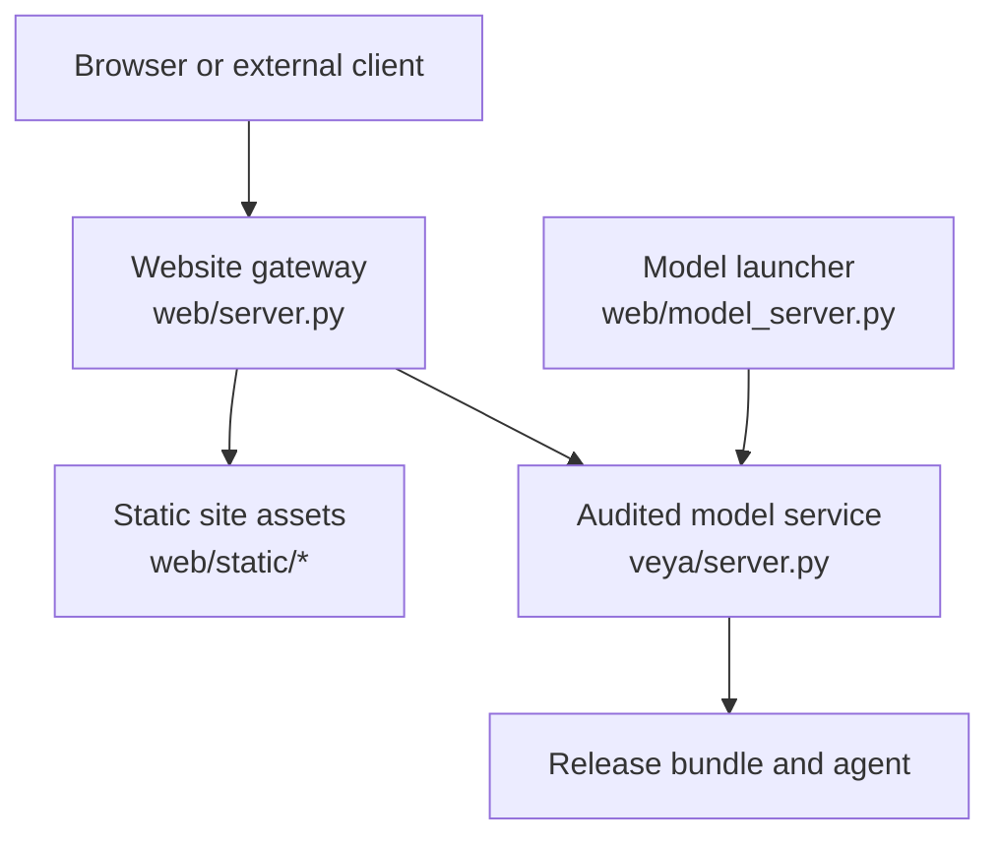
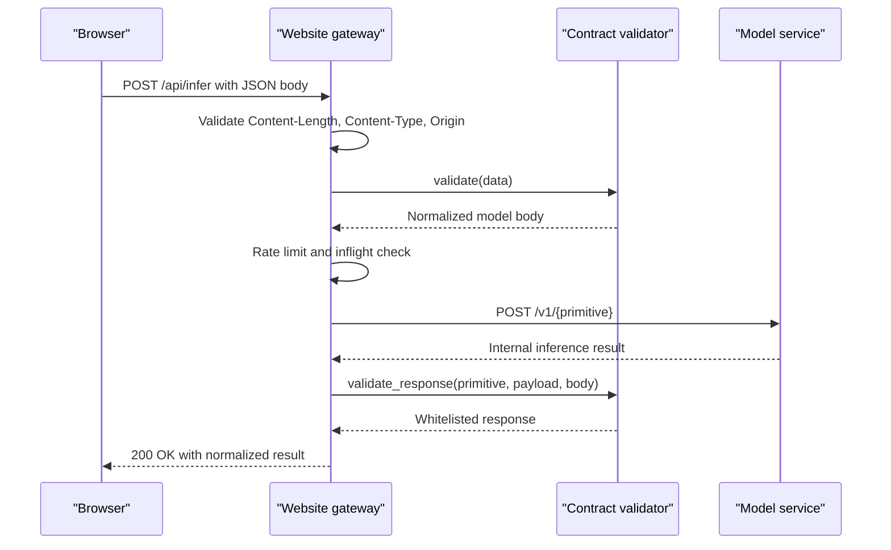
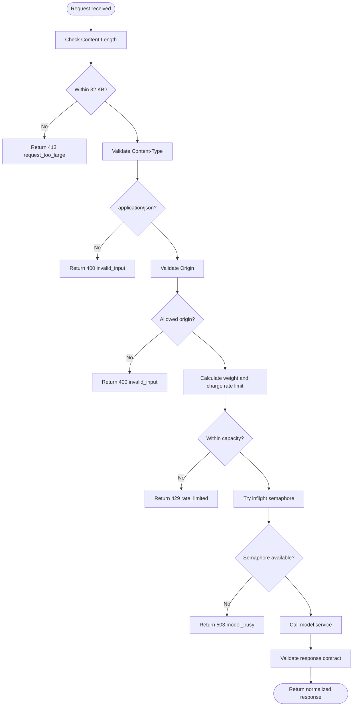
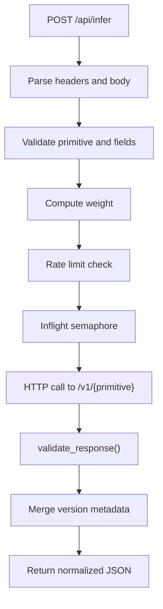
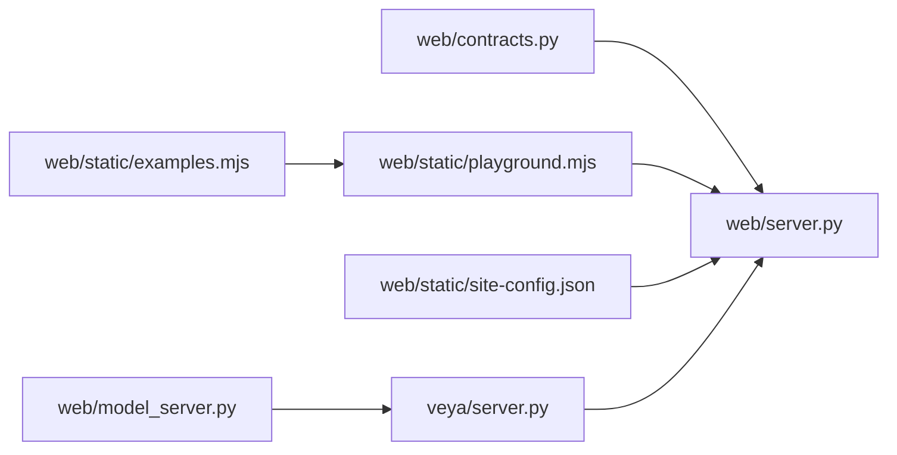

# Web Interface & HTTP API

<cite>
**Referenced Files in This Document**
- [veya/server.py](file://veya/server.py)
- [web/server.py](file://web/server.py)
- [web/model_server.py](file://web/model_server.py)
- [web/contracts.py](file://web/contracts.py)
- [web/static/site-config.json](file://web/static/site-config.json)
- [web/static/playground.mjs](file://web/static/playground.mjs)
- [web/static/examples.mjs](file://web/static/examples.mjs)
- [tests/test_web_gateway.py](file://tests/test_web_gateway.py)
</cite>

## Table of Contents
1. [Introduction](#introduction)
2. [Project Structure](#project-structure)
3. [Core Components](#core-components)
4. [Architecture Overview](#architecture-overview)
5. [Detailed Component Analysis](#detailed-component-analysis)
6. [Dependency Analysis](#dependency-analysis)
7. [Performance Considerations](#performance-considerations)
8. [Troubleshooting Guide](#troubleshooting-guide)
9. [Conclusion](#conclusion)
10. [Appendices](#appendices)

## Introduction
This document explains Veya’s web serving capabilities, focusing on the public website gateway and the audited model server it proxies. It covers:
- Public HTTP endpoints exposed by the website gateway: `/api/infer`, `/api/health`, and `/api/version`.
- The underlying model server endpoints used internally: `/health`, `/version`, and inference routes such as `/v1/choice`, `/v1/noul`, `/v1/score`, and `/v1/systemone`.
- Request validation, response normalization, rate limiting, concurrency control, CORS restrictions, and security headers.
- The interactive frontend playground and client integration examples.
- Production deployment considerations for running the website gateway and the model service together.

## Project Structure
The web interface is implemented as a small Python HTTP server that serves static site assets and forwards inference requests to an audited model service. The model service is a separate process that loads a release bundle and exposes internal inference endpoints.

**Diagram sources**
- [web/server.py:1-90](file://web/server.py#L1-L90)
- [web/server.py:334-406](file://web/server.py#L334-L406)
- [veya/server.py:137-243](file://veya/server.py#L137-L243)
- [web/model_server.py:1-18](file://web/model_server.py#L1-L18)

**Section sources**
- [web/server.py:1-90](file://web/server.py#L1-L90)
- [web/model_server.py:1-18](file://web/model_server.py#L1-L18)

## Core Components
- Website gateway (`web/server.py`): Serves the same-origin website, validates public requests, applies rate limits and concurrency controls, proxies validated requests to the model service, normalizes responses, and adds security headers.
- Contract validator (`web/contracts.py`): Defines the bounded public request schema, sanitizes inputs, and whitelists normalized response fields.
- Model server (`veya/server.py`): Exposes internal endpoints for health, version, and inference primitives against a loaded agent or release bundle.
- Model launcher (`web/model_server.py`): Loads the audited release manifest and starts the model server bound to localhost.
- Frontend playground (`web/static/playground.mjs` and `web/static/examples.mjs`): Provides an interactive workspace for testing Choice, Noul, Score, and SystemOne requests.

**Section sources**
- [web/server.py:1-90](file://web/server.py#L1-L90)
- [web/contracts.py:1-30](file://web/contracts.py#L1-L30)
- [veya/server.py:1-20](file://veya/server.py#L1-L20)
- [web/model_server.py:1-18](file://web/model_server.py#L1-L18)
- [web/static/playground.mjs:1-10](file://web/static/playground.mjs#L1-L10)

## Architecture Overview
The website gateway is the only public-facing surface. It restricts cross-origin access, enforces strict content types, bounds request sizes, validates payloads through the contract layer, and then calls the model service over HTTP. Responses are revalidated before being returned to clients.

**Diagram sources**
- [web/server.py:408-543](file://web/server.py#L408-L543)
- [web/contracts.py:121-176](file://web/contracts.py#L121-L176)
- [web/contracts.py:246-348](file://web/contracts.py#L246-L348)
- [veya/server.py:173-234](file://veya/server.py#L173-L234)

## Detailed Component Analysis

### Public Website Gateway Endpoints
The website gateway exposes these public endpoints:

| Endpoint | Method | Purpose | Authentication | Request Schema | Response Schema | Error Codes |
|---|---:|---|---|---|---|---|
| `/api/infer` | POST | Submit a structured decision request. | None at the gateway; optional token forwarded to upstream if configured. | See “Public request schema” below. | See “Normalized response schema” below. | 200, 400, 413, 429, 502, 503, 504 |
| `/api/health` | GET | Check whether the model service is reachable and healthy. | None. | None. | `{status: "ok"}` when healthy. | 200, 503 |
| `/api/version` | GET | Return sanitized version and capability metadata from the model service. | None. | None. | Sanitized version object including `model_version`, optional `release`, `architecture_version`, `checkpoint`, `calibration_version`, `reranker_id`, `hypothesis_scorer_id`, `supported_languages`, `supported_primitives`, and `release_status`. | 200, 503 |

#### Public Request Schema
The gateway accepts a JSON object with a required `primitive` field. Supported primitives are:
- `choice`: Choose among named candidates.
- `noul`: Evaluate a proposition probability.
- `score`: Estimate a categorical score.
- `systemone`: Run multiple typed questions over one shared state.

Common fields:
- `primitive`: Required string. One of the supported primitives.
- `state`: Optional non-empty string, object, or list. Bounded to 12 KB after serialization.
- `instructions`: Required for single-question primitives. Non-empty text up to 500 characters.
- `criteria`: Optional per primitive:
  - For `choice`: Object mapping candidate IDs to descriptions. Two to 100 entries. IDs must be unique after Unicode normalization; descriptions up to 240 characters.
  - For `score`: Array of two to ten ordered labels. Labels must be unique after normalization.
  - For `noul`: Not accepted by the website contract.
  - For `systemone`: Per-question criteria, validated recursively.
- `questions`: Required for `systemone`. A dictionary of one to eight question IDs. Each question has `type`, `instructions`, and optional `criteria`.

Validation rules include rejecting duplicate JSON keys, non-finite numbers, oversized bodies, invalid content types, and disallowed fields.

**Section sources**
- [web/server.py:408-543](file://web/server.py#L408-L543)
- [web/contracts.py:14-17](file://web/contracts.py#L14-L17)
- [web/contracts.py:49-79](file://web/contracts.py#L49-L79)
- [web/contracts.py:90-118](file://web/contracts.py#L90-L118)
- [web/contracts.py:121-176](file://web/contracts.py#L121-L176)

#### Normalized Response Schema
All successful responses share common fields:
- `decision`: Either `"answer"` or `"defer"`.
- `deferred`: Boolean derived from `decision`.
- `primitive`: Echoed primitive name.
- `model`: Optional public model name.
- `calibration_version`: Optional calibration identifier.
- `defer_reason`: Present and non-null when deferred.
- `request_id`: Unique request identifier added by the gateway.
- `gateway_latency_ms`: Milliseconds spent in the gateway.

Primitive-specific fields:
- `choice`:
  - `answer`: Selected candidate ID.
  - `probabilities`: Distribution over submitted candidates.
  - `route`: Optional route label.
  - `shortlist`: Optional short list of candidates when using high-cardinality routing.
  - `candidate_count`: Number of submitted candidates.
  - `calibration`: Optional calibration label.
  - `reranker_id`: Optional reranker identifier.
  - `automation`: Optional automation label.
- `noul`:
  - `answer`: Probability between 0 and 1.
  - `probabilities`: Derived distribution with `"False"` and `"True"` when not provided.
- `score`:
  - `answer`: Integer score index.
  - `probabilities`: Distribution over ordered levels.
  - `legend`: Mapping from level indices to labels.
- `systemone`:
  - `answers`: Dictionary keyed by question IDs, each containing type-specific answer data.
  - `routes`: Optional per-question route labels.

Version metadata may be merged into the response from `/api/version`, including `model_version`, `release`, `architecture_version`, `supported_languages`, and `release_status`.

**Section sources**
- [web/server.py:509-543](file://web/server.py#L509-L543)
- [web/contracts.py:179-243](file://web/contracts.py#L179-L243)
- [web/contracts.py:246-348](file://web/contracts.py#L246-L348)

#### Error Codes and Messages
| Status | Code | Meaning | Typical Cause |
|---:|---|---|---|
| 200 | Success | Valid request processed successfully. | Normal flow. |
| 400 | `invalid_input` | Invalid request body, missing fields, wrong content type, or cross-origin rejection. | Client input error. |
| 413 | `request_too_large` | Body exceeds 32 KB. | Oversized request. |
| 429 | `rate_limited` | Too many requests within the sliding window. | Rate limit exceeded. Includes `retry_after`. |
| 502 | `model_error` | Upstream model returned an unexpected error. | Model service failure. |
| 502 | `invalid_upstream_response` | Upstream response failed contract validation. | Malformed model output. |
| 503 | `model_unavailable` | Health or version probe failed, or model service unreachable. | Downstream outage. |
| 503 | `model_busy` | Inflight concurrency limit reached. | Temporary overload. |
| 504 | `timeout` | Upstream request timed out. | Slow or unresponsive model service. |

**Section sources**
- [web/server.py:421-635](file://web/server.py#L421-L635)

### Underlying Model Service Endpoints
The model service runs locally and is accessed by the website gateway. Its endpoints include:

| Endpoint | Method | Purpose | Request Schema | Response Notes |
|---|---|---|---|---|
| `/health` | GET | Liveness check. | None. | Returns `{"status": "ok"}`. |
| `/version` | GET | Version and capability metadata. | None. | Returns model version, checkpoint identifiers, calibration version, supported languages/primitives, and optional release metadata. |
| `/v1/choice` | POST | Single-choice decision. | `state`, `instructions`, optional `criteria`. | Normalized answer with probabilities and optional route/metadata. |
| `/v1/noul` | POST | Proposition probability. | `state`, `instructions`. | Normalized probability answer. |
| `/v1/score` | POST | Categorical score. | `state`, `instructions`, ordered `criteria`. | Normalized score answer with probabilities and legend. |
| `/v1/systemone` | POST | Multi-question batch. | `state`, `questions`. | Batched answers keyed by question IDs. |

Authentication:
- The model service itself does not require authentication in this implementation.
- The website gateway can forward an optional `Authorization: Bearer <token>` header to the model service when `VEYA_MODEL_TOKEN` is set.

Rate limiting and concurrency:
- The model service serializes inference with a lock to avoid concurrent model calls.
- The website gateway enforces per-IP sliding-window rate limiting and a bounded inflight semaphore.

Security:
- The model service logs no request details.
- The website gateway sets strict security headers and restricts allowed origins.

**Section sources**
- [veya/server.py:163-234](file://veya/server.py#L163-L234)
- [veya/server.py:137-171](file://veya/server.py#L137-L171)
- [web/server.py:94-114](file://web/server.py#L94-L114)

### Contract Validation System
The contract layer defines a bounded subset of the model API. It prevents arbitrary candidate text from being promoted to instructions and ensures all inputs and outputs conform to expected shapes.

Key behaviors:
- Rejects duplicate JSON keys.
- Rejects non-finite numbers.
- Enforces maximum sizes for state, instructions, candidate IDs, descriptions, and score labels.
- Normalizes candidate IDs and labels for uniqueness checks.
- Validates choice distributions, noul probabilities, and score level mappings.
- Whitelists response fields and rejects unexpected upstream data.

Complexity:
- Input validation is linear in the size of the request body and number of candidates or questions.
- Response validation is linear in the number of probability labels and answers.

Optimization opportunities:
- Precompute normalized keys for large candidate sets if needed.
- Cache validated schemas for repeated primitives during long-lived processes.

Error handling:
- Raises specific exceptions (`RequestError`, `UpstreamContractError`) that map to user-friendly status codes and messages.

**Section sources**
- [web/contracts.py:1-30](file://web/contracts.py#L1-L30)
- [web/contracts.py:49-79](file://web/contracts.py#L49-L79)
- [web/contracts.py:90-118](file://web/contracts.py#L90-L118)
- [web/contracts.py:121-176](file://web/contracts.py#L121-L176)
- [web/contracts.py:179-243](file://web/contracts.py#L179-L243)
- [web/contracts.py:246-348](file://web/contracts.py#L246-L348)

### Rate Limiting and Concurrency Control
The gateway uses a per-IP sliding window with configurable capacity:
- Window duration: 60 seconds.
- Base capacity: 12 requests per window.
- Weight calculation:
  - `choice` and `systemone` with many candidates incur higher weight.
  - Weight grows slowly beyond 19 candidates to protect against expensive high-cardinality requests.
- Inflight limit: At most two concurrent upstream requests.
- Retry guidance:
  - Local rate limit returns `Retry-After`.
  - Upstream 429 responses are preserved and mapped to gateway 429 responses.

**Diagram sources**
- [web/server.py:174-206](file://web/server.py#L174-L206)
- [web/server.py:421-508](file://web/server.py#L421-L508)

**Section sources**
- [web/server.py:74-84](file://web/server.py#L74-L84)
- [web/server.py:174-206](file://web/server.py#L174-L206)
- [web/server.py:453-508](file://web/server.py#L453-L508)
- [tests/test_web_gateway.py:443-511](file://tests/test_web_gateway.py#L443-L511)

### Security Measures
- Same-origin policy enforcement: Only requests from the current host or explicitly allowed origins are accepted.
- Strict content type: Only `application/json` is accepted for inference.
- Request size limits: 32 KB for the website gateway; smaller limits apply to upstream responses.
- Response size limits: Upstream responses are bounded to prevent memory exhaustion.
- Security headers:
  - `X-Content-Type-Options: nosniff`
  - `Referrer-Policy: strict-origin-when-cross-origin`
  - `X-Frame-Options: DENY`
  - `Permissions-Policy` restricting camera, microphone, and geolocation.
  - `Content-Security-Policy` restricting script, style, image, connect, and frame sources.
- Origin validation: Cross-origin model requests are rejected unless explicitly allowed via environment configuration.
- Token forwarding: Optional bearer token is forwarded to the model service when configured.

**Section sources**
- [web/server.py:32-50](file://web/server.py#L32-L50)
- [web/server.py:94-114](file://web/server.py#L94-L114)
- [web/server.py:244-268](file://web/server.py#L244-L268)
- [web/server.py:439-452](file://web/server.py#L439-L452)

### Model Server Implementation
The model server loads a release bundle and exposes internal endpoints:
- `/health`: Simple liveness check.
- `/version`: Rich metadata about the model, calibration, router, reranker, and release.
- Inference endpoints: `/v1/choice`, `/v1/noul`, `/v1/score`, `/v1/systemone`, plus experimental hypothesis endpoints.

Concurrency:
- A global lock serializes inference calls to avoid unsafe concurrent model execution.

Response formatting:
- Internal results are transformed into a public-facing shape with fields like `model`, `model_version`, `primitive`, `decision`, `answer`, `probabilities`, `confidence`, `deferred`, `defer_reason`, and `usage`.

**Section sources**
- [veya/server.py:137-234](file://veya/server.py#L137-L234)
- [veya/server.py:57-111](file://veya/server.py#L57-L111)
- [veya/server.py:40-54](file://veya/server.py#L40-L54)

### Request Processing Pipeline
The pipeline for `/api/infer` is:
1. Parse and validate `Content-Length` and `Content-Type`.
2. Validate `Origin` against allowed origins.
3. Calculate request weight based on primitive and candidate count.
4. Apply per-IP rate limiting.
5. Acquire inflight semaphore.
6. Serialize and send the validated body to the model service.
7. Validate the upstream response through the contract layer.
8. Merge version metadata and add gateway telemetry fields.
9. Return the normalized response.

**Diagram sources**
- [web/server.py:408-543](file://web/server.py#L408-L543)
- [web/contracts.py:121-176](file://web/contracts.py#L121-L176)
- [web/contracts.py:246-348](file://web/contracts.py#L246-L348)

**Section sources**
- [web/server.py:408-543](file://web/server.py#L408-L543)

### Web Frontend Components and Interactive Testing
The website includes:
- A navigation and page registry defined in `site-config.json`.
- An interactive playground that lets users test Choice, Noul, Score, and SystemOne against the live model service.
- Example payloads and copyable client code snippets.

Frontend features:
- Primitive tabs for switching between decision types.
- Dynamic form rendering for candidates, score levels, and SystemOne questions.
- Real-time status indicators for model connectivity.
- Result visualization showing decisions, distributions, deferrals, and technical metadata.
- Keyboard-accessible technical detail panels.

Client integration examples:
- Copyable `curl`, Python, and TypeScript snippets are generated from example payloads.
- The playground constructs requests according to the public contract and displays normalized responses.

**Section sources**
- [web/static/site-config.json:1-23](file://web/static/site-config.json#L1-L23)
- [web/static/playground.mjs:1-10](file://web/static/playground.mjs#L1-L10)
- [web/static/playground.mjs:11-32](file://web/static/playground.mjs#L11-L32)
- [web/static/examples.mjs:29-41](file://web/static/examples.mjs#L29-L41)

## Dependency Analysis
The website gateway depends on:
- `web/contracts.py` for request and response validation.
- `veya/server.py` indirectly through HTTP calls to the model service.
- Environment variables for configuration: `VEYA_MODEL_URL`, `VEYA_WEB_PORT`, `VEYA_WEB_HOST`, `VEYA_PUBLIC_ORIGIN`, `VEYA_ALLOWED_ORIGINS`, `VEYA_MODEL_TOKEN`.

The model launcher depends on:
- `veya.release_bundle.load_release_manifest` to load the audited release.
- `veya.server.serve` to start the model server.

**Diagram sources**
- [web/server.py:23-30](file://web/server.py#L23-L30)
- [web/model_server.py:6-15](file://web/model_server.py#L6-L15)
- [web/static/playground.mjs:1-4](file://web/static/playground.mjs#L1-L4)
- [web/static/examples.mjs:29-41](file://web/static/examples.mjs#L29-L41)
- [web/static/site-config.json:1-23](file://web/static/site-config.json#L1-L23)

**Section sources**
- [web/server.py:23-30](file://web/server.py#L23-L30)
- [web/model_server.py:6-15](file://web/model_server.py#L6-L15)

## Performance Considerations
- Request size limits prevent large payloads from consuming memory.
- Response size limits protect against oversized upstream responses.
- Sliding-window rate limiting protects against bursts and expensive high-cardinality requests.
- Inflight concurrency limits prevent overwhelming the model service.
- Version metadata is cached for one minute to reduce upstream calls.
- The model service serializes inference to avoid unsafe concurrent model execution.

Recommendations:
- Tune `CAPACITY`, `WINDOW_S`, and `MAX_INFLIGHT` based on deployment capacity.
- Use a reverse proxy for TLS termination and additional rate limiting.
- Monitor gateway latency and upstream timeouts.
- Avoid sending sensitive data in the public playground demo.

[No sources needed since this section provides general guidance]

## Troubleshooting Guide
Common issues and resolutions:
- `400 invalid_input`: Check that the request body is valid JSON, contains a supported primitive, and respects field limits. Ensure `Content-Type` is `application/json` and the origin is allowed.
- `413 request_too_large`: Reduce the size of `state`, `instructions`, or candidate lists.
- `429 rate_limited`: Back off according to `retry_after`. Large candidate sets consume more weight.
- `503 model_unavailable`: Verify that the model service is running and reachable at `VEYA_MODEL_URL`.
- `503 model_busy`: Retry after a short delay; the model service is temporarily overloaded.
- `502 model_error` or `invalid_upstream_response`: Inspect upstream logs; the model service returned an unexpected or malformed response.
- `504 timeout`: Increase client-side timeout or investigate slow model processing.

Operational checks:
- Call `/api/health` to verify model availability.
- Call `/api/version` to inspect model version and supported capabilities.
- Review gateway logs for telemetry including request ID, primitive, route, deferred status, latency, and error code.

**Section sources**
- [web/server.py:334-346](file://web/server.py#L334-L346)
- [web/server.py:421-635](file://web/server.py#L421-L635)
- [web/server.py:209-235](file://web/server.py#L209-L235)
- [tests/test_web_gateway.py:443-511](file://tests/test_web_gateway.py#L443-L511)

## Conclusion
Veya’s web interface provides a secure, validated gateway to an audited model service. The public API exposes a bounded set of primitives with strict input and output contracts, robust error handling, and production-oriented safeguards such as rate limiting, concurrency control, and security headers. The interactive playground and example integrations make it straightforward to test and adopt the API, while the underlying model server offers clear health and version endpoints for operational monitoring.

[No sources needed since this section summarizes without analyzing specific files]

## Appendices

### Environment Variables
| Variable | Default | Description |
|---|---|---|
| `VEYA_MODEL_URL` | `http://127.0.0.1:8080` | URL of the audited model service. |
| `VEYA_WEB_PORT` | `3000` | Port for the website gateway. |
| `VEYA_WEB_HOST` | `127.0.0.1` | Host binding for the website gateway. |
| `VEYA_PUBLIC_ORIGIN` | Empty | HTTPS origin for SEO and public deployment validation. |
| `VEYA_ALLOWED_ORIGINS` | Empty | Comma-separated list of additional allowed origins for model requests. |
| `VEYA_MODEL_TOKEN` | Empty | Optional bearer token forwarded to the model service. |
| `VEYA_DEVICE` | `cpu` | Device for loading the release bundle. |
| `VEYA_MODEL_PORT` | `8080` | Port for the audited model service. |

**Section sources**
- [web/server.py:32-50](file://web/server.py#L32-L50)
- [web/server.py:94-114](file://web/server.py#L94-L114)
- [web/model_server.py:9-15](file://web/model_server.py#L9-L15)

### Client Integration Examples
- cURL:
  - `curl -X POST '<origin>/api/infer' -H 'Content-Type: application/json' -d '<body>'`
- Python:
  - Build a JSON body with `primitive`, `state`, and either `instructions` and `criteria` or `questions`.
  - Send a POST request to `/api/infer` and parse the normalized response.
- TypeScript:
  - Use `fetch('/api/infer', { method: 'POST', headers: { 'Content-Type': 'application/json' }, body: JSON.stringify(body) })`.

These examples are generated from the playground’s example payloads and reflect the public contract.

**Section sources**
- [web/static/examples.mjs:29-41](file://web/static/examples.mjs#L29-L41)
- [web/static/playground.mjs:1-10](file://web/static/playground.mjs#L1-L10)