# Workflows & Presets

<cite>
**Referenced Files in This Document**
- [README.md](file://README.md)
- [presets.py](file://veya/presets.py)
- [router.py](file://veya/router.py)
- [selective.py](file://veya/selective.py)
- [release_bundle.py](file://veya/release_bundle.py)
- [contract.md](file://docs/commercialization/workflows/schema_guided_service_intent_routing/contract.md)
- [data_quality.md](file://docs/commercialization/workflows/schema_guided_service_intent_routing/data_quality.md)
- [phase12_report.md](file://docs/commercialization/workflows/schema_guided_service_intent_routing/phase12_report.md)
- [verification.md](file://docs/commercialization/workflows/schema_guided_service_intent_routing/verification.md)
</cite>

## Table of Contents
1. [Introduction](#introduction)
2. [Project Structure](#project-structure)
3. [Core Components](#core-components)
4. [Architecture Overview](#architecture-overview)
5. [Detailed Component Analysis](#detailed-component-analysis)
6. [Dependency Analysis](#dependency-analysis)
7. [Performance Considerations](#performance-considerations)
8. [Troubleshooting Guide](#troubleshooting-guide)
9. [Conclusion](#conclusion)
10. [Appendices](#appendices)

## Introduction
This document explains Veya’s built-in workflow presets and typed decision question schemas, focusing on:
- Pre-tuned configurations for intelligent model routing
- Prompt guardrails
- Content safety moderation
- Support ticket triage
- Confidence-based automated decisions
- Escalation patterns and human-in-the-loop integration
- Best practices for designing effective typed decision questions
- Interpreting confidence scores and automation outcomes

Veya exposes ready-to-use question schemas through preset functions and routes requests to the most appropriate checkpoint based on language, script, or explicit task selection. The same typed-decisions primitives support production workflows such as routing, safety checks, moderation, and customer service triage.

## Project Structure
The relevant implementation is concentrated in a small set of modules:
- `veya/presets.py` defines the built-in question schemas.
- `veya/router.py` selects the best checkpoint and can auto-detect typed-decisions workflows.
- `veya/selective.py` provides selective automation thresholds and risk/coverage metrics.
- `veya/release_bundle.py` integrates shortlist routing, calibration, and optional selective policy application.
- `README.md` documents usage examples, confidence gating, and decision primitives.
- `docs/commercialization/workflows/schema_guided_service_intent_routing/*.md` documents a schema-guided intent routing research contract and evaluation results.

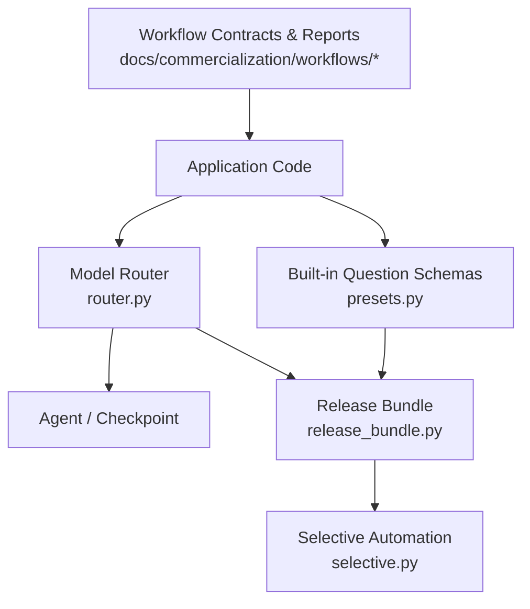

**Diagram sources**
- [presets.py:1-188](file://veya/presets.py#L1-L188)
- [router.py:1-337](file://veya/router.py#L1-L337)
- [release_bundle.py:1-503](file://veya/release_bundle.py#L1-L503)
- [selective.py:1-143](file://veya/selective.py#L1-L143)

**Section sources**
- [presets.py:1-188](file://veya/presets.py#L1-L188)
- [router.py:1-337](file://veya/router.py#L1-L337)
- [release_bundle.py:1-503](file://veya/release_bundle.py#L1-L503)
- [selective.py:1-143](file://veya/selective.py#L1-L143)
- [README.md:213-264](file://README.md#L213-L264)

## Core Components
Veya’s workflow surface is defined by three decision primitives and four built-in preset schemas:

| Primitive | Meaning | Typical Use |
|---|---|---|
| `choice` | Top label plus per-option probabilities and confidence | Intent classification, department routing, topic categorization |
| `score` | Expected ordinal level plus distribution and confidence | Frustration level, urgency, harm severity |
| `noul` | Calibrated probability P(true) from 0.0 to 1.0 | Phishing detection, spam filtering, jailbreak detection, churn risk |

The built-in presets are:
- `triage_questions()`: Customer support ticket triage with intent, urgency, frustration, refund request, and churn risk.
- `email_questions(categories=None)`: Inbound email triage and threat filtering with category, spam/phishing flags, urgency, and reply expectation.
- `guard_questions()`: Real-time prompt guardrails for jailbreaks, prompt injection, sensitive data, harm severity, and topic.
- `moderation_questions()`: Content safety and moderation for toxicity, harassment, threats, spam, and rule-breaking severity.
- `router_questions()`: Intelligent model routing signals including difficulty, domain, tool use, and sensitivity.

These presets return dictionaries that can be passed directly to Veya’s prediction interface.

**Section sources**
- [README.md:213-264](file://README.md#L213-L264)
- [presets.py:5-42](file://veya/presets.py#L5-L42)
- [presets.py:45-79](file://veya/presets.py#L45-L79)
- [presets.py:82-119](file://veya/presets.py#L82-L119)
- [presets.py:122-151](file://veya/presets.py#L122-L151)
- [presets.py:154-187](file://veya/presets.py#L154-L187)

## Architecture Overview
At runtime, an application typically:
1. Loads a Veya agent or release bundle.
2. Supplies state (for example, a message, prompt, post, or request).
3. Supplies one or more typed decision questions.
4. Optionally uses the router to select the best checkpoint.
5. Interprets answers, confidence scores, and optional automation flags.
6. Applies business logic for automation, deferral, escalation, or human review.

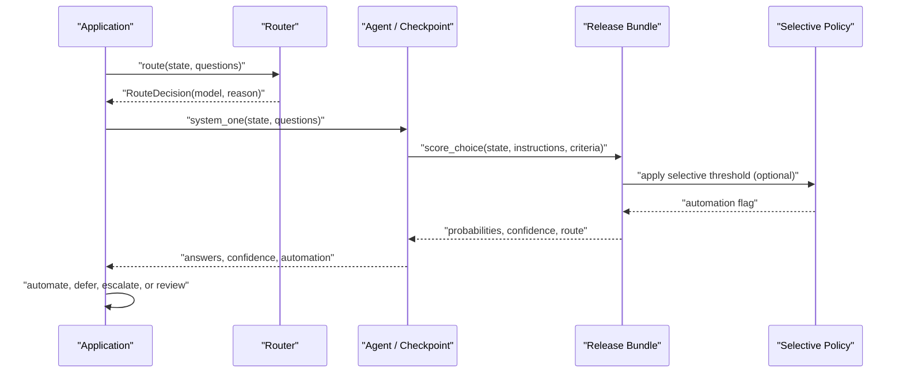

**Diagram sources**
- [router.py:257-331](file://veya/router.py#L257-L331)
- [release_bundle.py:208-323](file://veya/release_bundle.py#L208-L323)
- [selective.py:21-64](file://veya/selective.py#L21-L64)

## Detailed Component Analysis

### Built-in Workflow Presets

#### Support Ticket Triage
The triage preset models:
- Intent as a choice among refund, technical help, billing question, information, cancellation, and other.
- Urgency as a no-output yes/no signal.
- Frustration as an ordinal score from calm to very angry.
- Whether a refund is requested.
- Churn risk as a calibrated probability.

This preset is suitable for routing support tickets into queues, prioritizing high-frustration cases, and escalating refunds or churn signals.

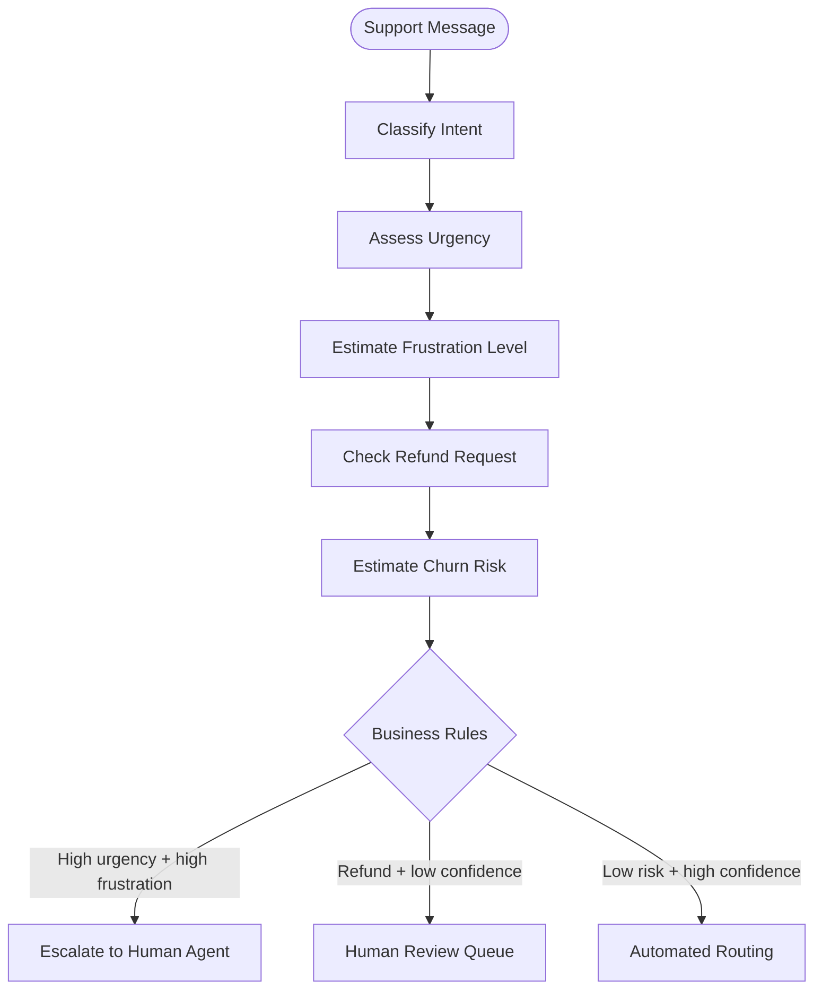

**Diagram sources**
- [presets.py:5-42](file://veya/presets.py#L5-L42)

**Section sources**
- [presets.py:5-42](file://veya/presets.py#L5-L42)

#### Email Triage and Threat Filtering
The email preset supports:
- Team category selection.
- Spam detection.
- Phishing detection with explicit true/false semantics.
- Urgency scoring.
- Reply expectation.

It is designed for inbound email pipelines where security-sensitive messages must be separated from normal support or sales traffic.

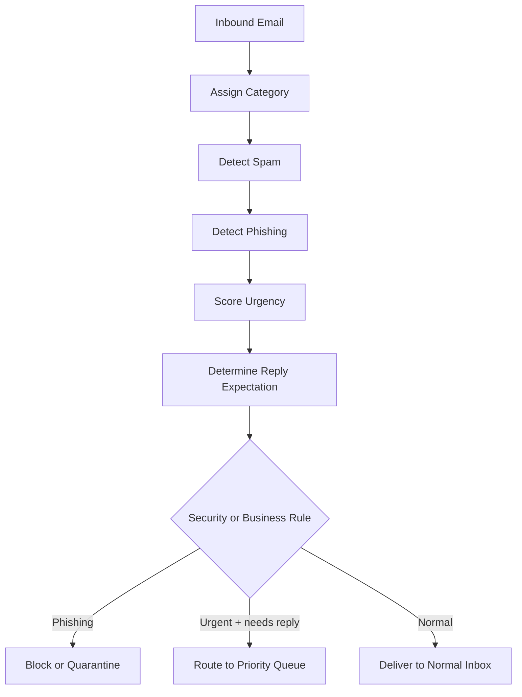

**Diagram sources**
- [presets.py:45-79](file://veya/presets.py#L45-L79)

**Section sources**
- [presets.py:45-79](file://veya/presets.py#L45-L79)

#### Prompt Guardrails
The guard preset detects:
- Jailbreak attempts.
- Prompt injection.
- Sensitive data exposure.
- Harm severity on an ordinal scale.
- Topic classification.

This preset should run before sending prompts to downstream models when input safety and policy compliance are required.

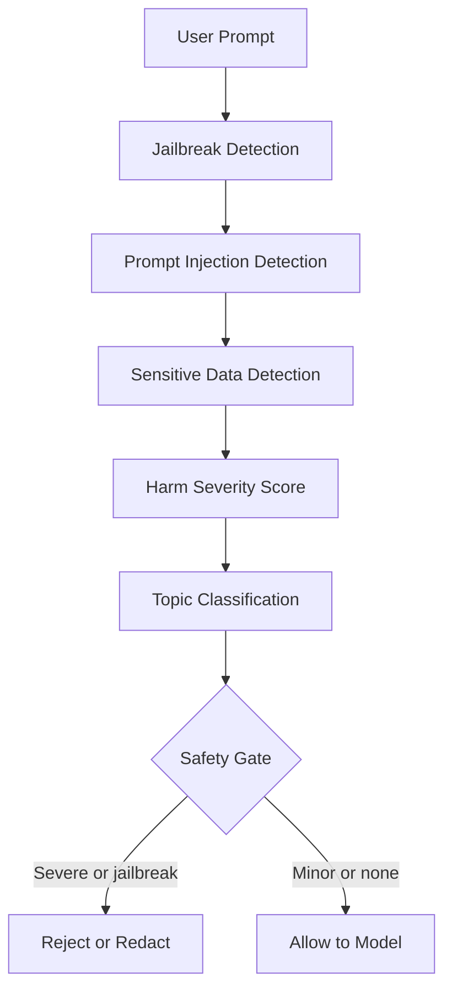

**Diagram sources**
- [presets.py:82-119](file://veya/presets.py#L82-L119)

**Section sources**
- [presets.py:82-119](file://veya/presets.py#L82-L119)

#### Content Safety Moderation
The moderation preset evaluates:
- Toxicity.
- Harassment.
- Threats.
- Spam.
- Overall rule-breaking severity.

It is intended for community content, comments, posts, or user-generated text where enforcement actions depend on both violation type and severity.

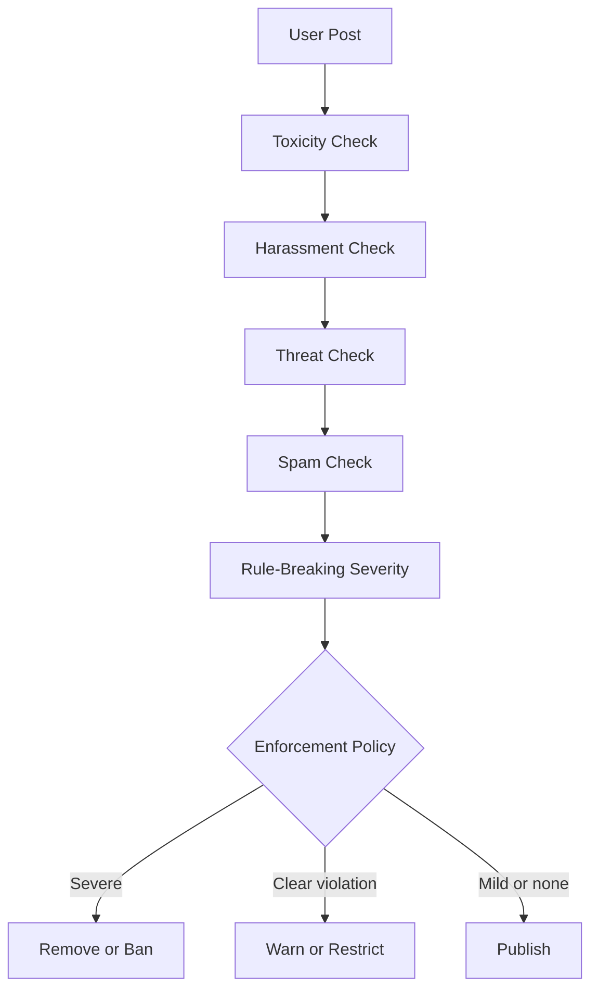

**Diagram sources**
- [presets.py:122-151](file://veya/presets.py#L122-L151)

**Section sources**
- [presets.py:122-151](file://veya/presets.py#L122-L151)

#### Intelligent Model Routing
The router preset captures:
- Difficulty.
- Domain.
- Tool use requirement.
- Sensitivity.

These signals complement the automatic script/language routing performed by the router. They are useful when your application wants to make explicit routing decisions based on request characteristics rather than only language detection.

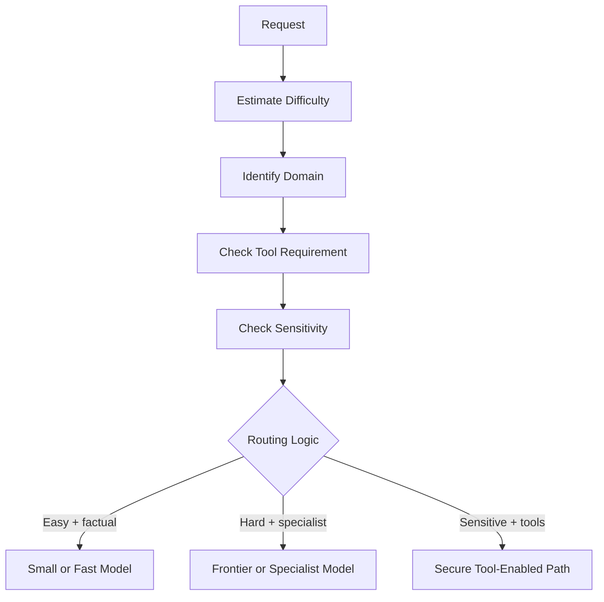

**Diagram sources**
- [presets.py:154-187](file://veya/presets.py#L154-L187)
- [router.py:1-29](file://veya/router.py#L1-L29)

**Section sources**
- [presets.py:154-187](file://veya/presets.py#L154-L187)
- [router.py:1-29](file://veya/router.py#L1-L29)

### Automated Confidence Gating and Escalation Patterns
Veya’s confidence scores are statistically meaningful because they come from calibrated decision heads trained with proper scoring objectives. Applications can gate automation using a confidence threshold:
- High-confidence answers can be processed automatically.
- Low-confidence answers can be deferred, escalated, or sent to a human reviewer.

The README includes a direct example showing how to branch on confidence for automated routing versus human escalation.

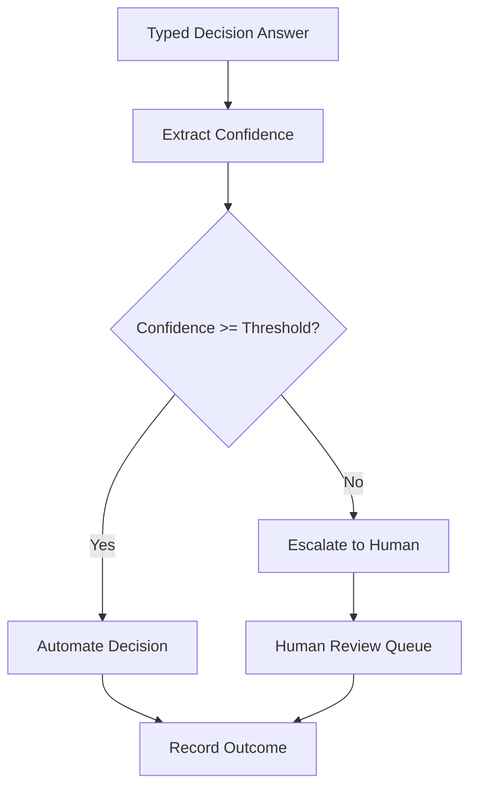

**Diagram sources**
- [README.md:213-227](file://README.md#L213-L227)

**Section sources**
- [README.md:213-227](file://README.md#L213-L227)

### Selective Automation Policies
For production Choice routing, Veya can apply a selective policy that maps probability vectors to a confidence score and compares it against a validation-selected threshold. Supported score kinds include:
- Maximum probability
- Negative entropy
- Margin between top candidates

A policy can mark a decision as automated or deferred. If no threshold applies, the default behavior does not accept the decision as automated.

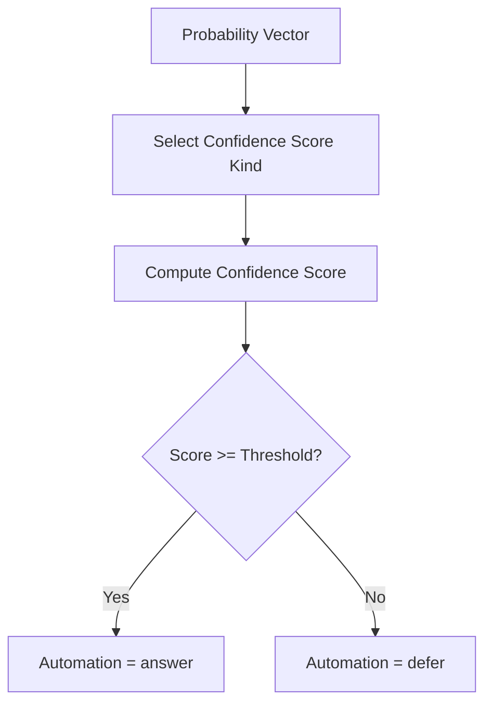

**Diagram sources**
- [selective.py:21-64](file://veya/selective.py#L21-L64)
- [release_bundle.py:292-323](file://veya/release_bundle.py#L292-L323)

**Section sources**
- [selective.py:21-64](file://veya/selective.py#L21-L64)
- [release_bundle.py:292-323](file://veya/release_bundle.py#L292-L323)

### Typed Decision Questions and Custom Schema Design
Veya’s typed-decisions capability is not limited to the built-in presets. You can define custom question schemas for domain-specific workflows. The router can auto-detect four predefined typed-decisions workflows by exact question-id signatures:
- Agent trace observability
- Customer service
- Invoice processing
- Security incidents

Auto-detection requires an exact match of question ids; unrelated schemas that happen to share common ids like “urgency” are not captured.

When designing custom typed decision questions:
- Keep instructions clear and grounded in observable evidence.
- For `choice`, provide mutually exclusive and reasonably exhaustive criteria.
- For `score`, define an ordered rubric with descriptive anchors.
- For `noul`, frame the question as a binary property with a clear positive interpretation.
- Prefer stable labels over free-form text so routing and evaluation remain deterministic.
- Use confidence thresholds to balance automation coverage and accepted error.

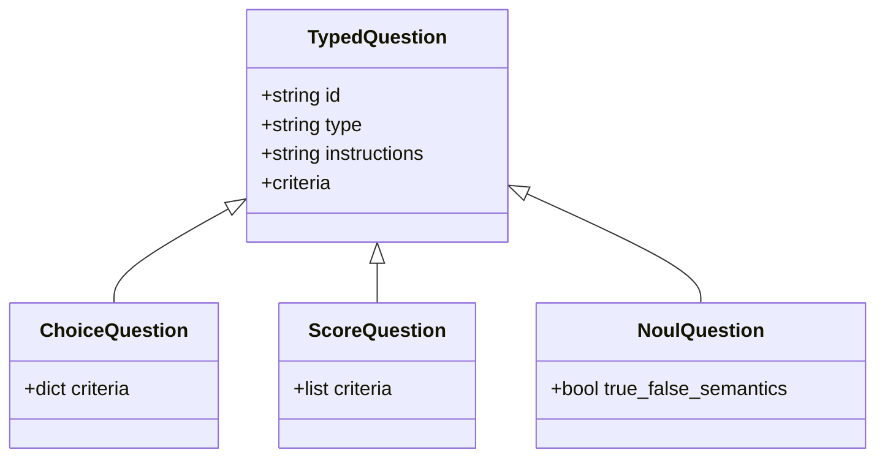

**Diagram sources**
- [presets.py:5-42](file://veya/presets.py#L5-L42)
- [presets.py:45-79](file://veya/presets.py#L45-L79)
- [presets.py:82-119](file://veya/presets.py#L82-L119)
- [presets.py:122-151](file://veya/presets.py#L122-L151)
- [presets.py:154-187](file://veya/presets.py#L154-L187)
- [router.py:73-80](file://veya/router.py#L73-L80)
- [router.py:110-120](file://veya/router.py#L110-L120)

**Section sources**
- [router.py:73-80](file://veya/router.py#L73-L80)
- [router.py:110-120](file://veya/router.py#L110-L120)
- [presets.py:5-187](file://veya/presets.py#L5-L187)

### Interpreting Confidence Scores
Confidence values represent calibrated model certainty and should be interpreted as part of a broader operational policy:
- Do not treat confidence alone as ground truth.
- Combine confidence with business risk tolerance.
- Use higher thresholds for irreversible actions.
- Use lower thresholds for reversible or informational outputs.
- Track automation coverage, observed risk, and Wilson intervals.
- Re-evaluate thresholds periodically as data drifts.

The selective module provides utilities for computing risk/coverage curves, Wilson intervals, and applying thresholds consistently.

**Section sources**
- [selective.py:67-113](file://veya/selective.py#L67-L113)
- [README.md:213-227](file://README.md#L213-L227)

## Dependency Analysis
The following diagram shows how the main workflow components interact:

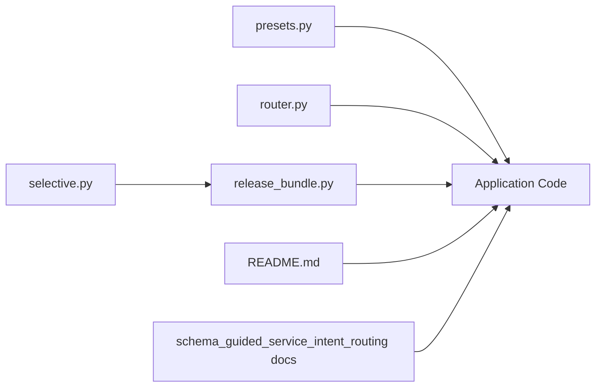

**Diagram sources**
- [presets.py:1-188](file://veya/presets.py#L1-L188)
- [router.py:1-337](file://veya/router.py#L1-L337)
- [release_bundle.py:1-503](file://veya/release_bundle.py#L1-L503)
- [selective.py:1-143](file://veya/selective.py#L1-L143)
- [README.md:213-264](file://README.md#L213-L264)
- [contract.md:1-73](file://docs/commercialization/workflows/schema_guided_service_intent_routing/contract.md#L1-L73)

**Section sources**
- [presets.py:1-188](file://veya/presets.py#L1-L188)
- [router.py:1-337](file://veya/router.py#L1-L337)
- [release_bundle.py:1-503](file://veya/release_bundle.py#L1-L503)
- [selective.py:1-143](file://veya/selective.py#L1-L143)
- [README.md:213-264](file://README.md#L213-L264)
- [contract.md:1-73](file://docs/commercialization/workflows/schema_guided_service_intent_routing/contract.md#L1-L73)

## Performance Considerations
- Use the router to avoid loading all checkpoints simultaneously unless you preloaded them.
- Preload models in server environments to eliminate cold-start latency.
- Prefer packed Choice for small candidate sets; hierarchical shortlist routing is used for larger candidate sets.
- Apply selective policies only when the cost of errors justifies deferring uncertain cases.
- Monitor p50, p95, and p99 latency, throughput, memory, and cost in production.
- Treat research benchmarks as internal guidance; production SLAs require measured deployment conditions.

[No sources needed since this section provides general guidance]

## Troubleshooting Guide
Common issues and their likely causes:
- Invalid schema response: The state is empty or blocked by configuration.
- Unknown model name: The model alias or name is not recognized.
- Mismatched selective policy: The policy belongs to a different route, checkpoint, shortlist, scorer, or validation split.
- No automation: A selective policy may be missing, invalid, or below threshold.
- Unexpected routing: Language/script detection or explicit model/task parameters changed the selected checkpoint.

Recommended diagnostics:
- Inspect the routing decision and reason.
- Inspect the answer’s primitive, probabilities, confidence, and automation fields.
- Validate question types and criteria.
- Compare observed risk and Wilson intervals against your acceptable error budget.
- Review the workflow contract and data quality notes when evaluating intent routing claims.

**Section sources**
- [release_bundle.py:260-323](file://veya/release_bundle.py#L260-L323)
- [release_bundle.py:325-392](file://veya/release_bundle.py#L325-L392)
- [selective.py:116-142](file://veya/selective.py#L116-L142)
- [router.py:101-107](file://veya/router.py#L101-L107)
- [contract.md:1-73](file://docs/commercialization/workflows/schema_guided_service_intent_routing/contract.md#L1-L73)
- [data_quality.md:1-35](file://docs/commercialization/workflows/schema_guided_service_intent_routing/data_quality.md#L1-L35)
- [phase12_report.md:1-74](file://docs/commercialization/workflows/schema_guided_service_intent_routing/phase12_report.md#L1-L74)
- [verification.md:1-51](file://docs/commercialization/workflows/schema_guided_service_intent_routing/verification.md#L1-L51)

## Conclusion
Veya’s workflow presets provide production-ready schemas for routing, guardrails, moderation, and support triage. Combined with calibrated confidence scores and optional selective automation policies, they enable confident automation for routine cases while preserving safe escalation paths for uncertain or high-risk inputs. For domain-specific workflows, design typed decision questions with clear primitives, stable labels, and well-defined criteria. Use confidence thresholds, risk reporting, and human-in-the-loop review to balance automation coverage with operational safety.

[No sources needed since this section summarizes without analyzing specific files]

## Appendices

### Using Built-in Presets
- Load a Veya agent.
- Call prediction with state and a preset question schema.
- Interpret answers, confidence, and automation flags.
- Apply business rules for automation, deferral, escalation, or human review.

**Section sources**
- [README.md:231-251](file://README.md#L231-L251)
- [presets.py:5-187](file://veya/presets.py#L5-L187)

### Schema-Guided Service Intent Routing Context
The schema-guided service intent routing contract defines a strict research workflow for selecting active intents within known service schemas. It specifies inputs, candidate semantics, accuracy and coverage gates, deferral behavior, latency targets, and evaluation populations. The associated data quality and verification reports document development performance, sealed test status, and limitations.

**Section sources**
- [contract.md:1-73](file://docs/commercialization/workflows/schema_guided_service_intent_routing/contract.md#L1-L73)
- [data_quality.md:1-35](file://docs/commercialization/workflows/schema_guided_service_intent_routing/data_quality.md#L1-L35)
- [phase12_report.md:1-74](file://docs/commercialization/workflows/schema_guided_service_intent_routing/phase12_report.md#L1-L74)
- [verification.md:1-51](file://docs/commercialization/workflows/schema_guided_service_intent_routing/verification.md#L1-L51)