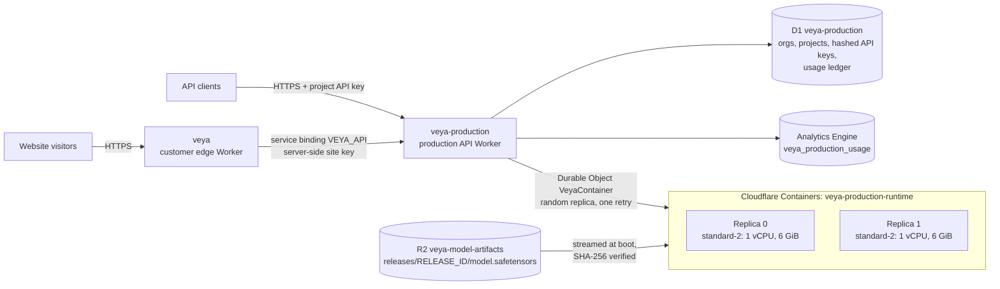

<p align="center">
  
</p>

# Veya

Veya is a non-autoregressive typed-decision system. Instead of generating text, it answers a typed question about a piece of input (pick one of several options, answer yes or no, or place something on a rating scale) in a single encoder forward pass, and returns a calibrated probability for every answer. The system has two parts:

- **Veya Core**: the decision model. It is a ModernBERT-large encoder (421M parameters) with packed decision heads, served CPU-only from Cloudflare Containers behind the `veya-production` Worker.
- **Veya Calibrations**: offline-fitted temperature-scaling artifacts (format `veya-calibration-v1`, method `temperature-nll`, produced by `veya/calibration.py`). They turn raw model scores into probabilities. They are baked into the container image and hash-pinned by the release manifest.

The current release is **`0.3.5-audit-baseline.1`** (package version `0.3.5`, architecture `veya-shortlist-k8-packed-rerank-v1`). It runs on Cloudflare: a customer-facing edge Worker, an authenticated production API, and a separate staging environment.

---

## Contents

- [Release status](#release-status)
- [Capabilities](#capabilities)
- [Architecture](#architecture)
- [API](#api)
- [Release integrity](#release-integrity)
- [Reliability and testing](#reliability-and-testing)
- [Security](#security)
- [Deployment and operations](#deployment-and-operations)
- [Local development](#local-development)
- [Model evaluation](#model-evaluation)
- [Research](#research)
- [Repository layout](#repository-layout)
- [Roadmap](#roadmap)
- [Documentation](#documentation)
- [License](#license)

---

## Release status

The forensic audit of phases 1 to 9 ([release verdict](docs/audit/release_verdict.md)) sets the status of each surface. Production serves exactly what is listed here and nothing more.

| Scope | Status | Served by `veya-production` |
|---|---|---|
| English `choice` | Research release | Yes |
| English `noul` | Research only | Yes (checkpoint temperature only) |
| English categorical `score` | Research only | Yes (checkpoint temperature only) |
| `systemone` (multi-question) | Not served in this release | No (rejected with `400 unsupported_primitive`) |
| Multilingual `choice` / `noul` / `score` | Research only | No |
| Ordinal `score`, Phase 9 hypothesis scorer | Research only | No |
| Automatic execution | Disabled | Every decision reports a prediction; automation stays off |
| Specialists (`/v1/responses`) | None enabled | Returns `403 specialist_not_enabled` |

Non-English input is detected before inference, and the model returns a `defer` decision (`unsupported_language`) instead of guessing. The machine-readable contract is [`artifacts/release/production_scope.json`](artifacts/release/production_scope.json); the human-readable version is [`docs/PRODUCTION_SCOPE.md`](docs/PRODUCTION_SCOPE.md).

---

## Capabilities

### Decision primitives

| Primitive | Question it answers | Output | Limits |
|---|---|---|---|
| `choice` | Which of these options applies? | Selected option, a probability per option, confidence | 2 to 100 candidates. 2 to 19 are scored packed in one pass; 20 to 100 go through a learned top-8 shortlist, then a packed rerank |
| `noul` | Is this statement true? | Calibrated probability that it is true | State and instructions only |
| `score` | Where does this fall on an ordered scale? | Selected level and a distribution over levels (categorical) | 2 to 10 ordered labels |

Request-level limits come from `web/contracts.py`: state up to 12,000 bytes, instructions up to 500 characters, candidate IDs up to 80 characters, candidate descriptions up to 240 characters. The production edge rejects any request body over 32 KB.

### Served route

```text
English input
  ├─ 1–19 candidates  -> packed base decision head
  └─ 20+ candidates   -> learned 128-d shortlist -> top 8 -> packed base decision head
Non-English input     -> defer (unsupported_language)
Automation            -> disabled
```

### Calibration

- Per-cardinality temperature buckets for packed `choice`, plus a frozen hierarchical route temperature for the shortlist route (`models/production/calibration.json`, `models/production/calibration_shortlist_k8.json`).
- `noul` and categorical `score` use checkpoint temperatures only.
- Temperatures are clamped to the same band at training and at serving (`veya.common.clamp_temperature`), so the temperature the trainer reports is the one production applies.
- Every calibration file is listed in the release manifest with its SHA-256. Changing one re-mints the manifest and the image.

### Checkpoints

| Checkpoint | Encoder | Parameters | Context | Status |
|---|---|---:|---:|---|
| `veya` (Veya Core) | ModernBERT-large | 421M | 512 | Served in production (English) |
| `veya-multilingual` | mmBERT-base | 322M | 1024 | Research only; calibration not validated for release |
| `veya-typed-decisions` | ModernBERT-large | 421M | 1024 | Research only; specialized for the typed-decisions benchmark |

Model weights are not stored in git (`models/production/**/*.safetensors` is ignored). The production checkpoint lives in private R2 storage, keyed by release ID.

---

## Architecture



**Customer edge: `veya`** (`worker/veya-edge.mjs`, logic in `worker/veya_site_edge.mjs`, config `wrangler.jsonc`)
- Serves the website from Workers static assets (`web/static`) and the same-origin gateway API (`/api/*`).
- `POST /api/infer` is forwarded to `veya-production` `POST /v1/decisions` over a **service binding**, authenticated with a server-side project key. Browsers never see a key.
- Keeps the gateway contract: 32 KB streamed cap, JSON only, same-origin check, and a weighted per-IP limit of 12 units per minute.
- Every upstream failure is returned as structured JSON (`model_busy`, `timeout`, `rate_limited`, `model_unavailable`, `invalid_upstream_response`), with no upstream detail leaked.
- Runs entirely on Cloudflare. It previously proxied to a laptop over Tailscale Funnel and went down whenever the laptop slept; that dependency was removed on 7 Oct 2026 (see [docs/VEYA_EDGE.md](docs/VEYA_EDGE.md)).

**Production API: `veya-production`** (`worker/veya-production.mjs`, logic in `worker/production_edge.mjs`, config `wrangler.production.jsonc`)
- Authenticates per-project API keys against D1, applies per-project rate tiers, enforces the body limit, and proxies decisions to the container pool.
- Picks one of two replicas at random. Each attempt has its own time budget, and a failed attempt (5xx, timeout or exception) is retried once on the other replica inside an overall 15 s deadline.
- Writes one usage record per decision to D1 (the exact ledger) and Analytics Engine (sampled, for trends), after the response is sent.

**Container runtime** (`deploy/cloudflare/`)
- `supervise.py` fetches the checkpoint through the Worker's private R2 binding (`veya-r2.internal`), verifies its SHA-256 against the release pins, then starts the model server (`web/model_server.py`, which loads and verifies the full release manifest) and the gateway (`web/server.py`).
- The gateway admits at most `VEYA_MAX_INFLIGHT` (default 2) concurrent requests per replica and sheds the rest with `503 model_busy`.
- Containers have no internet access and no R2 credentials. They sleep after an idle period (`VEYA_SLEEP_AFTER`: production `1h`, staging `15m`).

**Staging: `veya-staging`** (`wrangler.staging.jsonc`) runs the same container design with one instance, serves the `site/` build from static assets, and uses its own rate-limit namespaces and container application.

---

## API

### Production endpoints (`veya-production`)

| Method and path | Auth | Purpose |
|---|---|---|
| `GET /healthz`, `GET /__edge_health` | None | Edge-only liveness. Never touches a container |
| `GET /v1/models`, `GET /v1/version` | None | Release identity, enabled models (`veya-core`), specialists (none) |
| `POST /v1/decisions` | Project API key, scope `decisions:invoke` | Run one `choice`, `noul` or `score` decision |
| `POST /v1/responses` | Project API key, scope `responses:invoke` | Reserved for specialists. Returns `403 specialist_not_enabled` in this release |
| `GET /readyz`, `/startupz`, `/version`, `/api/version` | Admin secret | Container readiness and version probes |
| `GET /__admin/version`, `GET /__admin/replicas` | Admin secret | Deployed version, per-replica readiness |
| `POST /__admin/replicas/{i}/stop`, `/restart` | Admin secret | Failover drills |

Admin routes fail closed: without the admin secret configured, they return `401` to everyone.

### Example request

```bash
curl -sS -X POST "$VEYA_BASE_URL/v1/decisions" \
  -H "authorization: Bearer $VEYA_API_KEY" \
  -H "content-type: application/json" \
  -d '{
        "primitive": "choice",
        "state": "I was charged twice",
        "instructions": "Route this ticket",
        "criteria": {
          "billing": "Payments and refunds",
          "technical": "Bugs and errors"
        }
      }'
```

A response carries the `decision` (`answer` or `defer`), the answer, per-option probabilities, confidence, and release and calibration identifiers. Response headers include `x-veya-replica` (the replica that served it) and `x-veya-attempts`.

### Rate limits

Each project has a rate tier, stored in D1 `projects.rate_tier` (NULL means `default`). The mapping lives in `worker/rate_tiers.mjs`.

| Tier | `choice` | `noul` / `score` | Counted per |
|---|---|---|---|
| `default` | 20 per minute | 6 per minute | API key |
| `site` | 150 per minute | 45 per minute | Project |

The `site` tier is sized to the two-replica pool (about 2.6 requests per second) and is used by the public website, whose visitors are still limited individually at the `veya` edge. Workers rate limits are counted per Cloudflare location and are approximate; the gateway's `model_busy` load shedding is the hard capacity cap. Unknown tiers or missing bindings fall back to `default`, so a misconfiguration is never more lenient. A rate-limited response returns `429 rate_limited` with `Retry-After: 60` and `x-veya-rate-tier`.

### Errors

Errors are JSON with `code`, `detail` and `request_id`.

| Status and code | Meaning |
|---|---|
| `400 invalid_input` | Body isn't a JSON object, or the caller tried to select a model or URL |
| `400 unsupported_primitive` | `systemone` isn't served by this release |
| `401 unauthorized` | Missing, unknown, expired, revoked or out-of-scope key |
| `413 request_too_large` | More than 32 KB, counted on the streamed bytes whatever `content-length` says |
| `429 rate_limited` | Tier limit reached (`Retry-After: 60`) |
| `503 model_busy` | Both replicas are at their admission limit (`Retry-After: 2`). Capacity, not an outage: back off and retry |
| `503 container_unavailable` | No ready replica (`Retry-After: 5`) |
| `503 auth_unavailable`, `503 rate_limit_unavailable` | D1 key lookup or rate limiter temporarily unavailable |
| `504 upstream_timeout` | The 15 s inference deadline passed |

Production responses carry security headers: `Strict-Transport-Security: max-age=63072000; includeSubDomains`, a restrictive `Content-Security-Policy`, `Cross-Origin-Opener-Policy`, `Cross-Origin-Resource-Policy`, `X-Frame-Options: DENY`, `X-Content-Type-Options: nosniff`, `Referrer-Policy`, `Permissions-Policy` and `X-Robots-Tag: noindex`.

### Customer edge endpoints (`veya`)

| Path | Served by |
|---|---|
| `/`, site pages, `/static/*`, `/robots.txt`, `/sitemap.xml` | The edge Worker and static assets |
| `POST /api/infer` | `veya-production` `/v1/decisions` over the service binding |
| `GET /api/health`, `GET /api/version` | Mapped from `veya-production` `/healthz` and `/v1/version` |
| `GET /api/benchmark` | The sealed blind evaluation result, bundled at build time |
| `/healthz` | Edge liveness |
| `/readyz`, `/startupz`, `/__edge_health` | A real probe of `veya-production` (3 s timeout) |

---

## Release integrity

The release is identified by three values that must agree everywhere:

| Item | Value |
|---|---|
| Release ID | `0.3.5-audit-baseline.1` |
| Checkpoint SHA-256 | `891102d372688fc2a094dac56a384bc537b87c63f21f9f3dac0be2b7cbc8d86c` (842,609,210 bytes) |
| Manifest SHA-256 | `80720058c6b07dfef0640171d4193ff7bcaa3f40629ac60df7f9b28e074d65a4` |

- **Manifest.** [`artifacts/release/manifest.json`](artifacts/release/manifest.json) (format `veya-release-manifest-v2`) lists every runtime file with its SHA-256: checkpoint, tokenizer, router, shortlist, calibrations and selective policy. `veya.release_bundle.load_release_manifest` rejects path traversal, hash mismatches, incompatible components and router/code cutoff mismatches.
- **Pins.** The manifest digest is pinned in `wrangler.staging.jsonc`, `wrangler.production.jsonc`, `deploy/cloudflare/release-pins.json`, the container `Dockerfile`, `scripts/write_deploy_meta.py` and `worker/build-meta.mjs`. `tests/test_wrangler_configs.py` enforces agreement, and a container whose pins don't match refuses to boot.
- **Safe loading.** `torch.load` is only called with `weights_only=True`. CI fails the build on any other `torch.load`, on `pickle`, `joblib.load` or `yaml.load`, and on `os.system`, `subprocess`, `eval` or `exec` in the shipped package.
- **Re-minting.** The current manifest was re-minted after switching to `weights_only=True` loading and bounding the embedding cache, then re-audited on 7 Oct 2026: all version fields matched (release, manifest, checkpoint, shortlist, router, scorer, policy), and `choice` (small and high-N), `noul`, `score` and `systemone` all returned 200 from the model server. The procedure is in [RUNBOOK.md §9](RUNBOOK.md#9-release-identity-and-re-minting).

---

## Reliability and testing

### Continuous integration

| Workflow | What it checks |
|---|---|
| `CI` (`.github/workflows/ci.yml`) | Unit and protocol tests on Python 3.10, 3.11 and 3.13; lint (ruff, mypy, byte-compile); package build and `twine check`; PR gate (artifact hash pins and SBOM, security hardening, server security, Cloudflare config separation and release pins, production hardening, full offline pytest suite); Worker tests with `node --test` on Node 22; a main-branch gate with integration and reliability suites |
| `Security` (`.github/workflows/security.yml`) | gitleaks on the diff and the working tree; `pip-audit` on declared dependencies; CodeQL with a gate that fails on error- or warning-level findings (`.github/scripts/codeql_gate.py`, allowlist in `.github/codeql/allowlist.json`); the unsafe-deserialization and no-shell-out checks above |
| `Release Candidate Gate` (`.github/workflows/release-gate.yml`) | On version tags: full test suite, artifact integrity, license inventory, freeze records, Docker build |
| `Deploy veya-production` (`.github/workflows/deploy-production.yml`) | Manual dispatch or `prod-v*` tag only. Gated gradual or full deploys (see [Deployment](#deployment-and-operations)) |

### Production verification (7 Oct 2026)

All tests ran against the live `veya-production` stack with dedicated, short-lived load-test keys, which were revoked afterwards.

| Test | Load | Result |
|---|---|---|
| Failover drill | 36 req/min; replica 1 stopped, then restarted | **361 requests, 0 server errors.** 2xx p50 1.47 s, p95 2.04 s, p99 3.95 s; max 7.74 s; none over 15 s. Replica back in service 86 s after the stop and 70 s after the restart. The same drill before the per-attempt timeout fix had 7 server errors (1.9%) and 4 requests over 15 s |
| Burst | 180 req/min for 2 min across 6 keys | 361 requests: 240 succeeded (p50 1.83 s, p95 2.45 s, max 3.19 s; 52 were absorbed by a retry on the other replica), 25 `503 model_busy` with `Retry-After: 2`, 96 `429` from the per-key limit (expected with 6 keys on the default tier), **0 timeouts** |
| Baseline load (k6) | 1.5 req/s for 5 min | 450 requests, p50 1.53 s, p95 2.13 s, p99 3.07 s; 3 `model_busy` responses (0.66%) during a burst |
| Rollback rehearsal | Code-only rollback and roll-forward | Staging 3.0 s / 2.4 s with 116 of 116 probes returning 200. Production 3.0 s / 2.3 s with 55 of 55 probes returning 200 |
| Idle sleep | Staging, `VEYA_SLEEP_AFTER=15m` | Container stopped 15 min 44 s after the last request (the previous build was still running after 24 idle minutes). Cold start to ready: about 67 s |
| Usage accounting | 12-minute window | Analytics Engine's weighted total matched D1 exactly (559 and 559). D1 is the exact ledger; Analytics Engine samples and is used for trends |

### Capacity

On `standard-2` (1 vCPU, 6 GiB, single-threaded torch), a `choice` call is CPU-bound at about 1.1 to 1.3 s inside the container (about 1.5 s p50 at the edge). One replica handles about 1.3 requests per second; the two-replica pool is sized at about 2.6 requests per second before load shedding. Raising `VEYA_MAX_INFLIGHT` on one vCPU only adds queueing, so more capacity means more replicas or a larger instance type. Details: [RUNBOOK.md §8](RUNBOOK.md#8-operational-knobs-worker-vars-and-container-env).

---

## Security

- **API keys.** Per-project keys, stored in D1 as SHA-256 hashes only, with scopes, expiry and revocation. Keys are issued with `product/keys.py`. A failed key lookup returns a structured `503`, never a raw error.
- **Admin surface.** `/__admin/*` and the container probes require a separate admin secret and fail closed. Public health checks are answered at the edge and never wake a container.
- **Input handling.** A 32 KB cap counted on the streamed bytes (chunked uploads included), JSON objects only, and callers can't choose a model or upstream URL.
- **Isolation.** Containers have no internet access. The checkpoint comes through a private R2 binding with no credential in the container, and is SHA-256 verified before the model loads.
- **Privacy.** The usage ledger records metadata only: organization, project, key ID, endpoint, primitive, route, status, latency and release. `product/ledger.py` rejects content fields such as `state`, `instructions`, `criteria`, `prompt` and `messages`, and credential fields.
- **Secrets.** Admin and site keys are Worker secrets, never in git, config or logs. gitleaks runs on every pull request and on `main`. Version-preview URLs are disabled.
- **Edge headers.** HSTS (two years, include subdomains), CSP, COOP, CORP, frame denial, `nosniff`, referrer and permissions policies on every response.

The account-level hardening backlog (R2 bucket lock on `releases/`, retiring the one-time upload Worker, Cloudflare Access with an identity provider, alerting) is tracked in the [Roadmap](#roadmap).

---

## Deployment and operations

### Environments

| Worker | Config | Runtime | How it ships |
|---|---|---|---|
| `veya` (customer edge) | `wrangler.jsonc` | Worker + static assets, service binding to `veya-production` | Workers Builds on `main` runs `npx wrangler deploy --dry-run` (validation only). Releases use `wrangler versions upload`, then `wrangler versions deploy` at 10% and then 100% |
| `veya-staging` | `wrangler.staging.jsonc` | 1 container instance, `sleepAfter` 15m | Workers Builds on `deploy/cloudflare-staging` |
| `veya-production` | `wrangler.production.jsonc` | 2 container instances (`standard-2`), `sleepAfter` 1h | `Deploy veya-production` workflow, or `wrangler deploy --config wrangler.production.jsonc`. Workers Builds on `production/veya-dynamics` currently runs as a dry run |

Always pass the matching `--config` file. `tests/test_wrangler_configs.py` locks each config to its Worker name, entrypoint, container application, rate-limit namespaces and release pins.

### Production deploys

- **Gradual (code-only changes).** `wrangler versions upload`, then `wrangler versions deploy` at 10%, 50% and 100%, with a `/healthz` gate between steps and automatic revert to the previous version on failure. The workflow refuses gradual mode if container inputs (image, runtime, pins, manifest, models) changed since the previous `prod-v*` tag.
- **Full (image, config, binding or manifest changes).** `wrangler deploy` builds the image and starts a container rollout. During the rollout, the Worker routes around the replica that isn't ready.
- **Verification** after any deploy: `/healthz`, `/v1/models`, authenticated `/readyz` and `/__admin/replicas`, and a real decision ([RUNBOOK.md §2c](RUNBOOK.md#2c-manual-verification-after-any-deploy)).

### Rollback

- **Code-only releases:** `npx wrangler rollback <version-id> --config wrangler.production.jsonc`. Rehearsed at about 3 s on both staging and production.
- **Releases that changed the image, manifest, container config or bindings:** run a full deploy of the previous commit instead. `wrangler rollback` swaps Worker code only, and a new container started under an older Worker fails the pin check.
- Rolling back restores the target version's secrets; re-apply any secret rotated since then.

Full procedures: [RUNBOOK.md §3](RUNBOOK.md#3-rollback). Failover drill: [RUNBOOK.md §4](RUNBOOK.md#4-failover-drill-run-monthly-and-before-every-launch). Analytics queries: [RUNBOOK.md §5](RUNBOOK.md#5-analytics-engine-readback). Customer edge operations: [docs/VEYA_EDGE.md](docs/VEYA_EDGE.md).

### Custom domain

`veyadynamics.com` is being set up. The plan attaches `api.veyadynamics.com` to `veya-production` and the site hostnames to the customer edge, with Full (strict) TLS, Always Use HTTPS, minimum TLS 1.2, HSTS, WAF managed rules and an edge rate-limit rule, and then retires the `workers.dev` hostnames ([RUNBOOK.md §7](RUNBOOK.md#7-custom-domains-tls-and-waf)). Until then, the services are reachable on their `workers.dev` hostnames.

---

## Local development

Requires Python 3.10 or newer, and Node 22 for the Worker tests.

```bash
# Python package and tests (CPU-only torch keeps the install small)
python -m venv .venv && source .venv/bin/activate
pip install torch --index-url https://download.pytorch.org/whl/cpu
pip install -e . pytest

export USE_TF=0 USE_TORCH=1 TOKENIZERS_PARALLELISM=false PYTHONPATH="$PWD"
pytest -q tests/

# Worker (edge) tests
npm ci
node --test tests/*.mjs
```

To run the serving stack locally, start the model server and the gateway in two terminals, as described in [web/README.md](web/README.md). The model server needs the release checkpoint at `models/production/model.safetensors`, which isn't stored in git.

```bash
VEYA_DEVICE=cpu python3 -m web.model_server   # loads and verifies the release manifest, port 8080
python3 -m web.server                         # same-origin gateway and website, port 3000
```

Fine-tuning uses one training module, [`veya/train.py`](veya/train.py) (proper-scoring-rule rewards, policy gradient plus soft cross-entropy distillation, held-out temperature fitting), shared by the reference trainer and the Kaggle notebook in [`notebooks/`](notebooks/). Install the training extra with `pip install -e '.[train]'`.

---

## Model evaluation

### Sealed blind evaluation (audited)

CLINC150 validation, 3,000 in-scope examples, 150 candidates, evaluated once ([release verdict](docs/audit/release_verdict.md)):

| Metric | Value |
|---|---|
| Recall@8 (shortlist contains the target) | 35.6% |
| Accuracy when the target was retrieved | 98.03% |
| End-to-end accuracy | 34.9% |
| End-to-end ECE | 0.267 |

The bottleneck is retrieval, not reranking. At frozen development risk targets of 2%, 5% and 10%, the blind set showed 5.23%, 9.48% and 14.25% risk, which is why automation stays disabled. Probabilities should not be treated as a production risk guarantee.

### Historical capability measurements

These come from earlier benchmark runs, often on training-mix or development-exposed data. They are kept for reproducibility, not as release certification. Full tables are in [BENCHMARKS.md](BENCHMARKS.md).

- **Latency (Tesla T4):** 39.5 ms for one question on `veya`; 7.2 ms per question batched on `veya-multilingual`.
- **Calibration:** refitting one temperature per question type and option count on held-out data moved mean ECE from 0.466 to 0.081 (`veya`) and from 0.314 to 0.106 (`veya-multilingual`).
- **Fine-tuning:** on the typed-decisions benchmark (2,000 decisions), the fine-tuned checkpoint reached 0.766 accuracy, while the base checkpoints scored near chance zero-shot. Veya is a fast base to specialize, not a zero-shot decision engine.

---

## Research

Research code is kept separate from the served path and is not loaded by the release manifest.

| Area | Location | Status |
|---|---|---|
| veyabench evaluation harness: sealed blind protocols, phase runners, rival adapters, drift monitor, SBOM builder | [`research/veyabench/`](research/veyabench/) | Tooling |
| Phase 10 multi-schema retriever | [docs/phase10/final_report.md](docs/phase10/final_report.md) | Kept as research. MASSIVE English blind test: Recall@8 28.51% to 34.97%, end-to-end 22.93% to 27.34%, but it failed the robustness gate |
| Phase 11 query-noise robustness | [docs/phase11/final_report.md](docs/phase11/final_report.md) | Research. Semantic-field extraction raised JSON-noise Recall@8 from 11.00% to 38.50% |
| Phase 12 schema-guided context scoring | [phase12 report](docs/commercialization/workflows/schema_guided_service_intent_routing/phase12_report.md) | Research. Best development scorer 93.91% raw accuracy, below the frozen 98% target |
| Commercialization blind evaluation (HWU64) | [docs/commercialization/final_report.md](docs/commercialization/final_report.md) | One-shot blind result recorded |
| Experimental modules: ordinal score, hypothesis scorer, domain retriever, top-8 | [`veya/experimental/`](veya/experimental/) | Research only, not served |
| Expert routing: deterministic capability router, allowlisted model registry, promotion gates | [`experts/`](experts/) | Routing policy only. Nothing tuned or promoted |
| Quantum calibration boundary: validated observations from an external model, then a bounded Veya decision | [`quantum/`](quantum/) | Experimental, disabled by default, never eligible for execution or hardware control |

Phase 13 (a counterfactual routing bank with a sealed 3,646-row evaluation split) and the retrieval-robustness study are preserved on a private backup branch and haven't been merged. The Phase 13 baseline doesn't yet pass its gates.

---

## Repository layout

| Path | Contents |
|---|---|
| `veya/` | Python package: agent, calibration, release-bundle loader, language gate, shortlist and reranker, router, selective policy, trainer |
| `web/` | Container gateway (`server.py`), model server (`model_server.py`), request and response contracts, website assets (`web/static`) |
| `worker/` | Cloudflare Workers: customer edge (`veya-edge.mjs`, `veya_site_edge.mjs`), production API (`veya-production.mjs`, `production_edge.mjs`), container class (`veya-container.mjs`), replica pool, API keys, rate tiers, body hygiene, edge policy |
| `deploy/cloudflare/` | Container image, boot supervisor, checkpoint fetcher, release pins |
| `deploy/hf-space/` | Hugging Face Space packaging |
| `product/` | API key tooling, usage ledger, product contracts, D1 migrations |
| `site/` | Web console and documentation site (React and Vite), served by staging |
| `models/production/` | Model configs, tokenizers, calibrations, shortlist projection (weights not in git) |
| `artifacts/release/` | Release manifest, runtime audit, production scope, readiness matrix, SBOM, license and legal inventories |
| `research/` | veyabench, scripts, configs, datasets and results |
| `experts/`, `quantum/` | Experimental routing and calibration boundaries |
| `tests/` | pytest and `node:test` suites |
| `loadtest/` | k6 load-test script |
| `k8s/` | Kubernetes manifests, including a shadow-deployment overlay |
| `tools/cloudflare-r2-uploader/` | One-time checkpoint upload Worker |
| `notebooks/` | Fine-tuning notebook |
| `docs/` | Operations, scope, readiness, audit and research reports |
| `wrangler.jsonc`, `wrangler.staging.jsonc`, `wrangler.production.jsonc` | Worker configs for `veya`, `veya-staging` and `veya-production` |

---

## Roadmap

**Near term**
- Link the custom domain `veyadynamics.com` (API, app and docs hostnames) and retire the `workers.dev` hostnames.
- Account hardening: R2 bucket lock on `releases/`, retire the one-time upload Worker, Cloudflare Access with an identity provider for operator surfaces, budget and error-rate alerts, a scoped deploy token for the deploy workflow.

**Next**, ranked by impact relative to effort:
1. **Request-path performance and right-sizing:** thread pinning, instance sizing, readiness caching and response caching.
2. **Calibration lifecycle:** decision log and feedback API, shadow calibration, per-tenant refits, ECE and Brier drift monitoring. This needs one calibration bucket scheme first.
3. **veyabench regression gates in CI,** plus a rival harness, so quality, calibration and latency regressions block a release.
4. **Retrieval upgrade** for high-cardinality `choice`, the documented bottleneck: persistent label-set embeddings and exemplar retrieval.
5. **Faster, cheaper serving:** ONNX and int8 export, cold-start reduction, and a replica autoscaler.

---

## Documentation

| Document | Covers |
|---|---|
| [RUNBOOK.md](RUNBOOK.md) | Production stack, deploys, rollback, failover drill, analytics, custom domains, operational settings, re-minting |
| [docs/VEYA_EDGE.md](docs/VEYA_EDGE.md) | Customer edge Worker: design, rate limits, contract differences, operations |
| [deploy/cloudflare/README.md](deploy/cloudflare/README.md) | Container image, boot sequence and release identity |
| [docs/PRODUCTION_SCOPE.md](docs/PRODUCTION_SCOPE.md) | What the audited release supports and doesn't |
| [docs/PRODUCTION_READINESS.md](docs/PRODUCTION_READINESS.md) | Production readiness review and certification gates |
| [docs/OPERATIONS.md](docs/OPERATIONS.md), [docs/RUNBOOK.md](docs/RUNBOOK.md) | Serving-stack operations and incident response |
| [docs/CONCURRENCY.md](docs/CONCURRENCY.md) | Concurrency and overload model |
| [docs/SHADOW_DEPLOYMENT.md](docs/SHADOW_DEPLOYMENT.md), [docs/PROSPECTIVE_BLIND_WORKFLOW.md](docs/PROSPECTIVE_BLIND_WORKFLOW.md) | Shadow evaluation and prospective blind workflow |
| [docs/audit/release_verdict.md](docs/audit/release_verdict.md), [docs/audit/phase_1_9_matrix.md](docs/audit/phase_1_9_matrix.md) | Audit verdict and phase matrix |
| [web/README.md](web/README.md) | Website gateway and model contract |
| [BENCHMARKS.md](BENCHMARKS.md) | Benchmark tables and stated limits |
| [MASTER.md](MASTER.md) | Full code reference |

---

## License

Proprietary. Copyright (c) 2026 Veya Dynamics. All rights reserved.

No license is granted to use, copy, modify or distribute this software, its models or its documentation without prior written permission from the copyright holder. Third-party dependencies, base models and datasets remain under their own licenses.
